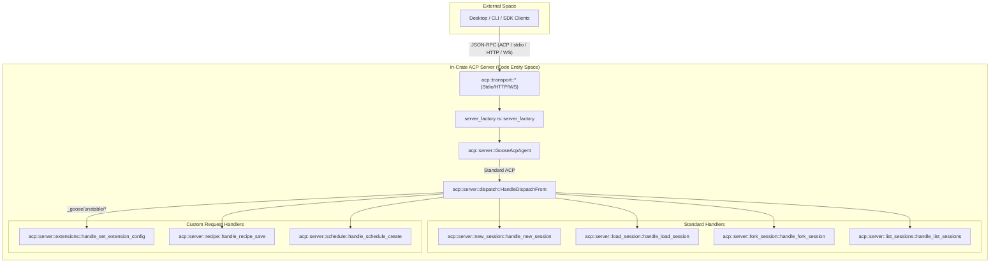

# ACP Server & Protocol Layer

Relevant source files

The following files were used as context for generating this wiki page:

- [crates/goose-provider-types/src/base.rs](crates/goose-provider-types/src/base.rs)
- [crates/goose-provider-types/tests/declared_model.rs](crates/goose-provider-types/tests/declared_model.rs)
- [crates/goose-providers/src/azure_foundry.rs](crates/goose-providers/src/azure_foundry.rs)
- [crates/goose-providers/tests/declared_vision.rs](crates/goose-providers/tests/declared_vision.rs)
- [crates/goose/src/acp/mod.rs](crates/goose/src/acp/mod.rs)
- [crates/goose/src/acp/provider.rs](crates/goose/src/acp/provider.rs)
- [crates/goose/src/acp/response_builder.rs](crates/goose/src/acp/response_builder.rs)
- [crates/goose/src/acp/server.rs](crates/goose/src/acp/server.rs)
- [crates/goose/src/acp/server/dispatch.rs](crates/goose/src/acp/server/dispatch.rs)
- [crates/goose/src/acp/server/fork_session.rs](crates/goose/src/acp/server/fork_session.rs)
- [crates/goose/src/acp/server/list_sessions.rs](crates/goose/src/acp/server/list_sessions.rs)
- [crates/goose/src/acp/server/load_session.rs](crates/goose/src/acp/server/load_session.rs)
- [crates/goose/src/acp/server/new_session.rs](crates/goose/src/acp/server/new_session.rs)
- [crates/goose/src/acp/server/recipe/mod.rs](crates/goose/src/acp/server/recipe/mod.rs)
- [crates/goose/tests/acp_common_tests/mod.rs](crates/goose/tests/acp_common_tests/mod.rs)
- [crates/goose/tests/acp_fork_session_test.rs](crates/goose/tests/acp_fork_session_test.rs)
- [crates/goose/tests/acp_server_test.rs](crates/goose/tests/acp_server_test.rs)
- [crates/goose/tests/declared_vision_registry.rs](crates/goose/tests/declared_vision_registry.rs)
- [goose-self-test.yaml](goose-self-test.yaml)

The ACP Server & Protocol Layer provides the **Agent Client Protocol (ACP)**-first architecture that powers Goose. This architecture replaces the legacy `goose-server` daemon, embedding the ACP server directly into the core `goose` crate (`crates/goose/src/acp`) [crates/goose/src/acp/server.rs:1-163](). It serves as the primary communication hub for the Electron desktop client, CLI, SDKs, and remote peers, managing agent sessions, transport security, custom JSON-RPC request dispatch, and tool lifecycles.

---

## Overview & Architecture

The in-crate ACP server implements the Agent Client Protocol, exposing standardized session management, prompt execution, tool approval loops, and extended capabilities. 

### Core Responsibilities
- **Session Lifecycle**: Managing creation, loading, forking, and closing of agent sessions via `SessionManager` [crates/goose/src/acp/server.rs:41-43]().
- **Transport Layer**: Supporting multiple transport mechanisms including standard I/O (stdio), HTTP, and WebSockets [crates/goose/src/acp/server.rs:1-85]().
- **Custom Request Dispatch**: Routing non-standard `_goose/unstable/*` requests for recipes, schedules, extensions, and provider configuration [crates/goose/src/acp/server/custom_dispatch.rs:6-30]().
- **Tool Call Conversion & Enrichment**: Translating internal tool execution into ACP protocol types and enriching tool calls with runtime metadata and chain summaries [crates/goose/src/acp/server/load_session.rs:52-84]().

### System Architecture: Server to Code Mapping

The following diagram illustrates how external clients interface with the in-crate ACP server modules and handlers.

**Sources:** [crates/goose/src/acp/server.rs:1-120](), [crates/goose/src/acp/server/custom_dispatch.rs:6-30](), [crates/goose/src/acp/server/new_session.rs:35-40](), [crates/goose/src/acp/server/dispatch.rs:4-136](), [crates/goose/src/acp/server/fork_session.rs:4-84](), [crates/goose/src/acp/server/list_sessions.rs:1-10](), [crates/goose/src/acp/server/recipe/mod.rs:1-10](), [crates/goose/src/acp/server/schedule.rs:1-10]()

---

## Transports & Transport Authentication

The ACP server is designed to operate seamlessly across different environments by abstracting its communication channel behind pluggable transports:
- **Stdio**: Used primarily by local CLI wrappers and subprocess embeddings, communicating over standard input and output streams.
- **HTTP / WebSocket**: Enables persistent bi-directional communication for web-based UIs and remote access connections.
- **Transport Authentication**: Employs token-based or mutual TLS authentication checks within the transport layer to secure endpoints against unauthorized access [crates/goose/src/acp/server.rs:46-66]().

For deep technical details on server setup, transport handlers, and session management, see **[ACP Server Implementation](#5.1)**.

**Sources:** [crates/goose/src/acp/server.rs:46-85]()

---

## Custom Requests & OpenAPI Schemas

To support advanced desktop and client features beyond the core ACP spec, Goose defines a robust extension mechanism using custom JSON-RPC requests prefixed with `_goose/unstable/*`. These are defined in `goose-sdk-types` and documented via generated schemas [crates/goose-sdk-types/src/custom_requests.rs:31-38]().

| Subsystem | Example Custom Method | Description |
| :--- | :--- | :--- |
| **Extensions** | `_goose/unstable/session/extensions/add` | Add an MCP or platform extension to an active session [crates/goose-sdk-types/src/custom_requests.rs:31-37]() |
| **Tools** | `_goose/unstable/tools/list` | List all available tools across active session extensions [crates/goose-sdk-types/src/custom_requests.rs:49-57]() |
| **Apps** | `_goose/unstable/apps/list` | Discover MCP applications providing HTML UI views [crates/goose-sdk-types/src/custom_requests.rs:123-129]() |
| **Recipes** | `_goose/unstable/recipe/save` | Save or persist workflow recipes [crates/goose/src/acp/server/custom_dispatch.rs:12-19]() |

- **`acp-schema.json` & `acp-meta.json`**: JSON Schema definitions and metadata files automatically generated from Rust type definitions to enforce strict wire compatibility [crates/goose/acp-schema.json:1-22](), [crates/goose/acp-meta.json:1-12]().
- **SDKs**: Consumed by the generated TypeScript client (`ui/goose-acp-client`) and `goose-sdk` UniFFI bindings for Python and Kotlin.

For details on schema generation, custom request routing, and SDK clients, see **[ACP Schema, Custom Requests & SDKs](#5.2)**.

**Sources:** [crates/goose-sdk-types/src/custom_requests.rs:31-182](), [crates/goose/acp-schema.json:1-40](), [crates/goose/acp-meta.json:1-25](), [crates/goose/src/acp/server/custom_dispatch.rs:6-38]()

---

## MCP Apps & UI Proxy

Goose extends standard MCP capabilities via the **GooseApp** system, allowing MCP servers to serve interactive HTML/JS UI components directly into the client interface.
- **App Resources**: MCP servers expose UI assets and resources that can be loaded on demand.
- **UI Proxying**: The server proxies frontend requests to underlying MCP servers, bridging sandboxed UI components safely within `McpAppRenderer` [crates/goose-sdk-types/src/custom_requests.rs:137-162]().
- **Examples**: Built-in extensions like the `autovisualiser` demonstrate real-time data visualization through MCP-rendered apps.

For implementation specifics on MCP apps, caching, and frontend integration, see **[MCP Apps & UI Proxy](#5.3)**.

**Sources:** [crates/goose-sdk-types/src/custom_requests.rs:123-176]()

---

## Gateway & Remote Access

The server layer includes tooling for remote connectivity and P2P roaming:
- **Gateway Subsystem**: Manages external integrations such as Telegram bot gateways routing prompts into ACP sessions.
- **`goose-roaming`**: P2P transport layer utilizing iroh and QUIC to securely connect remote Goose nodes using `ConnectionCard` and `TrustBook` verification.
- **Session Sharing & OIDC Proxy**: Supports deep links for sharing sessions and integrates with an OIDC proxy for seamless CI/CD key injection.

For configuration and architecture of remote access, see **[Gateway & Remote Access](#5.4)**.

---

## Child Pages

For detailed technical coverage of the topics introduced on this page, refer to the following child pages:

1. **[ACP Server Implementation](#5.1)** — Session lifecycle, dispatch mechanisms, tool call conversion, providers, config, dictation, apps, fs bridge, and transport auth.
2. **[ACP Schema, Custom Requests & SDKs](#5.2)** — Schema generation, `_goose/unstable/*` methods, TypeScript client, and UniFFI bindings.
3. **[MCP Apps & UI Proxy](#5.3)** — GooseApp system, MCP HTML UI serving, app resources, frontend rendering, and sandbox bridge.
4. **[Gateway & Remote Access](#5.4)** — Gateway services, `goose-roaming` P2P transport, session sharing, and OIDC proxy integration.