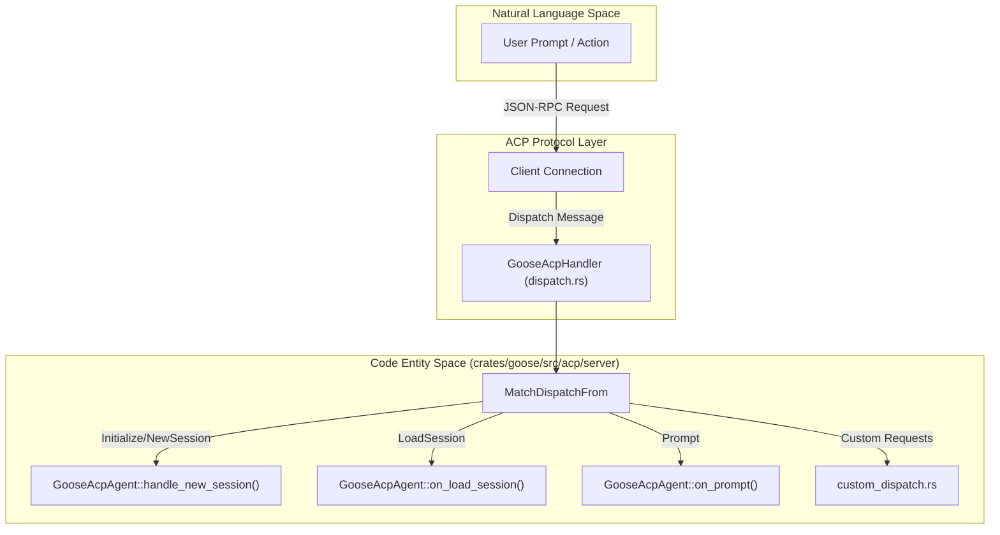
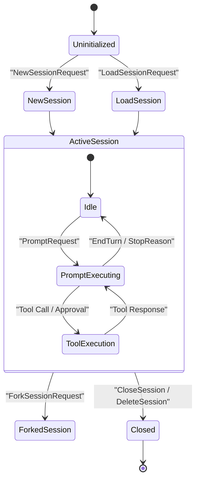

# ACP Server Implementation

Relevant source files

The following files were used as context for generating this wiki page:

- [crates/goose-cli/src/commands/info.rs](crates/goose-cli/src/commands/info.rs)
- [crates/goose-cli/src/commands/roam.rs](crates/goose-cli/src/commands/roam.rs)
- [crates/goose/src/acp/fs.rs](crates/goose/src/acp/fs.rs)
- [crates/goose/src/acp/response_builder.rs](crates/goose/src/acp/response_builder.rs)
- [crates/goose/src/acp/server.rs](crates/goose/src/acp/server.rs)
- [crates/goose/src/acp/server/apps.rs](crates/goose/src/acp/server/apps.rs)
- [crates/goose/src/acp/server/dispatch.rs](crates/goose/src/acp/server/dispatch.rs)
- [crates/goose/src/acp/server/fork_session.rs](crates/goose/src/acp/server/fork_session.rs)
- [crates/goose/src/acp/server/list_sessions.rs](crates/goose/src/acp/server/list_sessions.rs)
- [crates/goose/src/acp/server/load_session.rs](crates/goose/src/acp/server/load_session.rs)
- [crates/goose/src/acp/server/new_session.rs](crates/goose/src/acp/server/new_session.rs)
- [crates/goose/src/acp/server/recipe/mod.rs](crates/goose/src/acp/server/recipe/mod.rs)
- [crates/goose/src/acp/server/resources.rs](crates/goose/src/acp/server/resources.rs)
- [crates/goose/src/acp/server/schedule.rs](crates/goose/src/acp/server/schedule.rs)
- [crates/goose/src/acp/server/tool_calls/chain.rs](crates/goose/src/acp/server/tool_calls/chain.rs)
- [crates/goose/src/acp/server/tool_calls/conversion.rs](crates/goose/src/acp/server/tool_calls/conversion.rs)
- [crates/goose/src/acp/server/tool_calls/enrichment.rs](crates/goose/src/acp/server/tool_calls/enrichment.rs)
- [crates/goose/src/acp/server/tool_notifications.rs](crates/goose/src/acp/server/tool_notifications.rs)
- [crates/goose/src/acp/server/tools.rs](crates/goose/src/acp/server/tools.rs)
- [crates/goose/src/acp/server_factory.rs](crates/goose/src/acp/server_factory.rs)
- [crates/goose/src/acp/transport/mod.rs](crates/goose/src/acp/transport/mod.rs)
- [crates/goose/src/agents/state_machine/inference_preparation.rs](crates/goose/src/agents/state_machine/inference_preparation.rs)
- [crates/goose/src/config/permission.rs](crates/goose/src/config/permission.rs)
- [crates/goose/src/goose_apps/cache.rs](crates/goose/src/goose_apps/cache.rs)
- [crates/goose/src/model_config.rs](crates/goose/src/model_config.rs)
- [crates/goose/src/tool_call_labels.rs](crates/goose/src/tool_call_labels.rs)
- [crates/goose/tests/acp_common_tests/mod.rs](crates/goose/tests/acp_common_tests/mod.rs)
- [crates/goose/tests/acp_fixtures/mod.rs](crates/goose/tests/acp_fixtures/mod.rs)
- [crates/goose/tests/acp_fixtures/provider.rs](crates/goose/tests/acp_fixtures/provider.rs)
- [crates/goose/tests/acp_fixtures/server.rs](crates/goose/tests/acp_fixtures/server.rs)
- [crates/goose/tests/acp_fork_session_test.rs](crates/goose/tests/acp_fork_session_test.rs)
- [crates/goose/tests/acp_server_test.rs](crates/goose/tests/acp_server_test.rs)
- [crates/goose/tests/acp_transport_auth_test.rs](crates/goose/tests/acp_transport_auth_test.rs)
- [crates/goose/tests/permission_persistence.rs](crates/goose/tests/permission_persistence.rs)
- [documentation/docs/guides/roaming-agents.md](documentation/docs/guides/roaming-agents.md)
- [ui/desktop/src/acp/__tests__/chatNotifications.test.ts](ui/desktop/src/acp/__tests__/chatNotifications.test.ts)
- [ui/desktop/src/acp/adapter/toolNotifications.ts](ui/desktop/src/acp/adapter/toolNotifications.ts)
- [ui/desktop/src/acp/chatNotifications.ts](ui/desktop/src/acp/chatNotifications.ts)

## Purpose and Scope

This document provides a detailed technical breakdown of the Agent-Client Protocol (ACP) server implementation located in `crates/goose/src/acp/server`. The ACP server architecture replaces the legacy `goose-server` REST daemon, serving as an in-crate protocol server that handles client connections, translates high-level agent interactions, manages session lifecycles (`new`, `load`, `fork`, `manage`), executes tool conversions and enrichments, integrates provider configurations, bridges filesystem operations, handles transport authentication, and initializes via `server_factory`.

Sources: [crates/goose/src/acp/server.rs:1-163](), [crates/goose/src/acp/server_factory.rs:1-50]()

---

## 1. Architecture & Core Dispatch

The ACP server runs on top of the `agent_client_protocol` crate framework, handling bidirectional JSON-RPC messaging over multiple possible transports (Stdio, HTTP, WebSocket). The central message router is implemented through `HandleDispatchFrom<Client>` for `GooseAcpHandler`, which dispatches incoming standard ACP requests (`InitializeRequest`, `NewSessionRequest`, `LoadSessionRequest`, `PromptRequest`) as well as custom JSON-RPC request extensions [crates/goose/src/acp/server/dispatch.rs:4-136]().

### Request Dispatch Flow

The following diagram bridges the Natural Language interaction space with the underlying Rust code entities responsible for processing ACP operations.

**Diagram: ACP Request Dispatch and Execution Flow**

Sources: [crates/goose/src/acp/server/dispatch.rs:4-136](), [crates/goose/src/acp/server/custom_dispatch.rs:1-50]()

---

## 2. Session Lifecycle Management (`new`, `load`, `fork`, `manage`)

Sessions within the ACP server layer are managed via `SessionManager` and mapped to active agent instances through `AgentManager`. The server supports four primary lifecycle operations:

1.  **New Session (`new_session.rs`)**: Resolves workspace directories, loads configuration defaults, configures recipes and metadata (such as project IDs and titles), creates the session row in the SQLite database, and emits setup notifications [crates/goose/src/acp/server/new_session.rs:36-73](). The `finish_new_session_setup` function orchestrates the configuration, agent activation, and response building [crates/goose/src/acp/server/new_session.rs:75-99]().
2.  **Load Session (`load_session.rs`)**: Replays conversation histories back to the ACP client, supporting configurable `replayTail` boundaries and ensuring tool request-response pairs remain intact without splitting turns [crates/goose/src/acp/server/load_session.rs:108-179](). The `replay_conversation_to_client` function handles the message iteration and content chunking [crates/goose/src/acp/server/load_session.rs:108-179]().
3.  **Fork Session (`fork_session.rs`)**: Duplicates existing session structures and conversation states to branch investigative paths. The `on_fork_session` handler creates a new session and copies relevant data from the source session [crates/goose/src/acp/server/fork_session.rs:1-1]().
4.  **Manage Sessions (`manage_sessions.rs`)**: Handles session listing (`ListSessionsRequest`), deletion (`DeleteSessionRequest`), info retrieval (`GetSessionInfoRequest`), and status updates. The `is_acp_visible_session_type` function filters which session types are exposed to ACP clients [crates/goose/src/acp/server.rs:139-141]().

### Session Lifecycle State Machine

**Diagram: Session State Transitions**

Sources: [crates/goose/src/acp/server/new_session.rs:36-125](), [crates/goose/src/acp/server/load_session.rs:108-179](), [crates/goose/tests/acp_server_test.rs:45-86](), [crates/goose/src/acp/server.rs:139-141]()

---

## 3. Tool Call Conversion, Enrichment & Notifications

Tool invocations in Goose must be bridged between internal provider tool representations and the ACP `ToolCall` schema.

-   **Conversion (`tool_calls/conversion.rs`)**: Translates internal `ToolRequest` and `ToolResponse` structures into ACP tool call objects and update deltas [crates/goose/src/acp/server/load_session.rs:52-84](). Key functions include `build_initial_tool_call_with_message_meta` and `tool_call_update_fields_from_response` [crates/goose/src/acp/server/tool_calls/conversion.rs:1-1]().
-   **Enrichment (`tool_calls/enrichment.rs`)**: Asynchronously spawns task handlers to enrich tool call labels, chain summaries, and metadata descriptions [crates/goose/src/acp/server.rs:96-96](). `spawn_chain_summary_enrichment` and `spawn_tool_title_enrichment` are used for this purpose [crates/goose/src/acp/server/tool_calls/enrichment.rs:1-1]().
-   **Notifications (`ToolCallNotifier`)**: Dispatches real-time session updates to connected ACP clients as tools progress through states (pending, running, completed, error) [crates/goose/src/acp/server.rs:10-10](). This is handled by `tool_notifications.rs` [crates/goose/src/acp/server/tool_notifications.rs:1-1]().

Sources: [crates/goose/src/acp/server.rs:91-96](), [crates/goose/src/acp/server/load_session.rs:52-84](), [crates/goose/src/acp/server/tool_calls/conversion.rs:1-1](), [crates/goose/src/acp/server/tool_calls/enrichment.rs:1-1](), [crates/goose/src/acp/server/tool_notifications.rs:1-1]()

---

## 4. Supporting Subsystems: Providers, Config, Dictation & Apps

The ACP server integrates several subsystem managers to expose features directly through JSON-RPC endpoints:

| Subsystem | Module File | Key Responsibilities |
| :--- | :--- | :--- |
| **Providers** | `providers.rs` | Exposes provider inventories, model capabilities, authentication secrets masking, and catalog lists [crates/goose/src/acp/server/providers.rs:10-78](). The `build_provider_options` function constructs the list of available providers [crates/goose/src/acp/response_builder.rs:161-191](). |
| **Config** | `config.rs` | Manages configuration reads, writes, and options updates. `build_config_options` generates the available configuration options [crates/goose/src/acp/response_builder.rs:300-300](). |
| **Dictation** | `dictation.rs` | Coordinates voice-to-text configurations, local model availability, and transcription routing. This interacts with `LiveVoiceService` [crates/goose/src/acp/server.rs:117-117](). |
| **Apps** | `apps.rs` | Manages MCP applications, list requests, and UI proxy integration [crates/goose/src/acp/server/tools.rs:9-58](). The `on_get_apps` handler provides a list of available applications [crates/goose/src/acp/server/apps.rs:1-1](). |
| **Tools** | `tools.rs` | Handles `GetToolsRequest`, `CallToolRequest`, and `SetToolPermissionsRequest`. It interacts with `PermissionManager` to determine tool access levels [crates/goose/src/acp/server/tools.rs:9-58](). |
| **Recipes** | `recipe/mod.rs` | Manages recipe-related requests like `GetRecipeRequest`, `ListRecipesRequest`, and `RunRecipeRequest` [crates/goose/src/acp/server/recipe/mod.rs:1-1](). |
| **Schedule** | `schedule.rs` | Provides endpoints for scheduling jobs, listing schedules, and managing scheduled tasks [crates/goose/src/acp/server/schedule.rs:1-1](). |

Sources: [crates/goose/src/acp/server/providers.rs:10-78](), [crates/goose/src/acp/server/tools.rs:9-58](), [crates/goose/src/acp/response_builder.rs:161-191](), [crates/goose/src/acp/response_builder.rs:300-300](), [crates/goose/src/acp/server.rs:117-117](), [crates/goose/src/acp/server/apps.rs:1-1](), [crates/goose/src/acp/server/recipe/mod.rs:1-1](), [crates/goose/src/acp/server/schedule.rs:1-1]()

---

## 5. Filesystem Bridge, Transport Auth & Server Factory

-   **Filesystem Bridge (`fs.rs`)**: Implements `AcpTools` to bridge ACP filesystem capabilities (`ReadTextFileRequest`, `WriteTextFileRequest`, terminal calls) securely through client-provided or server-managed roots [crates/goose/src/acp/server.rs:3-3](). This module handles the actual file operations [crates/goose/src/acp/fs.rs:1-1]().
-   **Transport Auth**: Validates transport-level security tokens, headers, and environment parameters across Stdio, HTTP, and WebSocket channels [crates/goose/tests/acp_transport_auth_test.rs:1-1](). The `acp/transport/mod.rs` module defines the transport mechanisms [crates/goose/src/acp/transport/mod.rs:1-1]().
-   **Server Factory (`server_factory.rs`)**: Coordinates server initialization, wires provider factories (`AcpProviderFactory`), and establishes background worker tasks [crates/goose/src/acp/server.rs:128-137](), [crates/goose/src/acp/server_factory.rs:1-50](). The `AcpServerFactoryConfig` struct defines the server's initial configuration [crates/goose/src/acp/server_factory.rs:18-28](), and `create_agent` instantiates the `GooseAcpAgent` [crates/goose/src/acp/server_factory.rs:84-135]().

Sources: [crates/goose/src/acp/server.rs:3-3](), [crates/goose/src/acp/server.rs:128-137](), [crates/goose/src/acp/server_factory.rs:1-50](), [crates/goose/src/acp/fs.rs:1-1](), [crates/goose/tests/acp_transport_auth_test.rs:1-1](), [crates/goose/src/acp/transport/mod.rs:1-1](), [crates/goose/src/acp/server_factory.rs:18-28](), [crates/goose/src/acp/server_factory.rs:84-135]()