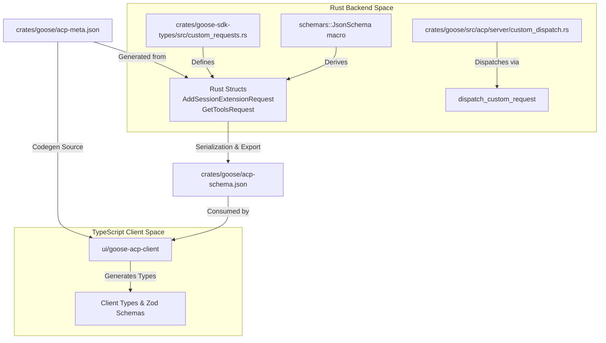
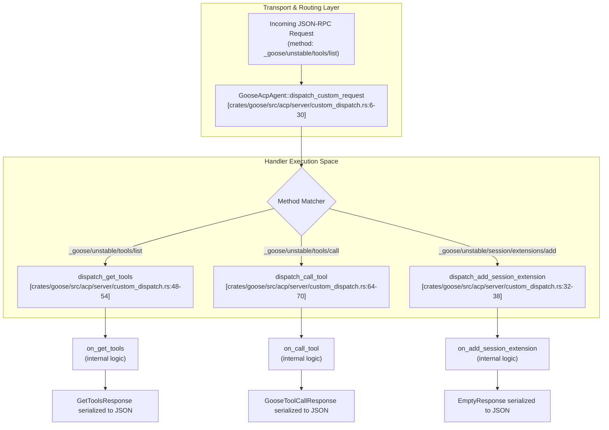

# ACP Schema, Custom Requests & SDKs

<details>
<summary>Relevant source files</summary>

The following files were used as context for generating this wiki page:

- [.github/workflows/gdk-release-pr.yml](.github/workflows/gdk-release-pr.yml)
- [.github/workflows/gdk-release.yml](.github/workflows/gdk-release.yml)
- [.github/workflows/maven-sdk.yml](.github/workflows/maven-sdk.yml)
- [.github/workflows/mcp-conformance.yml](.github/workflows/mcp-conformance.yml)
- [.github/workflows/model-toolcall-conformance.yml](.github/workflows/model-toolcall-conformance.yml)
- [crates/goose-agent/Cargo.toml](crates/goose-agent/Cargo.toml)
- [crates/goose-context-management/Cargo.toml](crates/goose-context-management/Cargo.toml)
- [crates/goose-download-manager/Cargo.toml](crates/goose-download-manager/Cargo.toml)
- [crates/goose-local-inference/Cargo.toml](crates/goose-local-inference/Cargo.toml)
- [crates/goose-provider-types/Cargo.toml](crates/goose-provider-types/Cargo.toml)
- [crates/goose-providers/Cargo.toml](crates/goose-providers/Cargo.toml)
- [crates/goose-sdk-types/Cargo.toml](crates/goose-sdk-types/Cargo.toml)
- [crates/goose-sdk-types/src/custom_requests.rs](crates/goose-sdk-types/src/custom_requests.rs)
- [crates/goose-sdk/Cargo.toml](crates/goose-sdk/Cargo.toml)
- [crates/goose-sdk/examples/uniffi/kotlin/src/main/kotlin/Main.kt](crates/goose-sdk/examples/uniffi/kotlin/src/main/kotlin/Main.kt)
- [crates/goose-sdk/maven/src/support/kotlin/io/github/aaif_goose/ProviderFlow.kt](crates/goose-sdk/maven/src/support/kotlin/io/github/aaif_goose/ProviderFlow.kt)
- [crates/goose-sdk/python/pyproject.toml](crates/goose-sdk/python/pyproject.toml)
- [crates/goose-sdk/scripts/gdk-release.py](crates/goose-sdk/scripts/gdk-release.py)
- [crates/goose-sdk/scripts/maven-resource-prefix.sh](crates/goose-sdk/scripts/maven-resource-prefix.sh)
- [crates/goose-sdk/scripts/prepare-maven-package.sh](crates/goose-sdk/scripts/prepare-maven-package.sh)
- [crates/goose/acp-meta.json](crates/goose/acp-meta.json)
- [crates/goose/acp-schema.json](crates/goose/acp-schema.json)
- [crates/goose/src/acp/server/custom_dispatch.rs](crates/goose/src/acp/server/custom_dispatch.rs)
- [crates/goose/src/acp/server/extensions.rs](crates/goose/src/acp/server/extensions.rs)
- [crates/goose/tests/acp_custom_requests_test.rs](crates/goose/tests/acp_custom_requests_test.rs)
- [documentation/src/data/gdk-api.json](documentation/src/data/gdk-api.json)
- [release-plz.toml](release-plz.toml)
- [scripts/test_local_model_smoke.sh](scripts/test_local_model_smoke.sh)
- [scripts/test_openrouter_toolcalls.sh](scripts/test_openrouter_toolcalls.sh)

</details>


This page covers the Agent Client Protocol (ACP) schema generation pipeline, the custom `_goose/unstable/*` JSON-RPC request subsystem (such as recipes, schedules, and extensions), the shared `goose-sdk-types` crate, the generated TypeScript client (`ui/goose-acp-client`), and multi-language `goose-sdk` UniFFI bindings for Python and Kotlin.

---

## 1. ACP Schema & Metadata Generation (`acp-schema.json` / `acp-meta.json`)

Goose utilizes an automated schema generation pipeline to keep the backend Agent Client Protocol (ACP) implementation synchronized with client interfaces and SDKs. Types defined in Rust are decorated with `schemars::JsonSchema` and custom attributes to produce strict JSON schema definitions (`acp-schema.json`) and method metadata mappings (`acp-meta.json`).

The schema generation system extracts request and response types, mapping them to specific `x-method` endpoints and `x-side` agent behaviors [crates/goose/acp-schema.json:1-22](). The metadata file (`acp-meta.json`) explicitly associates each JSON-RPC method string (e.g., `_goose/unstable/session/extensions/add`) with its corresponding Rust-derived request and response types [crates/goose/acp-meta.json:1-12]().

**ACP Schema Generation Pipeline**

Sources: [crates/goose/acp-schema.json:1-22](), [crates/goose/acp-meta.json:1-12](), [crates/goose-sdk-types/src/custom_requests.rs:31-57](), [crates/goose/src/acp/server/custom_dispatch.rs:1-30]()

---

## 2. Custom JSON-RPC Requests (`_goose/unstable/*`)

To support feature-rich desktop and CLI workflows beyond standard ACP lifecycle operations, Goose implements custom JSON-RPC request routing prefixed under `_goose/unstable/*`. These methods manage extensions, tools, resources, apps, working directories, configuration prompts, and provider inventories.

### Dispatch Implementation
The custom request handling relies on the `#[custom_methods]` procedural macro applied to `GooseAcpAgent` in `crates/goose/src/acp/server/custom_dispatch.rs` [crates/goose/src/acp/server/custom_dispatch.rs:4-6](). Incoming JSON-RPC calls enter via `dispatch_custom_request`, which matches method paths and delegates execution to specialized handler methods [crates/goose/src/acp/server/custom_dispatch.rs:6-30]().

| JSON-RPC Method | Request Struct | Response Struct | Implementation File |
| :--- | :--- | :--- | :--- |
| `_goose/unstable/session/extensions/add` | `AddSessionExtensionRequest` [crates/goose-sdk-types/src/custom_requests.rs:34-37]() | `EmptyResponse` | [crates/goose/src/acp/server/custom_dispatch.rs:32-38]() |
| `_goose/unstable/tools/list` | `GetToolsRequest` [crates/goose-sdk-types/src/custom_requests.rs:52-57]() | `GetToolsResponse` [crates/goose-sdk-types/src/custom_requests.rs:73-76]() | [crates/goose/src/acp/server/custom_dispatch.rs:48-54]() |
| `_goose/unstable/tools/call` | `GooseToolCallRequest` [crates/goose-sdk-types/src/custom_requests.rs:100-106]() | `GooseToolCallResponse` [crates/goose-sdk-types/src/custom_requests.rs:111-120]() | [crates/goose/src/acp/server/custom_dispatch.rs:64-70]() |
| `_goose/unstable/apps/list` | `AppsListRequest` [crates/goose-sdk-types/src/custom_requests.rs:126-129]() | `AppsListResponse` [crates/goose-sdk-types/src/custom_requests.rs:131-135]() | [crates/goose/src/acp/server/custom_dispatch.rs:80-86]() |
| `_goose/unstable/session/working-dir/update` | `UpdateWorkingDirRequest` [crates/goose-sdk-types/src/custom_requests.rs:182-185]() | `EmptyResponse` | [crates/goose/src/acp/server/custom_dispatch.rs:112-118]() |

**Custom Request Dispatch Flow**

Sources: [crates/goose/src/acp/server/custom_dispatch.rs:6-70](), [crates/goose-sdk-types/src/custom_requests.rs:34-120](), [crates/goose/tests/acp_custom_requests_test.rs:165-188]()

---

## 3. `goose-sdk-types` & Generated TypeScript Client (`ui/goose-acp-client`)

The `goose-sdk-types` crate acts as the single source of truth for shared protocol data structures. It uses macros like `#[request(...)]`, `JsonSchema`, `Serialize`, and `Deserialize` to define structures for custom JSON-RPC calls [crates/goose-sdk-types/src/custom_requests.rs:31-37](). This crate is a dependency for `goose-agent` [crates/goose-agent/Cargo.toml:28] and `goose-providers` [crates/goose-providers/Cargo.toml:41], ensuring consistent type definitions across the core components.

### TypeScript Client Integration
The TypeScript client package (`ui/goose-acp-client`) consumes the generated schemas (`acp-schema.json` and `acp-meta.json`) to provide strongly typed clients, interfaces, and Zod validation schemas for the Electron frontend and web UI. This guarantees type safety across the Node.js/Electron boundary when invoking unstable endpoints such as recipe saving [crates/goose/src/acp/server/custom_dispatch.rs:12-19](), configuration modifications, and session steer operations [crates/goose/acp-meta.json:64-67]().

Sources: [crates/goose-sdk-types/src/custom_requests.rs:1-57](), [crates/goose/acp-schema.json:1-30](), [crates/goose/acp-meta.json:1-70](), [crates/goose/src/acp/server/custom_dispatch.rs:12-20](), [crates/goose-agent/Cargo.toml:28](), [crates/goose-providers/Cargo.toml:41]()

---

## 4. `goose-sdk` UniFFI Bindings for Python & Kotlin

To enable non-Rust and non-Electron applications to interface directly with Goose's core agent capabilities, the `goose-sdk` crate exposes native bindings generated via **UniFFI**.

### Multi-Language Support Architecture
*   **Python Bindings**: Compiled utilizing the `uniffi` feature flag in `crates/goose-sdk/Cargo.toml` [crates/goose-sdk/Cargo.toml:21-33](), generating Python modules that interface with the underlying Rust libraries. The `goose-sdk/python/pyproject.toml` defines the Python package structure.
*   **Kotlin Bindings (GDK)**: Published to Maven for Android and JVM desktop clients, packaging compiled native shared libraries (`libgoose_sdk`) for architectures such as `darwin-aarch64`, `linux-x86-64`, and `win32-x86-64` into distributable JAR artifacts [.github/workflows/maven-sdk.yml:38-54](). The `crates/goose-sdk/scripts/prepare-maven-package.sh` script is used to prepare these native libraries for the Maven package [.github/workflows/maven-sdk.yml:118-124]().
*   **API Exposure**: The UniFFI layer exposes core provider initializers, model defaults, and error management enums (e.g., `GooseError::RateLimited`, `GooseError::ContextLengthExceeded`) [documentation/src/data/gdk-api.json:1-246]().

**UniFFI Binding Generation and Distribution**
```mermaid
graph TD
    A[crates/goose-sdk/Cargo.toml] --> B{UniFFI Feature Flag};
    B -- "Enabled" --> C[crates/goose-sdk/src/bindings.rs];
    C -- "UniFFI Build Process" --> D[goose-uniffi-bindgen binary];

    D -- "Generates" --> E[Python Bindings\n(goose-sdk/python)];
    D -- "Generates" --> F[Kotlin Bindings\n(crates/goose-sdk/maven)];

    F -- "Maven Workflow\n(.github/workflows/maven-sdk.yml)" --> G[Native Libraries\n(e.g., libgoose_sdk.so, .dylib, .dll)];
    G -- "Packaged into" --> H[Maven Artifacts\n(for Kotlin/JVM)];

    E -- "Published to" --> I[PyPI];
    H -- "Published to" --> J[Maven Central];

    K[documentation/src/data/gdk-api.json] -- "Documents exposed APIs" --> E;
    K -- "Documents exposed APIs" --> F;
```
Sources: [crates/goose-sdk/Cargo.toml:21-33](), [documentation/src/data/gdk-api.json:1-246](), [.github/workflows/maven-sdk.yml:38-54](), [.github/workflows/maven-sdk.yml:118-124]()