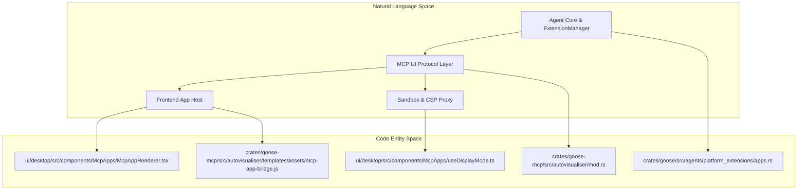
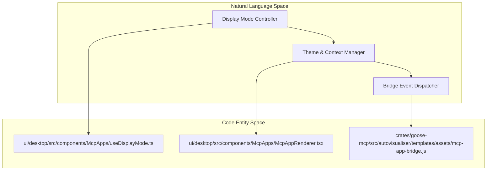
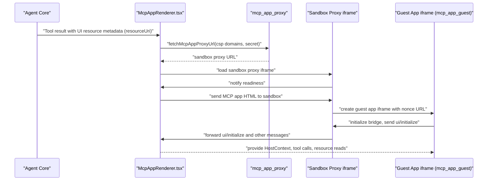

# MCP Apps & UI Proxy

Relevant source files

The following files were used as context for generating this wiki page:

- [crates/goose/src/acp/server/apps.rs](crates/goose/src/acp/server/apps.rs)
- [crates/goose/src/acp/server/resources.rs](crates/goose/src/acp/server/resources.rs)
- [crates/goose/src/acp/server/tools.rs](crates/goose/src/acp/server/tools.rs)
- [crates/goose/src/agents/state_machine/inference_preparation.rs](crates/goose/src/agents/state_machine/inference_preparation.rs)
- [crates/goose/src/goose_apps/cache.rs](crates/goose/src/goose_apps/cache.rs)
- [crates/goose/src/goose_apps/mod.rs](crates/goose/src/goose_apps/mod.rs)
- [crates/goose/src/goose_apps/resource.rs](crates/goose/src/goose_apps/resource.rs)
- [ui/desktop/src/components/McpApps/McpAppRenderer.tsx](ui/desktop/src/components/McpApps/McpAppRenderer.tsx)
- [ui/desktop/src/components/McpApps/PipWindow.tsx](ui/desktop/src/components/McpApps/PipWindow.tsx)
- [ui/desktop/src/components/McpApps/__tests__/McpAppRenderer.displayModes.test.tsx](ui/desktop/src/components/McpApps/__tests__/McpAppRenderer.displayModes.test.tsx)
- [ui/desktop/src/components/McpApps/__tests__/PipWindow.test.tsx](ui/desktop/src/components/McpApps/__tests__/PipWindow.test.tsx)
- [ui/desktop/src/components/McpApps/__tests__/containerDimensions.test.ts](ui/desktop/src/components/McpApps/__tests__/containerDimensions.test.ts)
- [ui/desktop/src/components/McpApps/containerDimensions.ts](ui/desktop/src/components/McpApps/containerDimensions.ts)
- [ui/desktop/src/components/McpApps/types.ts](ui/desktop/src/components/McpApps/types.ts)
- [ui/desktop/src/components/McpApps/useDisplayMode.ts](ui/desktop/src/components/McpApps/useDisplayMode.ts)
- [ui/desktop/src/components/apps/AppsView.tsx](ui/desktop/src/components/apps/AppsView.tsx)

The **GooseApp / MCP UI** system forms a crucial user interface layer in Goose, allowing Model Context Protocol (MCP) servers to expose interactive HTML UI components seamlessly within the Goose Desktop environment. This system enables enhanced interactivity through secure, sandboxed iframes that host third-party and built-in MCP apps with bi-directional communication.

## Overview and Architecture

Goose hosts MCP Apps by rendering UI resources declared as part of MCP tool results. These are typically `text/html;profile=mcp-app` MIME type resources served by MCP extension servers (e.g., `apps` or `autovisualiser`). 

To securely run these rich remote UIs, Goose employs a multi-stage sandbox proxy system that preserves browser features such as `localStorage` and `cookies` while strictly enforcing Content Security Policies (CSP) and iframe sandboxing.

### Key Components

| Component                 | Responsibility                                                    | Code Reference / Path                                    |
|---------------------------|------------------------------------------------------------------|----------------------------------------------------------|
| **MCP Servers**           | Serve UI resources and tools with MCP App metadata               | `crates/goose-mcp/src/autovisualiser/mod.rs` [17-19]()    |
| **McpAppRenderer**        | React component hosting the iframe sandbox and managing lifecycle| `ui/desktop/src/components/McpApps/McpAppRenderer.tsx` [2-198]() |
| **mcp_app_proxy**         | Proxy route serving sandbox wrappers with CSP enforcement        | `ui/desktop/src/components/McpApps/McpAppRenderer.tsx` [103-140]() (fetch proxy URL logic) |
| **Sandbox Bridge**        | Nested iframe structure for isolation and secure postMessage bridge | `ui/desktop/src/components/McpApps/McpAppRenderer.tsx` [2-198]() |
| **McpAppBridge JS SDK**   | JS injected into apps to enable host-guest communication and theming | `crates/goose-mcp/src/autovisualiser/templates/assets/mcp-app-bridge.js` |

---

### Architecture and Protocol Mapping Diagram

Sources: [ui/desktop/src/components/McpApps/McpAppRenderer.tsx:2-24](), [crates/goose-mcp/src/autovisualiser/mod.rs:17-19](), [crates/goose/src/agents/platform_extensions/apps.rs:1-12]()

---

## The UI Proxy System

Goose protects the main Electron window and the user environment using a layered sandbox proxy architecture for MCP Apps.

### The Two-Stage Sandbox Approach

1. **`mcp_app_proxy`: The Outer Proxy Sandbox**

   - A HTTP route `/mcp-app-proxy` hosted internally that dynamically serves an HTML “controller” page wrapping the guest UI iframe.
   - This proxy enforces CSP headers based on MCP resource metadata domains, restricting external connection and resource loading to only approved domains.
   - It manages secure communication by relaying postMessage events between the host and the inner guest iframes via the `@mcp-ui/client` AppBridge.
   - It also filters privileges via sandbox `allow-` tokens for scripts, same-origin, and forms.
   - The proxy URL is dynamically constructed in `McpAppRenderer` by inspecting the current ACP server and secret, with CSP domains added as query parameters.

2. **`mcp_app_guest`: The Inner App Frame**

   - The actual MCP App UI HTML is not loaded via `srcdoc` because that yields an `about:srcdoc` origin with many limitations.
   - Instead, Goose sends the HTML payload to the server which caches it and returns a nonce; this nonce is used to construct a URL `/mcp-app-guest?nonce=...` so the guest iframe runs with a real HTTP origin.
   - This maintains full web features: `localStorage`, `cookies`, CORS work properly.

### Content Security Policy (CSP) & Sandbox Permissions

- CSP headers strictly allow only declared domains for:
  - `connect-src` (XHR, WebSocket, fetch)
  - Resource loading (scripts, images, fonts, media)
  - Frame embedding (iframes)
  - Base-uri domains
  
- Sandbox iframe attribute tokens default to: `allow-scripts allow-same-origin allow-forms`.
- Additional sandbox permissions for camera, microphone, geolocation, and clipboard write access are handled based on resource metadata.

Sources: [ui/desktop/src/components/McpApps/McpAppRenderer.tsx:103-140](), [crates/goose/src/goose_apps/cache.rs:145-160]()

---

## Frontend Implementation: `McpAppRenderer`

`McpAppRenderer` is the frontend React component responsible for hosting and managing MCP App sandboxed iframes and the MCP Apps protocol interaction from the host side.

### Functional Responsibilities

- **Resource fetching**: Loads HTML app resource content via the MCP API with `readMcpAppResource`.
- **Sandbox proxy URL generation**: Builds the proxy URL with secret and CSP policies by calling Electron bridge methods.
- **App lifecycle control**: Initializes, monitors, and manages the session lifecycle of the MCP App.
- **Bi-directional communication**: Uses the `@mcp-ui/client` `AppBridge` with `PostMessageTransport` to handle the MCP App message protocol including UI initialization, tool calls, and resource reads.
- **Display mode management**: Supports multiple display modes (`inline`, `fullscreen`, `pip`, and Goose-specific `standalone`).
- **Error handling and fallbacks**: Handles resource fetch and sandbox proxy failures gracefully with error states.
- **Theming and context**: Passes theme information and display mode context to the embedded MCP Apps to ensure consistent UI experience.

### Display Modes Supported

| Mode        | Description                                               |
|-------------|-----------------------------------------------------------|
| **inline**  | Rendered embedded inline in the chat or UI stream.        |
| **fullscreen** | The app expands to fill all available viewport area.     |
| **pip**     | Picture-in-Picture floating window that persists on top.  |
| **standalone** | Goose-specific mode: entire Electron window dedicated to the app UI. |

Display mode state, transitions, and capability negotiation are managed via the React hook `useDisplayMode`.

### Display Modes & Sandbox Bridge: Code Mapping

Sources: [ui/desktop/src/components/McpApps/McpAppRenderer.tsx:40-62](), [ui/desktop/src/components/McpApps/useDisplayMode.ts:1-184](), [crates/goose-mcp/src/autovisualiser/templates/assets/mcp-app-bridge.js:1-12]()

---

### Data Flow: Rendering an MCP App from Tool Call

The following sequence outlines how a tool call returning an MCP App UI triggers rendering through the layered system.

---

## MCP Apps Cache

Goose manages a local cache of MCP Apps on disk to improve load performance and offline availability.

- The cache directory is `config_dir/mcp-apps-cache`.
- Cached apps are stored as JSON metadata files keyed by `[extension_name]_[hash].json`, where `hash` is SHA256 of extension name and resource URI.
- Bundled default apps (e.g., clock app) are automatically restored and protected from deletion.
- On PCP server connection, apps are fetched and updated in the cache.
- On delete, apps are removed both from cache and filesystem.

Key cache API surfaces exist in `McpAppCache` (struct) and functions like `list_apps()`, `store_app()`, and `delete_app()`.

Sources: [crates/goose/src/goose_apps/cache.rs:29-190](), [crates/goose/src/acp/server/apps.rs:7-154]()

---

## MCP Apps in Goose ACP Server

The Goose ACP server integrates MCP Apps through the following server functions:

- `on_list_apps` — Lists cached and active MCP Apps for a session, merges session and cache, restores defaults, and marks deletable apps.
- `on_export_app` — Serializes an app to HTML for export.
- `on_import_app` — Parses HTML to create and cache a new app, ensuring name uniqueness.
- `on_delete_app` — Deletes an app from cache and underlying storage, preventing removal of bundled defaults.
- `on_call_tool` — Interprets tool calls routed from the UI proxy to invoke MCP extension tools, validating visibility and permissions.

These functions form the backend lifecycle for MCP Apps including fetching, caching, and tool invocation.

Sources: [crates/goose/src/acp/server/apps.rs:7-154](), [crates/goose/src/acp/server/tools.rs:8-169]()

---

## Example: The Auto Visualiser MCP App

A practical demonstration of the MCP Apps system is the `autovisualiser` MCP extension:

- Provides tools returning UI metadata with resource URIs to render charts (Sankey, Donut, Treemap, Chord, Mermaid).
- Maps resource URIs such as `ui://autovisualiser/mermaid` to specific HTML templates.
- Templates inject `mcp-app-bridge.js` and libraries like Mermaid.js or D3.js.
- Supports dynamic, incremental updates from the host via MCP notifications.

This example showcases how MCP Apps integrate rich visualizations tightly coupled with agent logic and backend tooling.

Sources: [crates/goose-mcp/src/autovisualiser/mod.rs:3-77]()

---

## Security and Permissions

Security features in the MCP Apps system include:

- **Sandboxing**: MCP Apps run in iframes sandboxed with `allow-scripts allow-same-origin allow-forms` by default to limit browser privileges.
- **Content Security Policy (CSP)**: The proxy injects CSP headers strictly limiting allowed network domains and resource domains.
- **Permission Metadata**: Apps specify requested browser permissions (camera, microphone, geolocation, clipboard-write), reflected in the iframe policies.
- **Goose Mode Restrictions**: Tool calls from apps require the session to be in `Auto` GooseMode to prevent misuse.
- **Cache Protections**: Bundled default apps cannot be deleted, preventing accidental removal of system-critical apps.

This layered defense model ensures safe embedding of potentially untrusted UI.

Sources: [ui/desktop/src/components/McpApps/McpAppRenderer.tsx:101-113](), [crates/goose/src/goose_apps/resource.rs:3-145](), [crates/goose/src/acp/server/tools.rs:60-150]()

---

# Summary

The Goose MCP Apps & UI Proxy system is a comprehensive implementation enabling secure, performant, and interactive MCP Apps within the Goose environment. It balances rich capabilities with stringent sandboxing and policy enforcement, offering flexible display modes and seamless integration with the Goose agent and extensions.

This system is exemplified by the autovisualiser app, serving as a blueprint for building complex MCP Apps that enhance agent-user interactions with dynamic HTML/JS UIs.

---

# References

| File / Path                                                    | Description                             |
|---------------------------------------------------------------|---------------------------------------|
| `ui/desktop/src/components/McpApps/McpAppRenderer.tsx` [2-198]() | React MCP App host component           |
| `ui/desktop/src/components/McpApps/useDisplayMode.ts` [1-184]()  | Display mode state management hook     |
| `crates/goose-mcp/src/autovisualiser/mod.rs` [3-77]()         | Autovisualiser MCP server               |
| `crates/goose/src/goose_apps/cache.rs` [29-190]()              | MCP App cache disk and bundle logic    |
| `crates/goose/src/goose_apps/resource.rs` [3-145]()            | MCP App resource and UI metadata       |
| `crates/goose/src/acp/server/apps.rs` [7-154]()                | ACP server MCP Apps lifecycle           |
| `crates/goose/src/acp/server/tools.rs` [8-169]()               | ACP server MCP tool call permissions   |

---

This concludes the detailed technical documentation for section 5.3: "MCP Apps & UI Proxy."