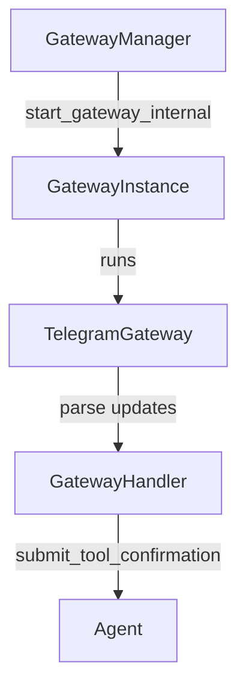
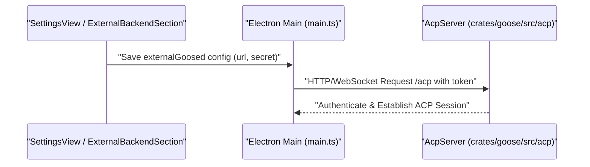

# Gateway & Remote Access

<details>
<summary>Relevant source files</summary>

The following files were used as context for generating this wiki page:

- [crates/goose-cli/src/commands/info.rs](crates/goose-cli/src/commands/info.rs)
- [crates/goose-cli/src/commands/roam.rs](crates/goose-cli/src/commands/roam.rs)
- [crates/goose/src/acp/server/schedule.rs](crates/goose/src/acp/server/schedule.rs)
- [crates/goose/src/acp/server_factory.rs](crates/goose/src/acp/server_factory.rs)
- [crates/goose/src/acp/transport/mod.rs](crates/goose/src/acp/transport/mod.rs)
- [crates/goose/src/config/permission.rs](crates/goose/src/config/permission.rs)
- [crates/goose/src/gateway/handler.rs](crates/goose/src/gateway/handler.rs)
- [crates/goose/src/gateway/manager.rs](crates/goose/src/gateway/manager.rs)
- [crates/goose/src/gateway/mod.rs](crates/goose/src/gateway/mod.rs)
- [crates/goose/src/gateway/telegram.rs](crates/goose/src/gateway/telegram.rs)
- [crates/goose/tests/acp_fixtures/mod.rs](crates/goose/tests/acp_fixtures/mod.rs)
- [crates/goose/tests/acp_fixtures/provider.rs](crates/goose/tests/acp_fixtures/provider.rs)
- [crates/goose/tests/acp_fixtures/server.rs](crates/goose/tests/acp_fixtures/server.rs)
- [crates/goose/tests/acp_transport_auth_test.rs](crates/goose/tests/acp_transport_auth_test.rs)
- [crates/goose/tests/permission_persistence.rs](crates/goose/tests/permission_persistence.rs)
- [documentation/docs/guides/roaming-agents.md](documentation/docs/guides/roaming-agents.md)
- [ui/desktop/eslint.config.js](ui/desktop/eslint.config.js)
- [ui/desktop/src/acp/__tests__/url.test.ts](ui/desktop/src/acp/__tests__/url.test.ts)
- [ui/desktop/src/acp/url.ts](ui/desktop/src/acp/url.ts)
- [ui/desktop/src/remoteBackends.test.ts](ui/desktop/src/remoteBackends.test.ts)
- [ui/desktop/src/remoteBackends.ts](ui/desktop/src/remoteBackends.ts)
- [ui/desktop/src/utils/__tests__/csp.test.ts](ui/desktop/src/utils/__tests__/csp.test.ts)
- [ui/desktop/src/utils/csp.ts](ui/desktop/src/utils/csp.ts)

</details>


The Gateway and Remote Access subsystem provides the infrastructure for connecting Goose to external messaging platforms (such as Telegram), managing remote agent interactions via peer-to-peer transports (`iroh` and `QUIC`), configuring external backend access, and securing server communication through token-based authentication and OIDC proxies.

---

## 1. Gateway Subsystem (Telegram & Messaging)

The Gateway system allows Goose to interface with external messaging platforms. It acts as a bridge between the agent execution logic and external message streams, letting users interact with Goose agents remotely through chat bots.

### Architecture and Data Flow

The Gateway subsystem is orchestrated by the `GatewayManager`, which coordinates active gateway instances, configurations, and lifecycle hooks [crates/goose/src/gateway/manager.rs:90-94]().

1.  **Lifecycle Management**: `GatewayManager` maintains active `GatewayInstance` records [crates/goose/src/gateway/manager.rs:62-68]() and supports auto-starting saved configurations [crates/goose/src/gateway/manager.rs:112-144]() as well as stopping or removing gateways [crates/goose/src/gateway/manager.rs:158-194]().
2.  **Telegram Implementation**: The `TelegramGateway` implements the `Gateway` trait, performing long-polling via the Telegram Bot API to retrieve incoming updates [crates/goose/src/gateway/telegram.rs:1-4]().
3.  **Media & Voice Processing**: Voice notes are processed through `VoiceTempFiles`, which tracks temporary voice files, enforces size constraints like `MAX_VOICE_FILE_SIZE` [crates/goose/src/gateway/telegram.rs:18](), and executes cleanup routines [crates/goose/src/gateway/telegram.rs:60-143]().
4.  **Message Handling & Pairing**: The `GatewayHandler` processes incoming messages (`IncomingMessage`) [crates/goose/src/gateway/handler.rs:127-135](), handles user pairing states [crates/goose/src/gateway/handler.rs:137-165](), and manages pending tool confirmations (`PendingConfirmation`) [crates/goose/src/gateway/handler.rs:42-48](). Max turn counts are resolved via `resolve_gateway_max_turns` [crates/goose/src/gateway/handler.rs:36-40]().

### Code Entity Mapping: Gateway Management

Title: GatewayManagementFlow

Sources: [crates/goose/src/gateway/manager.rs:62-144](), [crates/goose/src/gateway/telegram.rs:18-63](), [crates/goose/src/gateway/handler.rs:36-105]()

---

## 2. Remote Access & Roaming (P2P Transport)

Goose supports remote access through a peer-to-peer (P2P) mechanism referred to as **Roaming**. This allows clients (such as mobile apps or remote CLI instances) to connect directly to a host Goose instance without a centralized intermediary.

### Roaming Architecture & Components
*   **RoamingNode**: The core P2P entity handling node discovery, cryptographic handshakes, and encrypted transport using `iroh` and `QUIC`.
*   **ConnectionCard**: A serializable token used to establish a secure link between two nodes, containing P2P addresses and public keys.
*   **TrustBook**: A local registry of known and trusted peers, ensuring only authorized remote clients can interact with the host Goose agent.
*   **Workspace Context**: When establishing a roaming session, remote clients negotiate the working directory (`session_cwd`), ensuring absolute file paths map correctly on the host machine [crates/goose/src/acp/server_factory.rs:23-26]().

### Roaming CLI Command
The `goose roam` CLI command facilitates the roaming setup.
*   `goose roam serve`: Starts a Goose instance that listens for incoming roaming connections.
*   `goose roam connect`: Initiates a connection to a remote Goose instance using a `ConnectionCard`.

### Retired Mobile Tunnels
Previous versions of Goose utilized an experimental "Lapstone" or mobile tunnel infrastructure for Android (`goose-mobile`). These features have been archived and retired from current Goose Desktop builds in favor of direct P2P roaming and standard ACP server endpoints [documentation/docs/guides/roaming-agents.md]() (referencing older documentation).

Sources: [crates/goose/src/acp/server_factory.rs:23-26](), [crates/goose-cli/src/commands/roam.rs](), [documentation/docs/guides/roaming-agents.md]()

---

## 3. External Backend & ACP Server Security

Goose Desktop and CLI clients can connect to external remote Goose server backends instead of spawning a local subprocess.

### External Backend Configuration
The Electron desktop application maintains settings for connecting to an external backend via `ExternalBackendConfig` in `ui/desktop/src/remoteBackends.ts`:

```typescript
export interface ExternalBackendConfig {
  enabled: boolean;
  url: string;
  secret: string;
  certFingerprint?: string;
  workingDir?: string;
}
```
*   `externalGoosed`: Stored within the user settings structure (`Settings` interface) to manage remote URL routing, authentication secrets, and optional certificate verification pins [ui/desktop/src/remoteBackends.ts:10-16]().
*   The `remoteBackends.ts` file also contains logic for validating and managing these configurations [ui/desktop/src/remoteBackends.ts:20-100]().

### ACP Transport Security
The `goose serve` command exposes an Agent Client Protocol (ACP) server over HTTP and WebSocket transports. Security measures include:
*   **Token Authentication**: Middleware checks bearer or query parameter secrets (`check_acp_token`) [crates/goose/src/acp/transport/mod.rs:100-110]().
*   **Origin Policy**: The `AcpOriginPolicy` restricts connections to loopback interfaces and trusted web origins [crates/goose/src/acp/transport/mod.rs:28-57]().
*   **WebSocket Upgrades**: Origin headers are strictly validated during WebSocket handshakes to prevent Cross-Site WebSocket Hijacking [crates/goose/src/acp/transport/mod.rs:130-149](). Tests for these security measures are found in `crates/goose/tests/acp_transport_auth_test.rs` [crates/goose/tests/acp_transport_auth_test.rs:83-217]().

### Code Entity Mapping: External Backend & ACP Request Pipeline

Title: ExternalBackendRequestPipeline

Sources: [ui/desktop/src/remoteBackends.ts:10-16](), [crates/goose/src/acp/transport/mod.rs:28-149](), [crates/goose/tests/acp_transport_auth_test.rs:83-217]()

---

## 4. Session Sharing & Deep Links

Goose supports deep linking and session portability to streamline collaboration and workflow handoffs.

*   **Deep Link Protocol (`goose://`)**: Used for one-click extension installs, recipe execution, and configuration imports. The desktop renderer handles initial route parameters and recipe deep links (`recipeDeeplinkFromConfig`) [ui/desktop/src/acp/url.ts:10-12]().
*   **Session Import/Export**: The Electron preload bridge exposes utilities such as `selectImportSessionFile` to load serialized session JSON or SQLite database states into active UI contexts [ui/desktop/src/preload.ts:116-120]().

Sources: [ui/desktop/src/acp/url.ts:10-12](), [ui/desktop/src/preload.ts:116-120]()

---

## 5. OIDC Proxy & CI/CD Key Injection

For enterprise workflows and automated CI/CD pipelines, Goose supports an **OIDC Proxy** architecture to eliminate the need for long-lived static API keys.

*   **Functionality**: Instead of storing static provider keys in environment variables, Goose authenticates via short-lived tokens generated by GitHub Actions OIDC (OpenID Connect). This is particularly relevant for `ProviderCheckError::ProviderCreate` scenarios where API keys might be missing or invalid [crates/goose-cli/src/commands/info.rs:51-53]().
*   **Proxy Interception**: The proxy receives requests, validates the caller's OIDC identity claim, exchanges or injects valid provider `Authorization` headers, and forwards requests to upstream LLM providers (such as OpenAI or Anthropic).
*   **Rate Limiting**: Implemented typically as a Cloudflare Worker using Durable Objects to enforce per-workflow or per-organization rate limits, protecting token allocations.

Sources: [crates/goose-cli/src/commands/info.rs:51-53]()