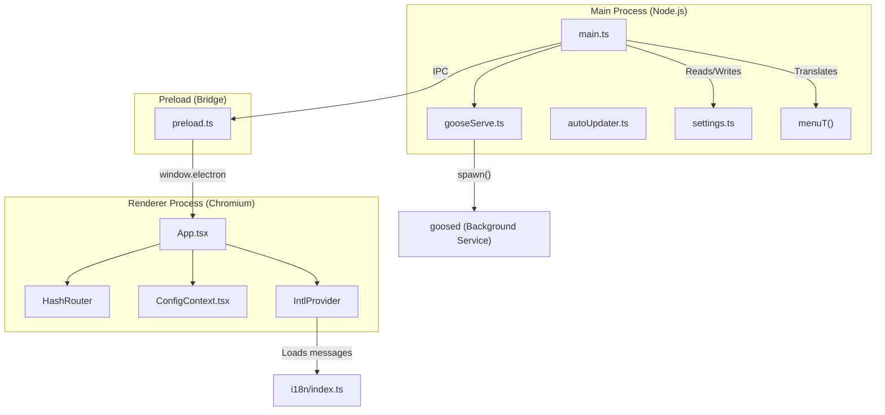
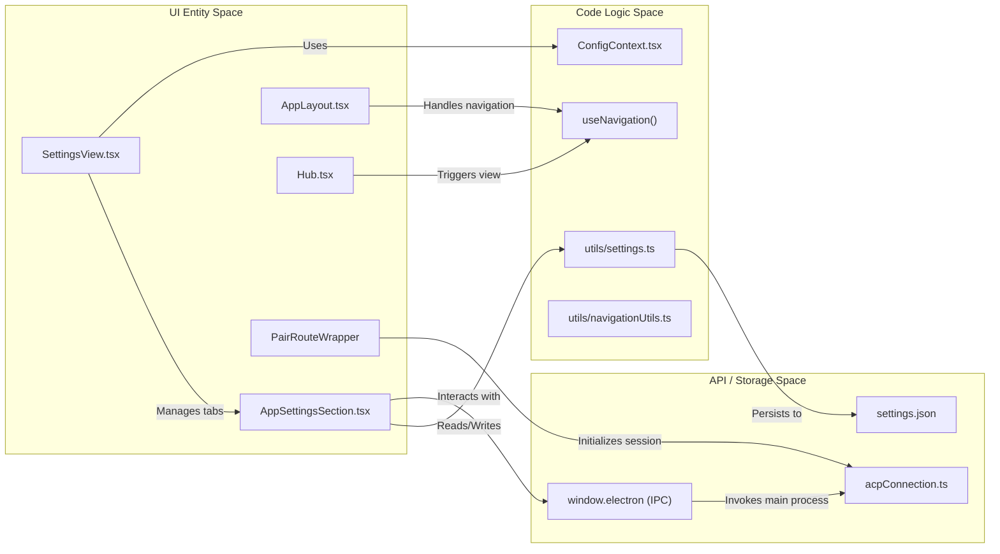

# Desktop Application (Electron UI)

Relevant source files

The following files were used as context for generating this wiki page:

- [ui/desktop/index.html](ui/desktop/index.html)
- [ui/desktop/src/App.tsx](ui/desktop/src/App.tsx)
- [ui/desktop/src/acp/__tests__/acpConnection.test.ts](ui/desktop/src/acp/__tests__/acpConnection.test.ts)
- [ui/desktop/src/acp/__tests__/gooseAcpClient.test.ts](ui/desktop/src/acp/__tests__/gooseAcpClient.test.ts)
- [ui/desktop/src/acp/acpConnection.ts](ui/desktop/src/acp/acpConnection.ts)
- [ui/desktop/src/acp/gooseAcpClient.ts](ui/desktop/src/acp/gooseAcpClient.ts)
- [ui/desktop/src/components/AnnouncementModal.tsx](ui/desktop/src/components/AnnouncementModal.tsx)
- [ui/desktop/src/components/GooseSidebar/ThemeSelector.tsx](ui/desktop/src/components/GooseSidebar/ThemeSelector.tsx)
- [ui/desktop/src/components/ImagePreview.tsx](ui/desktop/src/components/ImagePreview.tsx)
- [ui/desktop/src/components/settings/SettingsView.tsx](ui/desktop/src/components/settings/SettingsView.tsx)
- [ui/desktop/src/components/settings/app/AppSettingsSection.tsx](ui/desktop/src/components/settings/app/AppSettingsSection.tsx)
- [ui/desktop/src/components/settings/app/ExternalBackendSection.tsx](ui/desktop/src/components/settings/app/ExternalBackendSection.tsx)
- [ui/desktop/src/components/settings/keyboard/KeyboardShortcutsSection.tsx](ui/desktop/src/components/settings/keyboard/KeyboardShortcutsSection.tsx)
- [ui/desktop/src/contexts/ThemeContext.tsx](ui/desktop/src/contexts/ThemeContext.tsx)
- [ui/desktop/src/hooks/useProviderDeviceCode.ts](ui/desktop/src/hooks/useProviderDeviceCode.ts)
- [ui/desktop/src/i18n/i18n.test.ts](ui/desktop/src/i18n/i18n.test.ts)
- [ui/desktop/src/i18n/index.ts](ui/desktop/src/i18n/index.ts)
- [ui/desktop/src/main.ts](ui/desktop/src/main.ts)
- [ui/desktop/src/preload.ts](ui/desktop/src/preload.ts)
- [ui/desktop/src/renderer.tsx](ui/desktop/src/renderer.tsx)
- [ui/desktop/src/test/radixSingleVersion.test.ts](ui/desktop/src/test/radixSingleVersion.test.ts)
- [ui/desktop/src/test/setup.ts](ui/desktop/src/test/setup.ts)
- [ui/desktop/src/utils/settings.ts](ui/desktop/src/utils/settings.ts)
- [ui/desktop/vite.config.mts](ui/desktop/vite.config.mts)
- [ui/package.json](ui/package.json)
- [ui/pnpm-lock.yaml](ui/pnpm-lock.yaml)
- [ui/pnpm-workspace.yaml](ui/pnpm-workspace.yaml)

The Goose Desktop application is built using **Electron**, providing a cross-platform graphical interface for the Goose agent. It follows the standard Electron multi-process model, separating the privileged Node.js main process from the sandboxed Chromium renderer processes. The UI is built with **React**, **Tailwind CSS**, and **shadcn/ui** components [ui/pnpm-lock.yaml:19-182]().

## Process Model & Lifecycle

The application architecture is divided into three primary layers to ensure security and performance:

1.  **Main Process (`main.ts`)**: Manages the application lifecycle, native window creation, global shortcuts, and the lifecycle of the background server process [ui/desktop/src/main.ts:2-40](). It also handles native menu localization based on the configured locale via `menuT` and `translateMenuLabels` [ui/desktop/src/main.ts:145-179]().
2.  **Preload Script (`preload.ts`)**: Acts as a secure IPC bridge between the main process and the renderer, exposing a defined `ElectronAPI` set via `contextBridge` [ui/desktop/src/preload.ts:1-187]().
3.  **Renderer Process (`App.tsx`, `renderer.tsx`)**: The React-based frontend mounted inside `index.html` [ui/desktop/index.html:71-74](). It handles routing, internationalization via `IntlProvider`, and state management [ui/desktop/src/renderer.tsx:30-50]().

### Lifecycle Management
The main process coordinates backend status checks (`checkBackendStatus`), certificate verifiers, proxy configuration, and backend spawning via `startGooseServe` [ui/desktop/src/main.ts:29-34](). Communication with the Agent Client Protocol (ACP) backend is established through WebSocket streaming managed in `acpConnection.ts` [ui/desktop/src/acp/acpConnection.ts:131-184]().

### Process Architecture
The following diagram maps the relationship between Electron processes and backend services.

Title: Electron and Rust Backend Interaction

**Sources:** [ui/desktop/src/main.ts:2-40](), [ui/desktop/src/preload.ts:1-187](), [ui/desktop/src/App.tsx:1-60](), [ui/desktop/src/main.ts:29-34](), [ui/desktop/src/main.ts:145-179](), [ui/desktop/src/renderer.tsx:30-50]().

## IPC Bridge & API Integration

Communication between the React frontend and the system occurs through the `ElectronAPI` interface exposed in `preload.ts`. This bridge ensures the renderer never interacts directly with Node.js primitives.

*   **Settings Persistence**: Reading and writing configuration through `getSetting` and `setSetting` [ui/desktop/src/preload.ts:134-135]() adhering to the `Settings` interface [ui/desktop/src/utils/settings.ts:37-58]().
*   **File System**: Secure directory selection via `directoryChooser` [ui/desktop/src/preload.ts:106]() and file operations [ui/desktop/src/preload.ts:122-127]().
*   **ACP Connection**: Providing endpoints for communication via `getAcpUrl` [ui/desktop/src/preload.ts:137]().
*   **Window Management**: Creating chat windows via `createChatWindow` and handling shortcuts [ui/desktop/src/preload.ts:107]().

**Sources:** [ui/desktop/src/preload.ts:100-187](), [ui/desktop/src/utils/settings.ts:37-58]().

## Routing & Navigation

The application uses `react-router` with a `HashRouter` to manage views within the Electron window [ui/desktop/src/App.tsx:3](). Navigation is centralized through the `createNavigationHandler` utility and the `useNavigation` hook [ui/desktop/src/hooks/useNavigation.ts:1-10]().

| Route | Component | Purpose |
| :--- | :--- | :--- |
| `/` | `Hub` | Landing view for new sessions and recipe selection [ui/desktop/src/App.tsx:62-65](). |
| `/pair` | `PairRouteWrapper` | Session creation, resumption, and active session coordination [ui/desktop/src/App.tsx:77-182](). |
| `/settings` | `SettingsView` | Tabbed configuration interface for models, providers, and app behavior [ui/desktop/src/components/settings/SettingsView.tsx:76-84](). |
| `/sessions` | `SessionsView` | Management of chat session history [ui/desktop/src/App.tsx:30](). |
| `/extensions` | `ExtensionsView` | Extension management and configuration [ui/desktop/src/App.tsx:44](). |
| `/recipes` | `RecipesView` | Recipe browsing and execution [ui/desktop/src/App.tsx:45](). |
| `/schedules` | `SchedulesView` | Task scheduling and cron management [ui/desktop/src/App.tsx:31](). |
| `/skills` | `SkillsView` | Skill discovery and management [ui/desktop/src/App.tsx:46](). |

**Sources:** [ui/desktop/src/App.tsx:1-200](), [ui/desktop/src/components/settings/SettingsView.tsx:76-84](), [ui/desktop/src/hooks/useNavigation.ts:1-10]().

## System Architecture: Code to UI Mapping

The diagram below associates UI components with the core logic and API entities they interact with.

Title: Code Entity to UI Mapping

**Sources:** [ui/desktop/src/App.tsx:25-53](), [ui/desktop/src/components/settings/SettingsView.tsx:85-133](), [ui/desktop/src/components/settings/app/AppSettingsSection.tsx:1-24](), [ui/desktop/src/utils/settings.ts:76-99](), [ui/desktop/src/hooks/useNavigation.ts:1-10]().

## UI Subsystems

The Desktop application is composed of several specialized subsystems, each covered in detail in child pages:

### [Chat Interface & Message Rendering](#6.1)
Core chat UI including `ChatView`, `ChatInput`, and message lists (`ProgressiveMessageList`, `GooseMessage`, `ToolCallWithResponse`). Handles ACP session stores, notification adapters, and Markdown rendering. For details, see [Chat Interface & Message Rendering](#6.1).

### [Settings & Configuration UI](#6.2)
Manages application preferences via `SettingsView`, provider configuration modals, extension management, model switching, keyboard shortcuts, chat settings, telemetry, and localization catalogs [ui/desktop/src/components/settings/SettingsView.tsx:76-84](). The `AppSettingsSection` component handles general application settings like appearance, notifications, and language selection [ui/desktop/src/components/settings/app/AppSettingsSection.tsx:26-96](). Internationalization is managed by `react-intl` with message catalogs loaded dynamically based on `currentMessageLocale` [ui/desktop/src/i18n/index.ts:93-120](). For details, see [Settings & Configuration UI](#6.2).

### [Session Management UI](#6.3)
Handles session list views, navigation sidebars, session history, shared session views, session caching, and the bottom menu (`DirSwitcher`, alerts, mode selection, cost tracker). For details, see [Session Management UI](#6.3).

### [Voice Dictation & Audio](#6.4)
Voice dictation features including Whisper integration (local and ElevenLabs), audio recorder hooks, dictation settings UI, microphone selectors, and ACP dictation requests. For details, see [Voice Dictation & Audio](#6.4).

### [Local Inference & Model Management](#6.5)
Local model execution utilizing backends like candle, llama-cpp-2, and MLX, download managers, HuggingFace model search, and `LocalInferenceSection` UI [ui/desktop/src/components/settings/SettingsView.tsx:25](). For details, see [Local Inference & Model Management](#6.5).

### [Goose 2.0 & Future Architecture](#6.6)
The transition to an ACP-first architecture, removal of legacy daemons, TypeScript TUI beta, and the roadmap for client unification under the ACP server. For details, see [Goose 2.0 & Future Architecture](#6.6).

**Sources:** [ui/desktop/src/components/settings/SettingsView.tsx:1-84](), [ui/desktop/src/App.tsx:1-60](), [ui/desktop/src/preload.ts:1-187](), [ui/desktop/src/components/settings/app/AppSettingsSection.tsx:26-96](), [ui/desktop/src/i18n/index.ts:93-120]().