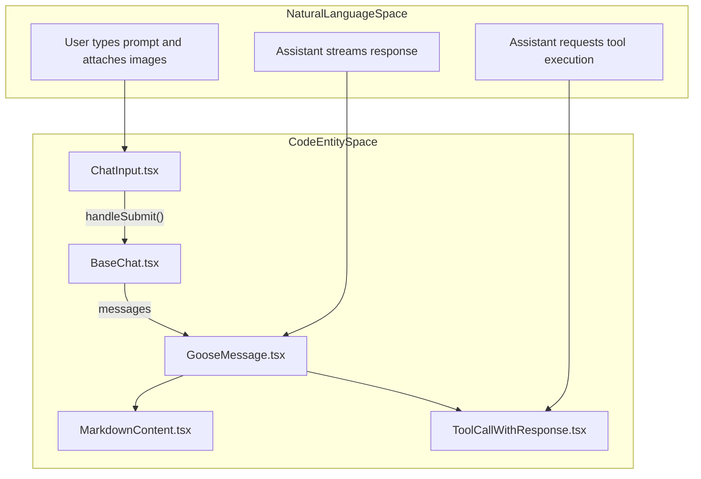
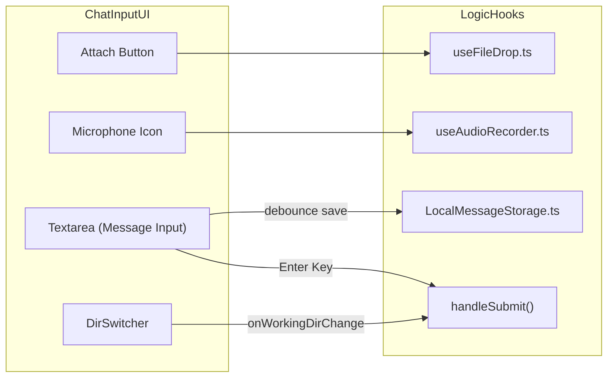

# Chat Interface & Message Rendering

Relevant source files

The following files were used as context for generating this wiki page:

- [documentation/docs/guides/file-management.md](documentation/docs/guides/file-management.md)
- [documentation/docs/guides/handling-llm-rate-limits-with-goose.md](documentation/docs/guides/handling-llm-rate-limits-with-goose.md)
- [documentation/docs/guides/logs.md](documentation/docs/guides/logs.md)
- [ui/desktop/src/acp/__tests__/chatSessionStore.test.ts](ui/desktop/src/acp/__tests__/chatSessionStore.test.ts)
- [ui/desktop/src/acp/__tests__/elicitationRequests.test.ts](ui/desktop/src/acp/__tests__/elicitationRequests.test.ts)
- [ui/desktop/src/acp/__tests__/gooseSessionNotifications.test.ts](ui/desktop/src/acp/__tests__/gooseSessionNotifications.test.ts)
- [ui/desktop/src/acp/__tests__/permissionRequests.test.ts](ui/desktop/src/acp/__tests__/permissionRequests.test.ts)
- [ui/desktop/src/acp/__tests__/sessionNotificationAdapter.test.ts](ui/desktop/src/acp/__tests__/sessionNotificationAdapter.test.ts)
- [ui/desktop/src/acp/adapter/gooseSessionNotifications.ts](ui/desktop/src/acp/adapter/gooseSessionNotifications.ts)
- [ui/desktop/src/acp/adapter/messages.ts](ui/desktop/src/acp/adapter/messages.ts)
- [ui/desktop/src/acp/adapter/permissions.ts](ui/desktop/src/acp/adapter/permissions.ts)
- [ui/desktop/src/acp/adapter/shared.ts](ui/desktop/src/acp/adapter/shared.ts)
- [ui/desktop/src/acp/adapter/tools.ts](ui/desktop/src/acp/adapter/tools.ts)
- [ui/desktop/src/acp/chatSessionStore.ts](ui/desktop/src/acp/chatSessionStore.ts)
- [ui/desktop/src/acp/elicitationRequests.ts](ui/desktop/src/acp/elicitationRequests.ts)
- [ui/desktop/src/acp/local-inference.ts](ui/desktop/src/acp/local-inference.ts)
- [ui/desktop/src/acp/permissionRequestTypes.ts](ui/desktop/src/acp/permissionRequestTypes.ts)
- [ui/desktop/src/acp/permissionRequests.ts](ui/desktop/src/acp/permissionRequests.ts)
- [ui/desktop/src/acp/sessionNotificationAdapter.ts](ui/desktop/src/acp/sessionNotificationAdapter.ts)
- [ui/desktop/src/components/BaseChat.tsx](ui/desktop/src/components/BaseChat.tsx)
- [ui/desktop/src/components/ChatInput.tsx](ui/desktop/src/components/ChatInput.tsx)
- [ui/desktop/src/components/GooseMessage.tsx](ui/desktop/src/components/GooseMessage.tsx)
- [ui/desktop/src/components/ItemIcon.tsx](ui/desktop/src/components/ItemIcon.tsx)
- [ui/desktop/src/components/LoadingGoose.tsx](ui/desktop/src/components/LoadingGoose.tsx)
- [ui/desktop/src/components/MarkdownContent.test.tsx](ui/desktop/src/components/MarkdownContent.test.tsx)
- [ui/desktop/src/components/MarkdownContent.tsx](ui/desktop/src/components/MarkdownContent.tsx)
- [ui/desktop/src/components/MentionPopover.resourceLimit.test.tsx](ui/desktop/src/components/MentionPopover.resourceLimit.test.tsx)
- [ui/desktop/src/components/MentionPopover.tsx](ui/desktop/src/components/MentionPopover.tsx)
- [ui/desktop/src/components/MessageCopyLink.tsx](ui/desktop/src/components/MessageCopyLink.tsx)
- [ui/desktop/src/components/ProgressiveMessageList.tsx](ui/desktop/src/components/ProgressiveMessageList.tsx)
- [ui/desktop/src/components/ToolApprovalButtons.test.tsx](ui/desktop/src/components/ToolApprovalButtons.test.tsx)
- [ui/desktop/src/components/ToolApprovalButtons.tsx](ui/desktop/src/components/ToolApprovalButtons.tsx)
- [ui/desktop/src/components/ToolCallArguments.tsx](ui/desktop/src/components/ToolCallArguments.tsx)
- [ui/desktop/src/components/ToolCallConfirmation.test.tsx](ui/desktop/src/components/ToolCallConfirmation.test.tsx)
- [ui/desktop/src/components/ToolCallConfirmation.tsx](ui/desktop/src/components/ToolCallConfirmation.tsx)
- [ui/desktop/src/components/ToolCallWithResponse.test.tsx](ui/desktop/src/components/ToolCallWithResponse.test.tsx)
- [ui/desktop/src/components/ToolCallWithResponse.tsx](ui/desktop/src/components/ToolCallWithResponse.tsx)
- [ui/desktop/src/components/UserMessage.tsx](ui/desktop/src/components/UserMessage.tsx)
- [ui/desktop/src/components/alerts/AlertBox.tsx](ui/desktop/src/components/alerts/AlertBox.tsx)
- [ui/desktop/src/components/alerts/__tests__/AlertBox.test.tsx](ui/desktop/src/components/alerts/__tests__/AlertBox.test.tsx)
- [ui/desktop/src/components/alerts/__tests__/useAlerts.test.tsx](ui/desktop/src/components/alerts/__tests__/useAlerts.test.tsx)
- [ui/desktop/src/components/alerts/types.ts](ui/desktop/src/components/alerts/types.ts)
- [ui/desktop/src/components/alerts/useAlerts.ts](ui/desktop/src/components/alerts/useAlerts.ts)
- [ui/desktop/src/components/bottom_menu/BottomMenuAlertPopover.tsx](ui/desktop/src/components/bottom_menu/BottomMenuAlertPopover.tsx)
- [ui/desktop/src/components/bottom_menu/ContextWindowIndicator.tsx](ui/desktop/src/components/bottom_menu/ContextWindowIndicator.tsx)
- [ui/desktop/src/components/bottom_menu/DirSwitcher.tsx](ui/desktop/src/components/bottom_menu/DirSwitcher.tsx)
- [ui/desktop/src/components/recipes/RecipeActivities.tsx](ui/desktop/src/components/recipes/RecipeActivities.tsx)
- [ui/desktop/src/components/ui/Expand.tsx](ui/desktop/src/components/ui/Expand.tsx)
- [ui/desktop/src/components/ui/scroll-area.tsx](ui/desktop/src/components/ui/scroll-area.tsx)
- [ui/desktop/src/hooks/useAutoSubmit.ts](ui/desktop/src/hooks/useAutoSubmit.ts)
- [ui/desktop/src/styles/main.css](ui/desktop/src/styles/main.css)
- [ui/desktop/src/types/chatState.ts](ui/desktop/src/types/chatState.ts)
- [ui/desktop/src/types/message.ts](ui/desktop/src/types/message.ts)
- [ui/desktop/src/utils/htmlSecurity.test.ts](ui/desktop/src/utils/htmlSecurity.test.ts)
- [ui/desktop/src/utils/htmlSecurity.ts](ui/desktop/src/utils/htmlSecurity.ts)
- [ui/desktop/src/utils/workingDir.ts](ui/desktop/src/utils/workingDir.ts)

The Chat Interface is the primary interaction layer of the Goose Desktop application. It is responsible for orchestrating the conversation lifecycle, processing real-time message streams, and rendering complex message types including Markdown, images, and Model Context Protocol (MCP) tool interactions.

## Core Components & Data Flow

The chat UI is built around a hierarchical structure of components that manage state and rendering. The entry point for a chat session is `BaseChat`, which utilizes session hooks to connect the UI to backend session logic [ui/desktop/src/components/BaseChat.tsx:144-165]().

### Component Hierarchy

| Component | Responsibility |
| :--- | :--- |
| `BaseChat` | Orchestrates the session view, manages layout, and initializes session hooks [ui/desktop/src/components/BaseChat.tsx:73-80](). |
| `ChatInput` | Handles user text input, image attachments, file drops, and voice dictation [ui/desktop/src/components/ChatInput.tsx:1-46](). |
| `ProgressiveMessageList` | Renders messages in batches to ensure UI responsiveness during long conversations [ui/desktop/src/components/ProgressiveMessageList.tsx:174-188](). |
| `GooseMessage` | Specialized renderer for assistant messages, including thinking blocks, tool calls, and responses [ui/desktop/src/components/GooseMessage.tsx:47-57](). |
| `UserMessage` | Renders user-originated messages and provides editing or session forking functionality [ui/desktop/src/components/UserMessage.tsx:100-105](). |
| `ToolCallWithResponse` | Manages the display of tool requests, approval states, and execution results [ui/desktop/src/components/ToolCallWithResponse.tsx:103-114](). |

Sources: [ui/desktop/src/components/BaseChat.tsx:73-80](), [ui/desktop/src/components/ChatInput.tsx:1-46](), [ui/desktop/src/components/ProgressiveMessageList.tsx:174-188](), [ui/desktop/src/components/GooseMessage.tsx:47-57](), [ui/desktop/src/components/ToolCallWithResponse.tsx:103-114]()

### Natural Language to Code Entity Mapping: Message Lifecycle

This diagram maps the conceptual flow of a message from user input to its rendered state in the DOM.

Sources: [ui/desktop/src/components/ChatInput.tsx:1-46](), [ui/desktop/src/components/BaseChat.tsx:144-165](), [ui/desktop/src/components/GooseMessage.tsx:47-57](), [ui/desktop/src/components/ToolCallWithResponse.tsx:103-114]()

## Streaming & State Management

### Session Interaction
The UI interaction is managed through session hooks providing state and methods needed for a chat session [ui/desktop/src/components/BaseChat.tsx:144-165](). It handles message submission, stream control, and configuration updates such as the working directory via `acpUpdateWorkingDir` [ui/desktop/src/acp/sessions.ts]().

### Chat States
The UI tracks session status through chat states and hooks:
- `LoadingConversation`: Fetching initial session history.
- `Streaming`: Actively receiving message content.
- `Thinking`: The model is generating internal reasoning.
- `Compacting`: The backend is performing context window management.

Sources: [ui/desktop/src/components/BaseChat.tsx:144-165](), [ui/desktop/src/types/chatState.ts](), [ui/desktop/src/acp/sessions.ts]()

## Message Rendering Logic

### `ProgressiveMessageList`
To handle sessions with large numbers of messages, Goose uses `ProgressiveMessageList`. It renders messages in configurable batches (default `batchSize: 5`) [ui/desktop/src/components/ProgressiveMessageList.tsx:180-180](). This prevents the main thread from locking up during DOM insertion of large chat histories.

- **Batching Logic:** Uses `renderedCount` state and `setTimeout` to progressively reveal messages [ui/desktop/src/components/ProgressiveMessageList.tsx:190-209]().
- **System Notifications:** Renders specialized inline notifications for events like model changes or credit exhaustion [ui/desktop/src/components/ProgressiveMessageList.tsx:47-60]().

### Markdown & Code Rendering
The `MarkdownContent` component serves as the primary text renderer [ui/desktop/src/components/MarkdownContent.tsx:54-57]().
- **Plugins:** Uses `remarkGfm`, `remarkMath`, and `rehypeKatex` for rich formatting [ui/desktop/src/components/MarkdownContent.tsx:3-6]().
- **Syntax Highlighting:** Implements `SyntaxHighlighter` with a custom `oneDark` theme (`customOneDarkTheme`) optimized for code readability [ui/desktop/src/components/MarkdownContent.tsx:11-27]().
- **Security:** Implements `wrapHTMLInCodeBlock` to prevent raw HTML execution and blocks dangerous protocols [ui/desktop/src/utils/htmlSecurity.ts:1-10]().

### Tool Interaction: `ToolCallWithResponse`
This component handles the lifecycle of a tool call:
- **Request:** Renders tool name and arguments using `ToolCallArguments` [ui/desktop/src/components/ToolCallWithResponse.tsx:6]().
- **Approval:** If the tool requires permission, it renders `ToolApprovalButtons` [ui/desktop/src/components/ToolApprovalButtons.tsx:1-10]().
- **Response:** Renders output, supporting text and complex MCP UI resources via `McpAppRenderer` [ui/desktop/src/components/ToolCallWithResponse.tsx:21](). It extracts subagent session IDs for delegation tools [ui/desktop/src/components/ToolCallWithResponse.tsx:116-141]().

Sources: [ui/desktop/src/components/ProgressiveMessageList.tsx:47-209](), [ui/desktop/src/components/MarkdownContent.tsx:3-57](), [ui/desktop/src/components/ToolCallWithResponse.tsx:6-141](), [ui/desktop/src/components/ToolApprovalButtons.tsx:1-10](), [ui/desktop/src/utils/htmlSecurity.ts:1-10]()

## User Input Handling

### `ChatInput` Features
The input area manages user prompts and attachments:
- **Image Management:** Supports pasting images and file uploads, with compression logic via `compressImageDataUrl` [ui/desktop/src/components/ChatInput.tsx:37-38]().
- **Slash Commands:** Recognizes commands like `/compact` to trigger manual context window management [ui/desktop/src/components/ChatInput.tsx:109-110]().
- **Token Awareness:** Integrates with `ContextWindowIndicator` and `CostTracker` to show resource usage [ui/desktop/src/components/ChatInput.tsx:25-26]().
- **Directory Switching:** Includes `DirSwitcher` for changing the agent's working directory [ui/desktop/src/components/ChatInput.tsx:12]().

### Entity Association: Input and Tooling
This diagram connects UI elements in `ChatInput` to their underlying logic and hooks.

Sources: [ui/desktop/src/components/ChatInput.tsx:12](), [ui/desktop/src/components/ChatInput.tsx:25-26](), [ui/desktop/src/components/ChatInput.tsx:37-38](), [ui/desktop/src/components/ChatInput.tsx:109-110](), [ui/desktop/src/components/bottom_menu/DirSwitcher.tsx]()

## Style System
Goose uses a semantic token system defined in `main.css`. These tokens map to MCP style variables, ensuring consistent theming across the application and MCP-served UIs.

- **Backgrounds:** `--color-background-primary`, `--color-background-secondary` [ui/desktop/src/styles/main.css:68-69]().
- **Borders:** `--color-border-primary`, `--color-border-secondary` [ui/desktop/src/styles/main.css:92-93]().
- **Typography:** Defines sans-serif and mono font stacks for consistent text and code rendering [ui/desktop/src/styles/main.css:113-114]().
- **App Specifics:** Defines aliases like `--color-inline-code` for Markdown rendering [ui/desktop/src/styles/main.css:186]().

Sources: [ui/desktop/src/styles/main.css:68-186]()