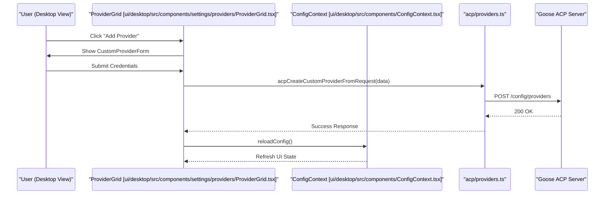

# Settings & Configuration UI

<details>
<summary>Relevant source files</summary>

The following files were used as context for generating this wiki page:

- [crates/goose-providers/src/declarative/definitions/zai_coding_plan.json](crates/goose-providers/src/declarative/definitions/zai_coding_plan.json)
- [crates/goose-providers/tests/zai_coding_plan.rs](crates/goose-providers/tests/zai_coding_plan.rs)
- [crates/goose/src/acp/server/recipe/conversions.rs](crates/goose/src/acp/server/recipe/conversions.rs)
- [ui/desktop/src/acp/__tests__/providers.test.ts](ui/desktop/src/acp/__tests__/providers.test.ts)
- [ui/desktop/src/acp/__tests__/session-extensions.test.ts](ui/desktop/src/acp/__tests__/session-extensions.test.ts)
- [ui/desktop/src/acp/extensions.ts](ui/desktop/src/acp/extensions.ts)
- [ui/desktop/src/acp/providers.ts](ui/desktop/src/acp/providers.ts)
- [ui/desktop/src/acp/session-extensions.ts](ui/desktop/src/acp/session-extensions.ts)
- [ui/desktop/src/components/ConfigContext.tsx](ui/desktop/src/components/ConfigContext.tsx)
- [ui/desktop/src/components/ExtensionInstallModal.test.tsx](ui/desktop/src/components/ExtensionInstallModal.test.tsx)
- [ui/desktop/src/components/ExtensionInstallModal.tsx](ui/desktop/src/components/ExtensionInstallModal.tsx)
- [ui/desktop/src/components/ModelAndProviderContext.tsx](ui/desktop/src/components/ModelAndProviderContext.tsx)
- [ui/desktop/src/components/bottom_menu/BottomMenuExtensionSelection.test.tsx](ui/desktop/src/components/bottom_menu/BottomMenuExtensionSelection.test.tsx)
- [ui/desktop/src/components/bottom_menu/BottomMenuExtensionSelection.tsx](ui/desktop/src/components/bottom_menu/BottomMenuExtensionSelection.tsx)
- [ui/desktop/src/components/conversation/SearchBar.tsx](ui/desktop/src/components/conversation/SearchBar.tsx)
- [ui/desktop/src/components/conversation/SearchView.tsx](ui/desktop/src/components/conversation/SearchView.tsx)
- [ui/desktop/src/components/extensions/ExtensionsView.tsx](ui/desktop/src/components/extensions/ExtensionsView.tsx)
- [ui/desktop/src/components/onboarding/LocalModelPicker.tsx](ui/desktop/src/components/onboarding/LocalModelPicker.tsx)
- [ui/desktop/src/components/onboarding/ProviderConfigForm.tsx](ui/desktop/src/components/onboarding/ProviderConfigForm.tsx)
- [ui/desktop/src/components/onboarding/ProviderSelector.tsx](ui/desktop/src/components/onboarding/ProviderSelector.tsx)
- [ui/desktop/src/components/recipes/shared/RecipeExtensionSelector.tsx](ui/desktop/src/components/recipes/shared/RecipeExtensionSelector.tsx)
- [ui/desktop/src/components/settings/chat/ChatSettingsSection.tsx](ui/desktop/src/components/settings/chat/ChatSettingsSection.tsx)
- [ui/desktop/src/components/settings/extensions/ExtensionsSection.tsx](ui/desktop/src/components/settings/extensions/ExtensionsSection.tsx)
- [ui/desktop/src/components/settings/extensions/agent-api.ts](ui/desktop/src/components/settings/extensions/agent-api.ts)
- [ui/desktop/src/components/settings/extensions/deeplink.test.ts](ui/desktop/src/components/settings/extensions/deeplink.test.ts)
- [ui/desktop/src/components/settings/extensions/deeplink.ts](ui/desktop/src/components/settings/extensions/deeplink.ts)
- [ui/desktop/src/components/settings/extensions/extension-manager.ts](ui/desktop/src/components/settings/extensions/extension-manager.ts)
- [ui/desktop/src/components/settings/extensions/subcomponents/ExtensionItem.test.tsx](ui/desktop/src/components/settings/extensions/subcomponents/ExtensionItem.test.tsx)
- [ui/desktop/src/components/settings/extensions/subcomponents/ExtensionItem.tsx](ui/desktop/src/components/settings/extensions/subcomponents/ExtensionItem.tsx)
- [ui/desktop/src/components/settings/extensions/subcomponents/ExtensionList.tsx](ui/desktop/src/components/settings/extensions/subcomponents/ExtensionList.tsx)
- [ui/desktop/src/components/settings/extensions/utils.test.ts](ui/desktop/src/components/settings/extensions/utils.test.ts)
- [ui/desktop/src/components/settings/extensions/utils.ts](ui/desktop/src/components/settings/extensions/utils.ts)
- [ui/desktop/src/components/settings/mode/ConversationLimitsDropdown.tsx](ui/desktop/src/components/settings/mode/ConversationLimitsDropdown.tsx)
- [ui/desktop/src/components/settings/mode/ModeSection.tsx](ui/desktop/src/components/settings/mode/ModeSection.tsx)
- [ui/desktop/src/components/settings/models/ModelsSection.tsx](ui/desktop/src/components/settings/models/ModelsSection.tsx)
- [ui/desktop/src/components/settings/models/bottom_bar/ModelsBottomBar.tsx](ui/desktop/src/components/settings/models/bottom_bar/ModelsBottomBar.tsx)
- [ui/desktop/src/components/settings/models/modelInterface.ts](ui/desktop/src/components/settings/models/modelInterface.ts)
- [ui/desktop/src/components/settings/models/subcomponents/SwitchModelModal.tsx](ui/desktop/src/components/settings/models/subcomponents/SwitchModelModal.tsx)
- [ui/desktop/src/components/settings/providers/ProviderGrid.tsx](ui/desktop/src/components/settings/providers/ProviderGrid.tsx)
- [ui/desktop/src/components/settings/providers/ProviderSettingsPage.tsx](ui/desktop/src/components/settings/providers/ProviderSettingsPage.tsx)
- [ui/desktop/src/components/settings/providers/modal/ProviderConfigurationModal.test.tsx](ui/desktop/src/components/settings/providers/modal/ProviderConfigurationModal.test.tsx)
- [ui/desktop/src/components/settings/providers/modal/ProviderConfigurationModal.tsx](ui/desktop/src/components/settings/providers/modal/ProviderConfigurationModal.tsx)
- [ui/desktop/src/components/settings/providers/modal/subcomponents/ProviderSetupActions.tsx](ui/desktop/src/components/settings/providers/modal/subcomponents/ProviderSetupActions.tsx)
- [ui/desktop/src/components/settings/providers/modal/subcomponents/forms/CustomProviderForm.test.tsx](ui/desktop/src/components/settings/providers/modal/subcomponents/forms/CustomProviderForm.test.tsx)
- [ui/desktop/src/components/settings/providers/modal/subcomponents/forms/CustomProviderForm.tsx](ui/desktop/src/components/settings/providers/modal/subcomponents/forms/CustomProviderForm.tsx)
- [ui/desktop/src/components/settings/providers/modal/subcomponents/forms/DefaultProviderSetupForm.tsx](ui/desktop/src/components/settings/providers/modal/subcomponents/forms/DefaultProviderSetupForm.tsx)
- [ui/desktop/src/components/settings/providers/modal/subcomponents/handlers/DefaultSubmitHandler.test.tsx](ui/desktop/src/components/settings/providers/modal/subcomponents/handlers/DefaultSubmitHandler.test.tsx)
- [ui/desktop/src/components/settings/providers/modal/subcomponents/handlers/DefaultSubmitHandler.tsx](ui/desktop/src/components/settings/providers/modal/subcomponents/handlers/DefaultSubmitHandler.tsx)
- [ui/desktop/src/components/settings/providers/subcomponents/ProviderCard.tsx](ui/desktop/src/components/settings/providers/subcomponents/ProviderCard.tsx)
- [ui/desktop/src/hooks/useNavigation.ts](ui/desktop/src/hooks/useNavigation.ts)
- [ui/desktop/src/i18n/messages/de.json](ui/desktop/src/i18n/messages/de.json)
- [ui/desktop/src/i18n/messages/en.json](ui/desktop/src/i18n/messages/en.json)
- [ui/desktop/src/i18n/messages/es.json](ui/desktop/src/i18n/messages/es.json)
- [ui/desktop/src/i18n/messages/fr.json](ui/desktop/src/i18n/messages/fr.json)
- [ui/desktop/src/i18n/messages/hi.json](ui/desktop/src/i18n/messages/hi.json)
- [ui/desktop/src/i18n/messages/id.json](ui/desktop/src/i18n/messages/id.json)
- [ui/desktop/src/i18n/messages/it.json](ui/desktop/src/i18n/messages/it.json)
- [ui/desktop/src/i18n/messages/ja.json](ui/desktop/src/i18n/messages/ja.json)
- [ui/desktop/src/i18n/messages/ko.json](ui/desktop/src/i18n/messages/ko.json)
- [ui/desktop/src/i18n/messages/ms.json](ui/desktop/src/i18n/messages/ms.json)
- [ui/desktop/src/i18n/messages/pt.json](ui/desktop/src/i18n/messages/pt.json)
- [ui/desktop/src/i18n/messages/ru.json](ui/desktop/src/i18n/messages/ru.json)
- [ui/desktop/src/i18n/messages/tr.json](ui/desktop/src/i18n/messages/tr.json)
- [ui/desktop/src/i18n/messages/vi.json](ui/desktop/src/i18n/messages/vi.json)
- [ui/desktop/src/i18n/messages/zh-CN.json](ui/desktop/src/i18n/messages/zh-CN.json)
- [ui/desktop/src/i18n/messages/zh-TW.json](ui/desktop/src/i18n/messages/zh-TW.json)
- [ui/desktop/src/types/providers.ts](ui/desktop/src/types/providers.ts)
- [ui/desktop/src/utils/searchHighlighter.ts](ui/desktop/src/utils/searchHighlighter.ts)

</details>


The Settings and Configuration UI in the Goose Desktop application provides a comprehensive interface for managing provider credentials, extension lifecycles, model switching, and application preferences. It is implemented as a modular React-based system within the Electron renderer process, interacting with the backend via the Agent Client Protocol (ACP) and local Electron storage for UI-specific state.

Sources: [ui/desktop/src/components/settings/providers/ProviderGrid.tsx:1-20](), [ui/desktop/src/components/settings/models/subcomponents/SwitchModelModal.tsx:1-33]()

## Core Settings Architecture

The configuration system is split between **Application Settings** (persisted in `settings.json` via Electron's `userData` path) and **Backend Configuration** (persisted in `config.yaml` and a secure keyring via the backend server).

### ConfigContext
The `ConfigContext` serves as the primary data provider for the settings UI, abstracting the complexity of fetching and updating backend configuration.

- **State Management**: It maintains `config`, `providersList`, and `extensionsList` in React state [ui/desktop/src/components/ConfigContext.tsx:48-51]().
- **API Interactivity**: It wraps ACP backend calls like `acpReadAllConfig`, `acpUpsertConfig`, and `acpReadConfig` into hooks for UI components [ui/desktop/src/components/ConfigContext.tsx:57-90]().
- **Extension Syncing**: On mount, it triggers `syncBundledExtensions` to ensure default extensions (e.g., developer, computercontroller) are present and updated from bundled assets [ui/desktop/src/components/ConfigContext.tsx:176-193]().
- **Provider Management**: It provides a centralized `getProviders` method that caches provider details and supports forced refreshes using `acpListProviderDetails` [ui/desktop/src/components/ConfigContext.tsx:139-152]().

Sources: [ui/desktop/src/components/ConfigContext.tsx:1-193](), [ui/desktop/src/acp/config.ts:1-20]()

## Provider & Model Configuration

Goose supports both built-in providers (OpenAI, Anthropic, etc.) and custom/declarative providers via the `ProviderGrid` component [ui/desktop/src/components/settings/providers/ProviderGrid.tsx:95-107]().

### Provider Management
- **Custom Providers**: Users can add providers using `CustomProviderForm`. The UI handles creation via `acpCreateCustomProviderFromRequest` and updates via `acpUpdateCustomProviderFromRequest` [ui/desktop/src/components/settings/providers/ProviderGrid.tsx:8-12](), [ui/desktop/src/components/settings/providers/ProviderGrid.tsx:163-178]().
- **Model Switching**: The `SwitchModelModal` provides a searchable interface for selecting models. It tracks model changes for analytics via `trackModelChanged` and maintains a list of recent models via `addToRecentModels` [ui/desktop/src/components/settings/models/subcomponents/SwitchModelModal.tsx:31-32]().
- **Extended Thinking**: For models supporting reasoning (e.g., Claude 3.7, Gemini 2.0), the UI allows configuring "Thinking Effort" and "Thinking Budget". Options include `Low`, `Medium`, `High`, and `Max` for Claude, or `Off`, `Low`, `High` for Gemini [ui/desktop/src/components/settings/models/subcomponents/SwitchModelModal.tsx:34-62](), [ui/desktop/src/components/settings/models/subcomponents/SwitchModelModal.tsx:152-171]().

**Provider Configuration Flow (Code Entity Space)**

Sources: [ui/desktop/src/components/settings/providers/ProviderGrid.tsx:123-215](), [ui/desktop/src/components/settings/models/subcomponents/SwitchModelModal.tsx:34-62](), [ui/desktop/src/acp/providers.ts:1-50]()

## Extension Management

The Extension UI handles the lifecycle of Model Context Protocol (MCP) servers and platform-native tools.

- **Global vs. Session Scoping**:
    - **Global**: Toggled via `ConfigContext.setExtensionEnabled`, which updates `config.yaml` for all future sessions [ui/desktop/src/components/ConfigContext.tsx:130-137]().
    - **Session**: Toggled via `BottomMenuExtensionSelection`, which allows users to enable/disable extensions for the current chat session or as defaults for new chats [ui/desktop/src/components/bottom_menu/BottomMenuExtensionSelection.tsx:180-199]().
- **Extension Configuration**: The `ExtensionModal` allows editing environment variables and custom HTTP headers for MCP servers [ui/desktop/src/components/settings/extensions/modal/ExtensionModal.tsx:153-213](). It includes a dirty check via `hasFormChanges` to warn users about unsaved modifications [ui/desktop/src/components/settings/extensions/modal/ExtensionModal.tsx:92-131]().
- **Deep Linking**: Extensions can be installed via `goose://` deep links. The system validates allowed commands (e.g., `npx`, `uvx`, `docker`) and checks for security risks like `npx -c` before installation [ui/desktop/src/components/settings/extensions/deeplink.ts:15-41]().

Sources: [ui/desktop/src/components/ConfigContext.tsx:109-193](), [ui/desktop/src/components/settings/extensions/modal/ExtensionModal.tsx:72-131]()

## Localization & Internationalization (i18n)

The settings UI utilizes an extensive message catalog system based on `defineMessages` and `useIntl` from `@formatjs/intl` [ui/desktop/src/components/settings/providers/ProviderGrid.tsx:20](), [ui/desktop/src/components/settings/models/subcomponents/SwitchModelModal.tsx:3]().

- **Message Catalogs**: JSON-based translations are located in `ui/desktop/src/i18n/messages/`, covering English (`en.json`), Simplified Chinese (`zh-CN.json`), Russian (`ru.json`), Turkish (`tr.json`), Hindi (`hi.json`), Japanese (`ja.json`), Spanish (`es.json`), Korean (`ko.json`), and Traditional Chinese (`zh-TW.json`).
- **Dynamic Fallbacks**: Unresolved keys or missing localizations fall back gracefully to the default English message definitions.

**Configuration Entity Mapping**
```mermaid
classDiagram
    class "ExtensionConfig" {
        +name: string
        +type: string
        +cmd: string
        +args: string[]
        +env_keys: string[]
    }
    class "ProviderDetails" {
        +name: string
        +provider_type: string
        +models: string[]
    }
    class "ConfigContext" {
        +upsert(key, value, is_secret)
        +addExtension(name, config, enabled)
        +setExtensionEnabled(configKey, enabled)
        +refreshExtensions()
    }
    class "ExtensionModal" {
        +formData: ExtensionFormData
        +handleEnvVarChange()
        +handleHeaderChange()
    }
    class "SwitchModelModal" {
        +switchModelProvider: string
        +selectedModel: string
    }

    "ConfigContext" ..> "ExtensionConfig" : Manages
    "ConfigContext" ..> "ProviderDetails" : Manages
    "ExtensionModal" --|> "ConfigContext" : Persists via
    "SwitchModelModal" ..> "ProviderDetails" : Queries
```
Sources: [ui/desktop/src/components/ConfigContext.tsx:26-38](), [ui/desktop/src/components/settings/extensions/modal/ExtensionModal.tsx:72-80](), [ui/desktop/src/components/settings/models/subcomponents/SwitchModelModal.tsx:1-30]()

## Technical Summary Table

| Feature | Implementation Detail | Code Reference |
| :--- | :--- | :--- |
| **Secret Management** | Uses `is_secret` flag in `acpUpsertConfig` to route to secure storage. | [ui/desktop/src/acp/config.ts:14]() |
| **Thinking Effort** | Maps UI levels to `ThinkingEffort` types for reasoning models. | [ui/desktop/src/types/providers.ts:30]() |
| **Bundled Sync** | `syncBundledExtensions` ensures default tools are present on boot. | [ui/desktop/src/components/ConfigContext.tsx:193]() |
| **I18n Support** | Uses `defineMessages` and `useIntl` for multi-language settings UI. | [ui/desktop/src/components/settings/providers/ProviderGrid.tsx:20]() |
| **Extension Removal** | `removeExtension` uses `acpRemoveConfig` to delete entries. | [ui/desktop/src/components/ConfigContext.tsx:109-118]() |
| **Custom Provider Forms** | Managed via `CustomProviderForm` and `CustomProviderCard`. | [ui/desktop/src/components/settings/providers/ProviderGrid.tsx:71-93]() |

Sources: [ui/desktop/src/acp/config.ts:1-20](), [ui/desktop/src/components/ConfigContext.tsx:109-118](), [ui/desktop/src/components/settings/providers/ProviderGrid.tsx:71-93]()