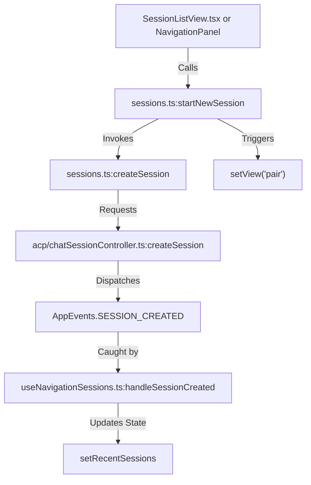
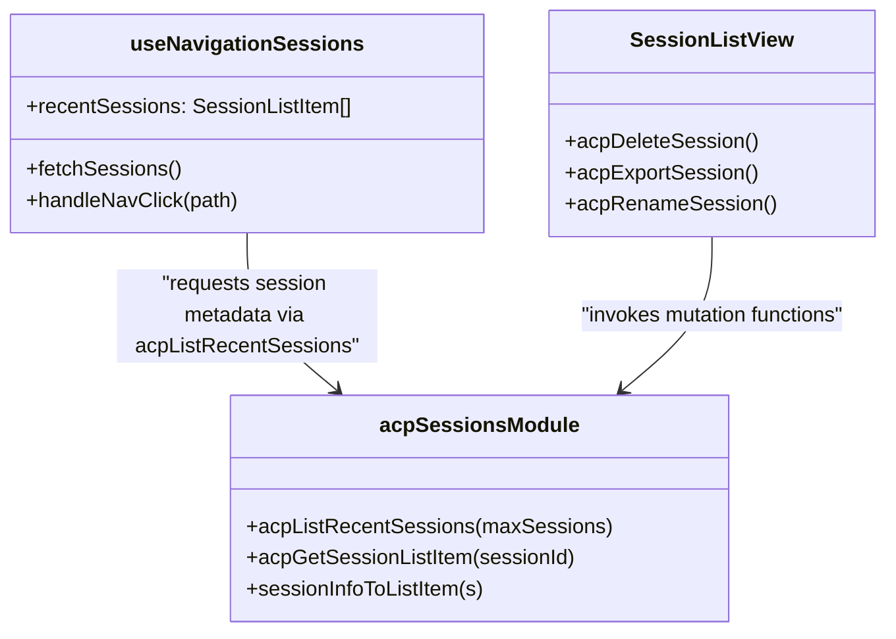
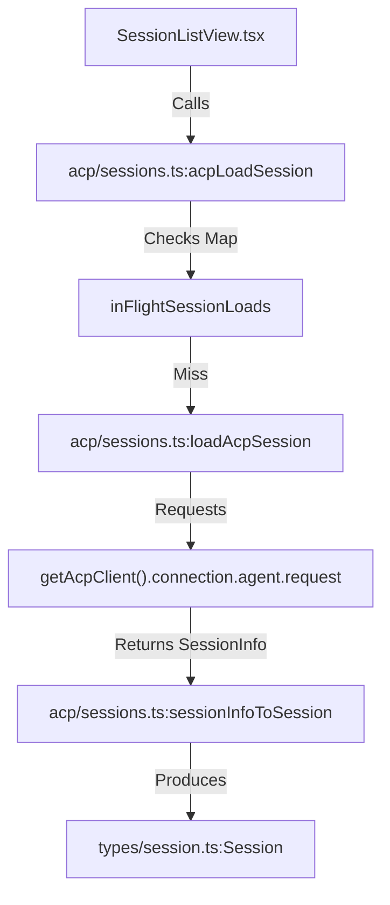

# Session Management UI

Relevant source files

The following files were used as context for generating this wiki page:

- [ui/desktop/src/App.test.tsx](ui/desktop/src/App.test.tsx)
- [ui/desktop/src/__tests__/createSession.test.ts](ui/desktop/src/__tests__/createSession.test.ts)
- [ui/desktop/src/__tests__/createSessionRecipeConsent.test.ts](ui/desktop/src/__tests__/createSessionRecipeConsent.test.ts)
- [ui/desktop/src/__tests__/sessions.test.ts](ui/desktop/src/__tests__/sessions.test.ts)
- [ui/desktop/src/acp/__tests__/chatSessionController.test.ts](ui/desktop/src/acp/__tests__/chatSessionController.test.ts)
- [ui/desktop/src/acp/__tests__/sessions.test.ts](ui/desktop/src/acp/__tests__/sessions.test.ts)
- [ui/desktop/src/acp/chatSessionController.ts](ui/desktop/src/acp/chatSessionController.ts)
- [ui/desktop/src/acp/config.ts](ui/desktop/src/acp/config.ts)
- [ui/desktop/src/acp/errors.ts](ui/desktop/src/acp/errors.ts)
- [ui/desktop/src/acp/sessions.ts](ui/desktop/src/acp/sessions.ts)
- [ui/desktop/src/components/ChatSessionsContainer.tsx](ui/desktop/src/components/ChatSessionsContainer.tsx)
- [ui/desktop/src/components/Hub.test.tsx](ui/desktop/src/components/Hub.test.tsx)
- [ui/desktop/src/components/Hub.tsx](ui/desktop/src/components/Hub.tsx)
- [ui/desktop/src/components/Layout/AppLayout.tsx](ui/desktop/src/components/Layout/AppLayout.tsx)
- [ui/desktop/src/components/Layout/NavigationPanel.tsx](ui/desktop/src/components/Layout/NavigationPanel.tsx)
- [ui/desktop/src/components/RecipeConsentModalContainer.tsx](ui/desktop/src/components/RecipeConsentModalContainer.tsx)
- [ui/desktop/src/components/SessionActionsHeader.tsx](ui/desktop/src/components/SessionActionsHeader.tsx)
- [ui/desktop/src/components/apps/StandaloneAppView.tsx](ui/desktop/src/components/apps/StandaloneAppView.tsx)
- [ui/desktop/src/components/sessions/SessionListView.tsx](ui/desktop/src/components/sessions/SessionListView.tsx)
- [ui/desktop/src/components/settings/extensions/modal/EnvVarsSection.tsx](ui/desktop/src/components/settings/extensions/modal/EnvVarsSection.tsx)
- [ui/desktop/src/components/settings/extensions/modal/ExtensionModal.test.tsx](ui/desktop/src/components/settings/extensions/modal/ExtensionModal.test.tsx)
- [ui/desktop/src/components/settings/extensions/modal/ExtensionModal.tsx](ui/desktop/src/components/settings/extensions/modal/ExtensionModal.tsx)
- [ui/desktop/src/components/settings/extensions/modal/HeadersSection.tsx](ui/desktop/src/components/settings/extensions/modal/HeadersSection.tsx)
- [ui/desktop/src/hooks/useNavigationSessions.ts](ui/desktop/src/hooks/useNavigationSessions.ts)
- [ui/desktop/src/recipe/consent.test.ts](ui/desktop/src/recipe/consent.test.ts)
- [ui/desktop/src/recipe/consent.ts](ui/desktop/src/recipe/consent.ts)
- [ui/desktop/src/sessions.ts](ui/desktop/src/sessions.ts)
- [ui/desktop/src/utils/navigationUtils.ts](ui/desktop/src/utils/navigationUtils.ts)
- [ui/desktop/src/utils/timeUtils.test.ts](ui/desktop/src/utils/timeUtils.test.ts)
- [ui/desktop/src/utils/timeUtils.ts](ui/desktop/src/utils/timeUtils.ts)

## Purpose and Scope

This section covers the session management UI subsystem within the Goose Desktop Electron application. It details the implementation of session lists (`SessionListView`), sidebar navigation and synchronization (`useNavigationSessions`), session creation and resumption utilities (`sessions.ts`, `acp/sessions.ts`), and the persistent bottom menu controls including the working directory switcher (`DirSwitcher`), alert popovers (`BottomMenuAlertPopover`, `AlertBox`), and model/inference configuration bars (`ModelsBottomBar`).

Sources: [ui/desktop/src/components/sessions/SessionListView.tsx:1-62](), [ui/desktop/src/sessions.ts:1-80](), [ui/desktop/src/hooks/useNavigationSessions.ts:1-60]()

---

## Session Organization and Navigation

The UI organizes conversation history through the navigation sidebar, hub view, and the searchable `SessionListView`.

*   **Navigation Sidebar (`NavigationPanel`)**: Renders recent sessions grouped by project or date, supporting inline renaming and status indicators via `useNavigationSessions` [ui/desktop/src/hooks/useNavigationSessions.ts:63-67]().
*   **Session List View (`SessionListView`)**: Provides a searchable list of past conversations with support for duplicate/forking, deletion, renaming, exporting in JSON or Markdown, and Nostr encrypted share link generation [ui/desktop/src/components/sessions/SessionListView.tsx:149-159]().

### Data Flow: Session Navigation and Creation

When a user initializes a new session via `startNewSession`, the application creates an ACP session, dispatches an `AppEvents.SESSION_CREATED` window event, updates the active session map, and transitions the view to the `pair` route [ui/desktop/src/sessions.ts:141-173]().

Title: Session Navigation and Creation Data Flow

Sources: [ui/desktop/src/sessions.ts:141-173](), [ui/desktop/src/hooks/useNavigationSessions.ts:116-145](), [ui/desktop/src/components/sessions/SessionListView.tsx:1-62]()

---

## Real-time Session State and Rendering

### Session Display Naming Logic
Session names are resolved dynamically via `getSessionDisplayName(session)` [ui/desktop/src/sessions.ts:17-25](). It checks whether a user has explicitly set a custom name (`session.user_set_name`), falls back to any associated recipe title (`session.recipe?.title`), and otherwise defaults to the session's internal name.

### State Synchronization and Polling
The `useNavigationSessions` hook maintains consistency between the sidebar and the backend using a combination of event listeners and short-term polling [ui/desktop/src/hooks/useNavigationSessions.ts:113-145](). When `AppEvents.SESSION_CREATED` fires, the hook prepends the new session item and polls `acpListRecentSessions` at 300ms intervals for up to 10 seconds to capture background metadata updates [ui/desktop/src/hooks/useNavigationSessions.ts:125-145]().

Title: Code Entity Map - Session State Synchronization

Sources: [ui/desktop/src/hooks/useNavigationSessions.ts:57-199](), [ui/desktop/src/acp/sessions.ts:168-184](), [ui/desktop/src/components/sessions/SessionListView.tsx:48-56]()

---

## Bottom Menu and Session Controls

The bottom menu provides persistent access to workspace controls, alerts, model configuration, and resource tracking.

### Directory Switcher (`DirSwitcher`)
`DirSwitcher` allows users to view and modify the current working directory (`workingDir`) for a session.
*   It fetches recent directories via `window.electron.listRecentDirs()` and Git worktrees via `window.electron.listGitWorktreeDirs(workingDir)`.
*   Changing a directory triggers `onWorkingDirChange` and records the new path in recent directories.

### Alert System and Context Management
`BottomMenuAlertPopover` and `AlertBox` manage runtime warnings, errors, and automated context compaction thresholds.
*   **Auto-Compaction Threshold**: Users can interactively edit the `GOOSE_AUTO_COMPACT_THRESHOLD` configuration value (stored as a percentage from 1% to 100%) directly inside the alert popover.
*   **Alert Types**: Categorized via the `AlertType` enum into `Error`, `Warning`, and `Info`.

### Model Selector (`ModelsBottomBar`)
`ModelsBottomBar` displays the active model and provider configuration, offering quick access to model switching modals and local inference settings. It tracks recent models via electron settings (`window.electron.getSetting('recentModels')`) and resolves provider default metadata.

Sources: [ui/desktop/src/components/Hub.tsx:19-20](), [ui/desktop/src/components/Hub.tsx:138-141]()

---

## Session Lifecycle (ACP Layer)

The desktop UI interfaces with the Rust agent via the Agent Client Protocol (ACP) wrapper module located at `ui/desktop/src/acp/sessions.ts`.

### Idempotent Session Loading
To prevent race conditions during rapid session switching, `acpLoadSession` checks an in-flight request map (`inFlightSessionLoads`). If a load for a given `sessionId` is already executing, it returns the existing promise rather than initiating duplicate requests [ui/desktop/src/acp/sessions.ts:186-201]().

### Session Serialization & Mapping
`sessionInfoToSession` and `sessionInfoToListItem` translate raw `SessionInfo` structs returned by the ACP agent into strongly typed frontend `Session` and `SessionListItem` objects [ui/desktop/src/acp/sessions.ts:84-134]().

Title: Code Entity Map - ACP Session Lifecycle

Sources: [ui/desktop/src/acp/sessions.ts:64-114](), [ui/desktop/src/acp/sessions.ts:186-213]()