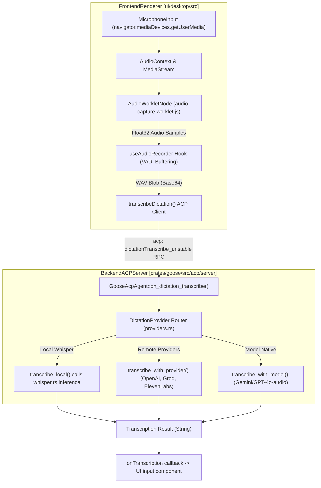
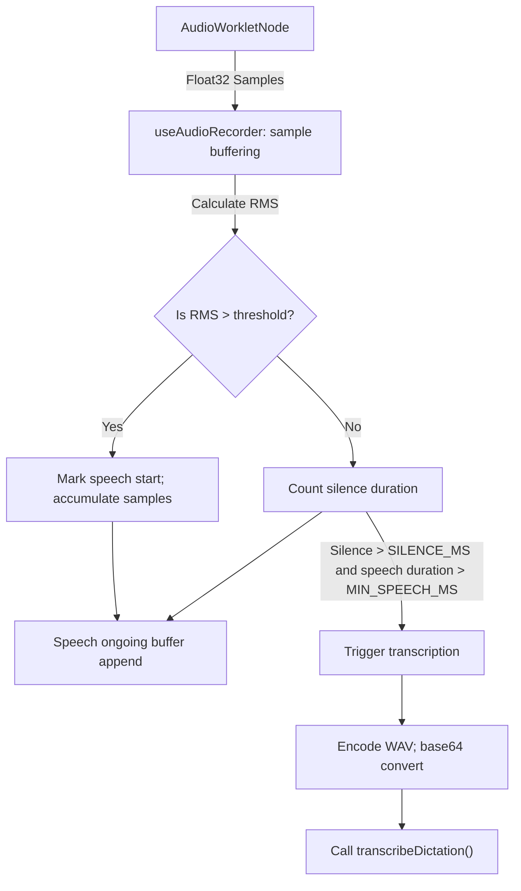
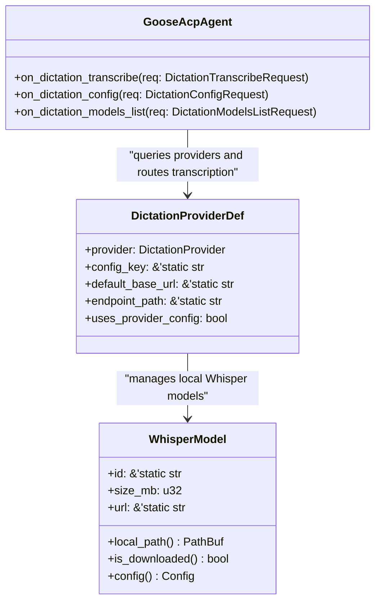
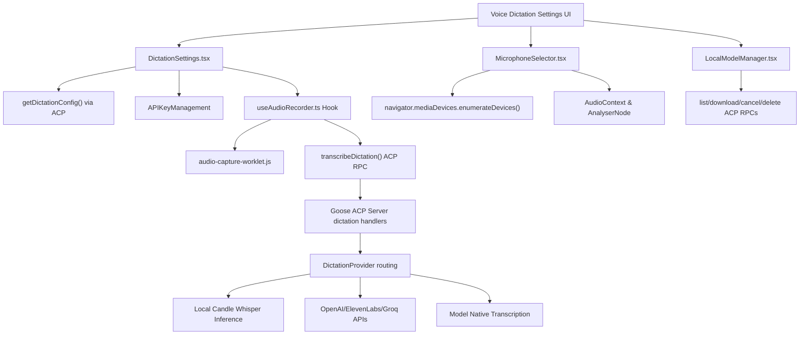

# Voice Dictation & Audio

Relevant source files

The following files were used as context for generating this wiki page:

- [crates/goose/src/dictation/providers.rs](crates/goose/src/dictation/providers.rs)
- [crates/goose/src/dictation/whisper.rs](crates/goose/src/dictation/whisper.rs)
- [ui/desktop/public/audio-capture-worklet.js](ui/desktop/public/audio-capture-worklet.js)
- [ui/desktop/src/acp/dictation.ts](ui/desktop/src/acp/dictation.ts)
- [ui/desktop/src/acp/sources.ts](ui/desktop/src/acp/sources.ts)
- [ui/desktop/src/components/Layout/NavigationContext.tsx](ui/desktop/src/components/Layout/NavigationContext.tsx)
- [ui/desktop/src/components/context_management/CreditsExhaustedNotification.tsx](ui/desktop/src/components/context_management/CreditsExhaustedNotification.tsx)
- [ui/desktop/src/components/context_management/SystemNotificationInline.tsx](ui/desktop/src/components/context_management/SystemNotificationInline.tsx)
- [ui/desktop/src/components/settings/dictation/DictationSettings.tsx](ui/desktop/src/components/settings/dictation/DictationSettings.tsx)
- [ui/desktop/src/components/settings/dictation/LocalModelManager.tsx](ui/desktop/src/components/settings/dictation/LocalModelManager.tsx)
- [ui/desktop/src/components/settings/dictation/MicrophoneSelector.test.tsx](ui/desktop/src/components/settings/dictation/MicrophoneSelector.test.tsx)
- [ui/desktop/src/components/settings/dictation/MicrophoneSelector.tsx](ui/desktop/src/components/settings/dictation/MicrophoneSelector.tsx)
- [ui/desktop/src/components/skills/SkillsView.tsx](ui/desktop/src/components/skills/SkillsView.tsx)
- [ui/desktop/src/hooks/useAudioRecorder.test.tsx](ui/desktop/src/hooks/useAudioRecorder.test.tsx)
- [ui/desktop/src/hooks/useAudioRecorder.ts](ui/desktop/src/hooks/useAudioRecorder.ts)
- [ui/desktop/src/types/dictation.ts](ui/desktop/src/types/dictation.ts)
- [ui/desktop/src/updates.ts](ui/desktop/src/updates.ts)

## Purpose and Scope

The voice dictation subsystem in Goose enables users to interact with the agent using spoken language. It provides an end-to-end audio pipeline encompassing frontend microphone capture, Voice Activity Detection (VAD) via an `AudioWorklet`, client-side WAV encoding, asynchronous ACP transport, and backend transcription supporting remote services (OpenAI, ElevenLabs, Groq), active model-native audio input, and local quantized Whisper models powered by the Candle machine learning framework.

---

## Architecture & Data Flow

The audio pipeline spans the Electron desktop frontend (`ui/desktop/src/hooks/useAudioRecorder.ts` and `ui/desktop/src/acp/dictation.ts`) and the Rust ACP server (`crates/goose/src/acp/server/dictation.rs`). Audio captured in the browser is processed into chunks, converted to base64-encoded WAV, and transmitted via ACP custom JSON-RPC requests to the backend. Transcription occurs via configured dictation providers, which may be remote APIs, local model inference, or model-native audio input.

### Audio Pipeline: Microphone to Text

Sources: [ui/desktop/src/hooks/useAudioRecorder.ts:108-200](), [ui/desktop/src/acp/dictation.ts:20-28](), [crates/goose/src/acp/server/dictation.rs:19-94](), [crates/goose/src/dictation/providers.rs:37-45]()

---

## Frontend Audio Capture & VAD

Voice recording and preprocessing happen in the frontend React hook `useAudioRecorder` [ui/desktop/src/hooks/useAudioRecorder.ts:108-200](). This hook manages the microphone access, processes raw audio samples, performs voice activity detection (VAD), and dispatches audio in manageable chunks for transcription.

### Key Implementation Details

- **Audio Input Source**: Uses `navigator.mediaDevices.getUserMedia` to request an audio stream at 16kHz sample rate.
- **AudioWorklet**: An off-main-thread `AudioWorkletNode` implemented in `audio-capture-worklet.js` captures raw PCM `Float32Array` samples from the microphone, passing them to the hook via `onmessage`.
- **Voice Activity Detection (VAD)**:
  - Uses Root Mean Square (RMS) energy thresholding to detect speech (threshold ~0.015).
  - Parameters: 
    - `SILENCE_MS` (800ms silence ends utterance)
    - `MIN_SPEECH_MS` (200ms minimum utterance length)
  - Samples are buffered and once silence after speech is detected, bundling occurs to send them for transcription.
- **WAV Encoding**: Buffers of float samples are encoded into 16-bit mono PCM WAV format using `encodeWav()`, creating a base64 blob suitable for API transmission.
- **Transcription Calls**: The encoded base64 WAV is sent to `transcribeDictation()`, which uses ACP RPC calls to the backend.

### VAD and Audio Chunk Flow Diagram

Sources: [ui/desktop/src/hooks/useAudioRecorder.ts:1-200](), [ui/desktop/public/audio-capture-worklet.js:1-12]()

---

## Backend Transcription & Provider Integration

Transcription backends are orchestrated in Rust within `crates/goose/src/dictation/providers.rs`. The core enum `DictationProvider` and accompanying struct `DictationProviderDef` define each supported transcription source, including local and remote options.

### Supported Dictation Providers Overview

| Provider            | Enum Variant               | Config Key              | Endpoint / Remarks                                      |
|---------------------|----------------------------|-------------------------|--------------------------------------------------------|
| OpenAI              | `DictationProvider::OpenAI` | `OPENAI_API_KEY`         | `https://api.openai.com/v1/audio/transcriptions`       |
| Groq                | `DictationProvider::Groq`   | `GROQ_API_KEY`           | `https://api.groq.com/openai/v1/audio/transcriptions`  |
| ElevenLabs          | `DictationProvider::ElevenLabs` | `ELEVENLABS_API_KEY`     | `https://api.elevenlabs.io/v1/speech-to-text`           |
| Local Whisper       | `DictationProvider::Local`  | `LOCAL_WHISPER_MODEL`    | Local quantized GGUF model inference via Candle ML      |
| Model Native Audio  | `DictationProvider::ModelNative` | N/A                     | Uses the active chat model if it supports native audio  |

These providers can be enumerated and checked for configuration readiness dynamically with helper functions in `providers.rs` [crates/goose/src/dictation/providers.rs:37-170]().

### Local Whisper Inference

Under the `local-inference` feature flag, Goose supports local transcription using OpenAI's Whisper models quantized into GGUF format and run via the `candle` ML framework (Rust). This is implemented in `crates/goose/src/dictation/whisper.rs`.

- Supports multiple model sizes: 
  - `"tiny"` (40 MB), `"base"` (78 MB), `"small"` (247 MB), `"medium"` (777 MB).
- Model metadata includes size, download URL (HuggingFace), description, and runtime config parameters for the Transformer model architecture.
- Model files are downloaded and stored locally (under Goose's data directory).
- Model loading and inference are cached behind a global mutex `LOCAL_TRANSCRIBER` to optimize repeated transcriptions.
- Audio format conversion, token suppression, and decoding inference follow the Candle Whisper example design [crates/goose/src/dictation/whisper.rs:1-180](), [crates/goose/src/dictation/providers.rs:27-30]().

### Provider Routing

When a dictation request arrives via ACP RPC, the Goose ACP server dispatches transcription to:
- `transcribe_local` for the `Local` provider.
- `transcribe_with_provider` for remote API providers (OpenAI, Groq, ElevenLabs).
- `transcribe_with_model` for active chat model native transcription.

---

### Code Entity to Natural Language Association

Sources: [crates/goose/src/acp/server/dictation.rs:19-170](), [crates/goose/src/dictation/providers.rs:47-128](), [crates/goose/src/dictation/whisper.rs:52-95]()

---

## ACP Dictation Request Protocol

Communication between the desktop application and the Goose backend uses ACP JSON-RPC calls implemented in `ui/desktop/src/acp/dictation.ts` and handled in `crates/goose/src/acp/server/dictation.rs`.

### Key ACP RPC Methods

- `dictationConfig_unstable`: Retrieves current dictation provider statuses, including configuration readiness and model selections [crates/goose/src/acp/server/dictation.rs:96-140]().

- `dictationTranscribe_unstable`: Receives base64-encoded audio and dispatches transcription based on the selected provider. It validates mime-types and payload sizes (~50MB max) then routes to respective backend handlers [crates/goose/src/acp/server/dictation.rs:19-94]().

- Model management RPCs:
  - `dictationModelsList_unstable`: Lists available local Whisper models.
  - `dictationModelsDownload_unstable`: Initiates model downloads.
  - `dictationModelsDownloadProgress_unstable`: Monitors download progress.
  - `dictationModelsCancel_unstable`: Cancels current model downloads.
  - `dictationModelsDelete_unstable`: Deletes a local model.

These enable the frontend to manage Whisper model lifecycle seamlessly [ui/desktop/src/acp/dictation.ts:14-57](), [crates/goose/src/acp/server/dictation.rs:141-170]().

---

## Settings & UI Components

### DictationSettings Component

Located at `ui/desktop/src/components/settings/dictation/DictationSettings.tsx`, this React component offers user control over voice dictation:

- Dropdown for selecting the dictation provider (from those allowed and configured).
- API key management UI for remote providers requiring authentication.
- Integration with the local model manager link for downloading and selecting Whisper models.
- Updates settings reactively and reports usage analytics [ui/desktop/src/components/settings/dictation/DictationSettings.tsx:85-197]().

### MicrophoneSelector Component

At `ui/desktop/src/components/settings/dictation/MicrophoneSelector.tsx`, this component:

- Enumerates all available system audio input devices (`audioinput`) via `navigator.mediaDevices.enumerateDevices`.
- Offers permission requests to access audio devices.
- Provides UI to select preferred microphone for dictation.
- Includes a microphone test feature with VU meter powered by `AudioContext`'s `AnalyserNode`.
- Manages device changes and permission state with reactive hooks [ui/desktop/src/components/settings/dictation/MicrophoneSelector.tsx:63-175]().

### LocalModelManager Component

The `LocalModelManager` in `ui/desktop/src/components/settings/dictation/LocalModelManager.tsx` manages the lifecycle of local Whisper models:

- Displays downloaded models with metadata such as size and recommended status.
- Provides download start, cancel, and delete controls.
- Queries status and progress via ACP RPC methods to keep UI state updated.
- Enables model selection, which updates the global config key `LOCAL_WHISPER_MODEL`.
- Displays notes regarding GPU acceleration support (CUDA/Metal) [ui/desktop/src/components/settings/dictation/LocalModelManager.tsx:1-207]().

---

## Summary Diagram of UI Components and Data Flow

Sources: Combines [ui/desktop/src/components/settings/dictation/DictationSettings.tsx:1-197](), [ui/desktop/src/components/settings/dictation/MicrophoneSelector.tsx:1-175](), [ui/desktop/src/hooks/useAudioRecorder.ts:1-200](), [ui/desktop/src/acp/dictation.ts:1-57](), [crates/goose/src/dictation/providers.rs:1-183](), [crates/goose/src/dictation/whisper.rs:1-180]()

---

# References

- Frontend audio hook and VAD: `ui/desktop/src/hooks/useAudioRecorder.ts`
- Audio capture Worklet: `ui/desktop/public/audio-capture-worklet.js`
- ACP dictation client helpers: `ui/desktop/src/acp/dictation.ts`
- Dictation providers and backend routing: `crates/goose/src/dictation/providers.rs`
- Local Whisper model inference: `crates/goose/src/dictation/whisper.rs`
- ACP server dictation handlers: `crates/goose/src/acp/server/dictation.rs`
- Dictation settings UI: `ui/desktop/src/components/settings/dictation/DictationSettings.tsx`
- Microphone selector UI: `ui/desktop/src/components/settings/dictation/MicrophoneSelector.tsx`
- Local model manager UI: `ui/desktop/src/components/settings/dictation/LocalModelManager.tsx`

---

This page covers the full voice dictation and audio subsystem from audio capture and transformation, through backend transcription provider routing, to user configuration and integration in the Goose desktop application.