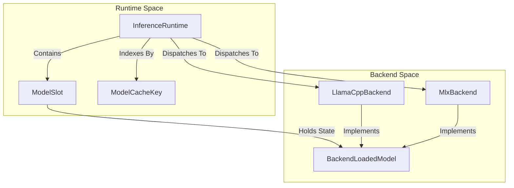
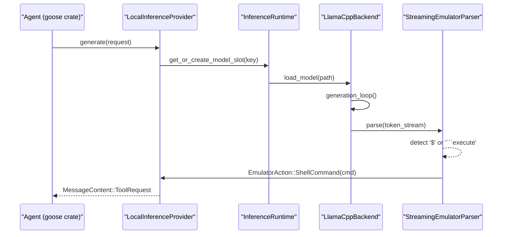
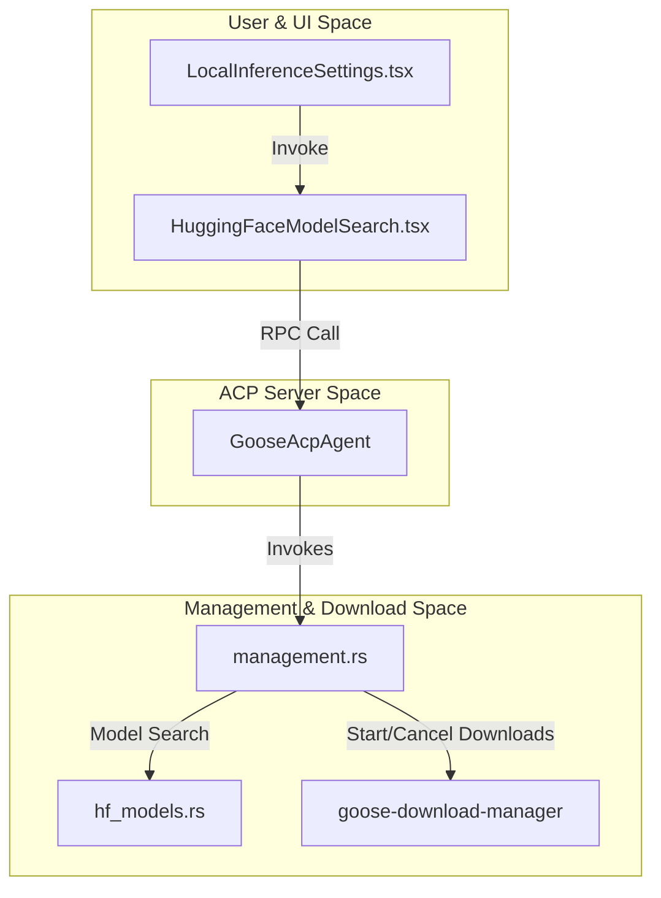
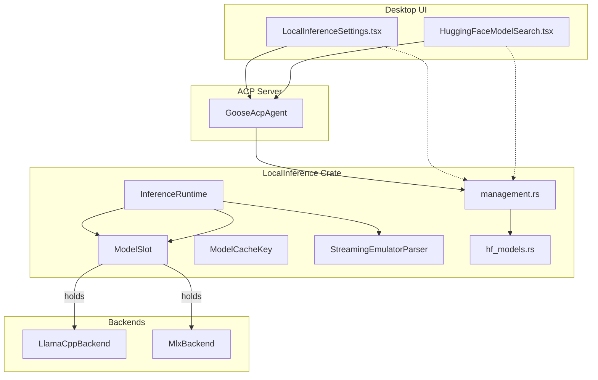

# Local Inference & Model Management

<details>
<summary>Relevant source files</summary>

The following files were used as context for generating this wiki page:

- [crates/goose-agent/Cargo.toml](crates/goose-agent/Cargo.toml)
- [crates/goose-context-management/Cargo.toml](crates/goose-context-management/Cargo.toml)
- [crates/goose-download-manager/Cargo.toml](crates/goose-download-manager/Cargo.toml)
- [crates/goose-local-inference/Cargo.toml](crates/goose-local-inference/Cargo.toml)
- [crates/goose-provider-types/Cargo.toml](crates/goose-provider-types/Cargo.toml)
- [crates/goose-providers/Cargo.toml](crates/goose-providers/Cargo.toml)
- [crates/goose-sdk-types/Cargo.toml](crates/goose-sdk-types/Cargo.toml)
- [crates/goose-sdk/Cargo.toml](crates/goose-sdk/Cargo.toml)
- [crates/goose-sdk/python/pyproject.toml](crates/goose-sdk/python/pyproject.toml)
- [documentation/blog/2025-03-31-goose-benchmark/index.md](documentation/blog/2025-03-31-goose-benchmark/index.md)
- [documentation/blog/2025-12-19-goose-mobile-terminal/index.md](documentation/blog/2025-12-19-goose-mobile-terminal/index.md)
- [documentation/blog/2025-12-19-goose-mobile-terminal/mobile_shots.png](documentation/blog/2025-12-19-goose-mobile-terminal/mobile_shots.png)
- [documentation/blog/2025-12-19-goose-mobile-terminal/shell.png](documentation/blog/2025-12-19-goose-mobile-terminal/shell.png)
- [documentation/docs/assets/guides/interactive-loop.png](documentation/docs/assets/guides/interactive-loop.png)
- [documentation/docs/experimental/_category_.json](documentation/docs/experimental/_category_.json)
- [documentation/docs/experimental/goose-mobile.md](documentation/docs/experimental/goose-mobile.md)
- [documentation/docs/experimental/index.md](documentation/docs/experimental/index.md)
- [documentation/docs/experimental/mobile-access.md](documentation/docs/experimental/mobile-access.md)
- [documentation/docs/experimental/ollama.md](documentation/docs/experimental/ollama.md)
- [documentation/docs/experimental/remote-access/index.md](documentation/docs/experimental/remote-access/index.md)
- [documentation/docs/experimental/remote-access/mobile-access.md](documentation/docs/experimental/remote-access/mobile-access.md)
- [documentation/docs/experimental/remote-access/telegram-gateway.md](documentation/docs/experimental/remote-access/telegram-gateway.md)
- [documentation/docs/experimental/vs-code-extension.md](documentation/docs/experimental/vs-code-extension.md)
- [documentation/docs/goose-architecture/extensions-design.md](documentation/docs/goose-architecture/extensions-design.md)
- [documentation/docs/goose-architecture/goose-architecture.md](documentation/docs/goose-architecture/goose-architecture.md)
- [documentation/docs/guides/tool-shim.md](documentation/docs/guides/tool-shim.md)
- [documentation/docs/mcp/vs-code-mcp.md](documentation/docs/mcp/vs-code-mcp.md)
- [documentation/src/data/gdk-api.json](documentation/src/data/gdk-api.json)

</details>


Goose provides a comprehensive system for local model execution and decentralized inference through the `goose-local-inference` crate. This architecture enables users to run models on their own hardware using efficient backends like `llama-cpp-2` and `safemlx` (MLX), emulate tool calls for models lacking native support, discover and manage models from HuggingFace, and integrate these capabilities seamlessly into the desktop UI and ACP protocol handlers.

---

## 1. Inference Runtime & Crate Architecture

The `goose-local-inference` crate houses the core components enabling local execution of models [crates/goose-local-inference/src/lib.rs:1-130](). Central to this is the `InferenceRuntime` singleton, responsible for loading and managing active model instances, caching, and concurrency control [crates/goose-local-inference/src/lib.rs:95-109]().

Key abstractions include:

- **InferenceRuntime**: Manages lifecycle of models, concurrency, caching, and backend dispatch.
- **ModelCacheKey**: Uniquely identifies models in the cache via parameters like path, format, and backend.
- **ModelSlot**: Represents a loaded model instance, holding runtime state.
- **BackendLoadedModel**: An abstraction implemented by specific backend model loaders (e.g., LlamaCpp, MLX).

The layered architecture partitions concerns between runtime management and backend-specific execution:



*Figure 1: Relationship between Inference runtime management entities and backends.*

Sources: [crates/goose-local-inference/src/lib.rs:88-129](), [crates/goose-local-inference/src/backend.rs:1-50]()

---

## 2. Execution Backends: `llama-cpp-2` and `safemlx` (MLX)

Local inference supports multiple backends optimized for different hardware and weight formats:

- **LlamaCppBackend**  
  Implements execution of GGUF-format LLaMA-family models using the `llama-cpp-2` Rust bindings. It supports features like sharded models, memory mapping, CUDA/Vulkan acceleration, and CPU-only modes [crates/goose-local-inference/src/lib.rs:38-39](), [crates/goose-local-inference/src/backend.rs:25-50]().
  
- **MlxBackend (safemlx based)**  
  Supports MLX models stored as directories of safetensors files optimized for Apple Silicon. The backend ensures snapshot integrity and completeness before loading [crates/goose-local-inference/src/mlx.rs:15-81](). It supports validation of snapshots, weight file mapping, and GPU pooling experiments [crates/goose-local-inference/src/mlx.rs:87-126]().

This flexibility allows Goose to run models locally across common platforms with optimized performance.

Sources: [crates/goose-local-inference/src/lib.rs:38-40](), [crates/goose-local-inference/src/mlx.rs:15-81]()

---

## 3. Tool Emulation for Local Models

Many local models do not yet support native tool calling protocols. To bridge this gap, Goose uses a text-based tool emulation layer called `StreamingEmulatorParser` [crates/goose-local-inference/src/tool_emulation.rs:1-152]().

- The parser consumes text tokens from local model output and detects embedded tool call markers.
- **Shell command emulation:** Lines starting with `$` indicate shell commands to run [crates/goose-local-inference/src/llamacpp/inference_emulated_tools.rs:11-15]().
- **Code execution:** Code blocks fenced with ```execute_typescript``` are interpreted as code to execute [crates/goose-local-inference/src/llamacpp/inference_emulated_tools.rs:16-19]().
- Specialized system prompt templates for small models (eg. tiny local models) are loaded to guide the formatting and behavior of tool calls [crates/goose-local-inference/src/llamacpp/inference_emulated_tools.rs:39-69]().

The flow from an agent's generation request to tool emulation is:



*Figure 2: Flow from agent request through runtime to emulator tool calls.*

Sources: [crates/goose-local-inference/src/tool_emulation.rs:1-152](), [crates/goose-local-inference/src/llamacpp/inference_emulated_tools.rs:39-69]()

---

## 4. Download Manager and HuggingFace Model Discovery

To support model acquisition, Goose integrates the `goose-download-manager` crate for asynchronous, cancellable downloads of weights and metadata. This is tightly integrated with the local inference crate and desktop UI [crates/goose-local-inference/src/lib.rs:2-3](), [crates/goose-download-manager/src/lib.rs:1-20]().

### HuggingFace Model Discovery & Quantization

- The `hf_models` module parses HuggingFace model metadata for quantization formats, supporting tags like `Q4_K_M` and `IQ4_NL` from multiple naming schemes [crates/goose-local-inference/src/hf_models.rs:103-127]().
- Filename parsing for GGUF weights is validated in dedicated tests [crates/goose-local-inference/tests/gguf_filename_parsing.rs:1-35]().
- Management functions include `list_models`, `search_huggingface_models`, and `download_model` with support for cancellation tokens for responsive UI integration [crates/goose-local-inference/src/management.rs:37-173]().

### Integration Diagram for UI and ACP Server



*Figure 3: Interaction between UI components, ACP server handlers, model management, and download manager.*

Sources: [crates/goose-local-inference/src/management.rs:37-173](), [crates/goose-local-inference/src/hf_models.rs:103-127](), [ui/desktop/src/components/settings/localInference/LocalInferenceSettings.tsx:112-193](), [ui/desktop/src/components/settings/localInference/HuggingFaceModelSearch.tsx:105-184]()

---

## 5. ACP Server Integration & Desktop UI Components

Local inference capabilities are exposed via ACP server handlers for external clients and integrated into the desktop settings UI:

- **ACP Handlers**  
  The `GooseAcpAgent` includes handlers for listing models, downloading models, and searching HuggingFace repositories [crates/goose/src/acp/server/local_inference.rs:9-190](). These handlers call into the `management` module to fulfill requests.

- **Desktop UI: LocalInferenceSettings**  
  Displays local models with detailed UI elements including vision model badges (`mmprojStatus`), eviction buttons, and download progress bars. It leverages hooks to stay in sync with download manager state [ui/desktop/src/components/settings/localInference/LocalInferenceSettings.tsx:112-193]().

- **Desktop UI: HuggingFaceModelSearch**  
  Implements debounced input searching, memory limit/status checks to protect hardware, and expansions of variants for user selections [ui/desktop/src/components/settings/localInference/HuggingFaceModelSearch.tsx:105-184]().

This integration enables smooth workflows for local model setup and management via UI and ACP clients.

Sources: [crates/goose/src/acp/server/local_inference.rs:9-190](), [ui/desktop/src/components/settings/localInference/LocalInferenceSettings.tsx:112-193](), [ui/desktop/src/components/settings/localInference/HuggingFaceModelSearch.tsx:105-184]()

---

## 6. Configuration & Settings Storage

Goose maintains persistent configuration of local inference parameters in the global configuration store under the key `GOOSE_LOCAL_MODEL_SETTINGS` [crates/goose/src/providers/local_inference.rs:10-49]().

- **Model Settings Resolution**  
  The functions `resolve_model_settings` and `write_model_settings` read and update stored settings such as temperature, context length, and tool call mode, keyed by model ID [crates/goose/src/providers/local_inference.rs:26-49]().

- **Provider Integration**  
  `LocalInferenceProvider::from_env` uses these resolvers to load configurable parameters on creation, ensuring local models respect user overrides and session state [crates/goose/src/providers/local_inference.rs:51-76]().

This allows users fine-grained control over local model execution parameters persisted across sessions.

Sources: [crates/goose/src/providers/local_inference.rs:1-76]()

---

# Summary

The local inference and model management subsystem in Goose tightly integrates high-performance local model execution backends (`llama-cpp-2`, `safemlx`), tool emulation for models without native support, and HuggingFace-discovered model management. Users interact with this system primarily via the desktop UI's local inference settings panels and ACP clients, while the underlying `InferenceRuntime` manages concurrency and model state.

Experimental features like mesh/GPU pooling with MLX backend and advanced tool-shim emulation models augment this subsystem, offering promising future avenues.

---

# Appendix: Key Code Entities and Relationships



*Figure 4: Summary diagram linking local inference internals, backends, ACP server, and UI components.*

Sources: Entire page citations

---

# References

- `crates/goose-local-inference/src/lib.rs:1-130`  
- `crates/goose-local-inference/src/backend.rs:1-66`  
- `crates/goose-local-inference/src/mlx.rs:15-126`  
- `crates/goose-local-inference/src/tool_emulation.rs:1-152`  
- `crates/goose-local-inference/src/llamacpp/inference_emulated_tools.rs:11-69`  
- `crates/goose-local-inference/src/hf_models.rs:103-127`  
- `crates/goose-local-inference/src/management.rs:37-173`  
- `crates/goose/src/acp/server/local_inference.rs:9-190`  
- `crates/goose/src/providers/local_inference.rs:1-76`  
- `ui/desktop/src/components/settings/localInference/LocalInferenceSettings.tsx:112-193`  
- `ui/desktop/src/components/settings/localInference/HuggingFaceModelSearch.tsx:105-184`