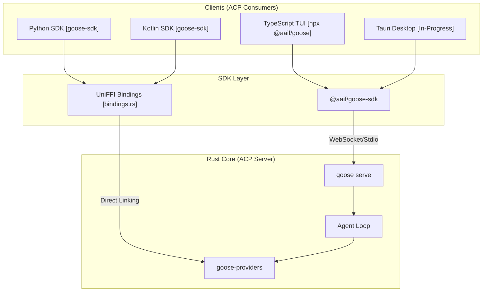
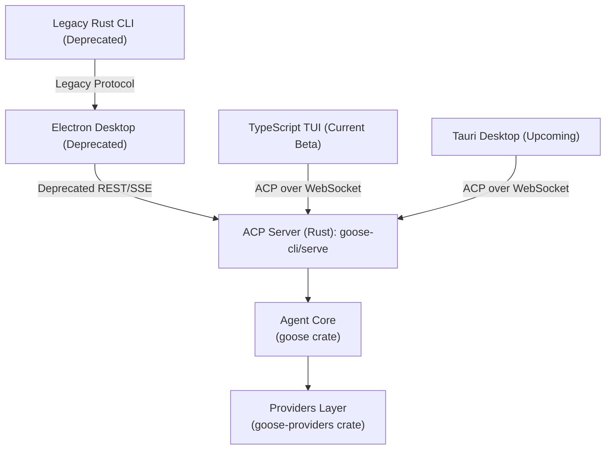
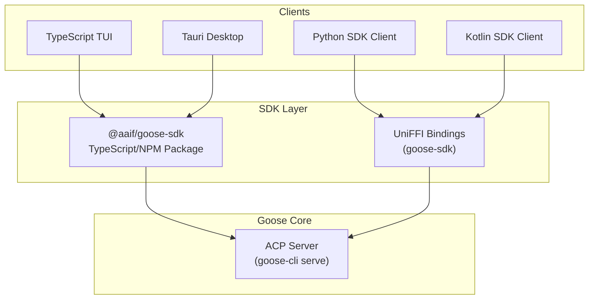

# Goose 2.0 & Future Architecture

<details>
<summary>Relevant source files</summary>

The following files were used as context for generating this wiki page:

- [.github/CODEOWNERS](.github/CODEOWNERS)
- [crates/goose-provider-types/src/base.rs](crates/goose-provider-types/src/base.rs)
- [crates/goose-provider-types/tests/declared_model.rs](crates/goose-provider-types/tests/declared_model.rs)
- [crates/goose-providers/src/azure_foundry.rs](crates/goose-providers/src/azure_foundry.rs)
- [crates/goose-providers/tests/declared_vision.rs](crates/goose-providers/tests/declared_vision.rs)
- [crates/goose/src/acp/mod.rs](crates/goose/src/acp/mod.rs)
- [crates/goose/src/acp/provider.rs](crates/goose/src/acp/provider.rs)
- [crates/goose/tests/declared_vision_registry.rs](crates/goose/tests/declared_vision_registry.rs)
- [documentation/blog/2025-04-01-top-5-mcp-servers/index.mdx](documentation/blog/2025-04-01-top-5-mcp-servers/index.mdx)
- [documentation/blog/2025-09-08-turn-any-mcp-server-mcp-ui-compatible/index.mdx](documentation/blog/2025-09-08-turn-any-mcp-server-mcp-ui-compatible/index.mdx)
- [documentation/blog/2026-02-24-goose-grant-goose-in-a-pond/index.md](documentation/blog/2026-02-24-goose-grant-goose-in-a-pond/index.md)
- [documentation/blog/2026-04-07-goose-moves-to-aaif/index.md](documentation/blog/2026-04-07-goose-moves-to-aaif/index.md)
- [documentation/blog/2026-04-08-goose-acp-and-new-tui/TUI.png](documentation/blog/2026-04-08-goose-acp-and-new-tui/TUI.png)
- [documentation/blog/2026-04-08-goose-acp-and-new-tui/index.md](documentation/blog/2026-04-08-goose-acp-and-new-tui/index.md)
- [documentation/docs/troubleshooting/index.mdx](documentation/docs/troubleshooting/index.mdx)
- [documentation/static/img/blog/goose-aaif-foundation.png](documentation/static/img/blog/goose-aaif-foundation.png)
- [goose-self-test.yaml](goose-self-test.yaml)

</details>


Goose 2.0 represents a significant architectural shift toward a unified, **ACP-first (Agent Client Protocol)** design. The goal is to consolidate the disparate Electron desktop app, the legacy Rust CLI, and various language-specific SDKs under a single protocol, enabling a consistent experience across the TypeScript TUI, the upcoming Tauri desktop rewrite, and third-party integrations.

## Architecture Overview

The core of Goose 2.0 is the **ACP Server** hosted within the `goose-cli` crate (via the `serve` command). This server acts as the primary orchestrator, abstracting the complex logic of session management, tool dispatch, and LLM provider interaction behind a standardized JSON-RPC interface.

### Key Architectural Shifts

| Component            | Legacy (1.x)              | Future (2.0)                          |
|----------------------|--------------------------|-------------------------------------|
| **Protocol**         | Custom REST/SSE (`goosed`) | Agent Client Protocol (ACP)          |
| **Desktop Runtime**  | Electron                  | Tauri (In-progress)                  |
| **CLI/TUI**          | Rust (`goose session`)    | TypeScript TUI (`npx @aaif/goose`)  |
| **SDKs**             | Manual/REST               | UniFFI-based (Python/Kotlin)         |

### System Connectivity Diagram

This diagram illustrates how the various 2.0 clients interface with the unified Rust core via ACP and the generated SDKs.



Sources: [documentation/blog/2026-04-08-goose-acp-and-new-tui/index.md:21-40](), [crates/goose-sdk/src/bindings.rs:1-7](), [ui/desktop/README.md:102-108]()

## Removal of the Legacy goose-server Daemon

In the 1.x architecture, the Electron desktop app accessed Goose functionality via the `goosed` daemon, a custom REST + SSE server layer, which abstracted agent operations and session management.

With Goose 2.0, this daemon is **fully removed**. The ACP Server is embedded directly within `goose` and `goose-cli`, providing a streamlined, unified JSON-RPC interface. This eliminates duplicated code paths and synchronization complexities, enabling all clients — terminal, desktop, and SDKs — to leverage the same agent core and provider implementations.

Key benefits of removing `goosed`:

- **Single source of truth** for agent state and sessions.
- Reduced latency, since clients connect directly over ACP transports: stdio, WebSocket, or HTTP.
- Simplified extension and tool dispatching via the ACP server layer.
- Unified security and permission enforcement integrated into the ACP stack.

Sources: [documentation/blog/2026-04-08-goose-acp-and-new-tui/index.md:15-20](), [crates/goose/src/acp/server.rs:1-120]()

## The TypeScript TUI Beta

A major new client for Goose 2.0 is the **TypeScript Terminal UI (TUI)**, installable via:

```bash
npx @aaif/goose
```

This TUI communicates directly with the ACP server via a WebSocket transport, implementing full support for:

- Streaming messages
- Tool invocation and responses
- Syntax-highlighted code blocks rendering
- Markdown support

The TUI is implemented entirely in TypeScript and React, leveraging the generated ACP client (`@aaif/goose-sdk`) for strongly-typed interactions. This design allows rapid iteration and modular UI improvements without recompiling the Rust backend.

### TUI Architecture

- The TUI uses the ACP client to manage session lifecycle events.
- User inputs result in ACP `prompt` requests.
- Streaming responses are rendered incrementally.
- Tool calls initiated by the agent are dispatched via ACP, and results streamed back.

The TUI offers experimental parity with legacy CLI features but is designed for extensibility, with plans for:

- Integrated provider and model selection UIs
- Session management lists with load/resume/export
- MCP feature controls and skill management UI

Sources: [documentation/blog/2026-04-08-goose-acp-and-new-tui/index.md:42-62](), [ui/tui/src/index.tsx:1-50]()

## Planned Desktop Rewrite to Tauri

The current Electron desktop app is undergoing a rewrite to **Tauri**, a Rust + webview based framework that offers:

- Reduced memory footprint compared to Electron
- Closer integration with Rust backend, facilitating direct ACP connections
- Improved desktop startup times and cross-platform parity with native widgets
- Enhanced security via Tauri's sandboxing features and permission model

### Architecture Details

- The Tauri desktop app will unify around the ACP protocol and the underlying `goose serve` backend.
- Communication between the Tauri frontend and Goose core uses a local WebSocket or stdio ACP transport.
- The existing Electron React codebase is being migrated to Tauri's frontend framework, preserving UI continuity.
- Modeled after the TypeScript TUI but enhanced with desktop-specific features like global hotkeys, native file pickers, and drag-drop.

This approach ensures all official Goose clients share the same protocol and backend, dramatically simplifying maintenance and enabling community client creation.

Sources: [documentation/blog/2026-04-08-goose-acp-and-new-tui/index.md:64-68](), [ui/desktop/README.md:40-55]()

## Roadmap for Unified Future

The Goose 2.0 effort is structured into four explicit phases, tracked in GitHub issue #6642:

| Phase                              | Status       | Description                                                                                  |
|-----------------------------------|--------------|----------------------------------------------------------------------------------------------|
| 1. Stabilize ACP Server            | ✅ Completed | The ACP server now supports session persistence, extensions, streaming, and tools.          |
| 2. TypeScript TUI Beta             | 🚧 In progress | The new feature-complete terminal client built on ACP is being iterated as a public beta.   |
| 3. Desktop Rewrite to Tauri       | 🚧 In progress | Replacing the Electron desktop app with a Tauri-based client using the ACP protocol.         |
| 4. Consolidation & Legacy Removal | Planned      | Remove the old `goosed` daemon and the native Rust CLI session logic, unifying architecture. |

### Benefits of This Roadmap

- A common protocol standard (ACP) decouples the agent core from any single client implementation.
- Simplifies extension and capabilities delivery through the ACP server's session and permission management.
- Enables broader ecosystem growth, allowing third-party developers to create new clients in any language.
- Provides a path to expand the desktop app to modern architectures and reduce technical debt.

Sources: [documentation/blog/2026-04-08-goose-acp-and-new-tui/index.md:29-36](), [ui/desktop/src/acp/acpConnection.ts:218-227]()

## ACP Server: The Unified Core

The ACP server exposes:

- **Session Lifecycle Management**: Creation, loading, forking, and closure of sessions.
- **Tool Call Translation and Enrichment**: Converting internal tool calls to ACP wire format and back.
- **Provider and Mode Configuration**: Dynamically applying configured providers and models per session.
- **Extension & MCP Support**: Managing MCP servers and extensions' lifecycle via ACP extensions.
- **Streaming and Permissions**: Streaming prompt completions, handling permission requests, and enforcing security policies.

Central code entities:

- `AcpProvider` struct: encapsulates provider logic and external agent server orchestration.
- `acp::server` module: entry point for ACP JSON-RPC, session routing and event handling.
- `acp::handoff`: manages handoff context memoization and retries on auth errors.

Sources: [crates/goose/src/acp/provider.rs:1-175](), [crates/goose/src/acp/mod.rs:1-94]()

## Natural Language to Code Entity Mapping Diagrams

### Diagram 1: Client to ACP Server to Agent


This diagram associates client products with their respective connection protocols and highlights the central ACP server acting as the broker to the agent loop and providers.

### Diagram 2: Goose SDK and Client Protocol Paths



This diagram presents the SDKs and their integration with clients and the ACP server, illustrating that Python and Kotlin clients use UniFFI bindings internally, while TypeScript clients use the NPM ACP SDK client.

Sources: [crates/goose-sdk/src/bindings.rs:1-7](), [ui/desktop/src/acp/acpConnection.ts:2-50](), [documentation/blog/2026-04-08-goose-acp-and-new-tui/index.md:21-62]()

---

This architecture positions Goose 2.0 as a modern, extensible, protocol-driven agent system uniting all clients, automation, and SDKs under the **Agent Client Protocol (ACP)** standard.

The ongoing transition will simplify client development, extend platform reach, and enable future feature growth with a smaller, more maintainable core.

---

Sources:  
- [documentation/blog/2026-04-08-goose-acp-and-new-tui/index.md:1-78]()  
- [crates/goose/src/acp/provider.rs:1-175]()  
- [crates/goose/src/acp/mod.rs:1-94]()  
- [crates/goose-sdk/src/bindings.rs:1-7]()  
- [ui/desktop/README.md:39-55]()  
- [ui/desktop/src/acp/acpConnection.ts:2-50,72-208]()