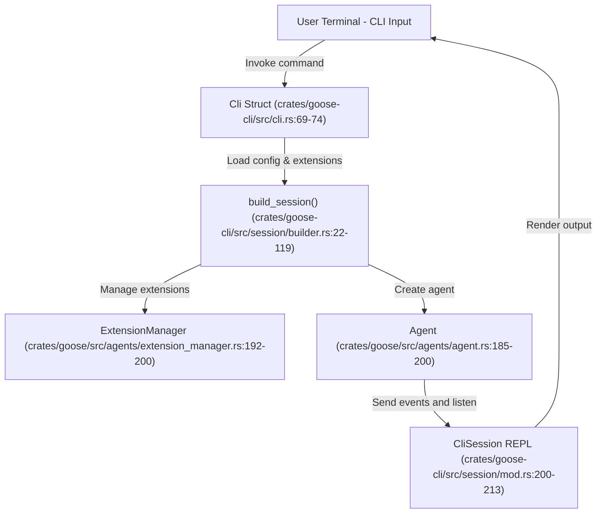
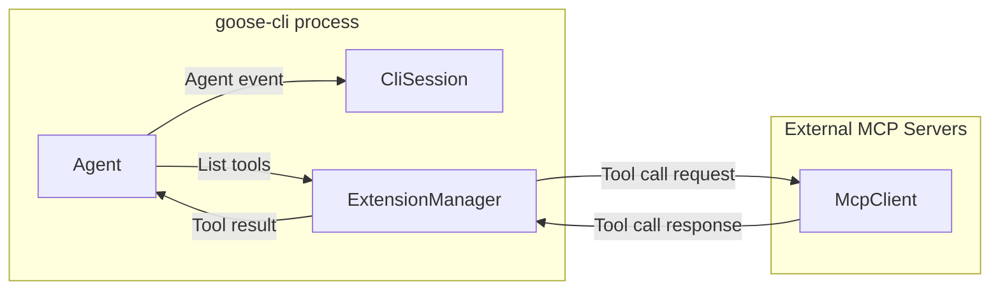

# CLI (`goose-cli`)

Relevant source files

The following files were used as context for generating this wiki page:

- [Cargo.lock](Cargo.lock)
- [Cargo.toml](Cargo.toml)
- [crates/goose-cli/Cargo.toml](crates/goose-cli/Cargo.toml)
- [crates/goose-cli/src/cli.rs](crates/goose-cli/src/cli.rs)
- [crates/goose-cli/src/commands/mod.rs](crates/goose-cli/src/commands/mod.rs)
- [crates/goose-cli/src/commands/session.rs](crates/goose-cli/src/commands/session.rs)
- [crates/goose-cli/src/lib.rs](crates/goose-cli/src/lib.rs)
- [crates/goose-cli/src/logging.rs](crates/goose-cli/src/logging.rs)
- [crates/goose-cli/src/main.rs](crates/goose-cli/src/main.rs)
- [crates/goose-mcp/Cargo.toml](crates/goose-mcp/Cargo.toml)
- [crates/goose-provider-types/src/canonical/data/canonical_models.json](crates/goose-provider-types/src/canonical/data/canonical_models.json)
- [crates/goose-provider-types/src/canonical/data/provider_metadata.json](crates/goose-provider-types/src/canonical/data/provider_metadata.json)
- [crates/goose/Cargo.toml](crates/goose/Cargo.toml)
- [crates/goose/src/logging.rs](crates/goose/src/logging.rs)
- [crates/goose/src/session/chat_history_search.rs](crates/goose/src/session/chat_history_search.rs)
- [crates/goose/src/session/mod.rs](crates/goose/src/session/mod.rs)
- [crates/goose/src/session/session_manager.rs](crates/goose/src/session/session_manager.rs)
- [ui/desktop/package.json](ui/desktop/package.json)

The `goose-cli` binary provides a comprehensive terminal-based interface for interacting with the Goose AI agent. It supports both an **interactive REPL** (Read-Eval-Print Loop) session for conversational AI workflows and a **non-interactive mode** for running single-shot commands, recipes, or automation tasks directly from the terminal.

Leveraging the `clap` crate, the CLI features a modular command structure with rich argument parsing [crates/goose-cli/src/cli.rs:1-187](). For interactive editing, history, and tab completion, it uses the `rustyline` crate [crates/goose-cli/Cargo.toml:50]().

---

## Command Structure

The `goose` CLI is designed around a root command and multiple subcommands that organize different functionalities. These include session management, configuration, MCP/ACP server control, recipe processing, scheduling, plugin management, and more. Each command typically has its own handler function invoked from the CLI parser.

### Core Execution Commands

- **`goose session`**: The primary command to launch an interactive REPL session for live conversational interaction with Goose. This REPL handles input, output, command history, command slash-prefix commands, and output rendering.
- **`goose run`**: Runs a single instruction, prompt, or recipe non-interactively and outputs the result. Input can come from a command-line string, a file, or standard input.
- **`goose configure`**: Manages global CLI configuration such as providers, models, and telemetry consent settings.

### Management and Utility Commands

- **`goose mcp` and `goose acp`**: Commands to run or connect to Model Context Protocol (MCP) and Agent Client Protocol (ACP) servers respectively, enabling extension hosting and remote control functionality.
- **`goose recipe`**: Commands to list, validate, open, and execute Goose Recipes—YAML-defined automation workflows.
- **`goose schedule`**: Manage scheduled task automation leveraging a cron-style scheduling system.
- **`goose session` subcommands**: List, remove, and rename saved chat sessions.
- **`goose plugin`**: Manage and update plugins.
- Additional commands cover skills listing, roaming, project management, gateway control, and update operations.

For full CLI commands, arguments, flags, and examples, see the dedicated [CLI Commands Reference](#7.2) page.

---

## Architecture: From CLI Command to Agent Interaction

The CLI binary serves as the user-facing frontend that orchestrates the Goose agent runtime. The main flow for command execution—especially interactive session creation—happens as follows:

1. **CLI Parsing**  
   The `Cli` struct models the root command and subcommands via `clap` [crates/goose-cli/src/cli.rs:69-74]().
   
2. **Session Construction**  
   When starting a session (`goose session`), the `build_session` function initializes all the components including the session context, model provider, and active extensions [crates/goose-cli/src/session/builder.rs:22-119]().

3. **Agent Instantiation**  
   `Agent` from the core `goose` crate is created with configuration and extension context [crates/goose/src/agents/agent.rs:185-200]().

4. **Session REPL Launch**  
   The `CliSession` wraps the agent with terminal I/O, input handling, and output rendering into an interactive prompt loop [crates/goose-cli/src/session/mod.rs:200-213]().

### CLI Component and Code Mapping Diagram

Sources: [crates/goose-cli/src/cli.rs:1-187](), [crates/goose-cli/src/session/builder.rs:22-119](), [crates/goose/src/agents/agent.rs:185-200](), [crates/goose-cli/src/session/mod.rs:200-213]()

---

## Interactive Session & REPL

The interactive `goose session` command launches a REPL with advanced input and output features:

- **Input Handling**: Supports command history, line editing, multiline input, and tab completion through a custom completer implementation.
- **Slash Commands**: Special commands starting with `/` like `/plan`, `/mode`, or `/extension` allow quick meta-actions or configuration changes during a session.
- **Output Rendering**: Responses are streamed and rendered using a markdown formatter with syntax highlighting via `bat` integration, supporting rich terminal display.
- **Thinking Indicators**: While waiting for LLM responses, a spinner provides user feedback of ongoing processing.
- **Editor Integration**: Optionally invoke external editors from the REPL for complex input editing.

These features ensure a productive terminal experience, combining conversational AI workflows with interactive tooling.

See the full technical deep dive in the [Interactive Session & REPL](#7.1) child page.

---

## Logging and Telemetry

At startup, `goose-cli` configures structured logging with adjustable verbosity and output formats. Logging is initialized early and is used throughout the CLI and session lifecycle [crates/goose-cli/src/logging.rs](), helping track internal state, errors, and debug information.

The CLI optionally integrates telemetry for usage analytics and crash reporting, with consent management handled via the `goose configure` command [crates/goose-cli/src/cli.rs:19-20]().

---

## Extension & Plugin Integration

The CLI permits dynamic extension integration to enhance Goose capabilities:

- **`--with-extension`**: Attach stdio-based MCP extensions to the session.
- **`--with-builtin`**: Load built-in extensions such as developer tools.
- **`--with-streamable-http-extension`**: Add HTTP stream based MCP extensions with configurable timeouts.

The `ExtensionManager` orchestrates extension lifecycles, tool registration, and communication between Goose's `Agent` and external MCP servers or builtin tools [crates/goose/src/agents/extension_manager.rs:192-200]().

### Extension Interaction Diagram

This integration enables sophisticated tool-assisted workflows while maintaining a clean separation of concerns.

Sources: [crates/goose-cli/src/cli.rs:143-213](), [crates/goose/src/agents/extension_manager.rs:192-200](), [crates/goose/src/agents/agent.rs:185-200]()

---

## Key Commands Overview

Below are pivotal commands frequently used in `goose-cli`:

| Command               | Description                                      |
|-----------------------|------------------------------------------------|
| `goose session`       | Start interactive REPL session                   |
| `goose run`           | Run instruction or recipe non-interactively     |
| `goose configure`     | Manage global settings, providers, and telemetry |
| `goose recipe`        | Manage and run recipes                            |
| `goose schedule`      | Manage scheduled task automation                  |
| `goose session list`  | List saved sessions                               |
| `goose session remove`| Remove selected saved sessions                    |
| `goose session rename`| Rename a saved session                            |
| `goose plugin`        | Manage plugins and updates                        |
| `goose mcp`           | Run or interact with MCP servers                  |
| `goose acp serve`     | Run the ACP server for remote agent access       |

For the complete list with flags and examples, see [CLI Commands Reference](#7.2).

---

## Sub-pages

This page provides the high-level context for the `goose-cli` binary. Detailed technical documentation is available in the following child pages:

- **[Interactive Session & REPL](#7.1)** — In-depth exploration of the interactive REPL: input handling, slash commands, output rendering, command completion, editor integration, and session builder internals.
- **[CLI Commands Reference](#7.2)** — Exhaustive reference for all CLI commands, arguments, options, flags, and usage examples.

---

Sources:  
[crates/goose-cli/src/cli.rs:1-187](),  
[crates/goose-cli/src/session/builder.rs:22-119](),  
[crates/goose/src/agents/agent.rs:185-200](),  
[crates/goose-cli/src/session/mod.rs:200-213](),  
[crates/goose/src/agents/extension_manager.rs:192-200]()