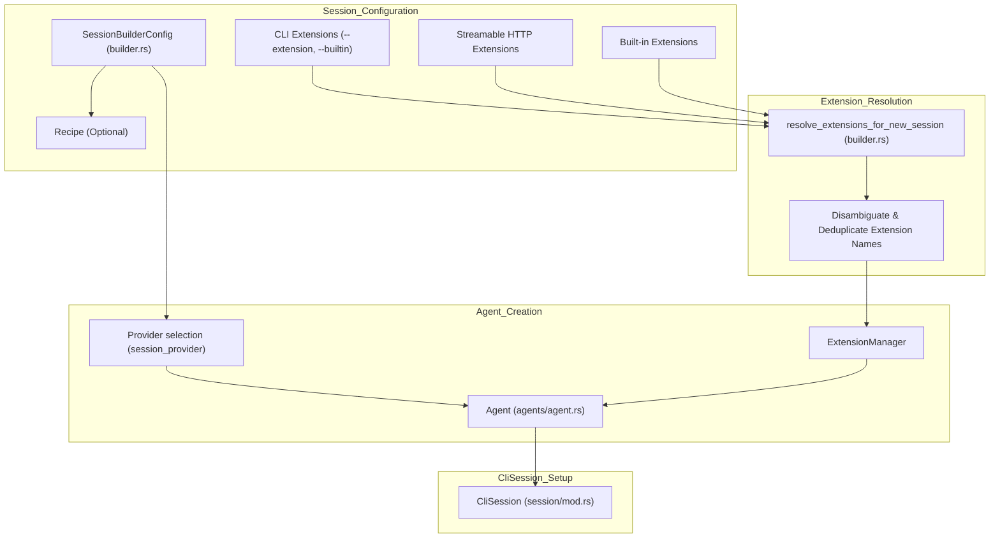
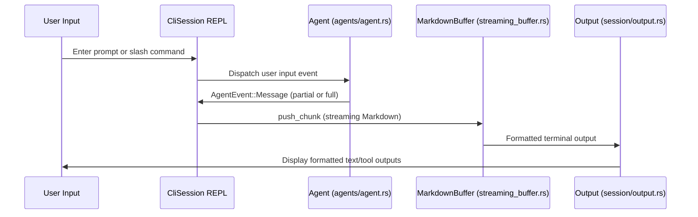
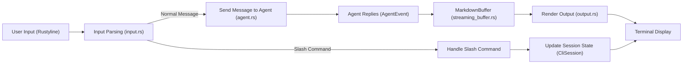

# Interactive Session & REPL

Relevant source files

The following files were used as context for generating this wiki page:

- [crates/goose-cli/src/commands/configure.rs](crates/goose-cli/src/commands/configure.rs)
- [crates/goose-cli/src/session/builder.rs](crates/goose-cli/src/session/builder.rs)
- [crates/goose-cli/src/session/completion.rs](crates/goose-cli/src/session/completion.rs)
- [crates/goose-cli/src/session/editor.rs](crates/goose-cli/src/session/editor.rs)
- [crates/goose-cli/src/session/elicitation.rs](crates/goose-cli/src/session/elicitation.rs)
- [crates/goose-cli/src/session/input.rs](crates/goose-cli/src/session/input.rs)
- [crates/goose-cli/src/session/mod.rs](crates/goose-cli/src/session/mod.rs)
- [crates/goose-cli/src/session/output.rs](crates/goose-cli/src/session/output.rs)
- [crates/goose-cli/tests/support/elicitation_signals.rs](crates/goose-cli/tests/support/elicitation_signals.rs)
- [crates/goose/src/agents/agent.rs](crates/goose/src/agents/agent.rs)
- [crates/goose/src/agents/extension.rs](crates/goose/src/agents/extension.rs)
- [crates/goose/src/agents/mod.rs](crates/goose/src/agents/mod.rs)
- [crates/goose/src/agents/reply_parts.rs](crates/goose/src/agents/reply_parts.rs)
- [crates/goose/src/config/extensions.rs](crates/goose/src/config/extensions.rs)
- [crates/goose/src/config/mod.rs](crates/goose/src/config/mod.rs)
- [crates/goose/src/execution/manager.rs](crates/goose/src/execution/manager.rs)
- [crates/goose/tests/agent.rs](crates/goose/tests/agent.rs)
- [ui/desktop/src/components/ElicitationRequest.tsx](ui/desktop/src/components/ElicitationRequest.tsx)
- [ui/desktop/src/components/ui/JsonSchemaForm.tsx](ui/desktop/src/components/ui/JsonSchemaForm.tsx)

The interactive session and REPL component of Goose CLI (`CliSession`) is the primary interface for user-agent interaction in the command-line environment. It orchestrates input handling through line editing and command parsing, presents output with rich formatting (including Markdown and syntax-highlighted tool outputs), offers tab completion, integrates external editors, and manages session creation and lifecycle seamlessly.

---

## Purpose and Scope

This page covers the internal implementation details and data flow of the Goose CLI REPL, including:

- The `CliSession` struct and its role in managing interaction state.
- Input handling, including slash command parsing and paste-aware input.
- Slash commands supported by the REPL.
- Output rendering components: `MarkdownBuffer` and integration with `bat` for syntax highlighting.
- Tab completion via the `GooseCompleter`.
- External editor integration for editing prompts.
- Session building via the `SessionBuilderConfig` and `build_session`.

---

## 1. Session Lifecycle and Builder

The `CliSession` is instantiated through a session building process that configures the session environment, including providers, extensions, and optional recipes.

- **SessionBuilderConfig** encapsulates all parameters (session id, extensions, provider/model overrides, recipe, etc.) necessary for constructing a session.
- The `build_session` function uses this config to:
  - Parse and resolve extensions (CLI stdio extensions, builtins, streamable HTTP extensions).
  - Deduplicate and rename conflicting extensions.
  - Construct an `Agent` with the configured providers and extension managers.
  - Instantiate the `CliSession` wrapping the agent, managing session state, conversation, and completion cache.

### Session Construction Diagram

The flow ensures that extensions are correctly loaded and named, preventing collisions especially for stdio extensions without explicit names. The agent is created with configured providers and the extension manager responsible for managing the lifecycle of extensions in the session.

Sources: [crates/goose-cli/src/session/builder.rs:11-83, 153-180](), [crates/goose-cli/src/session/mod.rs:210-240](), [crates/goose/src/agents/agent.rs:180-187]()

---

## 2. Input Handling and Slash Commands

### 2.1 Input Reading

Input is collected using the `rustyline` editor configured with:

- Custom keybindings supporting paste-aware input that avoids immediate submission when pasting multi-line text.
- Ctrl+C behavior:
  - Clears the current line if text is present.
  - On empty lines, requires a double Ctrl+C press to exit.
- Support for Ctrl+J (or configurable key) to insert newlines within multi-line prompts.
- History loading and saving managed by the `HistoryManager` ensuring persistence in a configurable file.

The entry function for input reading is `get_input` which:

- Checks if the user has configured an external editor for the prompt and if it should be used always.
- If using editor, launches the external editor pre-loaded with recent conversation history.
- Otherwise, reads line from `rustyline`, including paste-aware handlers.

Sources: [crates/goose-cli/src/session/input.rs:90-196](), [crates/goose-cli/src/session/mod.rs:190-210]()

### 2.2 Slash Command Parsing

Lines starting with `/` are interpreted as slash commands. The REPL parses the following slash commands as triggers for specific session actions or state changes:

| Slash Command   | Purpose                                                      |
|-----------------|--------------------------------------------------------------|
| `/exit`, `/quit`| Exit the interactive session.                                |
| `/extension`    | Add a new MCP extension dynamically.                        |
| `/builtin`      | Enable built-in platform extensions.                        |
| `/retry`        | Retry the previous operation.                               |
| `/plan`         | Enter `RunMode::Plan` for generating execution roadmap.     |
| `/endplan`      | Exit `RunMode::Plan`.                                       |
| `/compact`      | Manually trigger compaction of conversation context.        |
| `/mode`         | Switch Goose operating modes (`Auto`, `Chat`, etc.).        |
| `/clear`        | Clears the current conversation context.                    |
| `/recipe`       | Manage recipe execution and listing.                        |
| `/edit`         | Open prompt in configured external editor.                  |
| `/skills`       | List or load available skills/tools dynamically.             |
| `/prompts`      | List or filter available prompts.                            |
| `/prompt`       | Execute a stored prompt with optional arguments.            |
| `/model`        | Change the current model/provider.                           |
| `/toggle_theme` | Switch terminal display theme (Dark, Light, Ansi).           |

The command results are either executed immediately or passed on to further parsing to enact the requested behavior.

Sources: [crates/goose-cli/src/session/input.rs:15-34](), [crates/goose-cli/src/session/mod.rs:210-230]()

### 2.3 Tab Completion

The `GooseCompleter` implements the `rustyline::Completer` trait to provide context-aware tab completion for:

- Slash commands.
- Extension names and tools.
- Prompt names.
- File paths and known keywords.

This completer maintains a `CompletionCache` holding current prompts, extensions, and context to respond rapidly for completions on each keystroke.

Sources: [crates/goose-cli/src/session/completion.rs:20-80](), [crates/goose-cli/src/session/mod.rs:220-240]()

---

## 3. Output Rendering

Goose CLI produces rich terminal output utilizing buffered rendering and syntax highlighting.

### 3.1 MarkdownBuffer

Streaming LLM response text is accumulated and processed by the `MarkdownBuffer`. This component applies incremental Markdown parsing and formatting, keeping terminal rendering consistent even as incomplete chunks arrive.

- Supports streaming content.
- Handles delays and partial data to avoid flicker.
- Exposes terminal-friendly chunks for output.

### 3.2 bat Syntax Highlighting

For tool outputs or source code file contents, Goose uses the `bat` crate logic (embedded or invoked) to syntax highlight content:

- Theme is selected based on whether CLI theme is Light or Dark (configurable).
- Long outputs are paginated or truncated.
- Integrates with `output.rs` module to render highlighted output.

### 3.3 Thinking Indicator

While waiting for the LLM or tool response, Goose displays a spinner (`ThinkingIndicator`), which also can show random thinking messages. This improves user feedback for potentially long wait times.

### 3.4 Output Flow Diagram

Sources: [crates/goose-cli/src/session/output.rs:5-195](), [crates/goose-cli/src/session/streaming_buffer.rs:8-40](), [crates/goose-cli/src/session/mod.rs:207-230]()

---

## 4. Editor Integration

An external editor may be configured to compose or edit prompts:

- The configured editor is read from `GOOSE_PROMPT_EDITOR` environment/config, falling back on `$VISUAL` or `$EDITOR`.
- When invoked via `/edit` or prompt-editor-always config, Goose:
  1. Creates a temporary Markdown file containing:
     - Current prompt or blank template.
     - Last several messages of conversation as context.
  2. Launches the external editor command and waits for exit.
  3. Reads the file contents, removes helper context, and submits the edited prompt to the agent.

This provides advanced editing features to users relying on richer editors or workflows.

Sources: [crates/goose-cli/src/session/editor.rs:10-200](), [crates/goose-cli/src/session/input.rs:120-140]()

---

## 5. Technical Details

### Key Structs and Their Roles

| Struct                | Role                                                         | Location                                              |
|-----------------------|--------------------------------------------------------------|-------------------------------------------------------|
| `CliSession`          | Manages interactive REPL state: agent, conversation, output. | `crates/goose-cli/src/session/mod.rs`                 |
| `SessionBuilderConfig`| Data structure encapsulating session construction parameters.| `crates/goose-cli/src/session/builder.rs`             |
| `GooseCompleter`      | Provides tab completion logic for CLI input.                 | `crates/goose-cli/src/session/completion.rs`          |
| `MarkdownBuffer`      | Buffer and render streaming Markdown output.                  | `crates/goose-cli/src/session/streaming_buffer.rs`    |
| `ThinkingIndicator`   | Spinner UI for asynchronous processing feedback.              | `crates/goose-cli/src/session/output.rs`               |
| `HistoryManager`      | Loads and saves command history for the REPL.                 | `crates/goose-cli/src/session/mod.rs`                  |

### Session Builder Highlights

- The builder handles complex extension resolution from CLI flags, environment, and config.
- It deduplicates extensions to prevent conflicts, especially among stdio extensions without explicit names.
- Extension configuration includes inlining environment variables, command, arguments, and bundling metadata.
- The built `Agent` then manages the actual turn execution, tool calls, and state machine processing.

### Data Flow Summary

---

# Summary

The Goose CLI interactive session and REPL system provides a robust, interactive user experience. Through tightly integrated input handling, comprehensive slash commands, advanced output rendering with Markdown and syntax highlighting, and optional external editing, users enjoy a rich, productive command-line interface with Goose. The session builder ensures that each session is correctly configured with extensions, providers, and recipes, enabling varied workflows from chat to complex task orchestration.

---

Sources:  
- [crates/goose-cli/src/session/mod.rs:1-240]()  
- [crates/goose-cli/src/session/builder.rs:1-90,150-180]()  
- [crates/goose-cli/src/session/input.rs:1-200]()  
- [crates/goose-cli/src/session/output.rs:1-220]()  
- [crates/goose-cli/src/session/completion.rs]()  
- [crates/goose-cli/src/session/editor.rs:1-200]()  
- [crates/goose/src/agents/agent.rs:180-187]()