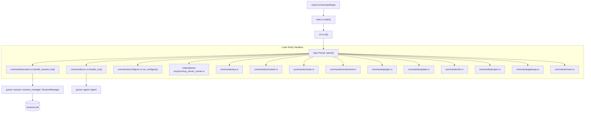
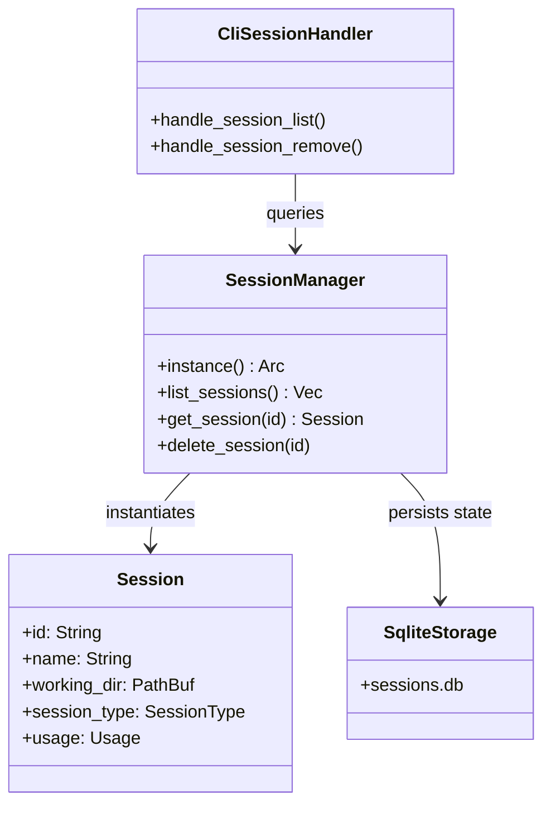

# CLI Commands Reference

Relevant source files

The following files were used as context for generating this wiki page:

- [crates/goose-cli/src/commands/plugin.rs](crates/goose-cli/src/commands/plugin.rs)
- [crates/goose-cli/src/commands/review/default_review_prompt.md](crates/goose-cli/src/commands/review/default_review_prompt.md)
- [crates/goose-cli/src/commands/review/handler.rs](crates/goose-cli/src/commands/review/handler.rs)
- [crates/goose-cli/src/commands/review/mod.rs](crates/goose-cli/src/commands/review/mod.rs)
- [crates/goose-cli/src/commands/review/orchestrator.rs](crates/goose-cli/src/commands/review/orchestrator.rs)
- [crates/goose-cli/src/commands/review/prompt.rs](crates/goose-cli/src/commands/review/prompt.rs)
- [crates/goose-local-inference/src/paths.rs](crates/goose-local-inference/src/paths.rs)
- [crates/goose/src/checks/mod.rs](crates/goose/src/checks/mod.rs)
- [crates/goose/src/config/paths.rs](crates/goose/src/config/paths.rs)
- [crates/goose/src/hints/import_files.rs](crates/goose/src/hints/import_files.rs)
- [crates/goose/src/hints/load_hints.rs](crates/goose/src/hints/load_hints.rs)
- [crates/goose/src/hints/mod.rs](crates/goose/src/hints/mod.rs)
- [crates/goose/src/hooks/mod.rs](crates/goose/src/hooks/mod.rs)
- [crates/goose/src/plugins/discovery.rs](crates/goose/src/plugins/discovery.rs)
- [crates/goose/src/plugins/formats/gemini.rs](crates/goose/src/plugins/formats/gemini.rs)
- [crates/goose/src/plugins/formats/mod.rs](crates/goose/src/plugins/formats/mod.rs)
- [crates/goose/src/plugins/formats/open_plugins.rs](crates/goose/src/plugins/formats/open_plugins.rs)
- [crates/goose/src/plugins/mod.rs](crates/goose/src/plugins/mod.rs)
- [crates/goose/src/sources.rs](crates/goose/src/sources.rs)
- [crates/goose/tests/git_command_security.rs](crates/goose/tests/git_command_security.rs)
- [documentation/docs/guides/config-files.md](documentation/docs/guides/config-files.md)
- [documentation/docs/guides/context-engineering/hooks.md](documentation/docs/guides/context-engineering/hooks.md)
- [documentation/docs/guides/context-engineering/subagents.mdx](documentation/docs/guides/context-engineering/subagents.mdx)
- [documentation/docs/guides/environment-variables.md](documentation/docs/guides/environment-variables.md)
- [documentation/docs/guides/goose-cli-commands.md](documentation/docs/guides/goose-cli-commands.md)
- [documentation/docs/guides/multi-model/index.mdx](documentation/docs/guides/multi-model/index.mdx)
- [documentation/docs/guides/recipes/index.mdx](documentation/docs/guides/recipes/index.mdx)
- [documentation/docs/guides/recipes/recipe-reference.md](documentation/docs/guides/recipes/recipe-reference.md)
- [documentation/docs/guides/recipes/session-recipes.md](documentation/docs/guides/recipes/session-recipes.md)
- [documentation/docs/guides/recipes/storing-recipes.md](documentation/docs/guides/recipes/storing-recipes.md)
- [documentation/docs/guides/recipes/subrecipes.md](documentation/docs/guides/recipes/subrecipes.md)
- [documentation/docs/guides/running-tasks.md](documentation/docs/guides/running-tasks.md)
- [documentation/docs/guides/sessions/smart-context-management.md](documentation/docs/guides/sessions/smart-context-management.md)
- [documentation/docs/troubleshooting/known-issues.md](documentation/docs/troubleshooting/known-issues.md)
- [documentation/docs/tutorials/recipes-tutorial.md](documentation/docs/tutorials/recipes-tutorial.md)
- [documentation/src/components/RecipeFields.js](documentation/src/components/RecipeFields.js)
- [documentation/src/components/VideoCarousel.js](documentation/src/components/VideoCarousel.js)
- [documentation/static/files/thoughts/plans/2025-12-23-remove-tool-selection-strategy.raw](documentation/static/files/thoughts/plans/2025-12-23-remove-tool-selection-strategy.raw)
- [documentation/static/files/thoughts/research/2025-12-22-llm-tool-selection-strategy.raw](documentation/static/files/thoughts/research/2025-12-22-llm-tool-selection-strategy.raw)
- [examples/plugins/hello-hooks/README.md](examples/plugins/hello-hooks/README.md)
- [examples/plugins/hello-hooks/hooks/hooks.json](examples/plugins/hello-hooks/hooks/hooks.json)
- [examples/plugins/hello-hooks/plugin.json](examples/plugins/hello-hooks/plugin.json)
- [ui/desktop/src/utils/pathUtils.test.ts](ui/desktop/src/utils/pathUtils.test.ts)
- [ui/desktop/src/utils/pathUtils.ts](ui/desktop/src/utils/pathUtils.ts)

This leaf page provides a comprehensive technical reference for all commands, flags, options, and behaviors supported by the `goose` command-line interface (`goose-cli`). The CLI serves as the primary terminal orchestration layer for managing AI agent sessions, executing non-interactive tasks, configuring language model providers, provisioning Model Context Protocol (MCP) and Agent Client Protocol (ACP) extensions, and managing automated recipes and schedules.

---

## Command Architecture & Execution Flow

The CLI binary is structured around a hierarchical argument parser built with `clap` [crates/goose-cli/src/cli.rs:30-75](). The execution entry point initializes logging and dispatches commands to respective handler modules in `crates/goose-cli/src/commands/` [crates/goose-cli/src/main.rs:17-30]().

### Diagram: Natural Language Space to Code Entity Space — CLI Command Dispatch

Sources: [crates/goose-cli/src/main.rs:17-30](), [crates/goose-cli/src/cli.rs:30-75](), [crates/goose/src/session/session_manager.rs:58-98]()

---

## Core & Setup Commands

### `configure`

Launches an interactive Terminal User Interface (TUI) via `clack` / `cancellable` dialogs to configure active LLM providers, API keys, extensions, and tool permissions [documentation/docs/guides/goose-cli-commands.md:40-50]().

- **Behavior**: Reads and writes persistently to the user's `config.yaml` typically found at `~/.config/goose/config.yaml` (or `%APPDATA%\Block\goose\config\config.yaml` on Windows). Provides type-to-filter search capability among providers, extensions, and tools making configuration efficient.

Sources: [documentation/docs/guides/goose-cli-commands.md:40-52](), [documentation/docs/guides/config-files.md:7-135](), [crates/goose-cli/src/commands/configure.rs]()

### `info`

Shows Goose runtime information: current version, configuration file locations, session database path, and system logs.

- **Flags**:
  - `-v, --verbose`: Displays extended details such as environment variables, enabled extensions, and active configuration [documentation/docs/guides/goose-cli-commands.md:57-59]().

Sources: [documentation/docs/guides/goose-cli-commands.md:54-63](), [crates/goose/src/session/diagnostics.rs:102-143]()

### `update`

Updates the `goose` CLI binary to the latest stable or canary release.

- **Options**:
  - `--canary, -c`: Updates to the latest pre-release (canary) version.
  - `--reconfigure, -r`: Forces a reset and reconfiguration flow during update.

Sources: [documentation/docs/guides/goose-cli-commands.md:77-94](), [crates/goose-cli/src/commands/update.rs]()

### `completion`

Generates shell completion scripts for supported shells (`bash, elvish, fish, nu, powershell, zsh`) which are printed to stdout. Users can redirect output to appropriate shell config locations to enable tab completion for commands, subcommands, and options, improving CLI ergonomics [documentation/docs/guides/goose-cli-commands.md:98-127]().

Sources: [documentation/docs/guides/goose-cli-commands.md:98-127]()

### `project`

Manages project scope identifiers used for grouping and filtering sessions within SQLite `sessions.db`.

Sources: [crates/goose/src/session/session_manager.rs:93]()

---

## Session & Execution Commands

### `session`

Starts or resumes interactive terminal REPL chat sessions backed by the persistent SQLite database (`sessions.db`) [documentation/docs/guides/goose-cli-commands.md:201-216]().

| Flag / Option                      | Description                                                                                  | Example                                   |
|----------------------------------|----------------------------------------------------------------------------------------------|-------------------------------------------|
| `-n, --name <name>`               | Assigns a descriptive title to the session                                                  | `goose session -n "Auth Refactor"`        |
| `--session-id <id>`               | Resumes or targets a specific unique session ID                                             | `goose session --session-id 20251108_1`  |
| `-r, --resume`                   | Resumes the most recent or targeted session                                                | `goose session --resume`                   |
| `--fork`                         | Duplicates conversation history into a new session                                         | `goose session --resume --fork`           |
| `--history`                      | Prints prior conversational turns upon resuming                                            | `goose session --resume --history`        |
| `--debug`                        | Outputs complete tool payloads, file paths, and metadata                                   | `goose session --debug`                    |
| `--edit`                         | Opens session history in `$VISUAL`/`$EDITOR` as YAML for manual scrubbing                   | `goose session --resume --edit`            |
| `--max-turns <NUM>`              | Caps automated turn count without user prompt (default is 1000)                           | `goose session --max-turns 50`             |
| `--max-tool-repetitions <NUM>`  | Throttles loops by limiting consecutive identical tool invocations                         | `goose session --max-tool-repetitions 3`  |
| `--container <id>`               | Executes extensions within an isolated Docker container                                     | `goose session --container my-env`         |

**Behavior:**
- Loads or creates a session entity via `goose::session::session_manager::SessionManager`.
- Handles interactive REPL loop accepting user prompts, invoking AI agent turn execution.
- Supports extension containerization for isolated tooling environments.
- Debug mode enhances visibility into tool invocation internals.
  
Sources: [documentation/docs/guides/goose-cli-commands.md:201-216](), [crates/goose-cli/src/commands/session.rs:93-144](), [crates/goose/src/session/session_manager.rs:58-98]()

---

### Diagram: Natural Language Space to Code Entity Space — Session Data Persistence

Sources: [crates/goose-cli/src/commands/session.rs:93-144](), [crates/goose/src/session/session_manager.rs:58-98]()

---

### `run`

Executes an agent workflow non-interactively in headless mode, suitable for automation, CI/CD, and scripting [documentation/docs/guides/running-tasks.md:7-169]().

**Options include:**

| Flag / Option                      | Description                                                   | Example                                   |
|----------------------------------|---------------------------------------------------------------|-------------------------------------------|
| `-t, --text <TEXT>`              | Pass inline prompt instructions (one-liner or multi-line)     | `goose run -t "Write a summary"`          |
| `-i, --instructions <PATH>`      | Read instructions from a file or from stdin (`-i -`)          | `goose run -i instructions.md`             |
| `--recipe <RECIPE>`              | Execute a specified recipe by name or filepath                | `goose run --recipe myrecipe.yaml`         |
| `--no-session`                   | Run ephemerally without creating/storing a session file       | `goose run --no-session -t "Check logs"`   |
| `--output-format <FORMAT>`       | Format output as `json` or `stream-json` for automation       | `goose run --output-format json`            |
| `-s, --interactive`              | Continue in interactive mode after task completes             | `goose run -t "Analyze data" -s`            |
| `--with-builtin <EXTENSIONS>`   | Load one or more built-in extensions (comma-separated list)   | `goose run --with-builtin "developer,git"` |
| `--with-extension <ARGS>`        | Pass arguments for custom extensions                           | `goose run --with-extension "ENV=VAL custom-ext-args"` |
| `--debug`                       | Enables detailed debugging including complete tool I/O        | `goose run --debug -t "Test debug"`         |
| `--provider <PROVIDER>`          | Override LLM provider                                          | `goose run --provider anthropic`            |
| `--model <MODEL>`                | Override model name                                           | `goose run --model "gpt-4" -t "Q"`          |

The option flags and parameters modify how Goose initiates the session and executes instructions before optionally handing control to an interactive shell.

Sources: [documentation/docs/guides/running-tasks.md:7-169](), [crates/goose-cli/src/commands/run.rs]()

---

## Extension, Protocol & Integration Commands

### `mcp`

Manages Model Context Protocol (MCP) server lifecycles, allowing Goose to start, stop, and interface with MCP servers such as `developer`, `computercontroller`, `memory`, `tutorial`, `autovisualiser`, and others.

- Command spawns and manages server processes.
- Includes flags to specify server behavior (e.g., hosts, ports, timeouts).

Sources: [documentation/docs/guides/goose-cli-commands.md:238-243](), [crates/goose-mcp/src/mcp_server_runner.rs:20-30]()

### `acp` / `serve`

Boots and manages the Agent Client Protocol (ACP) communication backends.

- Provides a standardized backend for client-server agent orchestration.
- Supports subcommands like `serve` to run the ACP server daemon.
- Handles transport layers including stdio, HTTP, and websockets.

Sources: [crates/goose-cli/src/cli.rs:54-59](), [crates/goose/src/acp/server.rs]()

### `gateway`

Configures gateways that facilitate remote access bridging for Goose agents connecting over messaging platforms like Telegram or other relays.

Sources: [crates/goose-server/src/commands/agent.rs:39-148]()

### `roam`

Interacts with the peer-to-peer session roaming subsystem implemented via `goose-roaming`, enabling session sync and node-to-node communications over QUIC and iroh protocols.

Sources: [crates/goose/src/session/mod.rs]()

### `plugin`

Manages Goose external binary plugins and hook registrations.

- Supports plugin discovery and enabling/disabling plugins.
- Manages plugin installation and updates, including auto-update features.

Sources: [crates/goose-cli/src/commands/plugin.rs](), [crates/goose/src/plugins/mod.rs:1-224]()

---

## Automation, Review & Recipe Commands

### `recipe`

Allows inspection, validation, and management of reusable instruction templates configured as recipes.

- Subcommands:
  - `list`: Discovers recipe files from local directories, environment-variable defined paths, and GitHub repositories.
  - `validate`: Validates recipe YAML/JSON files for schema conformance.
  
- Recipes can include parameterized inputs, extensions, settings, and retry logic.
  
Sources: [documentation/docs/guides/recipes/recipe-reference.md:11-55](), [documentation/docs/guides/recipes/session-recipes.md:12-153](), [crates/goose-cli/src/commands/recipe.rs]()

### `schedule`

Cron-based automation scheduler to run recipes or commands on defined intervals.

- Subcommands include `add`, `list`, and `remove` scheduled jobs.
- Supports background job management and session triggering.

Sources: [documentation/docs/guides/goose-cli-commands.md:275-296](), [crates/goose-cli/src/commands/schedule.rs]()

### `review`

Orchestrates automated code review via agent-driven checks against git diffs or specified path filters.

- Runs multi-agent parallel review passes with configurable models and prompts.
- Supports filtering by severity and check names.
- Handles sub-agent orchestration with manual or orchestrated execution modes.

Sources: [crates/goose-cli/src/commands/review/mod.rs:1-16]()

---

## CLI Commands to Code Entity Mapping

This diagram maps common CLI commands to the key internal Rust modules and structs managing their functionality.

```mermaid
graph TD
    subgraph CLI
        SessionCmd["goose session"]
        RunCmd["goose run"]
        ConfigureCmd["goose configure"]
        McpCmd["goose mcp"]
        AcpCmd["goose acp / serve"]
        RecipeCmd["goose recipe"]
        ScheduleCmd["goose schedule"]
        ReviewCmd["goose review"]
        PluginCmd["goose plugin"]
        UpdateCmd["goose update"]
        InfoCmd["goose info"]
        ProjectCmd["goose project"]
        GatewayCmd["goose gateway"]
        RoamCmd["goose roam"]
    end

    subgraph Code Entities
        SessionMgr["session::session_manager::SessionManager"]
        Agent["agent::Agent"]
        ConfigLoader["config::ConfigLoader"]
        McpRunner["mcp::mcp_server_runner"]
        AcpServer["acp::server"]
        RecipeManager["commands::recipe.rs"]
        Scheduler["commands::schedule.rs"]
        ReviewHandler["commands::review::handler"]
        PluginManager["plugins::mod.rs"]
        Updater["commands::update.rs"]
        InfoPrinter["commands::info.rs"]
        ProjectManager["session::project"]
        GatewayHandler["commands::gateway"]
        RoamingNode["session::roaming"]
    end

    SessionCmd -->|Session handling| SessionMgr
    RunCmd -->|Agent execution| Agent
    ConfigureCmd -->|Load & Save config| ConfigLoader
    McpCmd --> McpRunner
    AcpCmd --> AcpServer
    RecipeCmd --> RecipeManager
    ScheduleCmd --> Scheduler
    ReviewCmd --> ReviewHandler
    PluginCmd --> PluginManager
    UpdateCmd --> Updater
    InfoCmd --> InfoPrinter
    ProjectCmd --> ProjectManager
    GatewayCmd --> GatewayHandler
    RoamCmd --> RoamingNode
```

Sources: [crates/goose-cli/src/commands/session.rs:93-144](), [crates/goose-cli/src/commands/run.rs](), [crates/goose-cli/src/commands/configure.rs](), [crates/goose-mcp/src/mcp_server_runner.rs](), [crates/goose/src/acp/server.rs](), [crates/goose-cli/src/commands/recipe.rs](), [crates/goose-cli/src/commands/schedule.rs](), [crates/goose-cli/src/commands/review/handler.rs](), [crates/goose/src/plugins/mod.rs](), [crates/goose-cli/src/commands/update.rs](), [crates/goose-cli/src/commands/info.rs](), [crates/goose/src/session/session_manager.rs](), [crates/goose-cli/src/commands/gateway.rs](), [crates/goose/src/session/mod.rs]()

---

## Configuration & Environment Variables Reference

Most CLI flags can be overridden or supplemented using environment variables or persistent settings inside the Goose YAML configuration file located at `~/.config/goose/config.yaml` (or `%APPDATA%\Block\goose\config\config.yaml` on Windows) [documentation/docs/guides/config-files.md:7-135](), [documentation/docs/guides/environment-variables.md:7-138]().

| Environment Variable       | Purpose                                         | Default / Notes                      |
|---------------------------|-------------------------------------------------|------------------------------------|
| `GOOSE_PROVIDER`          | Sets the active LLM provider                    | Must be configured for LLM usage   |
| `GOOSE_MODEL`             | Selects model from provider                      | Must be configured                  |
| `GOOSE_TEMPERATURE`       | Controls response randomness (0.0 to 1.0)        | Provider/model default              |
| `GOOSE_MAX_TOKENS`        | Maximum tokens per LLM response                   | Provider/model default              |
| `GOOSE_CACHE_TTL`         | Anthropic prompt cache TTL (`5m`, `1h`)           | `5m` default                       |
| `GOOSE_CLI_THEME`         | Terminal markdown syntax highlighting theme      | `ansi` (default), or `light`, `dark` |
| `GOOSE_CLI_SHOW_THINKING` | Show LLM reasoning/thinking output in CLI         | `0` (off) by default                |
| `GOOSE_MAX_TURNS`         | Maximum conversation turns without user input    | 1000 by default                    |
| `SECURITY_PROMPT_ENABLED` | Enables prompt injection detection                | false by default                   |
| `GOOSE_RECIPE_GITHUB_REPO`| GitHub repository for recipe discovery           | None (optional)                    |

**Note:** Environment variables override configuration file settings for the current process. CLI commands can explicitly override both config and environment settings during execution.

Sources: [documentation/docs/guides/environment-variables.md:17-52](), [documentation/docs/guides/config-files.md:47-75]()

---

This comprehensive reference provides detailed insight into Goose CLI commands, their internal code mappings, execution flows, and configuration interfaces to facilitate advanced usage, extension, and troubleshooting of the Goose AI agent framework.

Sources:  
- [documentation/docs/guides/goose-cli-commands.md:1-217]()  
- [crates/goose-cli/src/main.rs:17-30]()  
- [crates/goose-cli/src/cli.rs:30-75]()  
- [crates/goose-cli/src/commands/session.rs:93-144]()  
- [crates/goose/src/session/session_manager.rs:58-98]()  
- [documentation/docs/guides/config-files.md:7-135]()  
- [documentation/docs/guides/environment-variables.md:7-138]()  
- [documentation/docs/guides/running-tasks.md:7-169]()  
- [crates/goose-cli/src/commands/run.rs]()  
- [crates/goose-mcp/src/mcp_server_runner.rs:20-30]()  
- [crates/goose/src/acp/server.rs]()  
- [crates/goose-cli/src/commands/review/mod.rs:1-16]()  
- [crates/goose-cli/src/commands/review/handler.rs:1-160]()  
- [crates/goose-cli/src/commands/plugin.rs]()  
- [crates/goose/src/plugins/mod.rs:1-224]()  
- [crates/goose-cli/src/commands/recipe.rs]()  
- [documentation/docs/guides/recipes/recipe-reference.md:10-55]()  
- [documentation/docs/guides/recipes/session-recipes.md:12-153]()  
- [crates/goose-cli/src/commands/schedule.rs]()