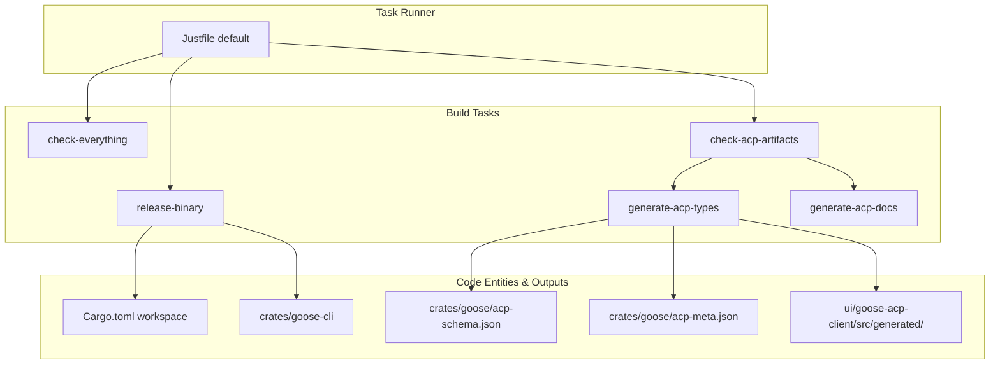
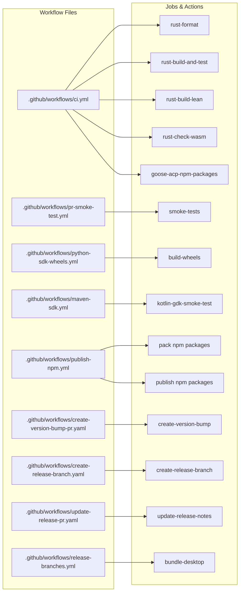

# Build, CI/CD & Release

Relevant source files

The following files were used as context for generating this wiki page:

- [.github/actions/generate-release-pr-body/pr_body_template.txt](.github/actions/generate-release-pr-body/pr_body_template.txt)
- [.github/workflows/check-release-pr.yaml](.github/workflows/check-release-pr.yaml)
- [.github/workflows/ci.yml](.github/workflows/ci.yml)
- [.github/workflows/close-release-pr-on-tag.yaml](.github/workflows/close-release-pr-on-tag.yaml)
- [.github/workflows/create-release-branch.yaml](.github/workflows/create-release-branch.yaml)
- [.github/workflows/create-version-bump-pr.yaml](.github/workflows/create-version-bump-pr.yaml)
- [.github/workflows/docs-update-cli-ref.yml](.github/workflows/docs-update-cli-ref.yml)
- [.github/workflows/minor-release.yaml](.github/workflows/minor-release.yaml)
- [.github/workflows/patch-release.yaml](.github/workflows/patch-release.yaml)
- [.github/workflows/pr-smoke-test.yml](.github/workflows/pr-smoke-test.yml)
- [.github/workflows/publish-npm.yml](.github/workflows/publish-npm.yml)
- [.github/workflows/python-sdk-wheels.yml](.github/workflows/python-sdk-wheels.yml)
- [.github/workflows/release-branches.yml](.github/workflows/release-branches.yml)
- [.github/workflows/update-release-pr.yaml](.github/workflows/update-release-pr.yaml)
- [Justfile](Justfile)
- [RELEASE.md](RELEASE.md)
- [RELEASE_CHECKLIST.md](RELEASE_CHECKLIST.md)
- [crates/goose/src/lib.rs](crates/goose/src/lib.rs)
- [workflow_recipes/release_risk_check/recipe.yaml](workflow_recipes/release_risk_check/recipe.yaml)
- [workflow_recipes/release_risk_check/release_risk_report.py](workflow_recipes/release_risk_check/release_risk_report.py)
- [workflow_recipes/release_risk_check/run.sh](workflow_recipes/release_risk_check/run.sh)

This page provides a high-level overview of how Goose is built, tested, and released across multiple platforms. The project uses a combination of Rust for the core agent workspace and Electron/TypeScript for the desktop interface. The build system is unified via a `Justfile` task runner [Justfile:1-5](), while GitHub Actions handles the multi-platform CI/CD pipeline [.github/workflows/ci.yml:1-15]().

## Build System & Local Development

Goose uses `just` as its primary command runner to abstract complex build steps, including cross-compilation, schema generation, and UI bundling. The local environment is bootstrapped and pinned via Hermit [.github/workflows/create-version-bump-pr.yaml:33-33](), ensuring consistent toolchains across development and CI environments.

Key build activities include:
*   **Rust Compilation**: Building the `goose` CLI and server binaries using `cargo` [Justfile:24-28]().
*   **UI Integration**: Managing the Electron frontend workspace inside `ui/desktop` [Justfile:87-91]().
*   **Schema & Type Generation**: Automatically generating Model Context Protocol (MCP) schemas and TypeScript bindings from Rust server definitions [Justfile:155-155]().

Title: Build Task Mapping to Code Entities

Sources: [Justfile:1-18](), [Justfile:24-28](), [Justfile:155-166]()

For details on Hermit setup, Nix configurations, and contributor workflows, see **[Local Development & Justfile](#8.1)**.

## CI/CD Workflows & Release Pipeline

The project relies on an extensive suite of GitHub Actions workflows to maintain code quality, perform live provider validation [.github/workflows/pr-smoke-test.yml:16-18](), and manage multi-platform packaging [.github/workflows/python-sdk-wheels.yml:11-28]().

### Continuous Integration
Pull requests and pushes to `main` trigger validation checks including Rust formatting [.github/workflows/ci.yml:69-84](), clippy linting [Justfile:12-13](), unit/integration tests [.github/workflows/ci.yml:85-110](), MCP conformance checks, and live LLM integration smoke tests [.github/workflows/pr-smoke-test.yml:76-128](). Specialized pipelines also validate cross-platform SDK publications for Python wheels [.github/workflows/python-sdk-wheels.yml:11-28]() and Kotlin/Maven GDK packages [.github/workflows/maven-sdk.yml:193-199](). The `ci.yml` workflow also checks `goose-acp` npm packages [.github/workflows/ci.yml:35-68](), builds a lean ACP binary [.github/workflows/ci.yml:111-133](), and verifies `wasm32` builds for GDK agent crates [.github/workflows/ci.yml:135-163]().

### Release and Distribution
Releases are managed via structured tag triggers (`v*` or `gdk-v*`) and automated version bump pull requests [RELEASE.md:1-27](). Workflows handle building platform-specific binaries, publishing crates to crates.io, Python wheels to PyPI, Kotlin packages to Maven Central, and MCP wrapper libraries to npm [.github/workflows/publish-npm.yml:1-15](). The release process includes creating version bump PRs [.github/workflows/create-version-bump-pr.yaml:1-101](), generating release branches [.github/workflows/create-release-branch.yaml](), updating release PRs with notes [.github/workflows/update-release-pr.yaml:1-67](), and closing release PRs on tag creation [.github/workflows/close-release-pr-on-tag.yaml](). Release candidates are built on release branches, including desktop bundles [.github/workflows/release-branches.yml:7-16]().

Title: CI Workflow Entity Map

Sources: [.github/workflows/ci.yml:35-68](), [.github/workflows/ci.yml:69-84](), [.github/workflows/ci.yml:85-110](), [.github/workflows/ci.yml:111-133](), [.github/workflows/ci.yml:135-163](), [.github/workflows/pr-smoke-test.yml:76-128](), [.github/workflows/python-sdk-wheels.yml:11-28](), [.github/workflows/ci.yml:189-199](), [.github/workflows/publish-npm.yml:27-58](), [.github/workflows/publish-npm.yml:60-86](), [.github/workflows/create-version-bump-pr.yaml:23-101](), [.github/workflows/create-release-branch.yaml](), [.github/workflows/update-release-pr.yaml:15-67](), [.github/workflows/release-branches.yml:7-16]()

For details on release orchestration, signing, container publishing, and verification, see **[CI/CD Workflows & Release Pipeline](#8.2)**.