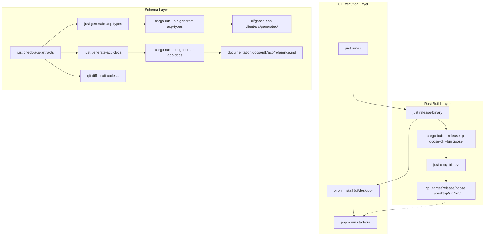

# Local Development & Justfile

Relevant source files

The following files were used as context for generating this wiki page:

- [.github/actions/generate-release-pr-body/pr_body_template.txt](.github/actions/generate-release-pr-body/pr_body_template.txt)
- [.github/copilot-instructions.md](.github/copilot-instructions.md)
- [.github/pull_request_template.md](.github/pull_request_template.md)
- [.github/workflows/check-release-pr.yaml](.github/workflows/check-release-pr.yaml)
- [.github/workflows/ci.yml](.github/workflows/ci.yml)
- [.github/workflows/close-release-pr-on-tag.yaml](.github/workflows/close-release-pr-on-tag.yaml)
- [.github/workflows/create-release-branch.yaml](.github/workflows/create-release-branch.yaml)
- [.github/workflows/create-version-bump-pr.yaml](.github/workflows/create-version-bump-pr.yaml)
- [.github/workflows/docs-update-cli-ref.yml](.github/workflows/docs-update-cli-ref.yml)
- [.github/workflows/goose-issue-solver.yml](.github/workflows/goose-issue-solver.yml)
- [.github/workflows/goose-pr-reviewer.yml](.github/workflows/goose-pr-reviewer.yml)
- [.github/workflows/minor-release.yaml](.github/workflows/minor-release.yaml)
- [.github/workflows/patch-release.yaml](.github/workflows/patch-release.yaml)
- [.github/workflows/pr-smoke-test.yml](.github/workflows/pr-smoke-test.yml)
- [.github/workflows/publish-npm.yml](.github/workflows/publish-npm.yml)
- [.github/workflows/python-sdk-wheels.yml](.github/workflows/python-sdk-wheels.yml)
- [.github/workflows/update-release-pr.yaml](.github/workflows/update-release-pr.yaml)
- [.gitignore](.gitignore)
- [.goosehints](.goosehints)
- [AGENTS.md](AGENTS.md)
- [BUILDING_LINUX.md](BUILDING_LINUX.md)
- [CONTRIBUTING.md](CONTRIBUTING.md)
- [Justfile](Justfile)
- [README.md](README.md)
- [bin/.just-1.40.0.pkg](bin/.just-1.40.0.pkg)
- [bin/just](bin/just)
- [crates/goose-providers/src/declarative/definitions/meta.json](crates/goose-providers/src/declarative/definitions/meta.json)
- [crates/goose/src/lib.rs](crates/goose/src/lib.rs)
- [crates/goose/src/providers/inventory/registrations.rs](crates/goose/src/providers/inventory/registrations.rs)
- [crates/goose/src/providers/kimicode.rs](crates/goose/src/providers/kimicode.rs)
- [crates/goose/src/providers/muse_code_def.rs](crates/goose/src/providers/muse_code_def.rs)
- [crates/goose/src/providers/oauth_device_flow.rs](crates/goose/src/providers/oauth_device_flow.rs)
- [crates/goose/src/providers/xai_oauth.rs](crates/goose/src/providers/xai_oauth.rs)
- [documentation/AGENTS.md](documentation/AGENTS.md)
- [documentation/blog/2025-09-26-hacktoberfest-2025/index.md](documentation/blog/2025-09-26-hacktoberfest-2025/index.md)
- [documentation/src/pages/recipes/data/recipes/README.md](documentation/src/pages/recipes/data/recipes/README.md)
- [flake.lock](flake.lock)
- [flake.nix](flake.nix)
- [ui/desktop/.gitignore](ui/desktop/.gitignore)
- [ui/desktop/README.md](ui/desktop/README.md)
- [ui/desktop/entitlements.plist](ui/desktop/entitlements.plist)
- [ui/desktop/forge.config.ts](ui/desktop/forge.config.ts)
- [ui/desktop/scripts/prepare-platform-binaries.js](ui/desktop/scripts/prepare-platform-binaries.js)
- [ui/desktop/src/platform/windows/bin/README.md](ui/desktop/src/platform/windows/bin/README.md)
- [ui/desktop/src/platform/windows/bin/npx.cmd](ui/desktop/src/platform/windows/bin/npx.cmd)
- [ui/desktop/src/platform/windows/npx.test.ts](ui/desktop/src/platform/windows/npx.test.ts)
- [ui/desktop/src/utils/winShims.ts](ui/desktop/src/utils/winShims.ts)

This page provides a technical overview of the local development environment for Goose. It covers the task automation provided by the `Justfile` task runner, dependency management via Hermit and Nix (`flake.nix`), schema and type generation pipelines, cross-compilation workflows, and contributor guidelines outlined in `CONTRIBUTING.md`, `AGENTS.md`, and `.goosehints`.

Sources:
- [Justfile:1-173]()
- [flake.nix:1-122]()
- [CONTRIBUTING.md:1-116]()
- [AGENTS.md:1-132]()

---

## 1. Development Environment & Toolchain Management

Goose supports reproducible local development through two primary environment managers: **Hermit** and **Nix**.

### Hermit Toolchain Manager
Hermit pins and manages development tool versions (such as Rustup, Node.js, pnpm, Just, etc.) [CONTRIBUTING.md:99-101]().
- **Activation**: Sourcing `bin/activate-hermit` configures the local shell `PATH` and environment variables [AGENTS.md:40](). Shell hook auto-integration is recommended so Hermit activates automatically upon entering the project directory [CONTRIBUTING.md:102-106]().
- **UI Bootstrapping**: The Electron desktop application uses these pinned tools during compilation, handled by initialization scripts such as `ui/desktop/scripts/prepare-platform-binaries.js` [ui/desktop/scripts/prepare-platform-binaries.js:1-50]().

### Nix Flake Setup (`flake.nix`)
For Nix users, `flake.nix` provides a declarative workspace definition utilizing `oxalica/rust-overlay` [flake.nix:6-9]() to pin the exact Rust version specified in `rust-toolchain.toml` [flake.nix:18]().
- **Package Build**: `packages.default` builds the `goose-cli` binary using `rustPlatform.buildRustPackage`, injecting appropriate metadata from Cargo manifests [flake.nix:40-43]() and handling platform dependencies like `libxcb` and `dbus` [flake.nix:62-65]().
- **Development Shell**: `devShells.default` provisions an interactive development environment with `cargo-watch`, `clippy`, `just`, Node.js, and other host utilities [flake.nix:93-107]().

Sources:
- [AGENTS.md:40]()
- [CONTRIBUTING.md:99-106]()
- [flake.nix:1-122]()
- [ui/desktop/scripts/prepare-platform-binaries.js:1-50]()

---

## 2. The Justfile Task Runner & Build Automation

The primary developer automation interface is the `Justfile`, which coordinates building binaries, running the desktop UI, linting, schema generation, and cross-compilation.

### Key Justfile Tasks

| Task | Command(s) | Purpose |
|---|---|---|
| `check-everything` | `cargo fmt --all`, `cargo clippy --all-targets -- -D warnings`, `pnpm run lint:check` | Runs all style and code lint checks [Justfile:8-17](). |
| `release-binary` | `cargo build --release -p goose-cli --bin goose` | Builds the production CLI binary [Justfile:24-26](). |
| `copy-binary` | `cp ./target/{{BUILD_MODE}}/goose ./ui/desktop/src/bin/` | Copies built CLI binary into Electron packaging directories [Justfile:45-54](). |
| `run-ui` | `just release-binary` + `pnpm install && pnpm run start-gui` | Compiles a fresh backend and launches the Electron application [Justfile:87-90](). |
| `generate-acp-types` | `cargo run --bin generate-acp-types` | Generates ACP TypeScript types for the UI [Justfile:178-181](). |
| `generate-acp-docs` | `cargo run --bin generate-acp-docs` | Generates ACP documentation [Justfile:183-186](). |
| `check-acp-artifacts` | `git diff --exit-code crates/goose/acp-schema.json crates/goose/acp-meta.json ui/goose-acp-client/src/generated/` | Validates that checked-in ACP definitions match Rust types [Justfile:155-165](). |

Sources:
- [Justfile:8-17]()
- [Justfile:24-26]()
- [Justfile:45-54]()
- [Justfile:87-90]()
- [Justfile:155-165]()
- [Justfile:178-181]()
- [Justfile:183-186]()

---

### Diagram: Justfile Build Pipeline

This diagram associates `Justfile` tasks with their corresponding cargo compilation targets and file system artifacts.

Sources:
- [Justfile:24-28]()
- [Justfile:45-54]()
- [Justfile:87-90]()
- [Justfile:155-165]()
- [Justfile:178-181]()
- [Justfile:183-186]()

---

## 3. Schema & Type Generation Pipeline

Goose maintains strict parity between Rust backend definitions and client-side interfaces using automated code-generation targets.

- **ACP Schema Generation**: The `generate-acp-types` binary inspects Rust data structures in `crates/goose` and outputs `acp-schema.json`, `acp-meta.json`, and TypeScript types for the UI [Justfile:178-181]().
- **Artifact Verification**: CI pipelines execute `check-acp-artifacts` to ensure developers regenerate schemas when modifying ACP types [Justfile:155-165]().

Sources:
- [Justfile:155-165]()
- [Justfile:178-181]()

---

## 4. Cross-Compilation & Platform Support

Goose targets macOS (Intel/ARM), Linux (glibc/musl/Vulkan), and Windows (MSVC/CUDA).

- **Windows MSVC Builds**: The `release-windows` target configures the MSVC toolchain, compiles `goose.exe`, and relocates the binary via `copy-binary-windows` [Justfile:35-37](), [Justfile:75-84]().
- **macOS Intel Builds**: The `release-intel` target builds for `x86_64-apple-darwin` [Justfile:40-42]() and `copy-binary-intel` handles the placement [Justfile:57-66]().
- **Linux Variants**: Linux builds leverage Docker containers (`manylinux_2_28`) [.github/workflows/build-cli.yml:1-10]() to guarantee glibc compatibility across different target distros. The `forge.config.ts` also includes specific configurations for `.deb`, `.rpm`, and Flatpak packages, including dependencies for Vulkan builds [ui/desktop/forge.config.ts:87-172]().

Sources:
- [Justfile:35-37]()
- [Justfile:40-42]()
- [Justfile:57-66]()
- [Justfile:75-84]()
- [.github/workflows/build-cli.yml:1-10]()
- [ui/desktop/forge.config.ts:87-172]()

---

## 5. Contributor Workflow & Guidelines

Contributors must follow the standards defined in `CONTRIBUTING.md`, `AGENTS.md`, and `.goosehints`.

- **Issue-Driven Development**: Work must link a verified **Ready** issue from the public Goose Issues board before opening a pull request [CONTRIBUTING.md:12-42](), [AGENTS.md:5-14]().
- **AI Code Reviews**: The project uses an AI code reviewer (codex) and expects contributors to address all AI-generated comments or provide justifications [CONTRIBUTING.md:63-71]().
- **Code Quality & Commits**: Developers must run `cargo fmt --all` and `cargo clippy --all-targets -- -D warnings` prior to submission [AGENTS.md:65-66](). Direct in-place overwriting of running binaries is prohibited to prevent macOS code signature invalidation (`SIGKILL`) [AGENTS.md:127-130]().
- **MCP Server Directory**: New third-party MCP servers should be published to the official MCP Registry, not `documentation/static/servers.json` [AGENTS.md:21-27]().

Sources:
- [CONTRIBUTING.md:1-107]()
- [AGENTS.md:1-132]()

---

## 6. CI/CD Integration

Local automation tasks are reflected in GitHub Actions (`.github/workflows/ci.yml`) to enforce build, test, and style compliance.

- **Rust Formatting & Clippy**: Validates formatting rules and lint parameters [ci.yml:69-84]().
- **Multi-Feature Matrix Testing**: Runs test suites across different TLS backends (`rustls-tls` vs `native-tls`) [ci.yml:200-237]() and checks UniFFI bindings for Python and Kotlin [ci.yml:164-188]().
- **NPM Package Checks**: Ensures `goose-acp` npm packages are correctly built and tested [ci.yml:35-68]().
- **CLI Documentation Updates**: A dedicated workflow (`.github/workflows/docs-update-cli-ref.yml`) automatically updates CLI command documentation on releases [docs-update-cli-ref.yml:1-180]().

Sources:
- [.github/workflows/ci.yml:35-68]()
- [.github/workflows/ci.yml:69-84]()
- [.github/workflows/ci.yml:164-188]()
- [.github/workflows/ci.yml:200-237]()
- [.github/workflows/docs-update-cli-ref.yml:1-180]()