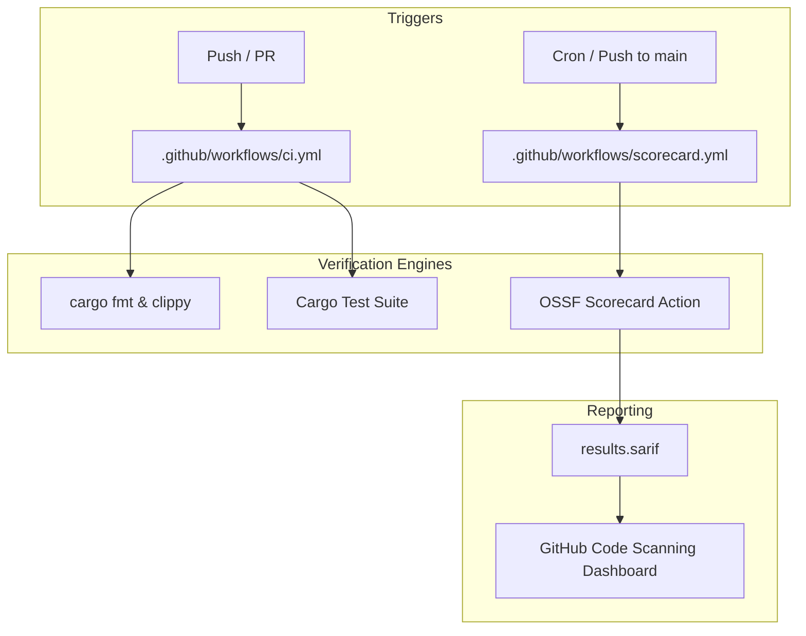
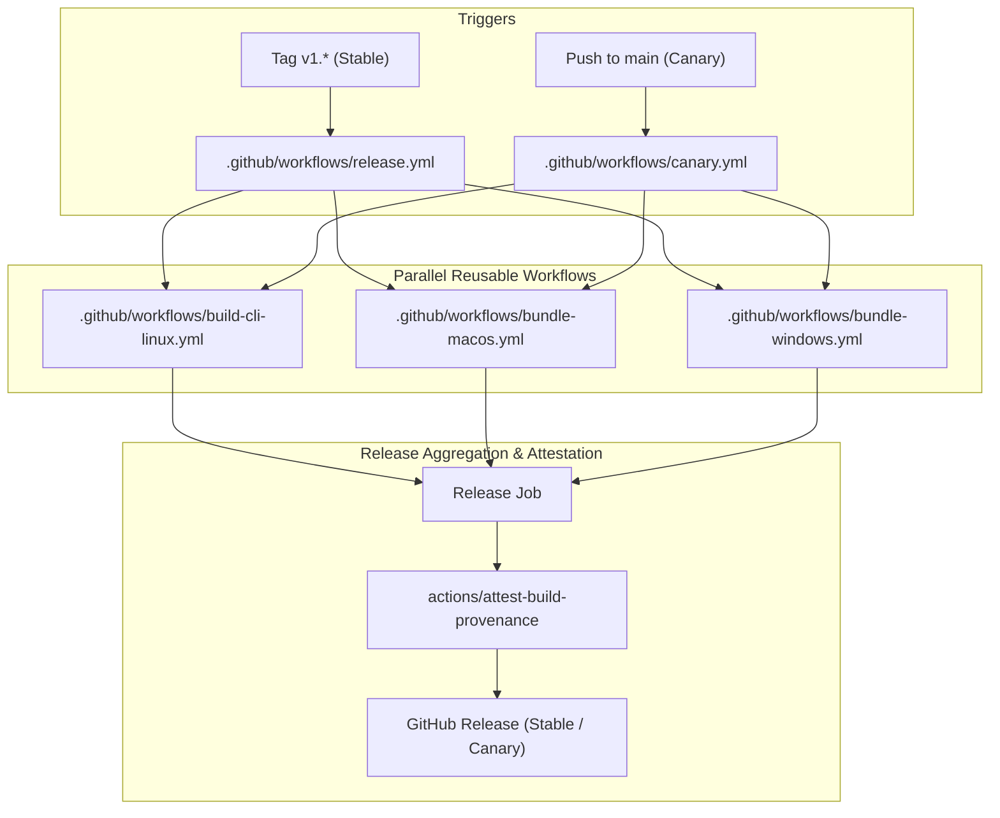
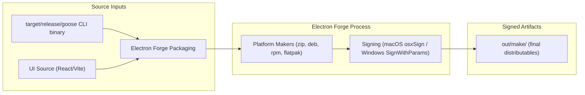
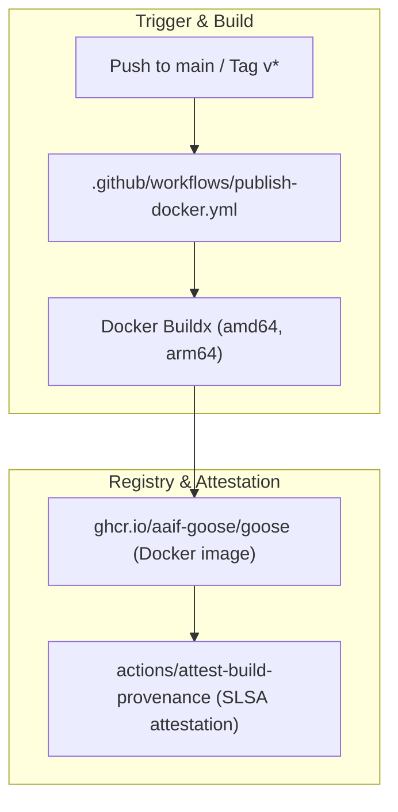
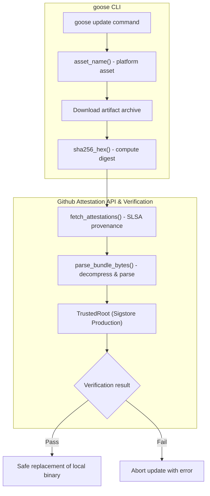
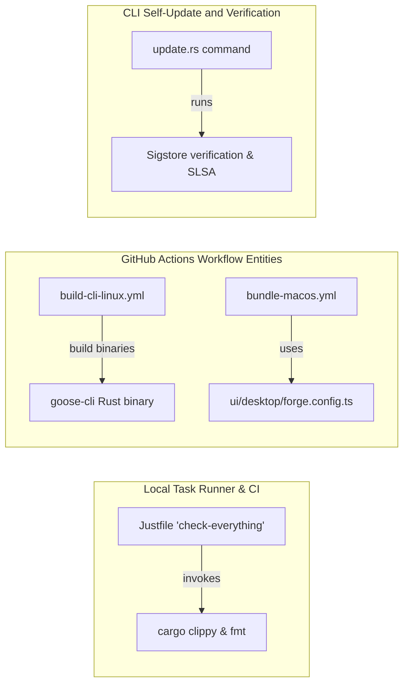

# CI/CD Workflows & Release Pipeline

Relevant source files

The following files were used as context for generating this wiki page:

- [.github/workflows/build-cli.yml](.github/workflows/build-cli.yml)
- [.github/workflows/bundle-windows.yml](.github/workflows/bundle-windows.yml)
- [.github/workflows/canary.yml](.github/workflows/canary.yml)
- [.github/workflows/cargo-deny.yml](.github/workflows/cargo-deny.yml)
- [.github/workflows/code-review.yml](.github/workflows/code-review.yml)
- [.github/workflows/gdk-release-pr.yml](.github/workflows/gdk-release-pr.yml)
- [.github/workflows/gdk-release.yml](.github/workflows/gdk-release.yml)
- [.github/workflows/maven-sdk.yml](.github/workflows/maven-sdk.yml)
- [.github/workflows/mcp-conformance.yml](.github/workflows/mcp-conformance.yml)
- [.github/workflows/model-toolcall-conformance.yml](.github/workflows/model-toolcall-conformance.yml)
- [.github/workflows/publish-ask-ai-bot.yml](.github/workflows/publish-ask-ai-bot.yml)
- [.github/workflows/publish-docker.yml](.github/workflows/publish-docker.yml)
- [.github/workflows/release-branches.yml](.github/workflows/release-branches.yml)
- [.github/workflows/release.yml](.github/workflows/release.yml)
- [.github/workflows/scorecard.yml](.github/workflows/scorecard.yml)
- [.github/workflows/stale.yml](.github/workflows/stale.yml)
- [.github/workflows/update-health-dashboard.yml](.github/workflows/update-health-dashboard.yml)
- [RELEASE.md](RELEASE.md)
- [RELEASE_CHECKLIST.md](RELEASE_CHECKLIST.md)
- [RISCV_SETUP.md](RISCV_SETUP.md)
- [crates/goose-cli/src/commands/update.rs](crates/goose-cli/src/commands/update.rs)
- [crates/goose-sdk/examples/uniffi/kotlin/src/main/kotlin/Main.kt](crates/goose-sdk/examples/uniffi/kotlin/src/main/kotlin/Main.kt)
- [crates/goose-sdk/maven/src/support/kotlin/io/github/aaif_goose/ProviderFlow.kt](crates/goose-sdk/maven/src/support/kotlin/io/github/aaif_goose/ProviderFlow.kt)
- [crates/goose-sdk/scripts/gdk-release.py](crates/goose-sdk/scripts/gdk-release.py)
- [crates/goose-sdk/scripts/maven-resource-prefix.sh](crates/goose-sdk/scripts/maven-resource-prefix.sh)
- [crates/goose-sdk/scripts/prepare-maven-package.sh](crates/goose-sdk/scripts/prepare-maven-package.sh)
- [download_cli.ps1](download_cli.ps1)
- [download_cli.sh](download_cli.sh)
- [release-plz.toml](release-plz.toml)
- [scripts/test_local_model_smoke.sh](scripts/test_local_model_smoke.sh)
- [scripts/test_openrouter_toolcalls.sh](scripts/test_openrouter_toolcalls.sh)
- [services/ask-ai-bot/.gitignore](services/ask-ai-bot/.gitignore)
- [services/ask-ai-bot/clients/ai.ts](services/ask-ai-bot/clients/ai.ts)
- [services/ask-ai-bot/index.ts](services/ask-ai-bot/index.ts)
- [ui/desktop/electron-builder.nsis.header.bmp](ui/desktop/electron-builder.nsis.header.bmp)
- [ui/desktop/electron-builder.nsis.nsh](ui/desktop/electron-builder.nsis.nsh)
- [ui/desktop/electron-builder.nsis.sidebar.bmp](ui/desktop/electron-builder.nsis.sidebar.bmp)
- [ui/desktop/electron-builder.nsis.yml](ui/desktop/electron-builder.nsis.yml)
- [ui/desktop/scripts/generate-windows-update-manifest.js](ui/desktop/scripts/generate-windows-update-manifest.js)
- [ui/desktop/scripts/sign-windows-installer.js](ui/desktop/scripts/sign-windows-installer.js)
- [ui/desktop/src/app-update.yml](ui/desktop/src/app-update.yml)
- [workflow_recipes/release_risk_check/recipe.yaml](workflow_recipes/release_risk_check/recipe.yaml)
- [workflow_recipes/release_risk_check/release_risk_report.py](workflow_recipes/release_risk_check/release_risk_report.py)
- [workflow_recipes/release_risk_check/run.sh](workflow_recipes/release_risk_check/run.sh)

This page details the automation infrastructure for Goose, covering continuous integration (CI), supply chain security analysis, multi-platform desktop bundling and signing, Electron Forge configuration, container and package publishing, and secure CLI self-updates with SLSA provenance and Sigstore verification.

---

## 1. Continuous Integration & Supply Chain Security

The CI pipeline validates every push and pull request, ensuring code quality, formatting, minimum supported Rust version (MSRV) compliance, and test suite execution. Additionally, supply-chain security is continuously monitored via OpenSSF Scorecard and automated health tracking.

### CI Orchestration & Verification
- **Path Filtering**: Workflows like `.github/workflows/ci.yml` utilize path filters to avoid redundant runs on documentation-only changes.
- **Rust Validation**: Enforces `cargo fmt --check`, MSRV checks, and feature-matrix builds (`rustls-tls`, `native-tls`, `goose-roaming`) [[.github/workflows/ci.yml:1-217]]().
- **Scorecard Analysis**: `.github/workflows/scorecard.yml` runs automated security scans on a weekly schedule and on pushes to `main`, generating SARIF reports and uploading results to GitHub's code scanning dashboard [[.github/workflows/scorecard.yml:1-79]]().

**CI & Supply Chain Security Architecture**

Sources: [[.github/workflows/ci.yml:1-217]](), [[.github/workflows/scorecard.yml:1-79]]()

---

## 2. Release Pipeline & Artifact Generation

Goose employs a tiered release architecture:
- **Canary** releases: Triggered automatically on every push to the `main` branch. Canary releases produce pre-release artifacts tagged as `canary` [[.github/workflows/canary.yml:1-174]]().
- **Stable** releases: Triggered by pushing semantic version tags matching `v1.*` and builds production-ready release artifacts [[.github/workflows/release.yml:1-198]]().

Both release workflows fan out to parallel reusable build workflows for Linux, macOS (ARM64 and x64), and Windows (standard and CUDA variants), before converging on a central release job. This final job bundles source archives, generates platform-specific update manifests, applies cryptographic provenance attestations, and creates or updates GitHub Releases with signed assets.

### Release Flow & Fan-Out Architecture

Key features of the release job include:
- Archiving Git source at the release ref into compressed tarballs and zip files.
- Generating macOS and Windows update manifests via Node.js scripts (`ui/desktop/scripts/generate-mac-update-manifest.js` and `generate-windows-update-manifest.js`).
- Attesting binaries, manifests, and packages for supply chain security compliance using `actions/attest-build-provenance`.
- Creating or updating GitHub Releases with all platform binaries and metadata.
- Conditional signing of macOS (using `osxSign`) and Windows artifacts, enabled only for tagged stable releases.

Sources: [[.github/workflows/release.yml:1-187]](), [[.github/workflows/canary.yml:1-174]](), [[.github/workflows/build-cli.yml:1-68]]()

---

## 3. Multi-Platform Desktop Bundling & Electron Forge Configuration

The Goose desktop application uses Electron Forge for packaging and signing across platforms. The Rust `goose-cli` binary is bundled inside an Electron wrapper delivering a cross-platform desktop UI.

### Electron Forge Configuration Overview

The main forge configuration file is `ui/desktop/forge.config.ts`. It includes:

- **Packaging (`asar`)**: Enables ASAR packaging with embedded CLI binaries (`src/bin`), app icons, and platform-specific update manifests [[ui/desktop/forge.config.ts:7-10]]().
- **Makers**: Configured makers include:
  - `@electron-forge/maker-zip` (macOS / Windows),
  - `@electron-forge/maker-deb` (Linux DEB packages),
  - `@electron-forge/maker-rpm` (RPM packages),
  - `@electron-forge/maker-flatpak` (Flatpak for Linux) [[ui/desktop/forge.config.ts:76-172]]().
- **Fuses Plugin**: Enforces security constraints such as disabling `RunAsNode`, enabling cookie encryption, and ASAR integrity validation to harden the app [[ui/desktop/forge.config.ts:198-206]]().

### Desktop Bundling & Signing Flow

Sources: [[ui/desktop/forge.config.ts:1-207]](), [[ui/desktop/README.md:1-115]]()

---

## 4. Publishing Services & Container Images

### Docker Image Publishing

The `.github/workflows/publish-docker.yml` workflow automates multi-architecture container image builds and publishes these images to the GitHub Container Registry (`ghcr.io`).

- **Triggers**: On `main` branch push or version tag push (`v*.*.*`). Ignores documentation and markdown file changes.
- **Platforms**: Builds images for `linux/amd64` and `linux/arm64` using Docker Buildx.
- **Tagging**: Utilizes `docker/metadata-action` to generate tags for branches, commit SHAs, and semantic version rules.
- **Attestation & Security**: Applies SLSA build provenance attestations using `actions/attest-build-provenance` and pushes these attestations alongside images [[.github/workflows/publish-docker.yml:1-73]]().

Sources: [[.github/workflows/publish-docker.yml:1-73]](), [[.github/workflows/publish-ask-ai-bot.yml:1-60]]()

---

## 5. CLI Self-Update & Cryptographic Verification

The Goose CLI supports a secure self-update mechanism implemented in `crates/goose-cli/src/commands/update.rs`. This feature downloads platform-specific release artifacts and verifies them cryptographically using SLSA provenance and Sigstore trust roots before replacing the local binary.

### Update Command Key Functionalities

- **Platform Asset Resolution**  
  The `asset_name()` function returns the expected archive name based on the current platform OS, architecture, and Rust environment (e.g., GNU vs MUSL, CUDA for Windows) [[crates/goose-cli/src/commands/update.rs:24-63]]().

- **Download & Compute SHA-256**  
  Downloads the release artifact and computes the SHA-256 hash of the file content.

- **Fetch & Verify SLSA Provenance Attestations**  
  `fetch_attestations()` queries the GitHub Attestation API for SLSA v1 provenance bundles associated with the binary's SHA-256 digest. Bundles may be served compressed and are decoded transparently [[crates/goose-cli/src/commands/update.rs:129-166]]().

- **Sigstore Root & Policy Verification**  
  Verifies the downloaded bundle against the Sigstore production trusted root (`SIGSTORE_PRODUCTION_TRUSTED_ROOT`). If the verification passes, the update proceeds safely. Otherwise, it aborts to prevent tampering.

### Self-Update & Verification Architecture

Sources: [[crates/goose-cli/src/commands/update.rs:1-220]](), [[download_cli.sh:1-183]]()

---

## 6. User-Facing Universal Installer Script

The shell script `download_cli.sh` provides an easy-to-use installer for the Goose CLI on multiple platforms (macOS, Linux, Windows/MSYS2, Termux on Android). It detects OS and architecture, determines the appropriate release (stable or canary), and downloads the corresponding binary package from GitHub releases.

Features include:
- OS and architecture auto-detection with overrides (`INSTALL_OS`, `GOOSE_LINUX_VARIANT`, `GOOSE_WINDOWS_VARIANT`).
- Manual version override with strict semantic version validation.
- Support for different Linux variants (`standard`, `musl`, `vulkan`) and Windows variants (`standard`, `cuda`).
- Dependency checks for tools like `curl`, `tar`, `unzip`, and PowerShell on Windows [[download_cli.sh:1-183]]().

This script is uploaded as an artifact during releases to ensure users always have an up-to-date CLI installer [[.github/workflows/release.yml:37-45]]().

---

## 7. Code-to-System Mapping & Build References

**Code Entity Space to Pipeline Role**

### Key Build and CI/CD References

| Component / Script           | File Path                            | Role in Pipeline                                                                        |
|-----------------------------|------------------------------------|----------------------------------------------------------------------------------------|
| Release Workflow            | `.github/workflows/release.yml`     | Orchestrates stable multi-platform builds, signing, and tagging                       |
| Canary Workflow             | `.github/workflows/canary.yml`      | Automated continuous deployment on pushes to `main`                                  |
| Electron Forge Config       | `ui/desktop/forge.config.ts`         | Packaging, signing, and platform-specific customizations for desktop                  |
| CLI Update & Verification   | `crates/goose-cli/src/commands/update.rs` | Implements SLSA attestation fetching and Sigstore cryptographic verification          |
| Universal Installer Script  | `download_cli.sh`                   | User-facing CLI installer script supports multi-OS and variant detection              |
| Scorecard Security Analysis | `.github/workflows/scorecard.yml`    | Runs OpenSSF Scorecard supply-chain security scans                                   |

Sources: [[.github/workflows/release.yml:1-187]](), [[.github/workflows/canary.yml:1-174]](), [[.github/workflows/build-cli.yml:1-68]](), [[ui/desktop/forge.config.ts:1-207]](), [[crates/goose-cli/src/commands/update.rs:1-220]](), [[download_cli.sh:1-183]](), [[.github/workflows/scorecard.yml:1-79]]()

---

This comprehensive CI/CD and release infrastructure ensures that Goose maintains high-quality builds, platform coverage, security, and ease of distribution through automation that integrates seamlessly with GitHub Actions, Electron Forge, and Sigstore's verification ecosystem.