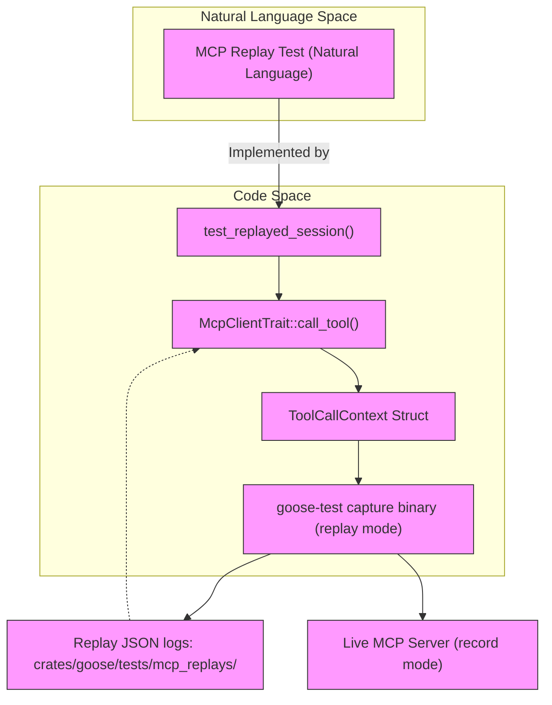
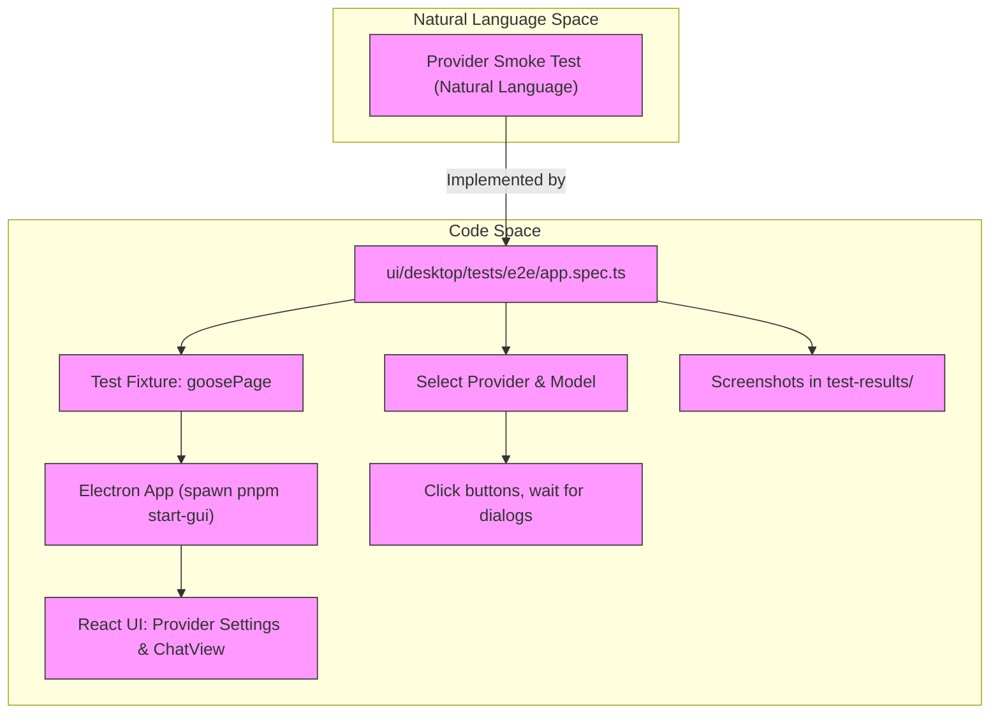

# Testing & Evaluation

Relevant source files

The following files were used as context for generating this wiki page:

- [crates/goose-test-support/src/mcp.rs](crates/goose-test-support/src/mcp.rs)
- [crates/goose/src/otel/mod.rs](crates/goose/src/otel/mod.rs)
- [crates/goose/src/otel/trace_context.rs](crates/goose/src/otel/trace_context.rs)
- [crates/goose/tests/acp_test_data/openai_inspect_context_tool_call.txt](crates/goose/tests/acp_test_data/openai_inspect_context_tool_call.txt)
- [crates/goose/tests/acp_trace_context_test.rs](crates/goose/tests/acp_trace_context_test.rs)
- [ui/desktop/playwright.config.ts](ui/desktop/playwright.config.ts)
- [ui/desktop/src/components/settings/models/bottom_bar/ModelsBottomBar.test.tsx](ui/desktop/src/components/settings/models/bottom_bar/ModelsBottomBar.test.tsx)
- [ui/desktop/tests/e2e/app.spec.ts](ui/desktop/tests/e2e/app.spec.ts)
- [ui/desktop/tests/e2e/basic-mcp.ts](ui/desktop/tests/e2e/basic-mcp.ts)
- [ui/desktop/tests/e2e/context-management.spec.ts](ui/desktop/tests/e2e/context-management.spec.ts)
- [ui/desktop/tests/e2e/enhanced-context-management.spec.ts](ui/desktop/tests/e2e/enhanced-context-management.spec.ts)
- [ui/desktop/tests/e2e/fixtures.ts](ui/desktop/tests/e2e/fixtures.ts)
- [ui/desktop/tests/e2e/loading-state.spec.ts](ui/desktop/tests/e2e/loading-state.spec.ts)
- [ui/desktop/tests/e2e/performance.spec.ts](ui/desktop/tests/e2e/performance.spec.ts)
- [ui/desktop/tests/e2e/test-overlay.ts](ui/desktop/tests/e2e/test-overlay.ts)

This page provides a high-level overview of the testing and evaluation strategies employed across the Goose codebase. The system uses a multi-layered approach to ensure robustness and reliability, covering core internal components, protocol compliance, external provider interactions, user-facing UI flows, and agent performance evaluation.

For detailed technical breakdowns and extensive coverage, see the following child pages:
- [Unit, Integration & E2E Tests](#9.1) — Covers Rust unit and integration tests for the agent, context management, ACP server, MCP replay, provider behavior, subprocess cleanup, plus scenario runners, desktop Vitest and Playwright suites, and provider-error-proxy tools for testing.
- [Benchmarking, Harbor & Evaluation Frameworks](#9.2) — Covers the evals/harbor benchmark tooling including the GooseBinaryAgent adapter and CLI tools, bench post-processing scripts and LLM judge flows, release risk check workflow recipes, and comprehensive model tool-call conformance sweeps.

---

## Overview of Testing Strategies

Goose employs several complementary testing methodologies that target different levels of functionality, integration, and runtime environments:

| Test Type | Scope | Key Tools & Infrastructure |
| --------- | ----- | -------------------------- |
| **Unit & Integration Tests** | Core agent logic, state machine operations, context compaction, ACP server, MCP replay server integrations, and provider-specific behaviors. | Rust's `cargo test`, with tests in crates such as `goose`, `goose-agent`, `goose-providers`, and supplementary crates like `goose-test-support` [crates/goose/tests/mcp_integration_test.rs:1-232](). |
| **MCP Replay & Conformance Tests** | Deterministic replay of recorded JSON-RPC traffic from various MCP server implementations (e.g., GitHub MCP), to verify protocol conformance and tool call correctness. | Recorded sessions in `crates/goose/tests/mcp_replays/`; integration tests invoking `capture` replay binary from goose-test crate for playback [crates/goose/tests/mcp_integration_test.rs:90-122](), [crates/goose-test-support/src/mcp.rs:1-180]() |
| **Provider Smoke & Subrecipe Parallel Tests** | Shell scripts to smoke test external providers and multi-agent subrecipe orchestration workflows to ensure live external dependencies function as expected. | `scripts/test_mcp.sh` invoking temporary FastMCP servers; `scripts/test_subrecipes.sh` testing subagent spawning and parallel subrecipe execution [scripts/test_mcp.sh:1-83](), [scripts/test_subrecipes.sh:1-126]() |
| **End-to-End Desktop UI Tests** | Playwright and Vitest-driven automated tests validating desktop app flows: chat interface, settings, model/provider selection, context management alerts, manual compaction workflows, and provider configuration dialogs. | Playwright-based tests in `ui/desktop/tests/e2e/`; fixture management code that launches fresh Electron app instances per test for isolation [ui/desktop/tests/e2e/app.spec.ts:1-188](), [ui/desktop/tests/e2e/fixtures.ts:1-176]() |
| **Benchmarking & Evaluation Frameworks** | Automated evaluation of agent task competency, accuracy, safety, and tool-call conformance using benchmark scenarios and post-processing judges. | The `evals/harbor` benchmark tooling using GooseBinaryAgent adapter with CLI and Python tooling, release risk check workflows, and LLM model conformance testing [Benchmarking, Harbor & Evaluation Frameworks](#9.2) |

---

## Core Testing Infrastructure

The Goose testing architecture includes a mix of in-code Rust test harnesses, protocol replay facilities, scripting for live smoke tests, and E2E UI automation. The architecture ensures coverage from low-level internal logic through fully integrated desktop client workflows.

### MCP Replay System

Due to the complex and protocol-driven nature of MCP servers, Goose uses a record-and-playback approach for reliable MCP testing:

- **MockProvider**: Implements stubbed behavior returning deterministic assistant messages enabling reproducible MCP session tests [crates/goose/tests/mcp_integration_test.rs:44-86]().
- **Replay Logs**: Store captured JSON-RPC protocol exchanges from real MCP servers or reference implementations. These are stored in `crates/goose/tests/mcp_replays/` covering GitHub MCP servers, the canonical modelcontextprotocol server, and FastMCP instances.
- **Capture Binary**: The `goose-test` crate includes a `capture` binary which performs protocol message recording (capture mode) and deterministic replay from saved JSON logs (replay mode) [crates/goose/tests/mcp_integration_test.rs:90-122]().
- **Fixture MCP Servers**: Implements a test MCP server `McpFixtureServer` providing tools and context inspection endpoints used to validate MCP client handling in tests [crates/goose-test-support/src/mcp.rs:60-180]().

### Integration & Script Validation

Live shell script tests exercise critical runtime scenarios:

- `scripts/test_mcp.sh`: Launches temporary FastMCP servers to validate client MCP extension lifecycle, tool discovery, and tool execution correctness.
- `scripts/test_subrecipes.sh`: Verifies multi-agent orchestration and parallel execution of user scenarios (subrecipes), such as file stats gathering and code pattern extraction workflows.

### End-to-End Desktop UI Tests

UI and UX validation uses Playwright-based E2E tests orchestrated with test fixtures that launch a fresh Electron desktop app instance per test, ensuring environment isolation and stable test runs.

- Fixture (`ui/desktop/tests/e2e/fixtures.ts`) launches Electron with remote debugging for Playwright control [ui/desktop/tests/e2e/fixtures.ts:1-176]().
- Tests (`ui/desktop/tests/e2e/*.spec.ts`) cover:
  - Basic chat flows and provider selection flows (`app.spec.ts`)
  - Context management UI alerts, manual compaction workflow, and loading states (`context-management.spec.ts`, `enhanced-context-management.spec.ts`)
  - Performance and responsiveness (`performance.spec.ts`)
- UI helpers display test overlays for visibility during runs (`test-overlay.ts`) [ui/desktop/tests/e2e/test-overlay.ts:1-52]().
- Playwright config tuned for robust test execution, video capture, screenshot on failure, and adjusted timeouts [ui/desktop/playwright.config.ts:1-26]().

---

## Evaluation Frameworks & Benchmarking

Goose includes production-grade evaluation frameworks to continuously assess agent skill accuracy, safety, and tool compliance:

- **Harbor benchmarking tooling** in `evals/harbor` measures agent performance in scripted conversational tasks.
- The `GooseBinaryAgent` adapter allows integrating Goose agent runs into evaluation workflows.
- Benchmark results are post-processed by LLM judges to generate scored outcomes and evaluations.
- Automated "release risk check" workflows validate new releases against benchmark suites.
- Model tool-call schema conformance and provider response correctness are automatically swept to ensure integration fidelity.

For details, see the dedicated child page: [Benchmarking, Harbor & Evaluation Frameworks](#9.2).

---

## Testing Architecture Diagrams

### Mapping Natural Language "MCP Replay Test" to Code

This diagram connects the natural language concept of "MCP replay tests" with the real code constructs:
- `test_replayed_session` in the Rust test suite orchestrates calls.
- Calls flow into MCP client traits and tool call context.
- Playback is performed by the `capture` binary, reading JSON replay files.
- Optionally, captures live MCP servers for recording new test data.

Sources: [crates/goose/tests/mcp_integration_test.rs:165-224](), [crates/goose/src/agents/mcp_client.rs:80-125](), [crates/goose-test-support/src/mcp.rs:60-180]()

---

### Mapping Desktop E2E Provider Smoke Test to Code

This diagram illustrates the "Provider Smoke Test" in the desktop UI:
- The Playwright test suite launches a fresh Electron app instance using a fixture (`ui/desktop/tests/e2e/fixtures.ts`).
- The test scripts (`app.spec.ts`) interact with the React UI to navigate to provider settings, select models, and validate UI workflows.
- UI actions such as clicking buttons and waiting for dialogs model user interactions.
- Screenshots are saved for test diagnostics.

Sources: [ui/desktop/tests/e2e/app.spec.ts:1-188](), [ui/desktop/tests/e2e/fixtures.ts:1-176](), [ui/desktop/tests/e2e/test-overlay.ts:1-52]()

---

## Sub-pages

- **[Unit, Integration & E2E Tests](#9.1)**  
  Deep dive into unit and integration testing approaches, the test-support framework, scenario runners, and the desktop UI test suites via Playwright and Vitest.

- **[Benchmarking, Harbor & Evaluation Frameworks](#9.2)**  
  Detailed coverage of benchmarking tooling, agent evaluation workflows, benchmark post-processing with LLM judges, and conformance sweeps for model tooling.

---

Sources:

- [crates/goose/tests/mcp_integration_test.rs:1-232]()
- [crates/goose-test-support/src/mcp.rs:1-180]()
- [scripts/test_mcp.sh:1-83]()
- [scripts/test_subrecipes.sh:1-126]()
- [ui/desktop/tests/e2e/app.spec.ts:1-188]()
- [ui/desktop/tests/e2e/fixtures.ts:1-176]()
- [ui/desktop/tests/e2e/test-overlay.ts:1-52]()
- [crates/goose/src/agents/mcp_client.rs:80-125]()