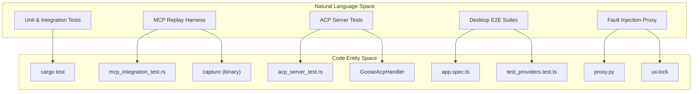
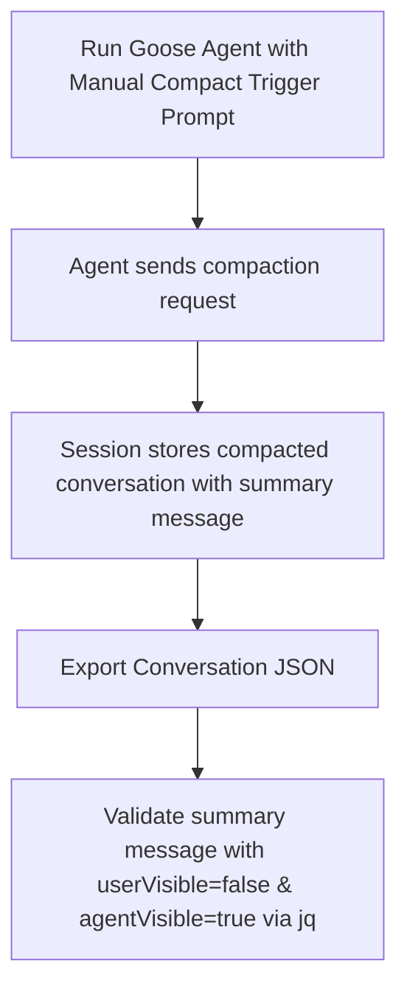
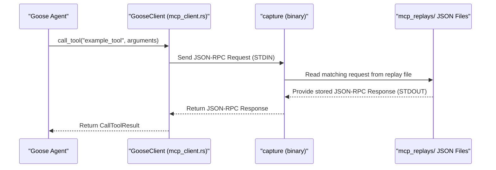

# Unit, Integration & E2E Tests

<details>
<summary>Relevant source files</summary>

The following files were used as context for generating this wiki page:

- [crates/goose-test-support/src/mcp.rs](crates/goose-test-support/src/mcp.rs)
- [crates/goose/src/agents/mcp_client.rs](crates/goose/src/agents/mcp_client.rs)
- [crates/goose/src/otel/mod.rs](crates/goose/src/otel/mod.rs)
- [crates/goose/src/otel/trace_context.rs](crates/goose/src/otel/trace_context.rs)
- [crates/goose/tests/acp_test_data/openai_inspect_context_tool_call.txt](crates/goose/tests/acp_test_data/openai_inspect_context_tool_call.txt)
- [crates/goose/tests/acp_trace_context_test.rs](crates/goose/tests/acp_trace_context_test.rs)
- [crates/goose/tests/mcp_integration_test.rs](crates/goose/tests/mcp_integration_test.rs)
- [crates/goose/tests/mcp_replays/github-mcp-serverstdio](crates/goose/tests/mcp_replays/github-mcp-serverstdio)
- [crates/goose/tests/mcp_replays/github-mcp-serverstdio.results.json](crates/goose/tests/mcp_replays/github-mcp-serverstdio.results.json)
- [crates/goose/tests/mcp_replays/npx-y@modelcontextprotocol_server-everything@2026.1.14](crates/goose/tests/mcp_replays/npx-y@modelcontextprotocol_server-everything@2026.1.14)
- [crates/goose/tests/mcp_replays/npx-y@modelcontextprotocol_server-everything@2026.1.14.results.json](crates/goose/tests/mcp_replays/npx-y@modelcontextprotocol_server-everything@2026.1.14.results.json)
- [crates/goose/tests/mcp_replays/uvrun--withfastmcp==2.14.4fastmcpruntests_fastmcp_test_server.py](crates/goose/tests/mcp_replays/uvrun--withfastmcp==2.14.4fastmcpruntests_fastmcp_test_server.py)
- [documentation/blog/2025-11-30-announcing-advent-of-ai/index.md](documentation/blog/2025-11-30-announcing-advent-of-ai/index.md)
- [documentation/blog/2025-12-04-mcp-sampling/index.md](documentation/blog/2025-12-04-mcp-sampling/index.md)
- [documentation/blog/2026-01-15-why-tool-descriptions-arent-enough/index.md](documentation/blog/2026-01-15-why-tool-descriptions-arent-enough/index.md)
- [documentation/docs/mcp/council-of-mine-mcp.md](documentation/docs/mcp/council-of-mine-mcp.md)
- [scripts/provider-error-proxy/README.md](scripts/provider-error-proxy/README.md)
- [scripts/provider-error-proxy/proxy.py](scripts/provider-error-proxy/proxy.py)
- [scripts/provider-error-proxy/pyproject.toml](scripts/provider-error-proxy/pyproject.toml)
- [scripts/provider-error-proxy/uv.lock](scripts/provider-error-proxy/uv.lock)
- [scripts/test_compaction.sh](scripts/test_compaction.sh)
- [ui/desktop/playwright.config.ts](ui/desktop/playwright.config.ts)
- [ui/desktop/src/components/settings/models/bottom_bar/ModelsBottomBar.test.tsx](ui/desktop/src/components/settings/models/bottom_bar/ModelsBottomBar.test.tsx)
- [ui/desktop/tests/e2e/app.spec.ts](ui/desktop/tests/e2e/app.spec.ts)
- [ui/desktop/tests/e2e/basic-mcp.ts](ui/desktop/tests/e2e/basic-mcp.ts)
- [ui/desktop/tests/e2e/context-management.spec.ts](ui/desktop/tests/e2e/context-management.spec.ts)
- [ui/desktop/tests/e2e/enhanced-context-management.spec.ts](ui/desktop/tests/e2e/enhanced-context-management.spec.ts)
- [ui/desktop/tests/e2e/fixtures.ts](ui/desktop/tests/e2e/fixtures.ts)
- [ui/desktop/tests/e2e/loading-state.spec.ts](ui/desktop/tests/e2e/loading-state.spec.ts)
- [ui/desktop/tests/e2e/performance.spec.ts](ui/desktop/tests/e2e/performance.spec.ts)
- [ui/desktop/tests/e2e/test-overlay.ts](ui/desktop/tests/e2e/test-overlay.ts)

</details>


Goose employs a comprehensive, multi-layered testing strategy ensuring robustness of its core agent logic, provider integrations, MCP extension interactions, and desktop UI stability. This strategy integrates Rust unit/integration tests, MCP record/replay harnesses, ACP server test suites, compaction smoke tests, frontend Vitest and Playwright E2E test suites, and a Python-based fault injection proxy for provider error simulation.

---

## Testing Architecture & Test Crates

The Goose workspace contains dedicated test support crates and binaries providing shared mocks, fixtures, and replay tools:

- **`goose-test-support`**  
  Supplies shared constants (`TEST_MODEL`, `TEST_IMAGE_B64`, `FAKE_CODE`), mock MCP servers (`McpFixtureServer`), test helpers, and session utilities used across tests [crates/goose-test-support/src/mcp.rs:23-128]().

- **`goose-test` crate**  
  Contains standalone test binaries including the `capture` binary dedicated to intercepting MCP binary I/O (STDIN/STDOUT) streams for replay tests [crates/goose/tests/mcp_integration_test.rs:46-80]().

These test crates enable isolation, fixture reuse, and deterministic testing for complex asynchronous interactions in MCP and ACP protocol layers.

**Testing Architecture Map (Natural Language to Code Entities)**  
This diagram maps major testing categories to core test code entities and utilities.



Sources: [crates/goose/tests/acp_common_tests/mod.rs:20](), [crates/goose/tests/acp_server_test.rs:1-31](), [crates/goose-test-support/src/mcp.rs:23-128](), [crates/goose/tests/mcp_integration_test.rs:46-80](), [scripts/provider-error-proxy/uv.lock:1-12]()

---

## Rust Unit & Integration Tests

Core logic, including agent behavior, context management, compaction, MCP client, and subprocess cleanup, is exercised via Rust unit and integration tests using the standard `cargo test` framework.

### Agent & Context Compaction Smoke Tests

The compaction feature controlling conversation context window size is verified with two main tests implemented in a shell script (`scripts/test_compaction.sh`):

- **Manual Compaction**: Sends a manual compact trigger prompt (`"Please compact this conversation"`) and verifies via exported session JSON that a summary message with metadata `userVisible=false` and `agentVisible=true` exists [scripts/test_compaction.sh:119-160]().
- **Auto Compaction**: Configures a very low auto-compaction threshold (`GOOSE_AUTO_COMPACT_THRESHOLD=0.005`) to force compactions during a long token output test run, validating presence of appropriate message visibility flags [scripts/test_compaction.sh:180-192]().

The script uses `jq` to parse and verify JSON session export structure, checking for summary and preserved messages with correct visibility flags [scripts/test_compaction.sh:51-109]().

#### Manual Compaction Validation Data Flow



Sources: [scripts/test_compaction.sh:3-109](), [scripts/test_compaction.sh:119-192]()

---

## ACP Server & MCP Replay Test Harnesses

### MCP Replay System

To achieve deterministic and network-flake-free testing of MCP client-server interactions, Goose uses a record/replay mechanism involving:

- **GooseClient**: The MCP client abstraction in `crates/goose/src/agents/mcp_client.rs` managing JSON-RPC communication and tool calls [crates/goose/src/agents/mcp_client.rs:199-207]().
- **capture binary**: Intercepts and records/mocks STDIN/STDOUT JSON-RPC streams between GooseClient and MCP servers [crates/goose/tests/mcp_integration_test.rs:88-122]().

Testing modes include:

- **Record Mode**: Executes real MCP server binaries capturing full JSON-RPC conversation for later playback.
- **Playback Mode**: Uses static JSON fixture files (e.g., `github-mcp-serverstdio`) replayed by the capture utility to simulate server responses reproducibly.

Mocks like `McpFixtureServer` provide controlled test MCP servers to exercise request handling and tool call workflows [crates/goose-test-support/src/mcp.rs:60-180]().

#### MCP Replay Data Flow Diagram



Sources: [crates/goose/src/agents/mcp_client.rs:199-207](), [crates/goose/tests/mcp_integration_test.rs:165-217](), [crates/goose-test-support/src/mcp.rs:60-180]()

### ACP Server Integration Tests

The ACP server suite, primarily in `acp_server_test.rs` and common test modules, validates:

- Session lifecycle operations: creating new sessions, listing active sessions, and deleting sessions.
- Tool call execution and state enrichment via the `GooseAcpHandler`.
- Replay and enrichment of conversations with tool call label resolution for client UI [crates/goose/src/acp/server/load_session.rs:118-179]().

These tests ensure robust ACP server behavior in realistic session contexts.

Sources: [crates/goose/tests/acp_server_test.rs:1-31](), [crates/goose/tests/acp_common_tests/mod.rs:68-105](), [crates/goose/src/acp/server/load_session.rs:118-179]()

---

## Desktop Frontend Test Suites (Vitest & Playwright)

Goose’s Electron desktop UI includes comprehensive frontend test suites for integration and end-to-end validation.

- **Vitest Integration Tests**:  
  Located in `ui/desktop/tests/integration/` and test isolated React components, hooks, and state management, validating provider configuration UI, model selection, and settings management [ui/desktop/tests/integration/test_providers.test.ts:1-1]().

- **Playwright End-to-End Tests**:  
  Under `ui/desktop/tests/e2e/`, these suites launch the full Electron app and orchestrate realistic user flows including prompt entry, provider/model selection, context management, and UI navigation. An example is `app.spec.ts` which tests provider selection workflows and UI readiness with viewport screenshots [ui/desktop/tests/e2e/app.spec.ts:1-188]().

Example of Playwright test setup for selecting a provider:

```typescript
async function selectProvider(mainWindow: Page, provider: Provider) {
  // Navigate settings, reset provider, select desired provider card,
  // handle dialogs, and return to chat interface.
  // See ui/desktop/tests/e2e/app.spec.ts for full implementation.
}
```

Sources: [ui/desktop/tests/integration/test_providers.test.ts:1-1](), [ui/desktop/tests/e2e/app.spec.ts:1-188]()

---

## Provider Error Proxy & Fault Injection

To verify Goose’s agent robustness against transient upstream failures such as rate limiting (HTTP 429), timeouts, and malformed provider payloads, a dedicated Python proxy is used:

- **`provider-error-proxy`**: Implements an HTTP proxy that intercepts and injects controlled errors into provider API requests to simulate failure scenarios and test recovery strategies [scripts/provider-error-proxy/proxy.py:1-100 (not shown)].
- This proxy leverages `aiohttp` and dependent asynchronous libraries pinned via `uv.lock` ensuring reproducible Python dependency resolution [scripts/provider-error-proxy/uv.lock:1-12]().

This fault injection setup is critical for testing Goose agent resilience in controlled, repeatable conditions.

Sources: [scripts/provider-error-proxy/uv.lock:1-12]()

---

This layered test infrastructure guarantees Goose’s reliability, from Rust core modules through MCP and ACP protocol boundaries, to end-user desktop UI workflows and fault tolerance in external provider interactions.