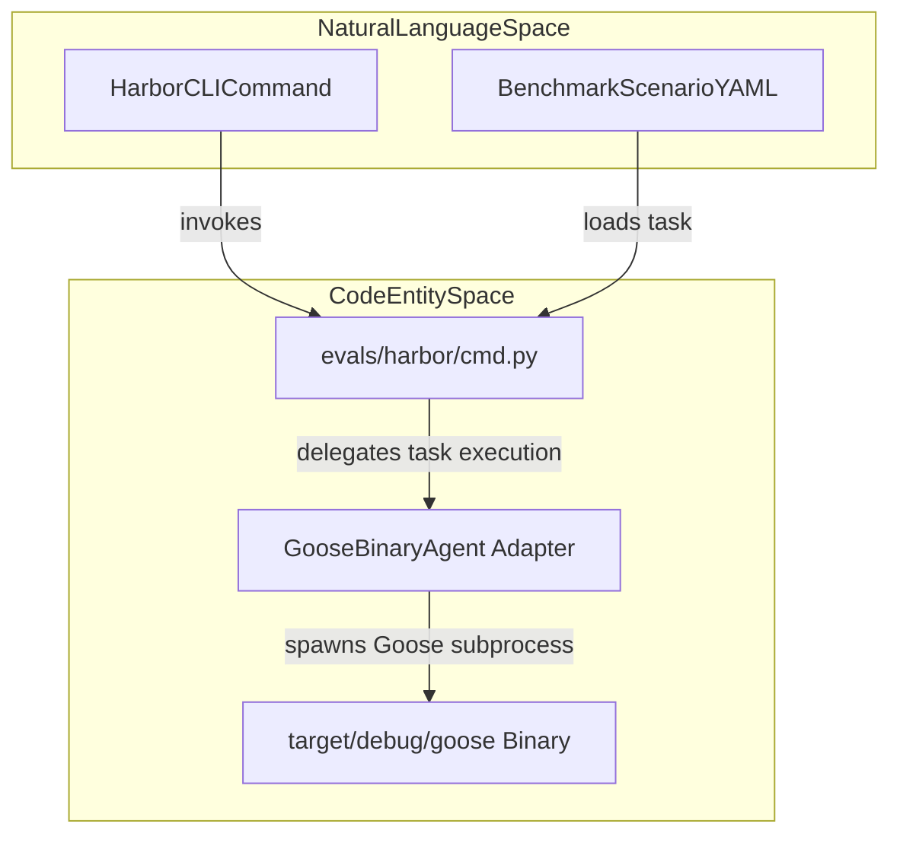
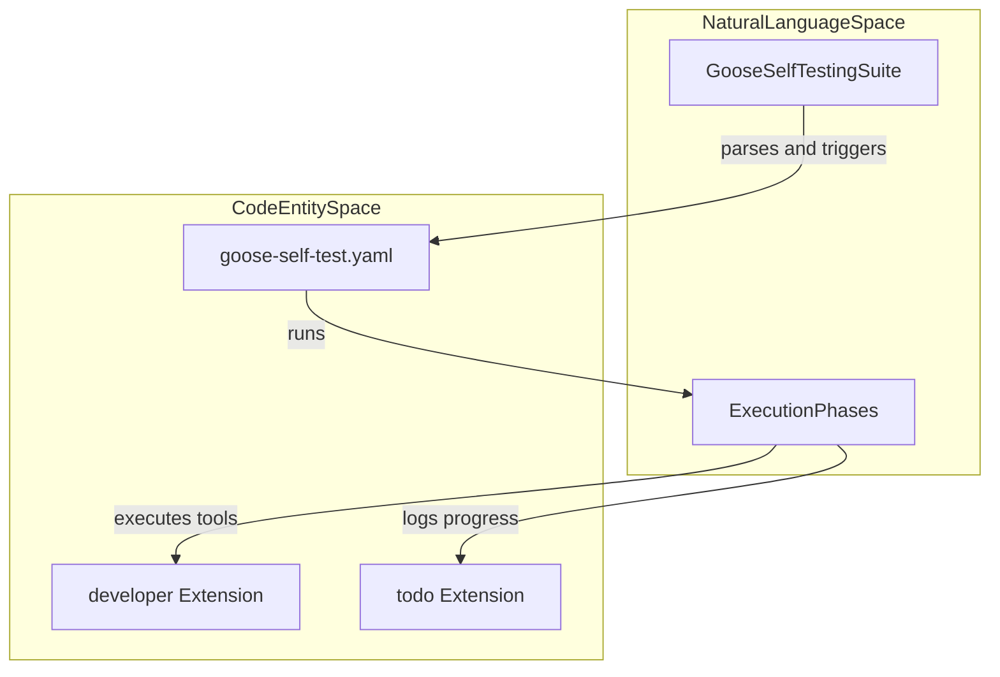
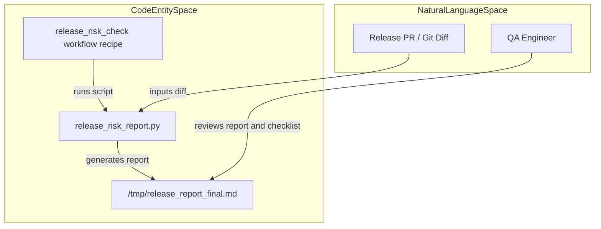
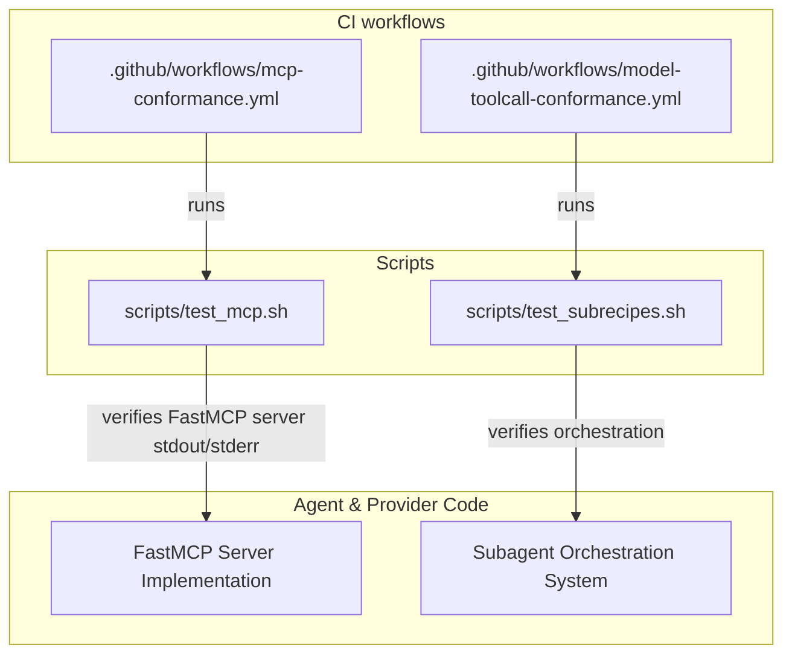

# Benchmarking, Harbor & Evaluation Frameworks

Relevant source files

The following files were used as context for generating this wiki page:

- [.github/workflows/release-branches.yml](.github/workflows/release-branches.yml)
- [RELEASE.md](RELEASE.md)
- [RELEASE_CHECKLIST.md](RELEASE_CHECKLIST.md)
- [crates/goose-provider-types/src/base.rs](crates/goose-provider-types/src/base.rs)
- [crates/goose-provider-types/tests/declared_model.rs](crates/goose-provider-types/tests/declared_model.rs)
- [crates/goose-providers/src/azure_foundry.rs](crates/goose-providers/src/azure_foundry.rs)
- [crates/goose-providers/tests/declared_vision.rs](crates/goose-providers/tests/declared_vision.rs)
- [crates/goose/src/acp/mod.rs](crates/goose/src/acp/mod.rs)
- [crates/goose/src/acp/provider.rs](crates/goose/src/acp/provider.rs)
- [crates/goose/tests/declared_vision_registry.rs](crates/goose/tests/declared_vision_registry.rs)
- [goose-self-test.yaml](goose-self-test.yaml)
- [scripts/test-subrecipes-examples/project_analyzer.yaml](scripts/test-subrecipes-examples/project_analyzer.yaml)
- [scripts/test-subrecipes-examples/project_analyzer_parallel.yaml](scripts/test-subrecipes-examples/project_analyzer_parallel.yaml)
- [scripts/test-subrecipes-examples/subrecipes/code_patterns.yaml](scripts/test-subrecipes-examples/subrecipes/code_patterns.yaml)
- [scripts/test-subrecipes-examples/subrecipes/file_stats.yaml](scripts/test-subrecipes-examples/subrecipes/file_stats.yaml)
- [scripts/test_mcp.sh](scripts/test_mcp.sh)
- [scripts/test_subrecipes.sh](scripts/test_subrecipes.sh)
- [workflow_recipes/release_risk_check/recipe.yaml](workflow_recipes/release_risk_check/recipe.yaml)
- [workflow_recipes/release_risk_check/release_risk_report.py](workflow_recipes/release_risk_check/release_risk_report.py)
- [workflow_recipes/release_risk_check/run.sh](workflow_recipes/release_risk_check/run.sh)

## Purpose and Scope

This page documents Goose's benchmarking, harness, and evaluation subsystems. These frameworks enable rigorous testing and validation of LLM providers and extensions, including meta self-tests, release risk assessment, and automated tool-call conformance. The components covered include:

- The `evals/harbor` benchmark tooling (GooseBinaryAgent adapter, CLI interface)
- Bench post-processing scripts and LLM judges for transcript evaluation
- The `goose-self-test.yaml` self-testing recipe
- The `release_risk_check` workflow recipe and risk analysis reports
- Model tool-call conformance testing and MCP-based validation

Together, these systems integrate closely with Goose's agent, provider layers, and CI/CD workflows to ensure reliability and correctness across releases.

Sources: `goose-self-test.yaml:1-21`(), `workflow_recipes/release_risk_check/recipe.yaml:1-12`() 

---

## 1. Harbor Benchmark Tooling & Adapters

The `evals/harbor` directory hosts Goose's primary benchmarking and agent evaluation tooling. It provides:

- **GooseBinaryAgent Adapter**: This serves as an interface adapter that wraps the Goose CLI binary (`target/debug/goose`). It enables benchmark scenarios defined in YAML to programmatically execute Goose runs as subprocesses.

- **`cmd.py` CLI**: The command-line entrypoint for running Harbor benchmarks. It loads scenario definitions (prompt tasks and tool invocations), manages task filtering (by scenario, model, or seed), coordinates subprocess execution via GooseBinaryAgent, and aggregates metrics.

### Flow of Harbor Execution

The pipeline transitions from human-readable benchmark scenarios through Python tooling into Goose subprocess runs:

This architecture supports flexible CLI options to select benchmarks by scenario or model, seed randomization, concurrency control, and detailed log generation to analyze LLM agent performance.

Sources: `.github/workflows/pr-smoke-test.yml:107-128`(), `.github/workflows/pr-smoke-test.yml:137-152`() 

---

## 2. Evaluation Frameworks & Self-Testing (`goose-self-test.yaml`)

Goose includes a comprehensive self-testing integration suite specified in `goose-self-test.yaml`, which enables the running Goose instance to validate its own internal functionality via first-person meta-testing.

### Self-Test Recipe Features

- **Phased Testing**: The suite is split into clear phases including environment and workspace initialization, tooling validation (file operations, shell command execution), extension system testing, code mode evaluation (JavaScript tooling and isolation), delegation tests, and advanced boundary/error conditions.

- **Core Philosophy**: The Goose agent is both the tester and the system under test. It uses its native tools, extensions (such as developer, todo, summon, skills), and environment to create test scenarios, run them, and report results. This approach validates multi-turn reasoning, permission handling, tool delegation limits, and error recovery internally.

- **Parameters**: Configurable parameters allow selective phase execution, parallel test runs, test depth control, and workspace location settings.

The recipe tests core system behaviors including file CRUD, shell commands, extension discovery and isolation, tool-call sequencing, nested delegation prevention, and ACP thinking effort discovery, to ensure the Goose agent behaves reliably under complex scenarios.

Sources: `goose-self-test.yaml:1-130`()

---

## 3. Bench Post-Process Scripts & LLM Judges

Following benchmark runs, Goose relies on automated evaluation scripts and LLM-based judges to assess the quality of generated conversations and tool call correctness.

- **LLM as Judge**: Using dedicated LLM prompts, transcripts from benchmark runs are evaluated to verify that tool calls satisfy instructions and model outputs align with expected assertions.

- **Regex & Heuristic Validators**: These scripts parse logs and output files to confirm scenario success, detect errors or missing tool calls, and verify compliance with benchmark objectives.

These post-processors integrate into the CI workflows and release pipelines, for example in GitHub Actions workflows like `pr-smoke-test.yml`.

Sources: `.github/workflows/pr-smoke-test.yml:137-163`(), `workflow_recipes/release_risk_check/release_risk_report.py:1-15`()

---

## 4. Release Risk Check Workflow Recipe

To safeguard release quality, Goose defines a `release_risk_check` workflow recipe that performs static risk analysis and generates manual testing plans before shipping a new version.

### Components:

- **`release_risk_report.py`**: This Python script analyzes Git diffs to identify the nature and scope of code changes. It computes a risk score based on line counts, modified core modules (agent, providers, extensions), and coverage of affected functionality by existing tests. It flags missing unit tests or large-impact areas that require manual intervention.

- **Manual Checklist Integration**: Supplementing the automated report, a QA checklist (e.g., in `RELEASE.md` and `RELEASE_CHECKLIST.md`) outlines steps including targeted manual testing and verification in critical subsystems such as the agent state machine, extension loader, and permission judge.

This workflow executes in CI and is run manually prior to tagging releases, outputting comprehensive risk assessments and suggested test plans.

Sources: `workflow_recipes/release_risk_check/release_risk_report.py:117-184`(), `RELEASE.md:1-29`()

---

## 5. Model Tool-Call Conformance Sweeps

Goose verifies LLM provider and tool integration correctness through automated tool-call conformance tests and continuous integration:

- **MCP Conformance Testing**: CI jobs (`mcp-conformance.yml`, `model-toolcall-conformance.yml`) run tests verifying compatibility with the Model Context Protocol. These validate upstream tool calling schemas, argument parsing, streaming behaviors, and correct serialization for providers like OpenAI, Anthropic, and Google.

- **Subrecipe & MCP Harness Verification**: Shell scripts such as `scripts/test_mcp.sh` confirm that subprocess MCP servers (e.g., implemented in FastMCP) correctly handle stdout, stderr, and provide expected tool outputs under live conditions. The `scripts/test_subrecipes.sh` validates multi-agent orchestration by running subrecipes in parallel workflows.

- **Integration With Harbor/Evals Harness**: These tests integrate with the Harbor benchmarking framework and release test suites to ensure multi-provider interoperability and that tools adhere strictly to protocol specifications.

Sources: `.github/workflows/pr-smoke-test.yml:137-163`(), `.github/workflows/ci.yml:104-113`(), `scripts/test_mcp.sh:1-83`(), `scripts/test_subrecipes.sh:1-127`()

---

# Summary

Goose's evaluation ecosystem is a robust, multi-layered framework combining:

- The *Harbor* benchmark harness for orchestrated agent testing with the GooseBinaryAgent adapter.
- Meta self-testing via declarative `goose-self-test.yaml` recipes validating agent capabilities using native tools.
- Automated post-processing and LLM-based ratings of benchmark outputs.
- Release risk checks that statically analyze code changes and provide QA plans before publishing.
- Continuous tool-call conformance sweeps ensuring MCP protocol adherence across providers and orchestrations.

These components integrate tightly with core code, CI pipelines, and provider abstractions to maintain high confidence in Goose's stability and correctness over evolving LLM and tooling landscapes.

---

# References

- `goose-self-test.yaml:1-161`  
- `workflow_recipes/release_risk_check/recipe.yaml:1-12`  
- `workflow_recipes/release_risk_check/release_risk_report.py:1-184`  
- `.github/workflows/pr-smoke-test.yml:107-163`  
- `.github/workflows/ci.yml:104-113`  
- `scripts/test_mcp.sh:1-83`  
- `scripts/test_subrecipes.sh:1-127`