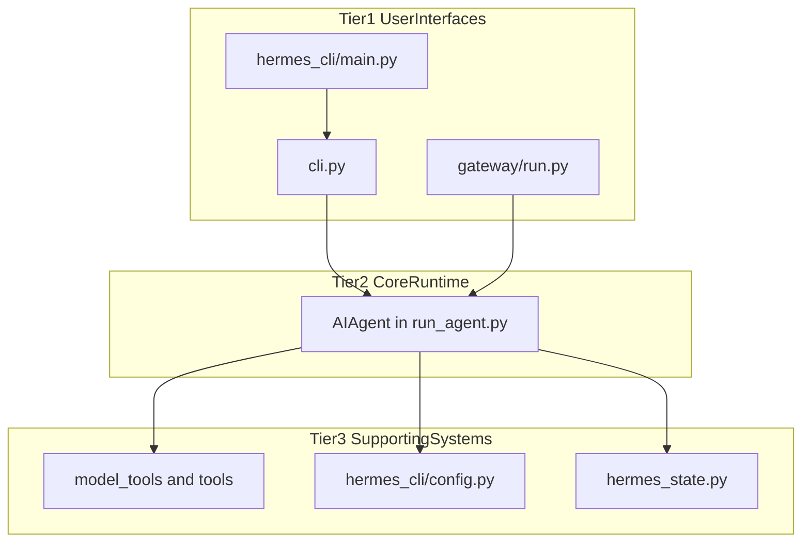
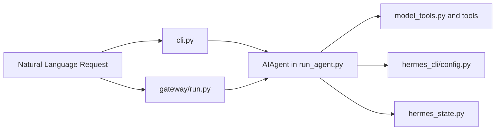

# Overview

Relevant source files

The following files were used as context for generating this wiki page:

- [.env.example](.env.example)
- [AGENTS.md](AGENTS.md)
- [CONTRIBUTING.es.md](CONTRIBUTING.es.md)
- [CONTRIBUTING.md](CONTRIBUTING.md)
- [README.md](README.md)
- [activate](activate)
- [activate.fish](activate.fish)
- [activate.ps1](activate.ps1)
- [agent/auxiliary_client.py](agent/auxiliary_client.py)
- [cli-config.yaml.example](cli-config.yaml.example)
- [cli.py](cli.py)
- [gateway/run.py](gateway/run.py)
- [gateway/session.py](gateway/session.py)
- [gateway/slash_commands.py](gateway/slash_commands.py)
- [hermes](hermes)
- [hermes_cli/cli_commands_mixin.py](hermes_cli/cli_commands_mixin.py)
- [hermes_cli/commands.py](hermes_cli/commands.py)
- [hermes_cli/config.py](hermes_cli/config.py)
- [hermes_cli/config_defaults.py](hermes_cli/config_defaults.py)
- [hermes_cli/main.py](hermes_cli/main.py)
- [hermes_cli/setup.py](hermes_cli/setup.py)
- [hermes_cli/subcommands/memory.py](hermes_cli/subcommands/memory.py)
- [hermes_state.py](hermes_state.py)
- [run_agent.py](run_agent.py)
- [scripts/_activation.sh](scripts/_activation.sh)
- [scripts/install.ps1](scripts/install.ps1)
- [scripts/install.sh](scripts/install.sh)
- [setup-hermes.sh](setup-hermes.sh)
- [tests/acp_adapter/test_edit_approval.py](tests/acp_adapter/test_edit_approval.py)
- [tests/agent/test_auxiliary_client.py](tests/agent/test_auxiliary_client.py)
- [tests/gateway/test_session.py](tests/gateway/test_session.py)
- [tests/hermes_cli/test_commands.py](tests/hermes_cli/test_commands.py)
- [tests/hermes_cli/test_launcher.py](tests/hermes_cli/test_launcher.py)
- [tests/hermes_cli/test_setup_pin_values.py](tests/hermes_cli/test_setup_pin_values.py)
- [tests/install/e2e-assets/source-build-env.ps1](tests/install/e2e-assets/source-build-env.ps1)
- [tests/pm/activation_support.py](tests/pm/activation_support.py)
- [tests/pm/test_activate_fish.py](tests/pm/test_activate_fish.py)
- [tests/pm/test_activate_scripts.py](tests/pm/test_activate_scripts.py)
- [tests/pm/test_activation_runtime.py](tests/pm/test_activation_runtime.py)
- [tests/pm/test_environment_script.py](tests/pm/test_environment_script.py)
- [tests/pm/test_setup_lock_format.py](tests/pm/test_setup_lock_format.py)
- [tests/scripts/install/test_install_sh_repository_stage.py](tests/scripts/install/test_install_sh_repository_stage.py)
- [tests/scripts/test_install_ps1_desktop_stage.py](tests/scripts/test_install_ps1_desktop_stage.py)
- [tests/scripts/test_install_sh_launch_handoff.py](tests/scripts/test_install_sh_launch_handoff.py)
- [tests/scripts/test_install_stage_frames.py](tests/scripts/test_install_stage_frames.py)
- [tests/scripts/test_mint_launchers.py](tests/scripts/test_mint_launchers.py)
- [ui-tui/src/__tests__/details.test.ts](ui-tui/src/__tests__/details.test.ts)
- [ui-tui/src/domain/details.ts](ui-tui/src/domain/details.ts)
- [website/docs/developer-guide/contributing.md](website/docs/developer-guide/contributing.md)
- [website/docs/getting-started/installation.md](website/docs/getting-started/installation.md)
- [website/docs/getting-started/quickstart.md](website/docs/getting-started/quickstart.md)
- [website/docs/getting-started/updating.md](website/docs/getting-started/updating.md)
- [website/docs/integrations/providers.md](website/docs/integrations/providers.md)
- [website/docs/reference/cli-commands.md](website/docs/reference/cli-commands.md)
- [website/docs/reference/environment-variables.md](website/docs/reference/environment-variables.md)
- [website/docs/reference/slash-commands.md](website/docs/reference/slash-commands.md)
- [website/docs/user-guide/cli.md](website/docs/user-guide/cli.md)
- [website/docs/user-guide/configuration.md](website/docs/user-guide/configuration.md)
- [website/docs/user-guide/features/fallback-providers.md](website/docs/user-guide/features/fallback-providers.md)
- [website/docs/user-guide/messaging/index.md](website/docs/user-guide/messaging/index.md)
- [website/docs/user-guide/tui.md](website/docs/user-guide/tui.md)
- [website/i18n/zh-Hans/docusaurus-plugin-content-docs/current/developer-guide/contributing.md](website/i18n/zh-Hans/docusaurus-plugin-content-docs/current/developer-guide/contributing.md)
- [website/i18n/zh-Hans/docusaurus-plugin-content-docs/current/getting-started/quickstart.md](website/i18n/zh-Hans/docusaurus-plugin-content-docs/current/getting-started/quickstart.md)
- [website/i18n/zh-Hans/docusaurus-plugin-content-docs/current/reference/environment-variables.md](website/i18n/zh-Hans/docusaurus-plugin-content-docs/current/reference/environment-variables.md)
- [website/i18n/zh-Hans/docusaurus-plugin-content-docs/current/user-guide/configuration.md](website/i18n/zh-Hans/docusaurus-plugin-content-docs/current/user-guide/configuration.md)
- [website/i18n/zh-Hans/docusaurus-plugin-content-docs/current/user-guide/features/fallback-providers.md](website/i18n/zh-Hans/docusaurus-plugin-content-docs/current/user-guide/features/fallback-providers.md)

## Purpose and scope

Hermes Agent is an AI agent framework from Nous Research. Its core runtime is the `AIAgent` in `run_agent.py`, which is described as a tool-calling agent runner with conversation-loop and session-lifecycle responsibilities. The framework also provides a CLI, a messaging gateway, configuration and provider support, persistent session state, and a home for agent-created skills. [run_agent.py:1-7]()

This parent page introduces the system and its major runtime surfaces. For implementation details, see [Architecture Overview](#1.1). For the repository layout, dependency management, and installation ecosystem, see [Project Structure and Dependencies](#1.2).

Sources: [run_agent.py:1-7](), [cli.py:1-2](), [gateway/run.py:1-4](), [website/docs/user-guide/configuration.md:19-32]()

## System Architecture

Hermes Agent can be understood as three connected areas: user-facing entry points, the core agent runtime, and the tools and services the runtime uses. The CLI and gateway are distinct ways to reach the agent; the runtime brings together conversation handling, tool access, configuration, and session state. [cli.py:1-2](), [gateway/run.py:1-4](), [run_agent.py:1-7](), [hermes_state.py:1-6]()

This is a high-level map rather than a complete dependency graph. The [Architecture Overview](#1.1) child page covers the tiers and subsystem interactions in more detail.

Sources: [cli.py:1-2](), [gateway/run.py:1-4](), [run_agent.py:1-7](), [hermes_state.py:1-6]()

### Three-Tier Architecture

- **Tier 1: User interfaces and entry points.** `hermes_cli/main.py` is the main CLI entry point, while `cli.py` provides the interactive terminal interface. `gateway/run.py` is the entry point for messaging-platform integrations. [hermes_cli/main.py:1-9](), [cli.py:1-2](), [gateway/run.py:1-4]()
- **Tier 2: Core agent runtime.** `AIAgent` in `run_agent.py` is the tool-calling agent runner, responsible for conversation-loop and session-lifecycle concerns. [run_agent.py:1-7]()
- **Tier 3: Tools, providers, configuration, and state.** The runtime imports tool and environment lifecycle components, while configuration is managed through `hermes_cli/config.py` and session metadata and history are stored by the SQLite-backed state store in `hermes_state.py`. [run_agent.py:103-107](), [hermes_cli/config.py:1-2](), [hermes_state.py:1-6]()

Sources: [hermes_cli/main.py:1-9](), [cli.py:1-2](), [gateway/run.py:1-4](), [run_agent.py:1-7](), [run_agent.py:103-107](), [hermes_cli/config.py:1-2](), [hermes_state.py:1-6]()

### Diagram: Hermes Agent High-Level Architecture

Sources: [hermes_cli/main.py:1-9](), [cli.py:1-2](), [gateway/run.py:1-4](), [run_agent.py:1-7](), [run_agent.py:103-107](), [hermes_cli/config.py:1-2](), [hermes_state.py:1-6]()

### Diagram: Natural Language Requests to Code Entities

This diagram connects user-facing request paths to the named code entities that represent the agent runtime, supporting systems, and persistent session state. It is a conceptual overview, not a complete call graph. [cli.py:1-2](), [gateway/run.py:1-4](), [run_agent.py:1-7](), [hermes_state.py:1-6]()

Sources: [cli.py:1-2](), [gateway/run.py:1-4](), [run_agent.py:1-7](), [run_agent.py:103-107](), [hermes_cli/config.py:1-2](), [hermes_state.py:1-6]()

### Diagram: Natural Language and Persistent Session State

Hermes state storage is a distinct part of the system: `hermes_state.py` describes a SQLite state store for session metadata, message history, model configuration, and search. [hermes_state.py:1-6]()

Sources: [cli.py:1-2](), [gateway/run.py:1-4](), [run_agent.py:1-7](), [hermes_state.py:1-6]()

## Runtime Modes

Hermes Agent exposes multiple ways to interact with or operate the system. The CLI supports interactive terminal use; the gateway starts configured messaging adapters; and the main CLI entry point documents subcommands including `chat`, `gateway`, and `setup`. [cli.py:1-2](), [gateway/run.py:1-4](), [hermes_cli/main.py:1-9]()

| Runtime mode | Code entry point | High-level role |
|---|---|---|
| CLI | `cli.py` | Interactive terminal interface. [cli.py:1-2]() |
| Gateway | `gateway/run.py` | Starts configured messaging-platform adapters. [gateway/run.py:1-4]() |
| CLI commands | `hermes_cli/main.py` | Dispatches the Hermes command-line interface and its subcommands. [hermes_cli/main.py:1-9]() |

Sources: [cli.py:1-2](), [gateway/run.py:1-4](), [hermes_cli/main.py:1-9]()

## Core Components and Self-Improvement

- **Agent runtime.** `AIAgent` is the central tool-calling runtime described in `run_agent.py`; that module imports toolset access and terminal, browser, and connection lifecycle components. [run_agent.py:1-7](), [run_agent.py:103-107]()
- **Skills and extensibility.** The documented Hermes home directory includes a `skills/` directory for agent-created skills, alongside configuration, memory, and session-related directories. This provides an extensibility surface for adding capabilities. [website/docs/user-guide/configuration.md:19-32]()
- **Configuration.** The documented precedence is CLI arguments, `config.yaml`, `.env`, then built-in defaults. The configuration module describes loading, saving, validation, and migration; the setup wizard provides an interactive setup path. [website/docs/user-guide/configuration.md:57-68](), [hermes_cli/config.py:1-2](), [hermes_cli/setup.py:1-6]()
- **Persistent state.** `hermes_state.py` describes SQLite-backed session metadata, message history, model configuration, and full-text search. [hermes_state.py:1-6]()

Sources: [run_agent.py:1-7](), [run_agent.py:103-107](), [website/docs/user-guide/configuration.md:19-32](), [website/docs/user-guide/configuration.md:57-68](), [hermes_cli/config.py:1-2](), [hermes_cli/setup.py:1-6](), [hermes_state.py:1-6]()

## Child Pages

- **[Architecture Overview](#1.1)** — Explains the three-tier architecture, major subsystems, and how they interact.
- **[Project Structure and Dependencies](#1.2)** — Documents the directory structure, dependency management with `uv` and the `pm/` package manager, lazy dependency installation, and the installation ecosystem, including Nix flake support.

Sources: [run_agent.py:1-7](), [hermes_cli/main.py:1-9]()