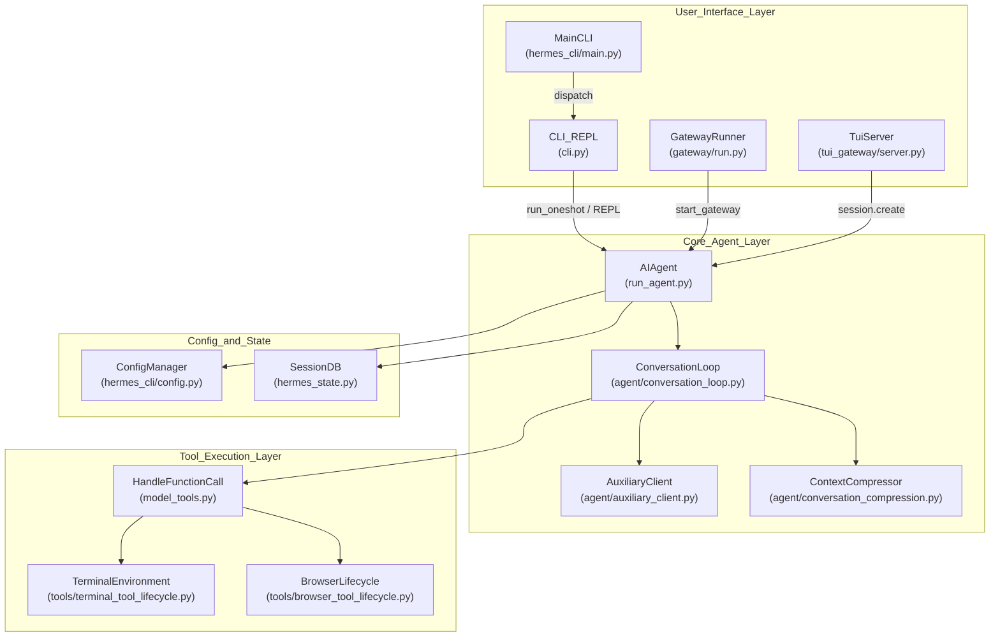
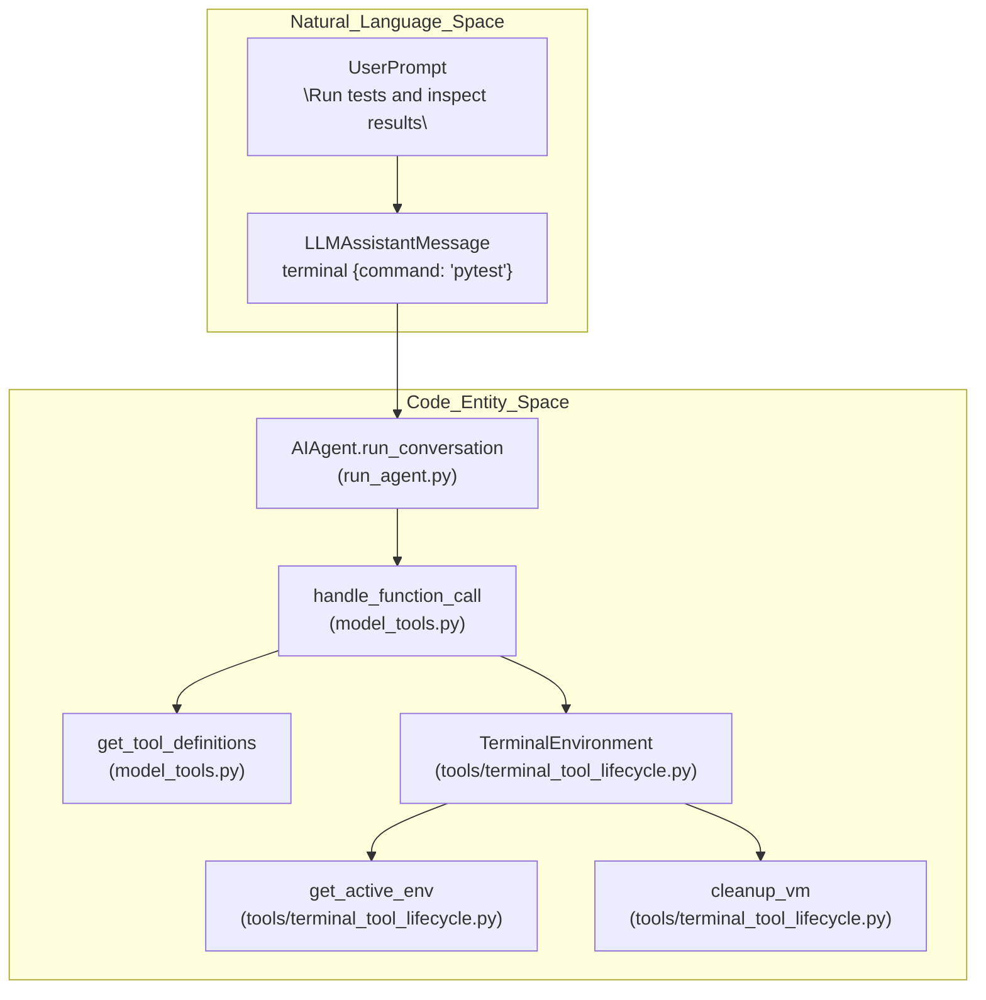

# Architecture Overview

Relevant source files

The following files were used as context for generating this wiki page:

- [agent/auxiliary_client.py](agent/auxiliary_client.py)
- [agent/tool_dispatch_helpers.py](agent/tool_dispatch_helpers.py)
- [agent/tool_executor.py](agent/tool_executor.py)
- [cli-config.yaml.example](cli-config.yaml.example)
- [cli.py](cli.py)
- [evals/desktop_bug_campaign/leases_live.py](evals/desktop_bug_campaign/leases_live.py)
- [gateway/run.py](gateway/run.py)
- [gateway/session.py](gateway/session.py)
- [gateway/session_images.py](gateway/session_images.py)
- [gateway/slash_commands.py](gateway/slash_commands.py)
- [hermes_cli/cli_commands_mixin.py](hermes_cli/cli_commands_mixin.py)
- [hermes_cli/commands.py](hermes_cli/commands.py)
- [hermes_cli/config.py](hermes_cli/config.py)
- [hermes_cli/config_defaults.py](hermes_cli/config_defaults.py)
- [hermes_cli/main.py](hermes_cli/main.py)
- [hermes_cli/setup.py](hermes_cli/setup.py)
- [hermes_state.py](hermes_state.py)
- [model_tools.py](model_tools.py)
- [run_agent.py](run_agent.py)
- [scripts/iso-certify.py](scripts/iso-certify.py)
- [tests/agent/test_auxiliary_client.py](tests/agent/test_auxiliary_client.py)
- [tests/agent/test_memory_user_id.py](tests/agent/test_memory_user_id.py)
- [tests/agent/test_tool_dispatch_helpers.py](tests/agent/test_tool_dispatch_helpers.py)
- [tests/gateway/test_hosted_room_replicas.py](tests/gateway/test_hosted_room_replicas.py)
- [tests/gateway/test_session.py](tests/gateway/test_session.py)
- [tests/gateway/test_session_images.py](tests/gateway/test_session_images.py)
- [tests/gateway/test_session_images_profile.py](tests/gateway/test_session_images_profile.py)
- [tests/hermes_cli/test_commands.py](tests/hermes_cli/test_commands.py)
- [tests/hermes_cli/test_custom_provider_identity.py](tests/hermes_cli/test_custom_provider_identity.py)
- [tests/hermes_cli/test_web_multi_profile_scope.py](tests/hermes_cli/test_web_multi_profile_scope.py)
- [tests/tools/test_async_delegation_failed_surface.py](tests/tools/test_async_delegation_failed_surface.py)
- [tests/tools/test_completed_process_results.py](tests/tools/test_completed_process_results.py)
- [tests/tools/test_process_wait_auto_notify.py](tests/tools/test_process_wait_auto_notify.py)
- [tests/tui_gateway/test_compute_host.py](tests/tui_gateway/test_compute_host.py)
- [tests/tui_gateway/test_compute_host_pending_model_switch.py](tests/tui_gateway/test_compute_host_pending_model_switch.py)
- [tests/tui_gateway/test_compute_host_phase1.py](tests/tui_gateway/test_compute_host_phase1.py)
- [tests/tui_gateway/test_file_attachment_allocation.py](tests/tui_gateway/test_file_attachment_allocation.py)
- [tests/tui_gateway/test_groups_replication_methods.py](tests/tui_gateway/test_groups_replication_methods.py)
- [tests/tui_gateway/test_iso_certify_seam.py](tests/tui_gateway/test_iso_certify_seam.py)
- [tests/tui_gateway/test_isolated_orphan_activity.py](tests/tui_gateway/test_isolated_orphan_activity.py)
- [tests/tui_gateway/test_multi_profile_hosting_fail_closed.py](tests/tui_gateway/test_multi_profile_hosting_fail_closed.py)
- [tests/tui_gateway/test_out_of_band_history_adoption.py](tests/tui_gateway/test_out_of_band_history_adoption.py)
- [tests/tui_gateway/test_profile_terminal_scope_entrypoints.py](tests/tui_gateway/test_profile_terminal_scope_entrypoints.py)
- [tests/tui_gateway/test_protocol.py](tests/tui_gateway/test_protocol.py)
- [tests/tui_gateway/test_remote_backend_launch_cwd.py](tests/tui_gateway/test_remote_backend_launch_cwd.py)
- [tests/tui_gateway/test_serve_exit_flush.py](tests/tui_gateway/test_serve_exit_flush.py)
- [tests/tui_gateway/test_subagent_snapshot.py](tests/tui_gateway/test_subagent_snapshot.py)
- [tests/tui_gateway/test_submit_time_user_row.py](tests/tui_gateway/test_submit_time_user_row.py)
- [tests/tui_gateway/test_tui_gateway_server.py](tests/tui_gateway/test_tui_gateway_server.py)
- [tests/tui_gateway/test_ws_orphan_races.py](tests/tui_gateway/test_ws_orphan_races.py)
- [tools/__init__.py](tools/__init__.py)
- [tools/process_registry_results.py](tools/process_registry_results.py)
- [tools/process_registry_wait_policy.py](tools/process_registry_wait_policy.py)
- [toolsets.py](toolsets.py)
- [tui_gateway/AGENTS.md](tui_gateway/AGENTS.md)
- [tui_gateway/compute_host.py](tui_gateway/compute_host.py)
- [tui_gateway/compute_host_bridge.py](tui_gateway/compute_host_bridge.py)
- [tui_gateway/host_supervisor.py](tui_gateway/host_supervisor.py)
- [tui_gateway/methods_complete.py](tui_gateway/methods_complete.py)
- [tui_gateway/methods_complete_helpers.py](tui_gateway/methods_complete_helpers.py)
- [tui_gateway/methods_groups.py](tui_gateway/methods_groups.py)
- [tui_gateway/methods_prompt.py](tui_gateway/methods_prompt.py)
- [tui_gateway/methods_session.py](tui_gateway/methods_session.py)
- [tui_gateway/methods_slash.py](tui_gateway/methods_slash.py)
- [tui_gateway/methods_subagents.py](tui_gateway/methods_subagents.py)
- [tui_gateway/methods_tools.py](tui_gateway/methods_tools.py)
- [tui_gateway/prompt_attachments.py](tui_gateway/prompt_attachments.py)
- [tui_gateway/prompt_turn.py](tui_gateway/prompt_turn.py)
- [tui_gateway/server.py](tui_gateway/server.py)
- [tui_gateway/session_lifecycle.py](tui_gateway/session_lifecycle.py)
- [tui_gateway/session_reaper.py](tui_gateway/session_reaper.py)
- [tui_gateway/session_workdir.py](tui_gateway/session_workdir.py)
- [ui-tui/src/__tests__/details.test.ts](ui-tui/src/__tests__/details.test.ts)
- [ui-tui/src/domain/details.ts](ui-tui/src/domain/details.ts)
- [website/docs/developer-guide/adding-tools.md](website/docs/developer-guide/adding-tools.md)
- [website/docs/developer-guide/tools-runtime.md](website/docs/developer-guide/tools-runtime.md)
- [website/docs/getting-started/quickstart.md](website/docs/getting-started/quickstart.md)
- [website/docs/integrations/index.md](website/docs/integrations/index.md)
- [website/docs/integrations/providers.md](website/docs/integrations/providers.md)
- [website/docs/reference/cli-commands.md](website/docs/reference/cli-commands.md)
- [website/docs/reference/environment-variables.md](website/docs/reference/environment-variables.md)
- [website/docs/reference/slash-commands.md](website/docs/reference/slash-commands.md)
- [website/docs/reference/tools-reference.md](website/docs/reference/tools-reference.md)
- [website/docs/reference/toolsets-reference.md](website/docs/reference/toolsets-reference.md)
- [website/docs/user-guide/cli.md](website/docs/user-guide/cli.md)
- [website/docs/user-guide/configuration.md](website/docs/user-guide/configuration.md)
- [website/docs/user-guide/features/fallback-providers.md](website/docs/user-guide/features/fallback-providers.md)
- [website/docs/user-guide/features/overview.md](website/docs/user-guide/features/overview.md)
- [website/docs/user-guide/features/tools.md](website/docs/user-guide/features/tools.md)
- [website/docs/user-guide/messaging/index.md](website/docs/user-guide/messaging/index.md)
- [website/docs/user-guide/tui.md](website/docs/user-guide/tui.md)
- [website/i18n/zh-Hans/docusaurus-plugin-content-docs/current/developer-guide/tools-runtime.md](website/i18n/zh-Hans/docusaurus-plugin-content-docs/current/developer-guide/tools-runtime.md)
- [website/i18n/zh-Hans/docusaurus-plugin-content-docs/current/getting-started/quickstart.md](website/i18n/zh-Hans/docusaurus-plugin-content-docs/current/getting-started/quickstart.md)
- [website/i18n/zh-Hans/docusaurus-plugin-content-docs/current/reference/environment-variables.md](website/i18n/zh-Hans/docusaurus-plugin-content-docs/current/reference/environment-variables.md)
- [website/i18n/zh-Hans/docusaurus-plugin-content-docs/current/reference/tools-reference.md](website/i18n/zh-Hans/docusaurus-plugin-content-docs/current/reference/tools-reference.md)
- [website/i18n/zh-Hans/docusaurus-plugin-content-docs/current/reference/toolsets-reference.md](website/i18n/zh-Hans/docusaurus-plugin-content-docs/current/reference/toolsets-reference.md)
- [website/i18n/zh-Hans/docusaurus-plugin-content-docs/current/user-guide/configuration.md](website/i18n/zh-Hans/docusaurus-plugin-content-docs/current/user-guide/configuration.md)
- [website/i18n/zh-Hans/docusaurus-plugin-content-docs/current/user-guide/features/browser.md](website/i18n/zh-Hans/docusaurus-plugin-content-docs/current/user-guide/features/browser.md)
- [website/i18n/zh-Hans/docusaurus-plugin-content-docs/current/user-guide/features/fallback-providers.md](website/i18n/zh-Hans/docusaurus-plugin-content-docs/current/user-guide/features/fallback-providers.md)
- [website/i18n/zh-Hans/docusaurus-plugin-content-docs/current/user-guide/features/tools.md](website/i18n/zh-Hans/docusaurus-plugin-content-docs/current/user-guide/features/tools.md)

## Purpose and Scope

This document presents a detailed technical overview of Hermes Agent’s architecture. Hermes Agent is a sophisticated AI agent framework featuring autonomous reasoning, tool usage, conversational memory, and self-improvement capabilities. The system is architected as a three-tier platform, integrating interactive user interfaces, a core agent orchestration layer, and a diverse tool and execution backend. This page explains these tiers, the major subsystems comprising them, and the technical flow of data and control between components.

The architecture supports multiple frontend interfaces — including CLI REPL (`[cli.py:1-3]()`), the Messaging Gateway (`[gateway/run.py:1-4]()`), web dashboard, and the terminal TUI (`[tui_gateway/server.py:1-4]`) — all converging on the central core agent. The core agent manages conversational loops, memory persistence, tool orchestration, and auxiliary LLM clients. The tool layer abstracts a wide range of capabilities: terminal commands, browser automation, vision tools, and more, executed within various isolated runtime environments.

Sources: [run_agent.py:1-7](), [cli.py:1-3](), [gateway/run.py:1-4]()

---

## Core Architecture Components

### System Architecture Overview

This diagram illustrates the layered organization:

- **User Interface Layer**: Connects users to Hermes via CLI (`[cli.py:1-3]()`), Gateway (`[gateway/run.py:1-4]()`), TUI gateway (`[tui_gateway/server.py:1-4]()`), and main entry points (`[hermes_cli/main.py:1-9]()`).
- **Core Agent Layer**: Centers on the `AIAgent` class (`[run_agent.py:2-7]()`) managing conversation state, memory, context compression (`[agent/conversation_compression.py]()`), and auxiliary LLM client support (`[agent/auxiliary_client.py:1-9]()`).
- **Tool & Execution Layer**: Manages tool definitions, discovery, and execution within isolated environments such as terminal shells (`[tools/terminal_tool_lifecycle.py]()`) and browsers (`[tools/browser_tool_lifecycle.py]()`).
- **Config & State**: Components handle persistent user configuration (`[hermes_cli/config.py:1-3]()`), environment loading (`[hermes_cli/env_loader.py]()`), and session message storage in SQLite (`[hermes_state.py:1-6]()`).

Sources: [run_agent.py:2-7](), [cli.py:1-3](), [gateway/run.py:1-4](), [tui_gateway/server.py:1-4](), [hermes_cli/main.py:1-9](), [hermes_cli/config.py:1-3](), [hermes_state.py:1-6]()

---

## AIAgent: The Central Orchestrator

The core of Hermes Agent is the `AIAgent` class defined in `run_agent.py`. This class encapsulates the primary conversation orchestration, including iterative reasoning, tool dispatch, session management, and integration with memory and compression subsystems.

### Conversation Orchestration

- Conversations are managed as iterative loops implemented across the agent packages (`[run_agent.py:2-7]()`).
- The conversation runner drives:
  - Building system prompts, injecting personality and behavioral cues.
  - Calling the configured LLM provider, supporting streaming and non-streaming modes.
  - Parsing model outputs for function calls representing tool invocations.
  - Dispatched via helper functions in `[model_tools.py]()`.
  - Handling retries, fallbacks, and error conditions with detailed error classification (`[agent/auxiliary_client.py:29-35]()`).
  - Managing iteration budgets (`[run_agent.py:91-91]()`) to prevent runaway loops.
- Conversation turns involve sanitizing messages and tool call IDs to ensure consistency (`[run_agent.py:127-131]()`).
- Interrupts and cancellations are cleanly handled within the loop (`[run_agent.py:105-105]()`).

Sources: [run_agent.py:2-131](), [agent/auxiliary_client.py:29-35]()

### Memory, Sessions, and Persistence

- Persistent session data and message history are stored in the SQLite-backed session database (`[hermes_state.py:2-6]()`).
- The state store supports WAL mode for concurrent readers and single-writer safety (`[hermes_state.py:74-76]()`).
- Multiple session mixins enable features such as full-text search (FTS5), compression indexing, Telegram topic bindings, and tool retry tracking (`[hermes_state.py:53-84]()`).
- The context compression subsystem (`[agent/conversation_compression.py]()`) summarizes message history with auxiliary LLM calls to keep context within model token budgets.
- Sessions include origin metadata (e.g., gateway routing data) and integration with auxiliary LLM clients for side tasks (`[run_agent.py:57-89]()`).
- The `AuxiliaryClient` in `[agent/auxiliary_client.py:1-9]()` acts as a shared router for side tasks like compression, search, and vision.

Sources: [hermes_state.py:2-84](), [run_agent.py:57-89](), [agent/auxiliary_client.py:1-9]()

---

## Tool System and Execution Flow

Hermes Agent implements a modular, extensible tool system that turns LLM-instructed tool calls into real command invocations executed in controlled environments.

### Tool Execution Flow from Natural Language to Code Entities

- Tools are registered and discovered through modules like `[model_tools.py:103-103]()`, which exposes functions for tool definitions.
- The conversation execution detects function calls embedded in LLM responses and routes them to handler functions (`[model_tools.py]()`).
- Terminal tools execute commands inside managed environments (`[tools/terminal_tool_lifecycle.py:104-104]()`), including environment acquisition (`get_active_env()`), command execution, and cleanup routines (`cleanup_vm()`).
- Beyond terminal tools, other tool categories include browser automation (`[tools/browser_session_lifecycle.py:106-106]()`) and various toolsets managed via the tool registry.
- The tool execution layer abstracts runtime isolation and lifecycle, allowing safe, reproducible tool runs within ephemeral or persistent sandboxes.

Sources: [run_agent.py:102-106](), [tools/terminal_tool_lifecycle.py:104-104](), [model_tools.py:103-103]()

---

## Configuration and Authentication Hierarchy

Hermes Agent’s configuration is centralized in `[hermes_cli/config.py:1-3]()` and layered across several sources for flexibility and security.

| Configuration Level         | Description                                                      | Example Files / Components                |
|----------------------------|------------------------------------------------------------------|-------------------------------------------|
| 1. CLI Arguments           | Per-invocation overrides with highest precedence                 | CLI flags parsed in `[cli.py:1-3]()`      |
| 2. `config.yaml`           | Main config for non-secret settings, including model/toolsets    | `~/.hermes/config.yaml`                   |
| 3. `.env` file             | Secrets storage for API keys, tokens, and passwords             | `~/.hermes/.env`                          |
| 4. Built-in Defaults       | Fallback hardcoded safe defaults                                 | `[hermes_cli/config_defaults.py:1-5]()`   |

- CLI arguments have the highest priority, allowing dynamic overrides for each run.
- `config.yaml` contains structured settings such as model selection, toolsets enabled, compression parameters, and runtime limits (`[cli-config.yaml.example:1-44]()`).
- `.env` stores sensitive credentials securely (e.g., OpenRouter API key, OAuth tokens) and is loaded at startup by environment loaders (`[run_agent.py:92-96]()`).
- Configuration validation and schema migrations ensure compatibility (`[hermes_cli/config.py:1-3]()`).
- Authentication supports OAuth, API keys, and provider credential pools.
- Runtime provider resolution chains are implemented in auxiliary client modules and related components to select appropriate LLM backends (`[agent/auxiliary_client.py:1-9]()`).

Sources: [hermes_cli/config.py:1-3](), [cli-config.yaml.example:1-44](), [run_agent.py:92-96](), [agent/auxiliary_client.py:1-9]()

---

## Summary

Hermes Agent is structured as a robust, modular three-tier system:

- **User Interface Layer**: Multiple interactive frontends including CLI REPL (`[cli.py:1-3]()`), terminal TUI (`[tui_gateway/server.py:1-4]()`), a messaging Gateway (`[gateway/run.py:1-4]()`), and web dashboard enable versatile user interaction.
- **Core Agent Layer**: The `AIAgent` class (`[run_agent.py:2-7]()`) orchestrates autonomous reasoning, conversation looping, session management, context compression, and auxiliary LLM client delegation.
- **Tool & Execution Layer**: A dynamic, extensible tool registry supports execution of terminal commands (`[tools/terminal_tool_lifecycle.py:104-104]()`), browser automation, and multi-agent delegation within isolated runtime environments.
- **Configuration and State**: Centralized configuration management (`[hermes_cli/config.py:1-3]()`) with layered precedence and secure secret handling, alongside a robust SQLite-based session database (`[hermes_state.py:2-6]()`) providing persistent state, indexing, and concurrency support.

This architecture facilitates complex AI-driven reasoning workflows, dynamic tool interactions, conversational state management, and multi-platform user interfacing, enabling Hermes Agent to operate as a versatile and extensible AI assistant framework.

Sources: [run_agent.py:2-7](), [cli.py:1-3](), [gateway/run.py:1-4](), [tui_gateway/server.py:1-4](), [tools/terminal_tool_lifecycle.py:104-104](), [hermes_cli/config.py:1-3](), [hermes_state.py:2-6]()