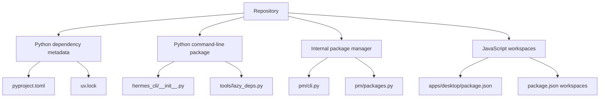
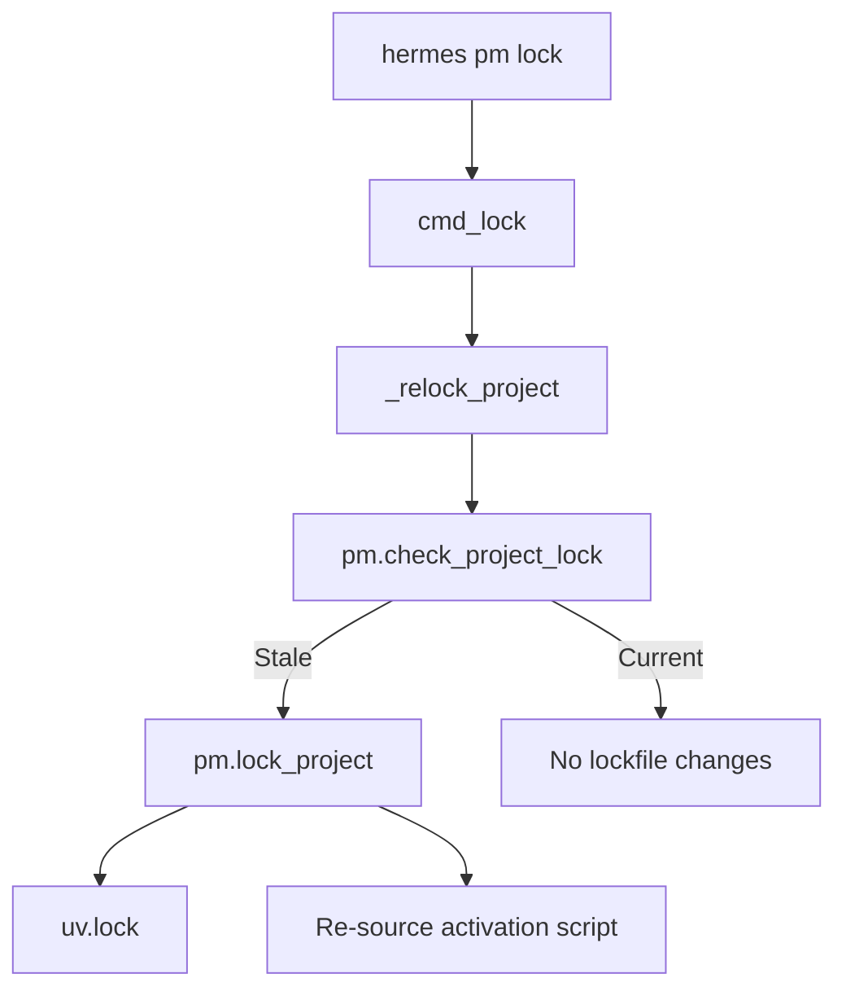
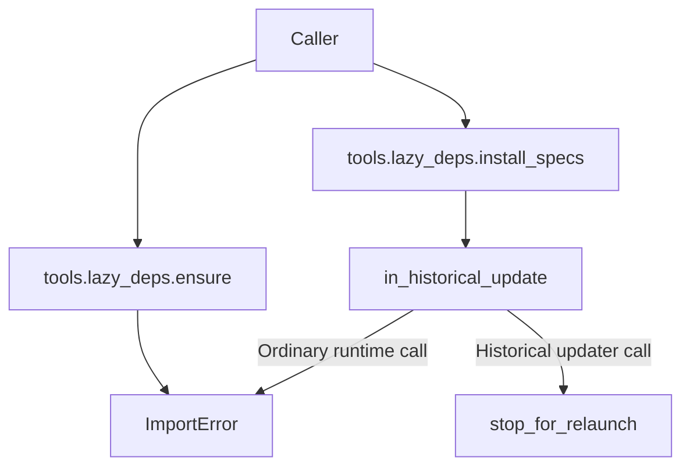
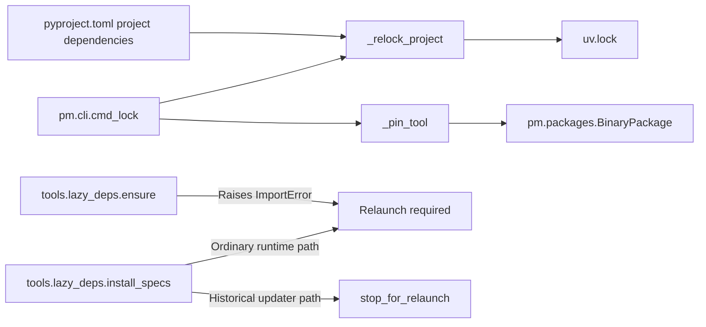

# Project Structure and Dependencies

Relevant source files

The following files were used as context for generating this wiki page:

- [.github/workflows/bootstrap-installer.yml](.github/workflows/bootstrap-installer.yml)
- [.npmrc](.npmrc)
- [apps/bootstrap-installer/index.html](apps/bootstrap-installer/index.html)
- [apps/bootstrap-installer/package.json](apps/bootstrap-installer/package.json)
- [apps/bootstrap-installer/src-tauri/Cargo.toml](apps/bootstrap-installer/src-tauri/Cargo.toml)
- [apps/bootstrap-installer/src-tauri/Info.plist](apps/bootstrap-installer/src-tauri/Info.plist)
- [apps/bootstrap-installer/src-tauri/entitlements.plist](apps/bootstrap-installer/src-tauri/entitlements.plist)
- [apps/bootstrap-installer/src-tauri/src/bootstrap.rs](apps/bootstrap-installer/src-tauri/src/bootstrap.rs)
- [apps/bootstrap-installer/src-tauri/src/events.rs](apps/bootstrap-installer/src-tauri/src/events.rs)
- [apps/bootstrap-installer/src-tauri/src/install_script.rs](apps/bootstrap-installer/src-tauri/src/install_script.rs)
- [apps/bootstrap-installer/src-tauri/src/lib.rs](apps/bootstrap-installer/src-tauri/src/lib.rs)
- [apps/bootstrap-installer/src-tauri/src/marker.rs](apps/bootstrap-installer/src-tauri/src/marker.rs)
- [apps/bootstrap-installer/src-tauri/src/marker_tests.rs](apps/bootstrap-installer/src-tauri/src/marker_tests.rs)
- [apps/bootstrap-installer/src-tauri/src/paths.rs](apps/bootstrap-installer/src-tauri/src/paths.rs)
- [apps/bootstrap-installer/src-tauri/src/powershell.rs](apps/bootstrap-installer/src-tauri/src/powershell.rs)
- [apps/bootstrap-installer/src-tauri/src/update.rs](apps/bootstrap-installer/src-tauri/src/update.rs)
- [apps/bootstrap-installer/src-tauri/tauri.conf.json](apps/bootstrap-installer/src-tauri/tauri.conf.json)
- [apps/desktop/electron/dock-launch-order.test.ts](apps/desktop/electron/dock-launch-order.test.ts)
- [apps/desktop/electron/dock-launch-order.ts](apps/desktop/electron/dock-launch-order.ts)
- [apps/desktop/electron/feature-flags.test.ts](apps/desktop/electron/feature-flags.test.ts)
- [apps/desktop/electron/feature-flags.ts](apps/desktop/electron/feature-flags.ts)
- [apps/desktop/package.json](apps/desktop/package.json)
- [apps/desktop/src/store/local-models-flag.ts](apps/desktop/src/store/local-models-flag.ts)
- [apps/desktop/update-feed.d.cts](apps/desktop/update-feed.d.cts)
- [apps/shared/package.json](apps/shared/package.json)
- [apps/shared/src/index.ts](apps/shared/src/index.ts)
- [apps/shared/src/skill-scaffold.test.ts](apps/shared/src/skill-scaffold.test.ts)
- [apps/shared/src/skill-scaffold.ts](apps/shared/src/skill-scaffold.ts)
- [contributors/README.md](contributors/README.md)
- [hermes_bootstrap.py](hermes_bootstrap.py)
- [hermes_cli/__init__.py](hermes_cli/__init__.py)
- [hermes_cli/data_cleanup.py](hermes_cli/data_cleanup.py)
- [hermes_cli/update_lock.py](hermes_cli/update_lock.py)
- [hermes_constants.py](hermes_constants.py)
- [hermes_constants_scratch.py](hermes_constants_scratch.py)
- [hermes_constants_scratch_stuck.py](hermes_constants_scratch_stuck.py)
- [package-lock.json](package-lock.json)
- [package.json](package.json)
- [pm/cli.py](pm/cli.py)
- [pm/defaults.py](pm/defaults.py)
- [pm/filesystem.py](pm/filesystem.py)
- [pm/install.py](pm/install.py)
- [pm/lock.json](pm/lock.json)
- [pm/lock.py](pm/lock.py)
- [pm/package.py](pm/package.py)
- [pm/packages.py](pm/packages.py)
- [pm/security_packages.py](pm/security_packages.py)
- [pm/store.py](pm/store.py)
- [pm/update.py](pm/update.py)
- [pyproject.toml](pyproject.toml)
- [scripts/add_contributor.py](scripts/add_contributor.py)
- [scripts/audit_pr_attribution.py](scripts/audit_pr_attribution.py)
- [scripts/contributor_audit.py](scripts/contributor_audit.py)
- [scripts/releases/authors.py](scripts/releases/authors.py)
- [scripts/releases/authors_legacy.py](scripts/releases/authors_legacy.py)
- [scripts/releases/distance.py](scripts/releases/distance.py)
- [scripts/releases/stamping.py](scripts/releases/stamping.py)
- [scripts/termux/build_builder_image.sh](scripts/termux/build_builder_image.sh)
- [scripts/termux/build_deb.sh](scripts/termux/build_deb.sh)
- [scripts/termux/stage_runtime_libs.py](scripts/termux/stage_runtime_libs.py)
- [scripts/verify-bootstrap-version-stamp.py](scripts/verify-bootstrap-version-stamp.py)
- [scripts/write_install_stamp.py](scripts/write_install_stamp.py)
- [tests-js/desktop-mac-entitlements.test.ts](tests-js/desktop-mac-entitlements.test.ts)
- [tests-js/package.json](tests-js/package.json)
- [tests/agent/test_relay_compaction_atof.py](tests/agent/test_relay_compaction_atof.py)
- [tests/cron/test_jobs_file_ownership.py](tests/cron/test_jobs_file_ownership.py)
- [tests/cron/test_jobs_shrink_merge.py](tests/cron/test_jobs_shrink_merge.py)
- [tests/gateway/test_media_cache_cleanup_signature.py](tests/gateway/test_media_cache_cleanup_signature.py)
- [tests/hermes_cli/test_atomic_json_write.py](tests/hermes_cli/test_atomic_json_write.py)
- [tests/hermes_cli/test_data_uninstall.py](tests/hermes_cli/test_data_uninstall.py)
- [tests/hermes_cli/test_doctor_cache_hogs.py](tests/hermes_cli/test_doctor_cache_hogs.py)
- [tests/hermes_cli/test_ensure_hermes_home_uid.py](tests/hermes_cli/test_ensure_hermes_home_uid.py)
- [tests/hermes_cli/test_local_legacy_engine.py](tests/hermes_cli/test_local_legacy_engine.py)
- [tests/hermes_cli/test_local_runtime_pm.py](tests/hermes_cli/test_local_runtime_pm.py)
- [tests/hermes_cli/test_update_lock.py](tests/hermes_cli/test_update_lock.py)
- [tests/hermes_cli/test_update_lock_fd_provenance.py](tests/hermes_cli/test_update_lock_fd_provenance.py)
- [tests/hermes_cli/test_update_lock_protocol.py](tests/hermes_cli/test_update_lock_protocol.py)
- [tests/pm/test_archive_safety.py](tests/pm/test_archive_safety.py)
- [tests/pm/test_deb_safety.py](tests/pm/test_deb_safety.py)
- [tests/pm/test_ffmpeg_resolution.py](tests/pm/test_ffmpeg_resolution.py)
- [tests/pm/test_filesystem_is_junction.py](tests/pm/test_filesystem_is_junction.py)
- [tests/pm/test_install_default_closure.py](tests/pm/test_install_default_closure.py)
- [tests/pm/test_installed_package.py](tests/pm/test_installed_package.py)
- [tests/pm/test_llamacpp_pins.py](tests/pm/test_llamacpp_pins.py)
- [tests/pm/test_lockfile_publication.py](tests/pm/test_lockfile_publication.py)
- [tests/pm/test_long_path_exits.py](tests/pm/test_long_path_exits.py)
- [tests/pm/test_npm_dist_tags.py](tests/pm/test_npm_dist_tags.py)
- [tests/pm/test_pm_core.py](tests/pm/test_pm_core.py)
- [tests/pm/test_python_release_identity.py](tests/pm/test_python_release_identity.py)
- [tests/pm/test_retired_agent_browser.py](tests/pm/test_retired_agent_browser.py)
- [tests/pm/test_store_extract.py](tests/pm/test_store_extract.py)
- [tests/pm/test_tree_digest_links.py](tests/pm/test_tree_digest_links.py)
- [tests/pm/test_update.py](tests/pm/test_update.py)
- [tests/pm/test_update_bootstrap_pins.py](tests/pm/test_update_bootstrap_pins.py)
- [tests/pm/test_update_request_reuse.py](tests/pm/test_update_request_reuse.py)
- [tests/scripts/install/test_install_ps1_managed_python_provenance.py](tests/scripts/install/test_install_ps1_managed_python_provenance.py)
- [tests/scripts/install/test_install_ps1_pinned_git_extract.py](tests/scripts/install/test_install_ps1_pinned_git_extract.py)
- [tests/scripts/install/test_install_sh_reuse_supported_python.py](tests/scripts/install/test_install_sh_reuse_supported_python.py)
- [tests/scripts/test_contributor_map.py](tests/scripts/test_contributor_map.py)
- [tests/scripts/test_install_stamp_distance.py](tests/scripts/test_install_stamp_distance.py)
- [tests/scripts/test_release_revision_anchor.py](tests/scripts/test_release_revision_anchor.py)
- [tests/scripts/test_termux_build_driver.py](tests/scripts/test_termux_build_driver.py)
- [tests/scripts/test_verify_bootstrap_version_stamp.py](tests/scripts/test_verify_bootstrap_version_stamp.py)
- [tests/scripts/test_version_stamping.py](tests/scripts/test_version_stamping.py)
- [tests/scripts/test_write_install_stamp.py](tests/scripts/test_write_install_stamp.py)
- [tests/test_atomic_json_writers_unified.py](tests/test_atomic_json_writers_unified.py)
- [tests/test_atomic_replace_symlinks.py](tests/test_atomic_replace_symlinks.py)
- [tests/test_hermes_bootstrap.py](tests/test_hermes_bootstrap.py)
- [tests/test_hermes_constants.py](tests/test_hermes_constants.py)
- [tests/test_packaging_metadata.py](tests/test_packaging_metadata.py)
- [tests/test_project_metadata.py](tests/test_project_metadata.py)
- [tests/test_scratch_dir.py](tests/test_scratch_dir.py)
- [tests/test_scratch_prune_undeletable.py](tests/test_scratch_prune_undeletable.py)
- [tests/test_scratch_scan_failures.py](tests/test_scratch_scan_failures.py)
- [tests/test_utils_atomic_roundtrip_yaml_save.py](tests/test_utils_atomic_roundtrip_yaml_save.py)
- [tests/tools/test_local_temp_dir.py](tests/tools/test_local_temp_dir.py)
- [tools/lazy_deps.py](tools/lazy_deps.py)
- [ui-tui/package.json](ui-tui/package.json)
- [ui-tui/packages/hermes-ink/ambient.d.ts](ui-tui/packages/hermes-ink/ambient.d.ts)
- [ui-tui/packages/hermes-ink/index.js](ui-tui/packages/hermes-ink/index.js)
- [ui-tui/packages/hermes-ink/package.json](ui-tui/packages/hermes-ink/package.json)
- [utils.py](utils.py)
- [uv.lock](uv.lock)
- [web/package.json](web/package.json)
- [website/.npmrc](website/.npmrc)
- [website/docs/reference/package-management.md](website/docs/reference/package-management.md)
- [website/docs/user-guide/local-models.md](website/docs/user-guide/local-models.md)
- [website/docusaurus.config.ts](website/docusaurus.config.ts)
- [website/package-lock.json](website/package-lock.json)
- [website/package.json](website/package.json)

## Purpose and scope

This page describes the repository areas and package-management files evidenced by the supplied code excerpts. It focuses on Python dependency declarations and locking, the `pm/` package manager, the current lazy-dependency shim, JavaScript workspaces, shared home-path resolution, and the available evidence about Nix support. [pyproject.toml:5-39](), [pm/cli.py:1-21](), [tools/lazy_deps.py:1-26](), [package.json:1-12](), [hermes_constants.py:1-18]()

Sources: [pyproject.toml:5-39](), [pm/cli.py:1-21](), [tools/lazy_deps.py:1-26](), [package.json:1-12](), [hermes_constants.py:1-18]()

---

## Repository Layout and Code Entities

The repository includes Python application and package-management areas, plus JavaScript workspaces for the desktop application, TUI, web frontend, and JavaScript tests. The supplied excerpts do not enumerate every root directory, so the table below is limited to paths directly evidenced by the files provided. [package.json:1-12](), [package-lock.json:6-18](), [apps/desktop/package.json:1-16](), [pm/packages.py:1-26](), [hermes_cli/__init__.py:1-21]()

### Top-Level Directory Structure and System Components

| Area | Code entities and role |
|---|---|
| `hermes_cli/` | Unified CLI package; `__init__.py` exposes lazy version compatibility and repairs standard output/error encoding. [hermes_cli/__init__.py:1-21](), [hermes_cli/__init__.py:42-76]() |
| `agent/` | Referenced by dependency comments as the location of `ssl_verify.py` and `chat_completion_helpers.py`; the supplied excerpts do not provide a complete agent directory map. [pyproject.toml:42-48](), [pyproject.toml:71-75]() |
| `tools/` | Contains `lazy_deps.py`; its current functions are compatibility shims for retired runtime installation behavior. [tools/lazy_deps.py:1-26]() |
| `pm/` | Hermes package-management implementation: package definitions, CLI operations, and related modules imported by `pm/cli.py`. [pm/packages.py:1-38](), [pm/cli.py:1-21]() |
| `apps/desktop/` | Desktop application workspace; its manifest defines Electron/React dependencies and development, build, and test scripts. [apps/desktop/package.json:1-16](), [apps/desktop/package.json:17-78]() |
| `ui-tui/`, `ui-tui/packages/*`, `web/`, `tests-js/` | Root npm workspaces. Their individual manifests are not included in the provided excerpts. [package.json:6-12](), [package-lock.json:12-18]() |
| `pyproject.toml`, `uv.lock` | Python project metadata and resolved dependency lockfile. [pyproject.toml:5-24](), [uv.lock:1-14]() |
| `package.json`, `package-lock.json` | Root npm workspace metadata and lockfile. [package.json:1-12](), [package-lock.json:1-18]() |

### Natural-language subsystems mapped to code entities

This diagram connects the package-management and application areas discussed here with their concrete files and symbols. The arrows indicate repository association, not runtime call order. [hermes_cli/__init__.py:1-21](), [tools/lazy_deps.py:1-26](), [pm/cli.py:1-21](), [pm/packages.py:1-26](), [apps/desktop/package.json:1-16](), [package.json:6-12]()

**Diagram: Repository areas and concrete entry points**

Sources: [hermes_cli/__init__.py:1-21](), [tools/lazy_deps.py:1-26](), [pm/cli.py:1-21](), [pm/packages.py:1-26](), [apps/desktop/package.json:1-16](), [package.json:6-12]()

---

## Versioning and Shared Runtime Constants

`hermes_cli.__init__` declares `__release_date__` and resolves `__version__` lazily through `__getattr__`. The lazy path reads the install stamp using `hermes_cli.steward.read_install_stamp` and attempts to locate the repository through `pm.paths.repo_root`; if `pm` is not importable, it falls back to `install-stamp.json` beside the package and then to `"0.0.0"`. [hermes_cli/__init__.py:5-39]()

The same module calls `_ensure_utf8()` at import time. That function attempts to configure stdout and stderr for UTF-8, replacing unsupported characters when necessary; this is process-local stream setup, not a change to `os.environ`. [hermes_cli/__init__.py:42-76]()

`hermes_constants.py` describes itself as import-safe and standard-library-only. Its context-local Hermes-home override is stored in a `ContextVar`, with `set_hermes_home_override`, `reset_hermes_home_override`, and `get_hermes_home_override` managing that state. [hermes_constants.py:1-4](), [hermes_constants.py:16-43]()

Home resolution uses platform-specific defaults: Windows uses `LOCALAPPDATA` when present, while other platforms use the account’s home directory and a `.hermes` directory. `hermes_root_for_environment` computes a root from another process’s environment and returns `None` when resolution depends on information not present there. [hermes_constants.py:46-63](), [hermes_constants.py:107-135]()

Sources: [hermes_cli/__init__.py:5-39](), [hermes_cli/__init__.py:42-76](), [hermes_constants.py:1-4](), [hermes_constants.py:16-43](), [hermes_constants.py:46-63](), [hermes_constants.py:107-135]()

---

## Dependency Management via `uv` and `pm/`

Python project dependencies are declared in `pyproject.toml` and resolved in `uv.lock`. The internal `pm/` package provides commands and implementation modules for project locking and managed tools. These are related but distinct responsibilities: the project metadata declares Python requirements, while `pm/` also defines and manages downloadable packages. [pyproject.toml:5-24](), [uv.lock:1-14](), [pm/cli.py:1-21](), [pm/packages.py:1-26]()

### Python version constraints and dependency declarations

The project metadata declares `requires-python = ">=3.11,<3.15"`. The nearby comments explain that Python 3.14 is the newest version for which the project expects wheels, while the lower versions remain accepted to support older installations during their update step. [pyproject.toml:10-16]()

The dependency list comments establish a policy that direct core dependencies should be exact-pinned and that only packages used by every Hermes session belong in the core dependency set. They direct maintainers to run `hermes pm lock` after changing a pin. [pyproject.toml:19-39]()

The shown dependency declarations include Python-version markers, platform-specific markers for `ruamel.yaml.clib`, and selected range constraints such as `urllib3>=2.8.0,<3`. The file’s comments explain that some optional or provider-specific dependencies belong in extras rather than the core set. [pyproject.toml:40-60](), [pyproject.toml:98-116]()

`uv.lock` records its supported Python range, platform resolution markers, and package overrides. The displayed lockfile excerpt includes overrides for `cryptography`, `pillow`, and `pynacl`; it is a generated resolution artifact rather than the declaration site for the project’s direct dependencies. [uv.lock:1-25]()

### `pm/`: project locking and managed packages

`pm/cli.py` exposes package-manager operations and imports the installation, registry, store, and update modules it uses. Its `cmd_lock` dispatches between project relocking and tool pinning: with no package name it relocks the project; with a name it proceeds to pin a managed tool. [pm/cli.py:1-28]()

For project locking, `_relock_project` checks whether `uv.lock` is current, calls `pm.lock_project` when it is stale, and reports that the activation environment should be re-sourced. It does not sync the environment as part of that relock operation. [pm/cli.py:31-71]()

For a managed tool pin, `_pin_tool` resolves target-specific artifact URLs, obtains hashes, writes the pin to the PM lockfile, and saves it. [pm/cli.py:113-146]()

`pm/packages.py` defines the package abstractions used by the registry. `BinaryPackage` provides staging, binary-path resolution, and verification; verification checks binary evidence and runs a version probe only for the native target when configured to do so. `Dmgbuild` is an example registered package definition. [pm/packages.py:15-26](), [pm/packages.py:65-118](), [pm/packages.py:130-156]()

### Project lock update flow

The diagram maps the `hermes pm lock` workflow to the named functions visible in the supplied code. [pm/cli.py:24-28](), [pm/cli.py:31-71]()

**Diagram: Project dependency lock workflow**

Sources: [pm/cli.py:24-28](), [pm/cli.py:31-71]()

### JavaScript workspaces and manifests

The root `package.json` declares npm workspaces for `apps/*`, `ui-tui`, `ui-tui/packages/*`, `web`, and `tests-js`. It also defines workspace-specific install and audit scripts for the root, web, and TUI packages. [package.json:6-23]()

The root lockfile records those workspaces and their resolved package metadata. The desktop manifest identifies `apps/desktop` as a private Electron application, specifies its Node.js engine range, and defines scripts for development, build, packaging, and tests. [package-lock.json:6-18](), [apps/desktop/package.json:1-16](), [apps/desktop/package.json:17-78]()

Sources: [pyproject.toml:10-16](), [pyproject.toml:19-39](), [pyproject.toml:40-60](), [pyproject.toml:98-116](), [uv.lock:1-25](), [pm/cli.py:1-28](), [pm/cli.py:31-71](), [pm/cli.py:113-146](), [pm/packages.py:15-26](), [pm/packages.py:65-118](), [package.json:6-23](), [package-lock.json:6-18](), [apps/desktop/package.json:1-16](), [apps/desktop/package.json:17-78]()

---

## Lazy Dependency Installation System

The supplied `tools/lazy_deps.py` is not an active runtime dependency installer. Its module documentation identifies the functions as shims for suppressing old updater work until relaunch and says new code must not use them. [tools/lazy_deps.py:1-1]()

### Current behavior of `tools/lazy_deps.py`

`ensure(feature, prompt=True)` unconditionally raises `ImportError` with a message asking the user to relaunch Hermes. It does not inspect a feature registry, install packages, or append an installation directory to `sys.path`. [tools/lazy_deps.py:8-11]()

`install_specs` accepts the retired API’s parameters. If called from a historical updater call stack, it invokes `stop_for_relaunch`; otherwise, it raises `ImportError` stating that runtime dependency installation is unavailable. The comments explain that plugins may still call this API during normal agent construction. [tools/lazy_deps.py:14-26]()

The provided `pyproject.toml` excerpt also places some optional or provider-specific packages outside the core dependency scope, but the supplied excerpts do not show how those extras are provisioned at runtime. [pyproject.toml:34-39]()

### Runtime dependency shim flow

**Diagram: Current lazy-dependency shim behavior**

Sources: [tools/lazy_deps.py:1-26]()

---

## Installation Ecosystem and Nix Flake Support

The supplied excerpts establish that Hermes has a `pm/` package-management implementation and a JavaScript workspace setup. They do not include the contents of the Unix or PowerShell installer scripts, Nix flake files, or their build definitions. As a result, implementation details for those installers and Nix packaging cannot be verified from the available line-numbered evidence. [pm/cli.py:1-21](), [pm/packages.py:1-26](), [package.json:6-12]()

The provided file list names Nix-related and installer-related files, but their contents are not present in the excerpts. This page therefore does not infer their runtime behavior, build outputs, or platform-specific installation steps. [pm/cli.py:1-21]()

### Installation and packaging entities shown in the supplied excerpts

| Concern | Evidence available |
|---|---|
| Managed package definitions | `pm/packages.py` defines package classes and target-aware binary verification. [pm/packages.py:65-118]() |
| PM command interface | `pm/cli.py` includes project locking and tool pinning operations. [pm/cli.py:24-71](), [pm/cli.py:113-146]() |
| Python dependency lock | `uv.lock` records supported markers and package overrides. [uv.lock:1-25]() |
| JavaScript workspace layout | The root manifest declares the npm workspace paths. [package.json:6-12]() |
| Nix flake internals | Not available in the supplied file contents; implementation details are not asserted here. |
| Shell and PowerShell installer internals | Not available in the supplied file contents; implementation details are not asserted here. |

Sources: [pm/cli.py:1-21](), [pm/cli.py:24-71](), [pm/cli.py:113-146](), [pm/packages.py:65-118](), [uv.lock:1-25](), [package.json:6-12]()

---

## Summary: Dependency and Package-Management Entities

This diagram associates dependency-management concepts with the concrete files and functions shown in the supplied excerpts. It distinguishes project locking from PM-managed tool packages and from the retired lazy-install API. [pyproject.toml:19-39](), [uv.lock:1-25](), [pm/cli.py:24-71](), [pm/cli.py:113-146](), [pm/packages.py:65-118](), [tools/lazy_deps.py:8-26]()

**Diagram: Dependency declarations, locking, and runtime behavior**

Sources: [pyproject.toml:19-39](), [uv.lock:1-25](), [pm/cli.py:24-71](), [pm/cli.py:113-146](), [pm/packages.py:65-118](), [tools/lazy_deps.py:8-26]()

---

## Additional Notes

- The project metadata describes exact-pinning direct core dependencies as the intended policy and instructs maintainers to refresh the project lock after changing pins. [pyproject.toml:19-39]()
- `hermes pm lock` handles both project relocking and tool pinning, with dispatch based on whether a package name was supplied. [pm/cli.py:24-28]()
- The shown lazy-dependency API is retired: `ensure` raises rather than installing, and `install_specs` only transfers control to the updater in a historical update context. [tools/lazy_deps.py:1-26]()
- The root npm workspace configuration includes desktop, TUI, web, and JavaScript test workspaces. [package.json:6-12]()
- Nix and installer behavior should be documented from their source contents; those implementation details are not included in the supplied excerpts. [package.json:6-12](), [pm/cli.py:1-21]() 

Sources: [pyproject.toml:19-39](), [pm/cli.py:24-28](), [tools/lazy_deps.py:1-26](), [package.json:6-12]()