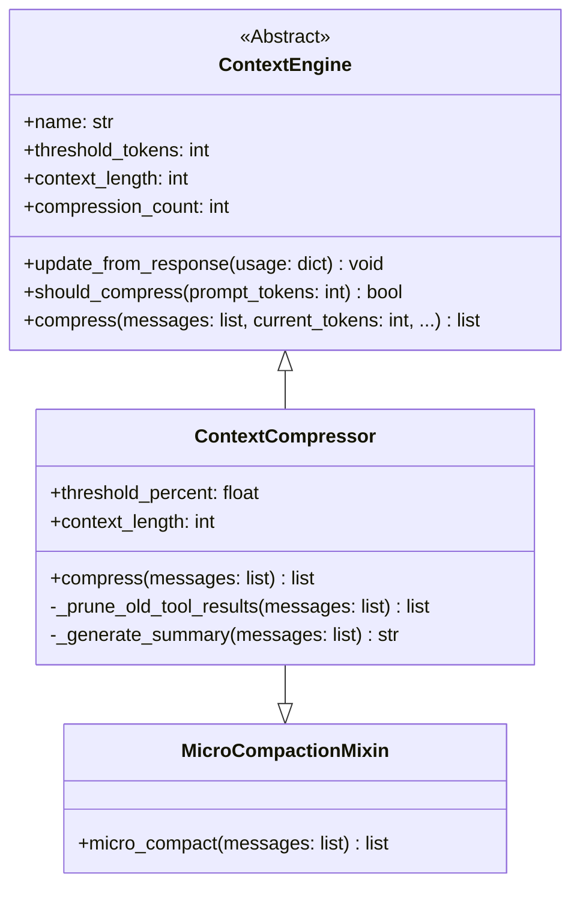

# Context Compression

<details>
<summary>Relevant source files</summary>

The following files were used as context for generating this wiki page:

- [agent/agent_init.py](agent/agent_init.py)
- [agent/agent_runtime_helpers.py](agent/agent_runtime_helpers.py)
- [agent/chat_completion_helpers.py](agent/chat_completion_helpers.py)
- [agent/compaction_display.py](agent/compaction_display.py)
- [agent/compaction_events.py](agent/compaction_events.py)
- [agent/compression_facade.py](agent/compression_facade.py)
- [agent/context_compressor.py](agent/context_compressor.py)
- [agent/context_compressor_telemetry.py](agent/context_compressor_telemetry.py)
- [agent/conversation_compression.py](agent/conversation_compression.py)
- [agent/conversation_compression_archive.py](agent/conversation_compression_archive.py)
- [agent/conversation_compression_codex.py](agent/conversation_compression_codex.py)
- [agent/conversation_compression_manual.py](agent/conversation_compression_manual.py)
- [agent/conversation_compression_telemetry.py](agent/conversation_compression_telemetry.py)
- [agent/conversation_loop.py](agent/conversation_loop.py)
- [agent/micro_compaction.py](agent/micro_compaction.py)
- [agent/model_metadata_token_memo.py](agent/model_metadata_token_memo.py)
- [agent/relay_compaction.py](agent/relay_compaction.py)
- [agent/turn_context.py](agent/turn_context.py)
- [agent/turn_finalizer.py](agent/turn_finalizer.py)
- [apps/desktop/e2e/core/reply-painted-once.spec.ts](apps/desktop/e2e/core/reply-painted-once.spec.ts)
- [apps/desktop/src/app/session/hooks/use-message-stream/reused-final-after-tool.test.tsx](apps/desktop/src/app/session/hooks/use-message-stream/reused-final-after-tool.test.tsx)
- [apps/desktop/src/app/session/hooks/use-message-stream/test-harness.tsx](apps/desktop/src/app/session/hooks/use-message-stream/test-harness.tsx)
- [scripts/micro_compaction_report.py](scripts/micro_compaction_report.py)
- [tests/agent/test_413_compression.py](tests/agent/test_413_compression.py)
- [tests/agent/test_compaction_events.py](tests/agent/test_compaction_events.py)
- [tests/agent/test_compression_attempt_effect.py](tests/agent/test_compression_attempt_effect.py)
- [tests/agent/test_compression_attempt_telemetry.py](tests/agent/test_compression_attempt_telemetry.py)
- [tests/agent/test_compression_commit_fence_race.py](tests/agent/test_compression_commit_fence_race.py)
- [tests/agent/test_compression_concurrent_fork.py](tests/agent/test_compression_concurrent_fork.py)
- [tests/agent/test_compression_refusal_restores_transcript.py](tests/agent/test_compression_refusal_restores_transcript.py)
- [tests/agent/test_compression_stall_fallback.py](tests/agent/test_compression_stall_fallback.py)
- [tests/agent/test_compression_stall_interrupt.py](tests/agent/test_compression_stall_interrupt.py)
- [tests/agent/test_compressor_truncated_summary_guard.py](tests/agent/test_compressor_truncated_summary_guard.py)
- [tests/agent/test_context_compressor.py](tests/agent/test_context_compressor.py)
- [tests/agent/test_conversation_compression_manual.py](tests/agent/test_conversation_compression_manual.py)
- [tests/agent/test_empty_response_recovery_persistence.py](tests/agent/test_empty_response_recovery_persistence.py)
- [tests/agent/test_in_place_merged_user_rows.py](tests/agent/test_in_place_merged_user_rows.py)
- [tests/agent/test_message_sequence_repair.py](tests/agent/test_message_sequence_repair.py)
- [tests/agent/test_micro_compaction.py](tests/agent/test_micro_compaction.py)
- [tests/agent/test_proactive_prune_restart_safety.py](tests/agent/test_proactive_prune_restart_safety.py)
- [tests/agent/test_relay_compaction.py](tests/agent/test_relay_compaction.py)
- [tests/agent/test_relay_runtime_bounded_scope_ops.py](tests/agent/test_relay_runtime_bounded_scope_ops.py)
- [tests/agent/test_token_memo_release_on_close.py](tests/agent/test_token_memo_release_on_close.py)
- [tests/agent/test_tool_call_args_sanitizer.py](tests/agent/test_tool_call_args_sanitizer.py)
- [tests/agent/test_turn_finalizer_cleanup_guard.py](tests/agent/test_turn_finalizer_cleanup_guard.py)
- [tests/agent/test_turn_finalizer_final_response_persistence.py](tests/agent/test_turn_finalizer_final_response_persistence.py)
- [tests/agent/test_turn_finalizer_iteration_limit_exit.py](tests/agent/test_turn_finalizer_iteration_limit_exit.py)
- [tests/agent/test_unicode_ascii_codec.py](tests/agent/test_unicode_ascii_codec.py)
- [tests/gateway/test_api_server_compaction_projection.py](tests/gateway/test_api_server_compaction_projection.py)
- [tests/gateway/test_queued_native_image_session_key.py](tests/gateway/test_queued_native_image_session_key.py)
- [tests/hermes_cli/test_gateway_agent_compress.py](tests/hermes_cli/test_gateway_agent_compress.py)
- [tests/hermes_cli/test_kanban_comment_queries.py](tests/hermes_cli/test_kanban_comment_queries.py)
- [tests/tools/test_kanban_comment_injection.py](tests/tools/test_kanban_comment_injection.py)
- [tests/tools/test_kanban_persisted_identity.py](tests/tools/test_kanban_persisted_identity.py)
- [tests/tui_gateway/test_manual_compress_history_fence.py](tests/tui_gateway/test_manual_compress_history_fence.py)
- [tests/tui_gateway/test_turn_payload_reused_final.py](tests/tui_gateway/test_turn_payload_reused_final.py)
- [website/docs/developer-guide/context-compression-and-caching.md](website/docs/developer-guide/context-compression-and-caching.md)

</details>


This page documents the context compression system within Hermes Agent (`https://github.com/NousResearch/hermes-agent`). Context compression manages the size of conversation histories to ensure they fit within large language model (LLM) context window limits, preserving important conversation content and session coherence while transparently reducing token counts.

For conversation orchestration details, see [Core Agent: Conversation Loop](). For prompt construction and caching, see [Core Agent: Context and Prompt Management]().

---

## Purpose and Scope

Hermes Agent employs context compression to address the problem of conversations growing beyond model context token limits. As messages and tool results accumulate, raw conversations can exceed a model’s maximum allowable tokens, causing truncation or failed completions.

The context compression system automatically:

- **Protects critical context regions**, preserving the initial ("head") messages including system prompts and the recent ("tail") messages verbatim to maintain conversation grounding and current turn context [agent/context_compressor.py:1-2]().

- **Summarizes middle messages** into a compact summary capturing the essential resolved and open information via an auxiliary model, effectively reducing token usage while preserving session state [agent/context_compressor.py:1-2]().

- **Prunes verbose tool call outputs** in messages by replacing long payloads with concise semantic stubs to reduce noise before summarization [agent/context_compressor.py:1-2]().

- **Supports micro-compaction** for incremental lightweight pruning via `MicroCompactionMixin` and **native compaction** for provider-supported native response compaction, delaying heavy summarization until needed [agent/context_compressor.py:35-41]().

- **Ensures concurrency safety** using durable per-session compression locks and commit fences that prevent race conditions, transcript forks, or orphaned session states during asynchronous compression [agent/conversation_compression.py:1-9]().

The core implementation centers on the `ContextCompressor` class in `agent/context_compressor.py` combined with the orchestration logic in `agent/conversation_compression.py` and `agent/compression_facade.py` [agent/context_compressor.py:13](), [agent/conversation_compression.py:1-9](), [agent/compression_facade.py:1-7]().

Sources: [agent/context_compressor.py:1-49](), [agent/conversation_compression.py:1-46](), [agent/compression_facade.py:1-7]()

---

## System Architecture

Hermes Agent organizes context compression along the conversation pipeline, linking natural language user interactions through layered components down to durable session storage:

```mermaid
graph TB
    subgraph "NaturalLanguage_Space"
        UserTurn["UserConversationTurn"]
        UserTurn --> AIAgent["AIAgentConversationOrchestration"]
    end

    subgraph "CodeEntity_Space"
        AIAgent["AIAgent"] -->|calls _compress_context| CompressionFacade["_compress_context (agent/compression_facade.py)"]
        CompressionFacade -->|uses commit guard| CompressionCommitFence["CompressionCommitFence (agent/conversation_compression.py)"]
        CompressionCommitFence -->|runs compress()| ContextCompressor["ContextCompressor (agent/context_compressor.py)"]
        ContextCompressor -->|prunes tool results| _prune_old_tool_results["_prune_old_tool_results()"]
        ContextCompressor -->|calls summary| AuxiliaryLLMSummarization["call_llm (agent/auxiliary_client.py)"]
        AuxiliaryLLMSummarization -->|persists data| SessionDB["SessionDB (hermes_state)"]
    end
```

This diagram bridges human turn processing to key code entities responsible for context compression steps.

Sources: [agent/context_compressor.py:1-49](), [agent/conversation_compression.py:1-46](), [agent/compression_facade.py:1-7]()

---

## Dual Compression System & Threshold Configuration

Hermes features two separate compression layers operating independently to prevent token overflow:

1. **Gateway Session Hygiene (85% threshold)**: Located in `gateway/run_turn_hygiene.py`, serving as a safety net that runs before the agent processes a message to catch sessions growing too large between turns (e.g., overnight accumulations) [website/docs/developer-guide/context-compression-and-caching.md:66-96]().
2. **Agent ContextCompressor (Default threshold 50%–75%, configurable)**: Located in `agent/context_compressor.py`, running inside the agent's tool loop with access to accurate API-reported token counts [website/docs/developer-guide/context-compression-and-caching.md:97-106]().

### Context Length Resolution & Thresholds

- The function `get_model_context_length()` fetches the model's active max context length token count [agent/model_metadata.py:40-44]().
- Compression activates when conversation estimated tokens exceed a configurable fraction (`threshold_percent`) of the model's max context tokens [tests/agent/test_context_compressor.py:38-51]().
- **Usage Anchor (`agent/usage_anchor.py`)**: Every compaction gate queries the usage anchor first, capturing the provider's last prompt/completion token counts plus an estimate of messages appended since that response [website/docs/developer-guide/context-compression-and-caching.md:107-118]().

### Summary Route Pinning

- The system uses a `ContextVar`-based pinned route mechanism `_SUMMARY_ROUTE_PIN` to fix the auxiliary LLM summarization call on precise provider credentials and model routes, enabling reliable retries and fallback without state leakage [agent/context_compressor.py:54-87]().

### Configuration Summary

| Parameter            | Description                                  | Default/Behavior                                   |
|----------------------|----------------------------------------------|---------------------------------------------------|
| `threshold_percent`  | Fraction of context tokens triggering compression | Configurable, typical ~0.75 (75%) [tests/agent/test_context_compressor.py:38-51]() |
| `protect_first_n`    | Count of initial messages to protect verbatim | Default 2-3 messages [tests/agent/test_context_compressor.py:38-51]() |
| `protect_last_n`     | Count of recent tail messages to protect verbatim | Default 2-6 messages [tests/agent/test_context_compressor.py:38-51]() |
| `tail_token_budget`  | Tokens allocated strictly for tail preservation | Computed dynamically during compression [agent/context_compressor.py:1-3]() |

Sources: [agent/context_compressor.py:54-117](), [agent/model_metadata.py:40-44](), [website/docs/developer-guide/context-compression-and-caching.md:66-132](), [tests/agent/test_context_compressor.py:38-51]()

---

## Compression Strategy: Surgical Compaction & Micro-Compaction

Hermes Agent compresses conversation context via a **Head-Middle-Tail** partitioning combined with tool output pruning and incremental micro compacting:

| Segment | Description | Treatment |
|---------|-------------|-----------|
| **Head** | The first `protect_first_n` messages, including system prompt | Preserved verbatim to maintain grounding context [agent/context_compressor.py:1-2]() |
| **Middle** | Messages between head and tail | Summarized into a compact checkpoint message by an auxiliary summarizer LLM, capturing resolved tasks, pending queries, and session state [agent/context_compressor.py:1-2]() |
| **Tail** | Most recent `protect_last_n` messages | Retained verbatim to preserve ongoing conversational context and avoid semantic drift [agent/context_compressor.py:1-2]() |

### Pruning Tool Outputs

- Long and verbose tool call outputs embedded in messages (web extraction, file reads, terminal outputs) are pruned before summarization to reduce token and payload size [agent/context_compressor.py:1-2]().
- Pruning replaces large outputs with semantic markers without losing metadata or important context anchors [tests/agent/test_context_compressor.py:79-126](). The `_summarize_tool_result` function handles this for specific tool types [tests/agent/test_context_compressor.py:12-21]().

### Micro-Compaction & Native Compaction

- **Micro-Compaction** (`MicroCompactionMixin`) incrementally performs mild payload pruning on nearly every turn to keep token cost manageable without heavy summarization [agent/context_compressor.py:41]().
- **Native Compaction** leverages provider/model native support to prune responses accurately on the client side, reducing preflight token estimates and avoiding unnecessary summarization [agent/conversation_loop.py:83-110](). This is checked by `_midturn_request_pressure_tokens` [agent/conversation_loop.py:83-110]().

Sources: [agent/context_compressor.py:1-49](), [agent/conversation_loop.py:83-110](), [tests/agent/test_context_compressor.py:12-126]()

---

## Concurrency Safety and Session Rotation

Context compression typically runs asynchronously under progress timeouts, requiring strict safety and consistency mechanisms:

- **Compression Commit Fence (`_CommitFenceRegistration`, `CompressionCommitFence`)**: Guards compression commits in `agent/compression_facade.py` and `agent/conversation_compression.py` to ensure state is only updated on successful, timely compressions. It discards stale or timed-out compression results to prevent inconsistent state [agent/conversation_compression.py:33-46](), [agent/compression_facade.py:20-34]().

- **Durable Per-Session Locks**: Compression acquires SQLite-backed locks by session ID in `SessionDB`, guaranteeing only one compression pass per session at a time. This prevents race conditions, transcript forks, or orphan child sessions [tests/agent/test_compression_concurrent_fork.py:134-162]().

- **Persistence Modes**:
  - *Rotation Mode*: Compression creates a child session, storing the summary compacted context there, ending the current session but preserving tail context in the child. Maintains linear session lineage [tests/agent/test_compression_concurrent_fork.py:1-27]().
  - *In-Place Compaction*: Compresses context internally by marking older rows replaced and rewriting the compacted snapshot within the same session [tests/agent/test_compression_concurrent_fork.py:98-102]().

Sources: [agent/conversation_compression.py:33-46](), [agent/compression_facade.py:20-34](), [tests/agent/test_compression_concurrent_fork.py:1-162]()

---

## Context Engine Plugin Architecture

Hermes Agent uses a plugin-based context engine abstraction via the `ContextEngine` ABC (`agent/context_engine.py`), allowing pluggable compression strategies tailored to environment or provider constraints [website/docs/developer-guide/context-compression-and-caching.md:39-64]().



### Key Interface Elements of `ContextEngine`

| Member                         | Type              | Description                                        |
|--------------------------------|-------------------|--------------------------------------------------|
| `name`                         | `str`             | Human-readable engine identifier [agent/context_engine.py:33]() |
| `threshold_tokens`             | `int`             | Token count where compression triggers [agent/context_engine.py:33]() |
| `context_length`               | `int`             | Maximum token window length [agent/context_engine.py:33]() |
| `update_from_response(usage)`  | `method`          | Updates engine state from LLM usage tokens [agent/context_engine.py:33]() |
| `should_compress(prompt_tokens)` | `method`        | Returns `True` when token budget exceeds threshold [agent/context_engine.py:33]() |
| `compress(messages, current_tokens, ...)` | `method` | Main compression logic producing message list [agent/context_engine.py:33]() |

The default engine is implemented via `ContextCompressor` in `agent/context_compressor.py`, but the system supports plugin overrides placed under `plugins/context_engine/<name>/` [website/docs/developer-guide/context-compression-and-caching.md:39-64]().

Sources: [agent/context_engine.py:33-36](), [agent/context_compressor.py:13-41](), [website/docs/developer-guide/context-compression-and-caching.md:39-64]()

---

## References

- `ContextCompressor` class and compression logic: [agent/context_compressor.py:1-146]()
- Compression orchestration and concurrency control: [agent/conversation_compression.py:1-130]()
- Host compression facade and commit fences: [agent/compression_facade.py:1-138]()
- Micro-compaction mixin: [agent/micro_compaction.py:1-40]()
- Context engine abstraction: [agent/context_engine.py:33-36]()
- Compression concurrency safety tests: [tests/agent/test_compression_concurrent_fork.py:1-162]()
- Tool output pruning details: [tests/agent/test_context_compressor.py:79-134]()
- Developer guide on context compression and caching: [website/docs/developer-guide/context-compression-and-caching.md:1-132]()