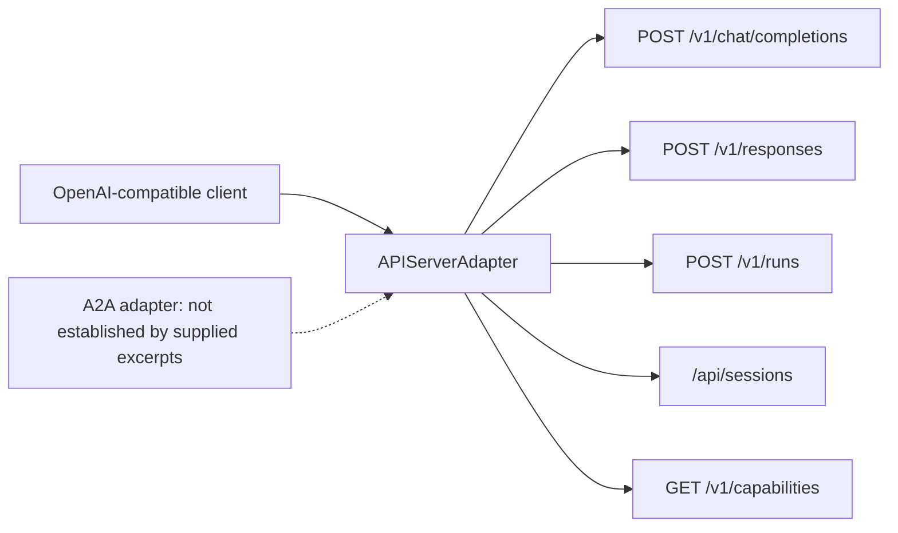
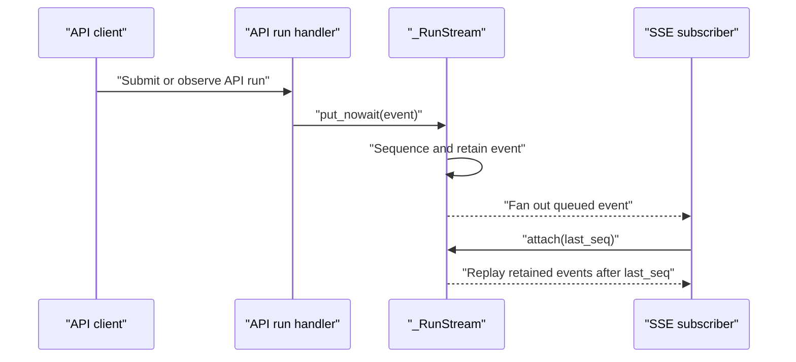
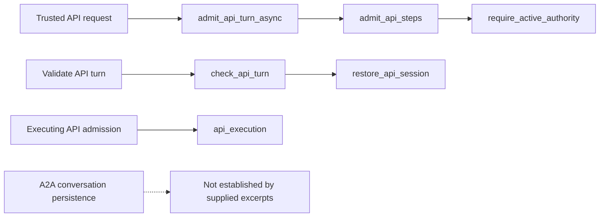
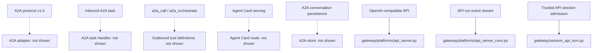

# A2A Agent-to-Agent Protocol

Relevant source files

The following files were used as context for generating this wiki page:

- [gateway/platform_registry.py](gateway/platform_registry.py)
- [gateway/platforms/api_server.py](gateway/platforms/api_server.py)
- [gateway/platforms/api_server_authority_runs.py](gateway/platforms/api_server_authority_runs.py)
- [gateway/platforms/api_server_memory_sessions.py](gateway/platforms/api_server_memory_sessions.py)
- [gateway/platforms/api_server_openai_routes.py](gateway/platforms/api_server_openai_routes.py)
- [gateway/platforms/api_server_response_admissions.py](gateway/platforms/api_server_response_admissions.py)
- [gateway/platforms/api_server_room_dispatch.py](gateway/platforms/api_server_room_dispatch.py)
- [gateway/platforms/api_server_room_grants.py](gateway/platforms/api_server_room_grants.py)
- [gateway/platforms/api_server_run_idempotency.py](gateway/platforms/api_server_run_idempotency.py)
- [gateway/platforms/api_server_runs.py](gateway/platforms/api_server_runs.py)
- [gateway/platforms/shared_ingress.py](gateway/platforms/shared_ingress.py)
- [gateway/platforms/tcp_site.py](gateway/platforms/tcp_site.py)
- [gateway/session_api.py](gateway/session_api.py)
- [gateway/session_api_turn.py](gateway/session_api_turn.py)
- [hermes_state_terminal.py](hermes_state_terminal.py)
- [plugins/platforms/dingtalk/adapter.py](plugins/platforms/dingtalk/adapter.py)
- [plugins/platforms/google_chat/__init__.py](plugins/platforms/google_chat/__init__.py)
- [plugins/platforms/google_chat/adapter.py](plugins/platforms/google_chat/adapter.py)
- [plugins/platforms/google_chat/oauth.py](plugins/platforms/google_chat/oauth.py)
- [plugins/platforms/google_chat/plugin.yaml](plugins/platforms/google_chat/plugin.yaml)
- [plugins/platforms/irc/adapter.py](plugins/platforms/irc/adapter.py)
- [plugins/platforms/irc/plugin.yaml](plugins/platforms/irc/plugin.yaml)
- [plugins/platforms/line/adapter.py](plugins/platforms/line/adapter.py)
- [plugins/platforms/mattermost/adapter.py](plugins/platforms/mattermost/adapter.py)
- [plugins/platforms/ntfy/adapter.py](plugins/platforms/ntfy/adapter.py)
- [plugins/platforms/raft/__init__.py](plugins/platforms/raft/__init__.py)
- [plugins/platforms/raft/adapter.py](plugins/platforms/raft/adapter.py)
- [plugins/platforms/raft/plugin.yaml](plugins/platforms/raft/plugin.yaml)
- [plugins/platforms/simplex/__init__.py](plugins/platforms/simplex/__init__.py)
- [plugins/platforms/simplex/adapter.py](plugins/platforms/simplex/adapter.py)
- [plugins/platforms/simplex/plugin.yaml](plugins/platforms/simplex/plugin.yaml)
- [plugins/platforms/sms/adapter.py](plugins/platforms/sms/adapter.py)
- [plugins/platforms/teams/adapter.py](plugins/platforms/teams/adapter.py)
- [plugins/platforms/teams/plugin.yaml](plugins/platforms/teams/plugin.yaml)
- [plugins/platforms/telegram/plugin.yaml](plugins/platforms/telegram/plugin.yaml)
- [tests/gateway/_plugin_adapter_loader.py](tests/gateway/_plugin_adapter_loader.py)
- [tests/gateway/test_admission_result_reply_once.py](tests/gateway/test_admission_result_reply_once.py)
- [tests/gateway/test_api_canonical_projection.py](tests/gateway/test_api_canonical_projection.py)
- [tests/gateway/test_api_cutover_results.py](tests/gateway/test_api_cutover_results.py)
- [tests/gateway/test_api_hosted_binding.py](tests/gateway/test_api_hosted_binding.py)
- [tests/gateway/test_api_idempotency_after_delete.py](tests/gateway/test_api_idempotency_after_delete.py)
- [tests/gateway/test_api_implicit_session_after_delete.py](tests/gateway/test_api_implicit_session_after_delete.py)
- [tests/gateway/test_api_runs_native_session_refusal.py](tests/gateway/test_api_runs_native_session_refusal.py)
- [tests/gateway/test_api_server.py](tests/gateway/test_api_server.py)
- [tests/gateway/test_api_server_bind_guard.py](tests/gateway/test_api_server_bind_guard.py)
- [tests/gateway/test_api_server_memory_sessions.py](tests/gateway/test_api_server_memory_sessions.py)
- [tests/gateway/test_api_server_reasoning_nonstream.py](tests/gateway/test_api_server_reasoning_nonstream.py)
- [tests/gateway/test_api_server_runs.py](tests/gateway/test_api_server_runs.py)
- [tests/gateway/test_api_source_binding.py](tests/gateway/test_api_source_binding.py)
- [tests/gateway/test_api_store_error_status.py](tests/gateway/test_api_store_error_status.py)
- [tests/gateway/test_api_terminal_http.py](tests/gateway/test_api_terminal_http.py)
- [tests/gateway/test_api_unknown_resolution.py](tests/gateway/test_api_unknown_resolution.py)
- [tests/gateway/test_chat_completions_tool_progress_optout.py](tests/gateway/test_chat_completions_tool_progress_optout.py)
- [tests/gateway/test_derived_generation_after_sweep.py](tests/gateway/test_derived_generation_after_sweep.py)
- [tests/gateway/test_derived_session_after_delete.py](tests/gateway/test_derived_session_after_delete.py)
- [tests/gateway/test_dingtalk.py](tests/gateway/test_dingtalk.py)
- [tests/gateway/test_google_chat.py](tests/gateway/test_google_chat.py)
- [tests/gateway/test_google_chat_oauth_dependencies.py](tests/gateway/test_google_chat_oauth_dependencies.py)
- [tests/gateway/test_irc_adapter.py](tests/gateway/test_irc_adapter.py)
- [tests/gateway/test_line_plugin.py](tests/gateway/test_line_plugin.py)
- [tests/gateway/test_mattermost.py](tests/gateway/test_mattermost.py)
- [tests/gateway/test_ntfy_plugin.py](tests/gateway/test_ntfy_plugin.py)
- [tests/gateway/test_platform_registry.py](tests/gateway/test_platform_registry.py)
- [tests/gateway/test_raft_adapter.py](tests/gateway/test_raft_adapter.py)
- [tests/gateway/test_readiness.py](tests/gateway/test_readiness.py)
- [tests/gateway/test_responses_chain_api_content.py](tests/gateway/test_responses_chain_api_content.py)
- [tests/gateway/test_retained_response_chain_after_delete.py](tests/gateway/test_retained_response_chain_after_delete.py)
- [tests/gateway/test_session_api.py](tests/gateway/test_session_api.py)
- [tests/gateway/test_signal.py](tests/gateway/test_signal.py)
- [tests/gateway/test_signal_format.py](tests/gateway/test_signal_format.py)
- [tests/gateway/test_signal_rate_limit.py](tests/gateway/test_signal_rate_limit.py)
- [tests/gateway/test_simplex_plugin.py](tests/gateway/test_simplex_plugin.py)
- [tests/gateway/test_sms.py](tests/gateway/test_sms.py)
- [tests/gateway/test_teams.py](tests/gateway/test_teams.py)
- [tests/gateway/test_teams_dotenv_isolation.py](tests/gateway/test_teams_dotenv_isolation.py)
- [tests/gateway/test_unauthorized_dm_behavior.py](tests/gateway/test_unauthorized_dm_behavior.py)
- [tests/gateway/test_unknown_receipt_boundaries.py](tests/gateway/test_unknown_receipt_boundaries.py)
- [tests/hermes_cli/test_tools_disable_enable.py](tests/hermes_cli/test_tools_disable_enable.py)
- [tests/website/test_check_doc_links.py](tests/website/test_check_doc_links.py)
- [website/README.md](website/README.md)
- [website/docs/developer-guide/extending-the-cli.md](website/docs/developer-guide/extending-the-cli.md)
- [website/docs/developer-guide/programmatic-integration.md](website/docs/developer-guide/programmatic-integration.md)
- [website/docs/user-guide/features/api-server.md](website/docs/user-guide/features/api-server.md)
- [website/docs/user-guide/messaging/google_chat.md](website/docs/user-guide/messaging/google_chat.md)
- [website/docs/user-guide/messaging/ntfy.md](website/docs/user-guide/messaging/ntfy.md)
- [website/docs/user-guide/messaging/open-webui.md](website/docs/user-guide/messaging/open-webui.md)
- [website/docs/user-guide/messaging/raft.md](website/docs/user-guide/messaging/raft.md)
- [website/docs/user-guide/messaging/simplex.md](website/docs/user-guide/messaging/simplex.md)
- [website/docs/user-guide/messaging/teams.md](website/docs/user-guide/messaging/teams.md)
- [website/docs/user-guide/messaging/whatsapp-cloud.md](website/docs/user-guide/messaging/whatsapp-cloud.md)
- [website/i18n/zh-Hans/docusaurus-plugin-content-docs/current/user-guide/features/api-server.md](website/i18n/zh-Hans/docusaurus-plugin-content-docs/current/user-guide/features/api-server.md)
- [website/i18n/zh-Hans/docusaurus-plugin-content-docs/current/user-guide/messaging/google_chat.md](website/i18n/zh-Hans/docusaurus-plugin-content-docs/current/user-guide/messaging/google_chat.md)
- [website/i18n/zh-Hans/docusaurus-plugin-content-docs/current/user-guide/messaging/open-webui.md](website/i18n/zh-Hans/docusaurus-plugin-content-docs/current/user-guide/messaging/open-webui.md)
- [website/i18n/zh-Hans/docusaurus-plugin-content-docs/current/user-guide/messaging/teams.md](website/i18n/zh-Hans/docusaurus-plugin-content-docs/current/user-guide/messaging/teams.md)
- [website/scripts/check_doc_links.py](website/scripts/check_doc_links.py)
- [website/src/remark/relativeDocLinks.js](website/src/remark/relativeDocLinks.js)

## Purpose and Scope

This page records what can be verified about A2A from the supplied code excerpts and identifies what those excerpts do not establish. The supplied material does **not** include an A2A adapter, A2A task handlers, `a2a_call` or `a2a_orchestrate` tool definitions, Agent Card routes, or A2A conversation-storage implementation. Consequently, their implementation and behavior cannot be documented reliably from these sources. [gateway/platforms/api_server.py:1-7](), [gateway/platforms/api_server.py:59-81](), [gateway/session_api_turn.py:16-25]()

The excerpts do show the separate OpenAI-compatible API server and its durable session-admission machinery. Those are described below as code that is present in the supplied material—not as A2A functionality. [gateway/platforms/api_server.py:1-7](), [gateway/session_api_turn.py:1-16]()

Sources: [gateway/platforms/api_server.py:1-7](), [gateway/platforms/api_server.py:59-81](), [gateway/session_api_turn.py:1-16]()

---

## 1. A2A Implementation Evidence

The supplied files do not substantiate the previous draft’s claims about an A2A-specific adapter, `/v1/a2a/task`, HMAC authentication, `_ssrf_redirect_guard`, Agent Cards, or an `a2a_conversations/` directory. The shown API-server route inventory instead lists OpenAI-compatible endpoints, run endpoints, and session endpoints; it does not list an A2A route in that inventory. [gateway/platforms/api_server.py:59-81]()

| Requested A2A area | What the supplied excerpts establish |
|---|---|
| A2A v1.0 adapter and inbound task handling | No A2A adapter or task handler is shown. The supplied API-server excerpts identify `APIServerAdapter` as an OpenAI-compatible HTTP adapter. [gateway/platforms/api_server.py:1-7]() |
| Outbound `a2a_call` and `a2a_orchestrate` | No definitions or call sites for these tools are shown. |
| Agent Card serving | No Agent Card type, route, or handler is shown. The displayed API-server endpoint inventory lists its known endpoints. [gateway/platforms/api_server.py:59-81]() |
| A2A security model | No A2A-specific authentication, signing, or peer-authorization implementation is shown. |
| A2A conversation persistence | No A2A conversation store or `a2a_conversations/` path is shown. The supplied persistence-related excerpt concerns API session admissions. [gateway/session_api_turn.py:1-16]() |

Sources: [gateway/platforms/api_server.py:1-7](), [gateway/platforms/api_server.py:59-81](), [gateway/session_api_turn.py:1-16]()

---

## 2. Verified Neighboring System: OpenAI-Compatible API Server

`gateway/platforms/api_server.py` describes an aiohttp-based OpenAI-compatible API server. Its module documentation names `/v1/chat/completions`, `/v1/responses`, `/v1/models`, `/v1/capabilities`, `/api/sessions`, `/v1/runs`, `/api/jobs`, and health routes; it also documents profile-prefixed paths when gateway profile multiplexing is enabled. These are API-server routes, not evidence of an A2A protocol surface. [gateway/platforms/api_server.py:1-7]()

The displayed capability endpoint table includes chat, Responses, runs, skills, toolsets, and session operations. It does not include an Agent Card or A2A task endpoint in the excerpt. [gateway/platforms/api_server.py:59-81]()

### API-server entity map

This diagram maps the documented API-server concepts to entities and route names visible in the supplied excerpts. It does not assert an A2A integration. [gateway/platforms/api_server.py:1-7](), [gateway/platforms/api_server.py:59-81]()

Sources: [gateway/platforms/api_server.py:1-7](), [gateway/platforms/api_server.py:59-81]()

### Capability and route inventory

The API-server capability table defines static feature flags and a route inventory. The displayed entries include run status, run events, approvals, steering, stop, skills, toolsets, and session routes. The excerpt does not show A2A-specific feature flags or routes. [gateway/platforms/api_server.py:48-81]()

| Capability or route group | Examples in supplied excerpt |
|---|---|
| Chat APIs | `POST /v1/chat/completions`, `POST /v1/responses` [gateway/platforms/api_server.py:61-68]() |
| Run control | `POST /v1/runs`, `GET /v1/runs/{run_id}`, run events, approval, steering, and stop routes [gateway/platforms/api_server.py:65-71]() |
| Session APIs | `/api/sessions` list, create, read, update, delete, messages, fork, chat, and model-lock routes [gateway/platforms/api_server.py:72-81]() |
| A2A / Agent Card | Not present in the displayed inventory [gateway/platforms/api_server.py:59-81]() |

Sources: [gateway/platforms/api_server.py:48-81]()

---

## 3. Verified API Run Handling and Event Streaming

The supplied run-handler excerpt documents `_RunStream`, which sequences and retains run events, fans them out to SSE subscribers, and replays buffered events when a subscriber attaches with a last-seen sequence number. Its backlog is bounded, and subscriber queues are bounded; an overflowing subscriber is detached and receives an overflow marker. These behaviors concern API runs and are not shown as A2A task semantics. [gateway/platforms/api_server_runs.py:117-163]()

The module also tracks API-server agent work submitted to an executor. `_submit_api_worker` increments a process-level live-worker count before submission and releases it when the worker exits, including when submission fails. This protects shutdown accounting for API-server turns; it is not evidence of an A2A worker lifecycle. [gateway/platforms/api_server_runs.py:33-75]()

### API run event flow

Sources: [gateway/platforms/api_server_runs.py:117-163]()

---

## 4. Verified Session Admission and Persistence Boundary

`gateway/session_api_turn.py` describes trusted API preparation and observation of a canonical durable FIFO. It defines an `api_execution` context variable, the `AdmissionQueued` exception, API-turn settings validation, and the `admit_api_turn` / `admit_api_turn_async` entry points. The asynchronous path obtains the active session authority and runs admission steps off the owner event loop. [gateway/session_api_turn.py:1-16](), [gateway/session_api_turn.py:29-39](), [gateway/session_api_turn.py:120-138]()

`check_api_turn` validates the persisted API-turn payload and settings, restores API sessions when the source platform is `API_SERVER`, and rejects unavailable or mismatched adapters. `admit_api_steps` obtains the active authority and begins admission using the request’s session identifier or a generated identifier. These are API-session mechanisms; the supplied excerpt does not connect them to A2A peer identity or A2A conversation persistence. [gateway/session_api_turn.py:48-71](), [gateway/session_api_turn.py:140-144]()

### Natural-language concepts mapped to verified code entities

Sources: [gateway/session_api_turn.py:1-16](), [gateway/session_api_turn.py:48-71](), [gateway/session_api_turn.py:120-144]()

---

## 5. Security and Conversation Persistence: Evidence Limits

The supplied excerpts support specific security and persistence statements about the neighboring API server, but not about A2A:

- The API-server route inventory includes run and session operations, but the displayed excerpts do not establish A2A peer authentication, request signing, replay protection, or SSRF controls for A2A. [gateway/platforms/api_server.py:59-81]()
- API run-event previews are force-redacted before truncation in `_tool_completed_preview`; this is a run-stream behavior, not an A2A response-signing mechanism. [gateway/platforms/api_server_runs.py:106-115]()
- API-turn admission uses an active session authority and validates API-turn settings. The shown code does not define A2A peer-scoped history or an A2A conversation store. [gateway/session_api_turn.py:48-71](), [gateway/session_api_turn.py:120-144]()

Do not infer that API-server authentication or session handling is equivalent to an A2A security or persistence contract. The relevant A2A implementation files are not included in the supplied material. [gateway/platforms/api_server.py:1-7](), [gateway/session_api_turn.py:1-16]()

Sources: [gateway/platforms/api_server.py:1-7](), [gateway/platforms/api_server.py:59-81](), [gateway/platforms/api_server_runs.py:106-115](), [gateway/session_api_turn.py:48-71](), [gateway/session_api_turn.py:120-144]()

---

## 6. Code-navigation Map

The following diagram distinguishes the code entities that can be searched in the supplied excerpts from the A2A entities requested by this page but not shown. [gateway/platforms/api_server.py:1-7](), [gateway/platforms/api_server_runs.py:117-163](), [gateway/session_api_turn.py:1-16]()

Sources: [gateway/platforms/api_server.py:1-7](), [gateway/platforms/api_server_runs.py:117-163](), [gateway/session_api_turn.py:1-16]()

---

## Summary

The supplied excerpts do not provide enough implementation evidence to document the A2A v1.0 adapter, inbound task handling, `a2a_call` or `a2a_orchestrate`, Agent Card serving, A2A security, or A2A conversation persistence. The previous draft’s specific claims about those entities and behaviors are therefore not retained as codebase facts.

The excerpts do establish a neighboring OpenAI-compatible API server, API run streaming, and trusted API session admission. These systems should not be presented as A2A components without additional source evidence. [gateway/platforms/api_server.py:1-7](), [gateway/platforms/api_server_runs.py:117-163](), [gateway/session_api_turn.py:1-16]()

Sources: [gateway/platforms/api_server.py:1-7](), [gateway/platforms/api_server_runs.py:117-163](), [gateway/session_api_turn.py:1-16]()