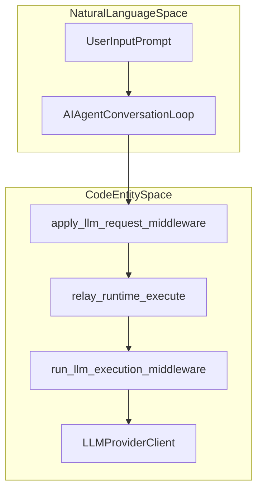
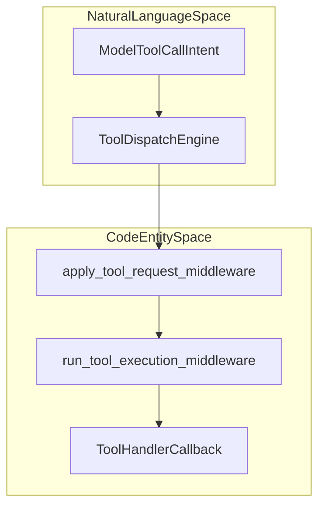

# Middleware System

<details>
<summary>Relevant source files</summary>

The following files were used as context for generating this wiki page:

- [agent/shell_hooks.py](agent/shell_hooks.py)
- [agent/tool_dispatch_helpers.py](agent/tool_dispatch_helpers.py)
- [agent/tool_executor.py](agent/tool_executor.py)
- [hermes_cli/agent_plugins.py](hermes_cli/agent_plugins.py)
- [hermes_cli/hooks.py](hermes_cli/hooks.py)
- [hermes_cli/mcp_picker.py](hermes_cli/mcp_picker.py)
- [hermes_cli/mcp_security.py](hermes_cli/mcp_security.py)
- [hermes_cli/memory_oauth.py](hermes_cli/memory_oauth.py)
- [hermes_cli/middleware.py](hermes_cli/middleware.py)
- [hermes_cli/plugin_oauth.py](hermes_cli/plugin_oauth.py)
- [hermes_cli/plugin_provider_requests.py](hermes_cli/plugin_provider_requests.py)
- [hermes_cli/plugin_validate.py](hermes_cli/plugin_validate.py)
- [hermes_cli/plugin_validate_desktop.py](hermes_cli/plugin_validate_desktop.py)
- [hermes_cli/plugins.py](hermes_cli/plugins.py)
- [hermes_cli/plugins_cmd.py](hermes_cli/plugins_cmd.py)
- [hermes_cli/plugins_cmd_catalog.py](hermes_cli/plugins_cmd_catalog.py)
- [hermes_cli/plugins_cmd_install.py](hermes_cli/plugins_cmd_install.py)
- [hermes_cli/plugins_cmd_remove.py](hermes_cli/plugins_cmd_remove.py)
- [hermes_cli/plugins_cmd_update.py](hermes_cli/plugins_cmd_update.py)
- [hermes_cli/plugins_cmd_update_all.py](hermes_cli/plugins_cmd_update_all.py)
- [hermes_cli/plugins_discovery.py](hermes_cli/plugins_discovery.py)
- [hermes_cli/plugins_dispatch.py](hermes_cli/plugins_dispatch.py)
- [hermes_cli/plugins_ledger.py](hermes_cli/plugins_ledger.py)
- [hermes_cli/plugins_loader.py](hermes_cli/plugins_loader.py)
- [hermes_cli/plugins_manifest.py](hermes_cli/plugins_manifest.py)
- [hermes_cli/plugins_state.py](hermes_cli/plugins_state.py)
- [hermes_cli/plugins_transaction.py](hermes_cli/plugins_transaction.py)
- [hermes_cli/plugins_updates.py](hermes_cli/plugins_updates.py)
- [hermes_cli/subcommands/plugins.py](hermes_cli/subcommands/plugins.py)
- [model_tools.py](model_tools.py)
- [plugin-catalog/README.md](plugin-catalog/README.md)
- [tests/agent/test_post_compaction_hook.py](tests/agent/test_post_compaction_hook.py)
- [tests/agent/test_shell_hooks.py](tests/agent/test_shell_hooks.py)
- [tests/agent/test_tool_dispatch_helpers.py](tests/agent/test_tool_dispatch_helpers.py)
- [tests/gateway/test_weak_credential_guard.py](tests/gateway/test_weak_credential_guard.py)
- [tests/hermes_cli/test_agent_plugins.py](tests/hermes_cli/test_agent_plugins.py)
- [tests/hermes_cli/test_hooks_cli.py](tests/hermes_cli/test_hooks_cli.py)
- [tests/hermes_cli/test_mcp_security.py](tests/hermes_cli/test_mcp_security.py)
- [tests/hermes_cli/test_plugin_dependency_consent.py](tests/hermes_cli/test_plugin_dependency_consent.py)
- [tests/hermes_cli/test_plugin_hook_failure_reporting.py](tests/hermes_cli/test_plugin_hook_failure_reporting.py)
- [tests/hermes_cli/test_plugin_install_ref.py](tests/hermes_cli/test_plugin_install_ref.py)
- [tests/hermes_cli/test_plugin_loader_module_eviction.py](tests/hermes_cli/test_plugin_loader_module_eviction.py)
- [tests/hermes_cli/test_plugin_module_eviction_race.py](tests/hermes_cli/test_plugin_module_eviction_race.py)
- [tests/hermes_cli/test_plugin_oauth.py](tests/hermes_cli/test_plugin_oauth.py)
- [tests/hermes_cli/test_plugin_scan_dunder_dirs.py](tests/hermes_cli/test_plugin_scan_dunder_dirs.py)
- [tests/hermes_cli/test_plugin_uninstall_windows_live.py](tests/hermes_cli/test_plugin_uninstall_windows_live.py)
- [tests/hermes_cli/test_plugin_validate.py](tests/hermes_cli/test_plugin_validate.py)
- [tests/hermes_cli/test_plugins.py](tests/hermes_cli/test_plugins.py)
- [tests/hermes_cli/test_plugins_catalog_requires_hermes.py](tests/hermes_cli/test_plugins_catalog_requires_hermes.py)
- [tests/hermes_cli/test_plugins_check_updates.py](tests/hermes_cli/test_plugins_check_updates.py)
- [tests/hermes_cli/test_plugins_cmd.py](tests/hermes_cli/test_plugins_cmd.py)
- [tests/hermes_cli/test_plugins_cmd_catalog.py](tests/hermes_cli/test_plugins_cmd_catalog.py)
- [tests/hermes_cli/test_plugins_cmd_enable_disable_nested.py](tests/hermes_cli/test_plugins_cmd_enable_disable_nested.py)
- [tests/hermes_cli/test_plugins_loader.py](tests/hermes_cli/test_plugins_loader.py)
- [tests/hermes_cli/test_plugins_update_all.py](tests/hermes_cli/test_plugins_update_all.py)
- [tests/hermes_cli/test_web_memory_user_dir_provider.py](tests/hermes_cli/test_web_memory_user_dir_provider.py)
- [tests/plugins/test_memory_hook_registration.py](tests/plugins/test_memory_hook_registration.py)
- [tests/pm/test_plugin_declarations.py](tests/pm/test_plugin_declarations.py)
- [tests/providers/fake_pkce_idp.py](tests/providers/fake_pkce_idp.py)
- [tests/tools/test_completed_process_results.py](tests/tools/test_completed_process_results.py)
- [tests/tools/test_process_wait_auto_notify.py](tests/tools/test_process_wait_auto_notify.py)
- [tools/__init__.py](tools/__init__.py)
- [tools/process_registry_results.py](tools/process_registry_results.py)
- [tools/process_registry_wait_policy.py](tools/process_registry_wait_policy.py)
- [toolsets.py](toolsets.py)
- [website/docs/developer-guide/adding-tools.md](website/docs/developer-guide/adding-tools.md)
- [website/docs/developer-guide/middleware.md](website/docs/developer-guide/middleware.md)
- [website/docs/developer-guide/plugins/catalog-submission.md](website/docs/developer-guide/plugins/catalog-submission.md)
- [website/docs/developer-guide/plugins/index.md](website/docs/developer-guide/plugins/index.md)
- [website/docs/developer-guide/tools-runtime.md](website/docs/developer-guide/tools-runtime.md)
- [website/docs/integrations/index.md](website/docs/integrations/index.md)
- [website/docs/reference/tools-reference.md](website/docs/reference/tools-reference.md)
- [website/docs/reference/toolsets-reference.md](website/docs/reference/toolsets-reference.md)
- [website/docs/user-guide/features/hooks.md](website/docs/user-guide/features/hooks.md)
- [website/docs/user-guide/features/overview.md](website/docs/user-guide/features/overview.md)
- [website/docs/user-guide/features/plugin-catalog.md](website/docs/user-guide/features/plugin-catalog.md)
- [website/docs/user-guide/features/plugins.md](website/docs/user-guide/features/plugins.md)
- [website/docs/user-guide/features/tools.md](website/docs/user-guide/features/tools.md)
- [website/i18n/zh-Hans/docusaurus-plugin-content-docs/current/developer-guide/tools-runtime.md](website/i18n/zh-Hans/docusaurus-plugin-content-docs/current/developer-guide/tools-runtime.md)
- [website/i18n/zh-Hans/docusaurus-plugin-content-docs/current/reference/tools-reference.md](website/i18n/zh-Hans/docusaurus-plugin-content-docs/current/reference/tools-reference.md)
- [website/i18n/zh-Hans/docusaurus-plugin-content-docs/current/reference/toolsets-reference.md](website/i18n/zh-Hans/docusaurus-plugin-content-docs/current/reference/toolsets-reference.md)
- [website/i18n/zh-Hans/docusaurus-plugin-content-docs/current/user-guide/features/browser.md](website/i18n/zh-Hans/docusaurus-plugin-content-docs/current/user-guide/features/browser.md)
- [website/i18n/zh-Hans/docusaurus-plugin-content-docs/current/user-guide/features/tools.md](website/i18n/zh-Hans/docusaurus-plugin-content-docs/current/user-guide/features/tools.md)

</details>


## Purpose and Scope

The Hermes Middleware System is a core plugin-driven interception layer designed for rewriting and transforming requests and arguments, as well as wrapping execution callbacks related to LLM and tool invocations. This system provides a flexible pipeline architecture enabling the injection of cross-cutting concerns such as guardrails, context and prompt injection, argument validation, logging, telemetry, and security without modifying core agent logic or tool implementation code.

Sources: `[hermes_cli/middleware.py:1-176]()`, `[hermes_cli/plugins.py:1-132]()`

---

## Middleware Kinds

Hermes defines **four distinct kinds** of middleware, each corresponding to a specific stage in the lifecycle of a user-agent interaction or a tool call:

| Middleware Kind | Target Stage | Description |
|---|---|---|
| `llm_request` | LLM Input Request | Intercept and transform the LLM request dictionary (messages, parameters, tools) before sending to the provider. |
| `llm_execution` | LLM Execution Callback | Wrap the actual execution that sends the request to the LLM provider and processes the response, enabling interception of network calls or streaming behavior. |
| `tool_request` | Tool Input Arguments | Transform or validate the arguments passed to a tool before the tool handler runs. |
| `tool_execution` | Tool Handler Execution | Wrap the entire execution of a tool handler, allowing pre/post processing, instrumentation, or error handling. |

Sources: `[hermes_cli/middleware.py:19-27]()`, `[tests/hermes_cli/test_plugins.py:27-32]()`

---

## Architecture and Data Flow

Middleware chains consist of sequences of callbacks that may transform data or wrap function execution. The core agent and tool dispatch logic integrate these chains at well-defined call sites.

### LLM Middleware Flow

Title: LLM Middleware Execution Flow



In this flow, the user’s input progresses through the agent’s conversation loop. The raw LLM request dict is transformed via `apply_llm_request_middleware()` `[hermes_cli/middleware.py:88-100]()`. The execution of the request is wrapped by `run_llm_execution_middleware()` `[hermes_cli/middleware.py:126-141]()`, which invokes registered middleware callbacks before calling the provider client.

Sources: `[hermes_cli/middleware.py:88-141]()`, `[tests/hermes_cli/test_plugins.py:28-32]()`

---

### Tool Middleware Flow

Title: Tool Middleware Execution Flow



Here, a tool call intent from the model enters the tool dispatch system. The tool arguments (`args`) may be transformed by `apply_tool_request_middleware()` `[hermes_cli/middleware.py:102-114]()`. The actual execution handler of the tool is then wrapped by `run_tool_execution_middleware()` `[hermes_cli/middleware.py:143-150]()`, allowing middleware callbacks to insert logic around tool invocation.

Sources: `[hermes_cli/middleware.py:102-150]()`, `[tests/hermes_cli/test_plugins.py:29-31]()`

---

## Implementation Details and Plugin Authoring

Middleware callbacks are registered by plugins primarily during their setup via the `PluginContext.register_middleware()` API `[hermes_cli/plugins.py:1900-1902]()`, which takes the middleware kind and a callback function.

### Registering Middleware in a Plugin

Example `register(ctx)` function inside a plugin:

```python
def register(ctx):
    # Example middleware that adds a system prompt message to all LLM requests
    def add_system_prompt(request):
        request.setdefault("messages", []).insert(0, {"role": "system", "content": "Enforce strict safety."})
        return request

    ctx.register_middleware("llm_request", add_system_prompt)
```

This middleware callback receives and returns the LLM request dictionary, rewriting it to prepend a system message. Plugins can similarly register callbacks for the other middleware kinds (`tool_request`, `llm_execution`, `tool_execution`).

Sources: `[hermes_cli/plugins.py:1-132]()`, `[tests/hermes_cli/test_plugins.py:30-35]()`, `[website/docs/user-guide/features/plugins.md:105-105]()`

### Execution Order & Fault Isolation

- Middleware callbacks run **sequentially in registration order**.
- Exceptions in middleware are **caught and logged internally** to avoid crashing core agent loops.
- User-installed and project-level plugins can override bundled middleware by registering later.
- Middleware may implement **fail-closed** behavior (blocking action on errors) or **fail-open** (allowing requests to pass through if middleware fails).
- Execution middleware supports asynchronous or streaming scenarios for LLMs and tools.

Sources: `[hermes_cli/middleware.py:161-176]()`, `[hermes_cli/plugins.py:1-60]()`

---

## Shell Hook Integration

Hermes supports legacy and complementary middleware hooks implemented as external shell scripts managed through the profile’s configuration. These shell hooks receive a structured JSON payload representing the tool call or LLM call context via standard input and respond with JSON on standard output to block, modify, or approve actions.

Shell hooks integrate with the plugin middleware system, providing an out-of-process interception point for guardrails, compliance, or auditing workflows.

Sources: `[agent/shell_hooks.py:1-157]()`, `[tests/agent/test_shell_hooks.py:1-184]()`, `[website/docs/user-guide/features/hooks.md:15-15]()`

---

## Key Classes and Functions

| Entity | Location | Description |
|---|---|---|
| `PluginManager` | `hermes_cli/plugins.py` | Central manager for plugin discovery, loading, middleware registration, and dispatch ordering. |
| `PluginContext` | `hermes_cli/plugins.py` | Context API provided to plugins for registering middleware, tools, commands, and hooks. |
| `apply_llm_request_middleware()` | `hermes_cli/middleware.py`| Transform the LLM request dictionary via registered `llm_request` middleware callbacks. |
| `apply_tool_request_middleware()`| `hermes_cli/middleware.py`| Transform tool call arguments via `tool_request` middleware callbacks. |
| `run_llm_execution_middleware()` | `hermes_cli/middleware.py`| Wrap the LLM request execution call with `llm_execution` middleware callbacks. |
| `run_tool_execution_middleware()`| `hermes_cli/middleware.py`| Wrap the tool handler execution with `tool_execution` middleware callbacks. |
| `ShellHookSpec` | `agent/shell_hooks.py` | Parses and manages configuration and invocation of shell-script middleware hooks. |

Sources: `[hermes_cli/plugins.py:1-60]()`, `[hermes_cli/middleware.py:29-150]()`, `[agent/shell_hooks.py:135-146]()`

---

## Summary

Hermes's Middleware System implements a comprehensive plugin-driven architecture to intercept and transform LLM requests, execution callbacks, tool arguments, and tool handlers, enabling robust cross-cutting capabilities such as guardrails, argument validation, and logging without core source changes.

Sources: `[hermes_cli/middleware.py:1-176]()`, `[hermes_cli/plugins.py:1-132]()`

---

## Sources

- `[hermes_cli/plugins.py:1-132]()`
- `[hermes_cli/middleware.py:1-176]()`
- `[tests/hermes_cli/test_plugins.py:27-35]()`
- `[agent/shell_hooks.py:1-157]()`
- `[tests/agent/test_shell_hooks.py:1-184]()`
- `[website/docs/user-guide/features/plugins.md:105-105]()`
- `[website/docs/user-guide/features/hooks.md:15-15]()`