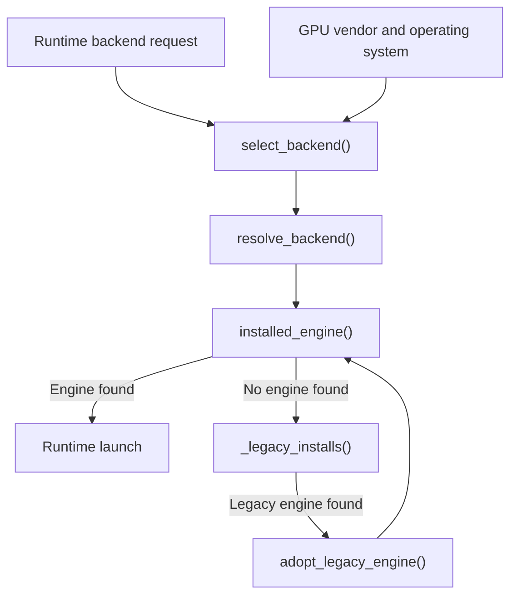
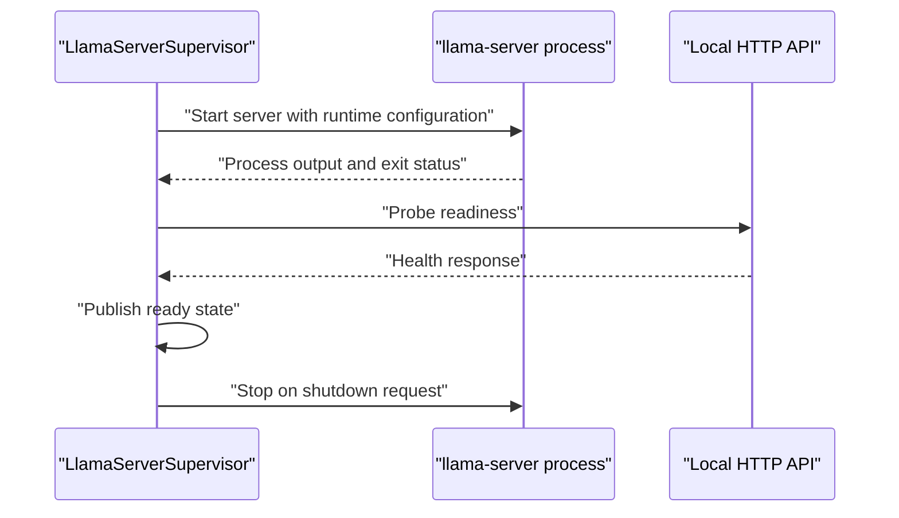
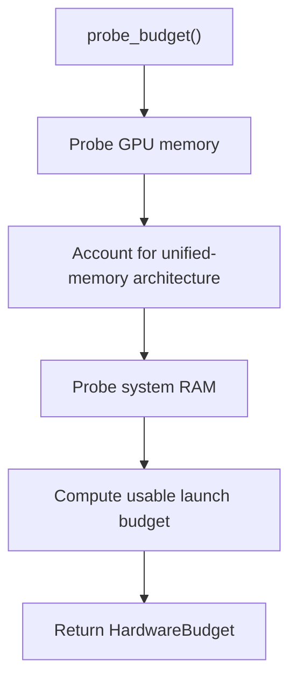
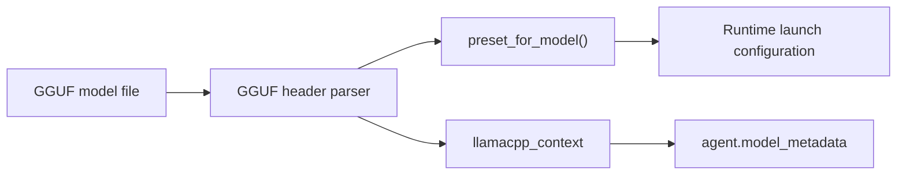
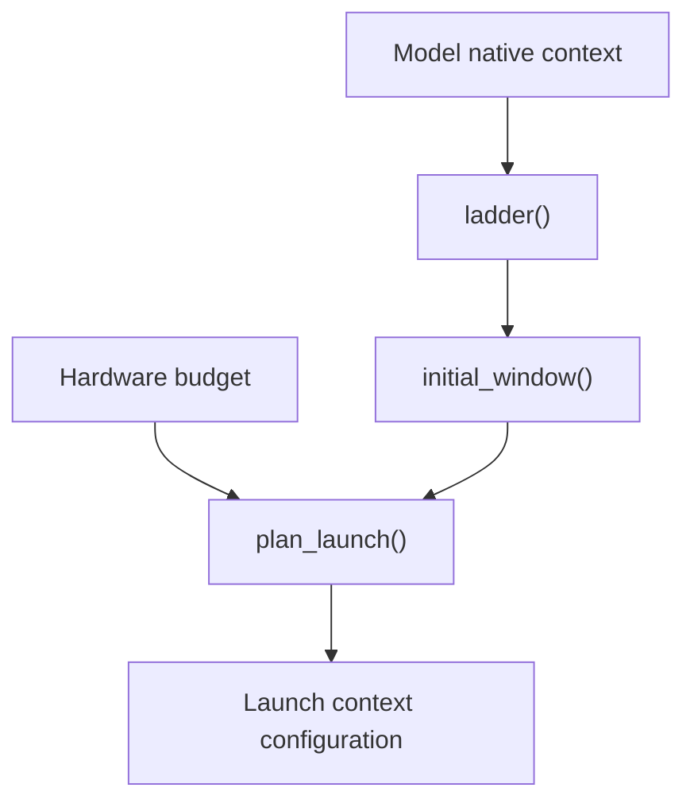
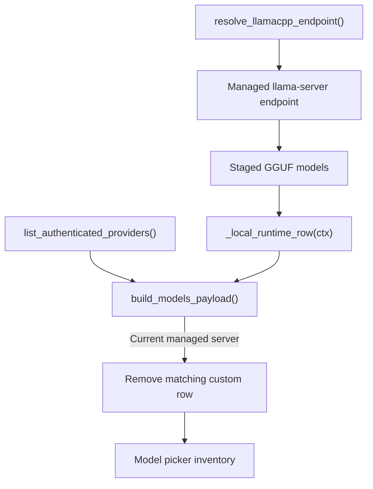
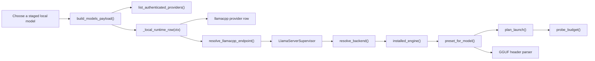
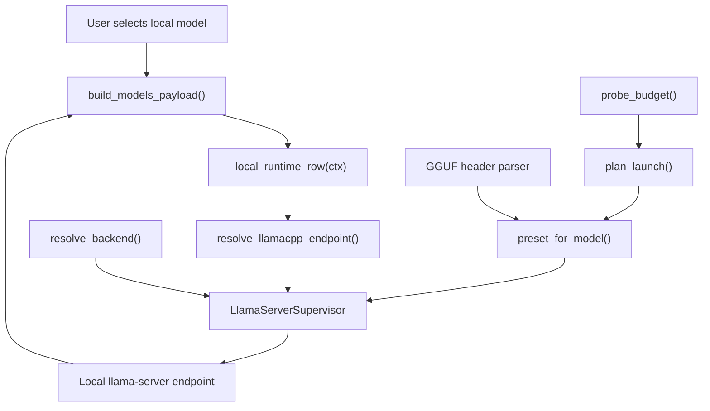

# Local Model Runtime

Relevant source files

The following files were used as context for generating this wiki page:

- [agent/image_routing.py](agent/image_routing.py)
- [agent/insights.py](agent/insights.py)
- [agent/moa_loop.py](agent/moa_loop.py)
- [agent/model_metadata.py](agent/model_metadata.py)
- [agent/models_dev.py](agent/models_dev.py)
- [agent/reasoning_effort.py](agent/reasoning_effort.py)
- [agent/reasoning_timeouts.py](agent/reasoning_timeouts.py)
- [agent/usage_pricing.py](agent/usage_pricing.py)
- [apps/desktop/electron/feature-flags.test.ts](apps/desktop/electron/feature-flags.test.ts)
- [apps/desktop/electron/feature-flags.ts](apps/desktop/electron/feature-flags.ts)
- [apps/desktop/src/app/settings/model-settings.test.tsx](apps/desktop/src/app/settings/model-settings.test.tsx)
- [apps/desktop/src/app/settings/model-settings.tsx](apps/desktop/src/app/settings/model-settings.tsx)
- [apps/desktop/src/store/local-models-flag.ts](apps/desktop/src/store/local-models-flag.ts)
- [contributors/emails/elisam@nvidia.com](contributors/emails/elisam@nvidia.com)
- [contributors/emails/kevinbanjo@gmail.com](contributors/emails/kevinbanjo@gmail.com)
- [hermes_cli/codex_models.py](hermes_cli/codex_models.py)
- [hermes_cli/data_cleanup.py](hermes_cli/data_cleanup.py)
- [hermes_cli/inventory.py](hermes_cli/inventory.py)
- [hermes_cli/local_runtime/capabilities.py](hermes_cli/local_runtime/capabilities.py)
- [hermes_cli/moa_cmd.py](hermes_cli/moa_cmd.py)
- [hermes_cli/moa_config.py](hermes_cli/moa_config.py)
- [hermes_cli/model_switch.py](hermes_cli/model_switch.py)
- [hermes_cli/model_switch_providers.py](hermes_cli/model_switch_providers.py)
- [hermes_cli/models.py](hermes_cli/models.py)
- [hermes_cli/models_catalog_static.py](hermes_cli/models_catalog_static.py)
- [hermes_cli/models_local.py](hermes_cli/models_local.py)
- [hermes_cli/models_pricing.py](hermes_cli/models_pricing.py)
- [hermes_cli/models_profile_cache.py](hermes_cli/models_profile_cache.py)
- [hermes_cli/models_reasoning_caps.py](hermes_cli/models_reasoning_caps.py)
- [hermes_cli/models_validate.py](hermes_cli/models_validate.py)
- [pm/cli.py](pm/cli.py)
- [pm/defaults.py](pm/defaults.py)
- [pm/filesystem.py](pm/filesystem.py)
- [pm/install.py](pm/install.py)
- [pm/lock.json](pm/lock.json)
- [pm/lock.py](pm/lock.py)
- [pm/package.py](pm/package.py)
- [pm/packages.py](pm/packages.py)
- [pm/security_packages.py](pm/security_packages.py)
- [pm/store.py](pm/store.py)
- [pm/update.py](pm/update.py)
- [tests/agent/test_astra_baseline_runtime.py](tests/agent/test_astra_baseline_runtime.py)
- [tests/agent/test_cache_disabled_on_stubs.py](tests/agent/test_cache_disabled_on_stubs.py)
- [tests/agent/test_capability_probe_credentials.py](tests/agent/test_capability_probe_credentials.py)
- [tests/agent/test_image_routing.py](tests/agent/test_image_routing.py)
- [tests/agent/test_insights.py](tests/agent/test_insights.py)
- [tests/agent/test_model_metadata.py](tests/agent/test_model_metadata.py)
- [tests/agent/test_model_metadata_local_ctx.py](tests/agent/test_model_metadata_local_ctx.py)
- [tests/agent/test_models_dev.py](tests/agent/test_models_dev.py)
- [tests/agent/test_probe_cache_followups.py](tests/agent/test_probe_cache_followups.py)
- [tests/agent/test_reasoning_effort_module.py](tests/agent/test_reasoning_effort_module.py)
- [tests/agent/test_reasoning_stale_timeout_floor.py](tests/agent/test_reasoning_stale_timeout_floor.py)
- [tests/agent/test_relay_compaction_atof.py](tests/agent/test_relay_compaction_atof.py)
- [tests/agent/test_usage_pricing.py](tests/agent/test_usage_pricing.py)
- [tests/hermes_cli/test_codex_cli_model_picker.py](tests/hermes_cli/test_codex_cli_model_picker.py)
- [tests/hermes_cli/test_codex_models.py](tests/hermes_cli/test_codex_models.py)
- [tests/hermes_cli/test_data_uninstall.py](tests/hermes_cli/test_data_uninstall.py)
- [tests/hermes_cli/test_inventory.py](tests/hermes_cli/test_inventory.py)
- [tests/hermes_cli/test_inventory_pricing.py](tests/hermes_cli/test_inventory_pricing.py)
- [tests/hermes_cli/test_local_legacy_engine.py](tests/hermes_cli/test_local_legacy_engine.py)
- [tests/hermes_cli/test_local_models_activate_rescan.py](tests/hermes_cli/test_local_models_activate_rescan.py)
- [tests/hermes_cli/test_local_runtime_pm.py](tests/hermes_cli/test_local_runtime_pm.py)
- [tests/hermes_cli/test_managed_vision_capability.py](tests/hermes_cli/test_managed_vision_capability.py)
- [tests/hermes_cli/test_moa_config.py](tests/hermes_cli/test_moa_config.py)
- [tests/hermes_cli/test_model_switch_custom_providers.py](tests/hermes_cli/test_model_switch_custom_providers.py)
- [tests/hermes_cli/test_model_validation.py](tests/hermes_cli/test_model_validation.py)
- [tests/hermes_cli/test_model_validation_managed_local.py](tests/hermes_cli/test_model_validation_managed_local.py)
- [tests/hermes_cli/test_models.py](tests/hermes_cli/test_models.py)
- [tests/hermes_cli/test_multiplex_cli_cache_scope.py](tests/hermes_cli/test_multiplex_cli_cache_scope.py)
- [tests/hermes_cli/test_nous_picker_on_sale.py](tests/hermes_cli/test_nous_picker_on_sale.py)
- [tests/hermes_cli/test_nous_reasoning_metadata.py](tests/hermes_cli/test_nous_reasoning_metadata.py)
- [tests/hermes_cli/test_ollama_cloud_provider.py](tests/hermes_cli/test_ollama_cloud_provider.py)
- [tests/hermes_cli/test_reasoning_caps_disk_cache.py](tests/hermes_cli/test_reasoning_caps_disk_cache.py)
- [tests/hermes_cli/test_sale_pricing.py](tests/hermes_cli/test_sale_pricing.py)
- [tests/hermes_cli/test_setup_provider_catalog.py](tests/hermes_cli/test_setup_provider_catalog.py)
- [tests/hermes_cli/test_tencent_tokenhub_provider.py](tests/hermes_cli/test_tencent_tokenhub_provider.py)
- [tests/hermes_cli/test_user_providers_model_switch.py](tests/hermes_cli/test_user_providers_model_switch.py)
- [tests/pm/test_archive_safety.py](tests/pm/test_archive_safety.py)
- [tests/pm/test_deb_safety.py](tests/pm/test_deb_safety.py)
- [tests/pm/test_ffmpeg_resolution.py](tests/pm/test_ffmpeg_resolution.py)
- [tests/pm/test_filesystem_is_junction.py](tests/pm/test_filesystem_is_junction.py)
- [tests/pm/test_install_default_closure.py](tests/pm/test_install_default_closure.py)
- [tests/pm/test_installed_package.py](tests/pm/test_installed_package.py)
- [tests/pm/test_llamacpp_pins.py](tests/pm/test_llamacpp_pins.py)
- [tests/pm/test_lockfile_publication.py](tests/pm/test_lockfile_publication.py)
- [tests/pm/test_long_path_exits.py](tests/pm/test_long_path_exits.py)
- [tests/pm/test_npm_dist_tags.py](tests/pm/test_npm_dist_tags.py)
- [tests/pm/test_pm_core.py](tests/pm/test_pm_core.py)
- [tests/pm/test_python_release_identity.py](tests/pm/test_python_release_identity.py)
- [tests/pm/test_retired_agent_browser.py](tests/pm/test_retired_agent_browser.py)
- [tests/pm/test_store_extract.py](tests/pm/test_store_extract.py)
- [tests/pm/test_tree_digest_links.py](tests/pm/test_tree_digest_links.py)
- [tests/pm/test_update.py](tests/pm/test_update.py)
- [tests/pm/test_update_bootstrap_pins.py](tests/pm/test_update_bootstrap_pins.py)
- [tests/pm/test_update_request_reuse.py](tests/pm/test_update_request_reuse.py)
- [tests/scripts/install/test_install_ps1_managed_python_provenance.py](tests/scripts/install/test_install_ps1_managed_python_provenance.py)
- [tests/scripts/install/test_install_ps1_pinned_git_extract.py](tests/scripts/install/test_install_ps1_pinned_git_extract.py)
- [tests/scripts/install/test_install_sh_reuse_supported_python.py](tests/scripts/install/test_install_sh_reuse_supported_python.py)
- [tests/tui_gateway/test_session_create_model_provider_guard.py](tests/tui_gateway/test_session_create_model_provider_guard.py)
- [tui_gateway/methods_session_model_guard.py](tui_gateway/methods_session_model_guard.py)
- [website/docs/reference/package-management.md](website/docs/reference/package-management.md)
- [website/docs/user-guide/features/mixture-of-agents.md](website/docs/user-guide/features/mixture-of-agents.md)
- [website/docs/user-guide/local-models.md](website/docs/user-guide/local-models.md)
- [website/static/api/model-catalog.json](website/static/api/model-catalog.json)

## Purpose and Scope

The Local Model Runtime manages the `llama.cpp` runtime and connects staged GGUF models to Hermes Agent’s model-selection surfaces. Its documented areas include binary selection, server supervision, hardware-budget probing, GGUF metadata, context sizing, presets, and endpoint resolution. The model inventory has a dedicated managed-runtime path: it adds a `llamacpp` row for staged models and avoids representing the managed server a second time as a custom endpoint when that runtime is current. [hermes_cli/inventory.py:105-121]()

Sources: [hermes_cli/inventory.py:105-121](), [agent/model_metadata.py:20-23]()

---

## Binary Resolution and Verification

### Overview

The runtime’s binary-resolution layer selects an engine backend and resolves it to an installed executable. The existing runtime documentation describes backend choice in terms of host GPU and operating system, and includes legacy-install discovery and adoption. [hermes_cli/local_runtime/binaries.py:54-64](), [hermes_cli/local_runtime/binaries.py:91-105](), [hermes_cli/local_runtime/binaries.py:138-152]()

The model-inventory code shown here does not resolve binaries directly; it handles staged models after runtime setup. In particular, `_local_runtime_row(ctx)` contributes managed local models to the provider inventory, independently of credential-based provider discovery. [hermes_cli/inventory.py:93-110]()

### Key Code Entities

| Entity | Role |
|---|---|
| `select_backend(gpu_vendor, os_name)` | Selects a backend from host characteristics. [hermes_cli/local_runtime/binaries.py:54-64]() |
| `resolve_backend(requested, gpu_vendor, target)` | Resolves the requested backend to an available engine or raises a resolution error. [hermes_cli/local_runtime/binaries.py:91-105]() |
| `installed_engine(backend, allow_outdated)` | Looks up an installed engine. [hermes_cli/local_runtime/binaries.py:116-127]() |
| `_legacy_installs()` | Enumerates legacy engine locations. [hermes_cli/local_runtime/binaries.py:138-152]() |
| `adopt_legacy_engine(engine)` | Moves a legacy engine into managed package storage. [hermes_cli/local_runtime/binaries.py:138-152]() |

Sources: [hermes_cli/local_runtime/binaries.py:54-64](), [hermes_cli/local_runtime/binaries.py:91-105](), [hermes_cli/local_runtime/binaries.py:116-127](), [hermes_cli/local_runtime/binaries.py:138-152](), [hermes_cli/inventory.py:93-110]()

### Binary-resolution flow

**Diagram: Backend selection and engine resolution**

Sources: [hermes_cli/local_runtime/binaries.py:54-64](), [hermes_cli/local_runtime/binaries.py:91-105](), [hermes_cli/local_runtime/binaries.py:116-127](), [hermes_cli/local_runtime/binaries.py:138-152]()

---

## LlamaServerSupervisor

### Overview

`LlamaServerSupervisor` is the managed process-lifecycle component for `llama-server`. The existing runtime documentation describes it as responsible for starting and stopping the server, checking readiness, watching process health, and publishing server state for local clients. [hermes_cli/local_runtime/supervisor.py:128-154]()

The managed endpoint is also relevant to model inventory: a current managed server may otherwise appear as a `custom` provider, so the inventory builder removes that duplicate when the staged-model `Local` row owns the current runtime. [hermes_cli/inventory.py:105-121]()

### Key attributes and methods

| Entity | Role |
|---|---|
| `LlamaServerSupervisor.binary` | Resolved server executable. [hermes_cli/local_runtime/supervisor.py:128]() |
| `LlamaServerSupervisor.models_dir` | Directory from which the server can serve GGUF models. [hermes_cli/local_runtime/supervisor.py:129]() |
| `LlamaServerSupervisor.port` | Server listening port. [hermes_cli/local_runtime/supervisor.py:131]() |
| `LlamaServerSupervisor.api_key` | Server API credential. [hermes_cli/local_runtime/supervisor.py:132]() |
| `LlamaServerSupervisor.proc` | Subprocess handle. [hermes_cli/local_runtime/supervisor.py:136]() |
| `LlamaServerSupervisor.start()` / `stop()` | Start and stop the managed server. [hermes_cli/local_runtime/supervisor.py:128-154]() |
| `LlamaServerSupervisor.base_url()` | Returns the server URL used by clients. [hermes_cli/local_runtime/supervisor.py:152-154]() |

### Readiness and lifecycle

**Diagram: Supervisor and server lifecycle**

Sources: [hermes_cli/local_runtime/supervisor.py:128-154]()

---

## Hardware Budget Probing

### Overview

Hardware probing supplies a resource snapshot for launch planning. The documented `probe_budget()` API returns a `HardwareBudget` containing memory information used to decide how a model can be run. [hermes_cli/local_runtime/hardware.py:1-159]()

Sources: [hermes_cli/local_runtime/hardware.py:1-159]()

### Budget flow

**Diagram: Hardware budget probe**

Sources: [hermes_cli/local_runtime/hardware.py:1-159]()

---

## GGUF Header Parsing

GGUF parsing provides model metadata used by runtime planning. The runtime’s GGUF module is identified as the header parser, while the preset layer consumes model information for launch configuration. Hermes’ general model-metadata module imports `llamacpp_context` from `agent.model_metadata_llamacpp`, keeping llama.cpp context lookup available to the broader metadata utilities. [hermes_cli/local_runtime/gguf.py:1-1](), [hermes_cli/local_runtime/presets.py:79-143](), [agent/model_metadata.py:20-23]()

Sources: [hermes_cli/local_runtime/gguf.py:1-1](), [hermes_cli/local_runtime/presets.py:79-143](), [agent/model_metadata.py:20-23]()

### Metadata path

**Diagram: GGUF metadata into model context lookup**

Sources: [hermes_cli/local_runtime/gguf.py:1-1](), [hermes_cli/local_runtime/presets.py:79-143](), [agent/model_metadata.py:20-23]()

---

## Context-Window Ladder and Growth Policy

### Overview

The context policy uses a discrete ladder of supported context sizes to guide launch sizing. `ladder()`, `initial_window()`, and `plan_launch()` are the named policy entry points in the runtime documentation. They connect model capacity and launch planning rather than treating context length as an unconstrained value. [hermes_cli/local_runtime/context_policy.py:1-157]()

Hermes’ model metadata layer also imports `llamacpp_context`, providing a llama.cpp-specific context lookup path alongside its general metadata utilities. [agent/model_metadata.py:20-23]()

Sources: [hermes_cli/local_runtime/context_policy.py:1-157](), [agent/model_metadata.py:20-23]()

### Ladder and launch planning

| Function | Responsibility |
|---|---|
| `ladder(native)` | Builds the discrete context-size sequence. [hermes_cli/local_runtime/context_policy.py:1-157]() |
| `initial_window(...)` | Selects an initial context window for a launch. [hermes_cli/local_runtime/context_policy.py:1-157]() |
| `plan_launch(...)` | Combines policy and resource inputs into a launch plan. [hermes_cli/local_runtime/context_policy.py:1-157]() |

Sources: [hermes_cli/local_runtime/context_policy.py:1-157]()

**Diagram: Context sizing path**

Sources: [hermes_cli/local_runtime/context_policy.py:1-157](), [hermes_cli/local_runtime/hardware.py:1-159]()

---

## Presets and Endpoint Resolution

### Preset generation

The preset layer turns a selected local model into runtime launch configuration. `preset_for_model()` is the named entry point for generating the model preset; the runtime documentation describes presets as carrying model paths and launch settings used by the launcher. [hermes_cli/local_runtime/presets.py:79-143]()

Sources: [hermes_cli/local_runtime/presets.py:79-143]()

### Endpoint resolution

Endpoint resolution bridges a managed or detected llama.cpp server to the provider-facing model path. The runtime endpoint module is responsible for resolving the local endpoint, while the inventory layer makes staged GGUF models selectable by inserting a local-runtime provider row. The inventory calls `_local_runtime_row(ctx)` after authenticated-provider discovery and replaces any existing `llamacpp` row with the managed row. [hermes_cli/local_runtime/endpoint.py:1-150](), [hermes_cli/inventory.py:93-110]()

When the managed row is current, the inventory removes a `custom` row whose models are all staged models. This prevents the current managed server from appearing twice and gives the local-runtime row ownership of its provider identity. [hermes_cli/inventory.py:111-121]()

Sources: [hermes_cli/local_runtime/endpoint.py:1-150](), [hermes_cli/inventory.py:93-121]()

### Endpoint-resolution flow

**Diagram: Runtime endpoint to model inventory**

Sources: [hermes_cli/local_runtime/endpoint.py:1-150](), [hermes_cli/inventory.py:76-121]()

### Natural-language concepts mapped to code entities

**Diagram: Local-runtime concepts and implementation identifiers**

Sources: [hermes_cli/inventory.py:76-121](), [hermes_cli/model_switch_providers.py:1-5](), [hermes_cli/local_runtime/endpoint.py:1-150](), [hermes_cli/local_runtime/supervisor.py:128-154](), [hermes_cli/local_runtime/binaries.py:54-127](), [hermes_cli/local_runtime/presets.py:79-143](), [hermes_cli/local_runtime/context_policy.py:1-157](), [hermes_cli/local_runtime/hardware.py:1-159](), [hermes_cli/local_runtime/gguf.py:1-1]()

### Managed local models in the shared inventory

`build_models_payload()` is the shared model-inventory builder. It first asks `list_authenticated_providers()` for provider rows, then injects `_local_runtime_row(ctx)` because the managed runtime has no credential to discover—the runtime’s reachability is its relevant signal. The local row replaces any existing `llamacpp` row. [hermes_cli/inventory.py:76-110]()

For a current managed server, the inventory drops a matching `custom` row when its models are a subset of the staged model list. This makes the local row the single inventory identity for that managed runtime. [hermes_cli/inventory.py:111-121]()

Sources: [hermes_cli/inventory.py:76-121]()

---

## Overall System Architecture

**Diagram: Managed local runtime architecture**

Sources: [hermes_cli/inventory.py:76-121](), [hermes_cli/local_runtime/endpoint.py:1-150](), [hermes_cli/local_runtime/supervisor.py:128-154](), [hermes_cli/local_runtime/binaries.py:54-127](), [hermes_cli/local_runtime/hardware.py:1-159](), [hermes_cli/local_runtime/context_policy.py:1-157](), [hermes_cli/local_runtime/gguf.py:1-1](), [hermes_cli/local_runtime/presets.py:79-143]()

---

## Summary

The local model runtime connects managed `llama.cpp` execution with Hermes’ model inventory. Runtime modules cover executable resolution, server lifecycle, resource probing, GGUF-based model metadata, context planning, presets, and endpoint resolution. In the shared inventory, `_local_runtime_row(ctx)` makes staged GGUF models selectable, and removes a duplicate matching custom-provider row when the managed runtime is current. [hermes_cli/local_runtime/binaries.py:54-127](), [hermes_cli/local_runtime/supervisor.py:128-154](), [hermes_cli/local_runtime/hardware.py:1-159](), [hermes_cli/local_runtime/gguf.py:1-1](), [hermes_cli/local_runtime/context_policy.py:1-157](), [hermes_cli/local_runtime/presets.py:79-143](), [hermes_cli/local_runtime/endpoint.py:1-150](), [hermes_cli/inventory.py:105-121]()

Sources: [hermes_cli/local_runtime/binaries.py:54-127](), [hermes_cli/local_runtime/supervisor.py:128-154](), [hermes_cli/local_runtime/hardware.py:1-159](), [hermes_cli/local_runtime/gguf.py:1-1](), [hermes_cli/local_runtime/context_policy.py:1-157](), [hermes_cli/local_runtime/presets.py:79-143](), [hermes_cli/local_runtime/endpoint.py:1-150](), [hermes_cli/inventory.py:105-121]()