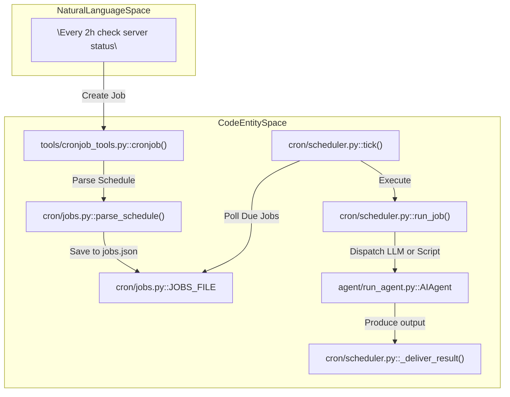
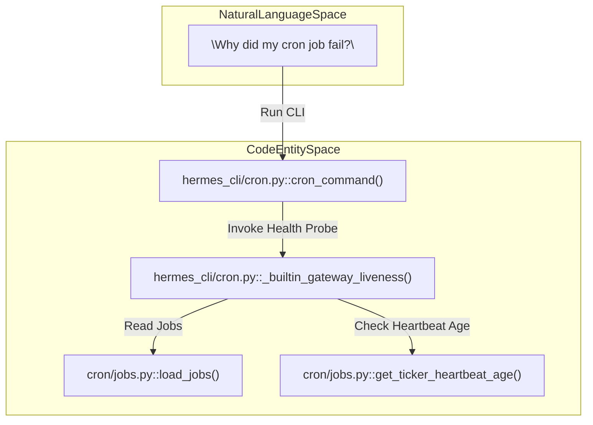

# Cron and Scheduled Tasks

Relevant source files

The following files were used as context for generating this wiki page:

- [agent/secret_scope.py](agent/secret_scope.py)
- [agent/secret_sources/__init__.py](agent/secret_sources/__init__.py)
- [agent/secret_sources/_cache.py](agent/secret_sources/_cache.py)
- [agent/secret_sources/base.py](agent/secret_sources/base.py)
- [agent/secret_sources/bitwarden.py](agent/secret_sources/bitwarden.py)
- [agent/secret_sources/command.py](agent/secret_sources/command.py)
- [agent/secret_sources/onepassword.py](agent/secret_sources/onepassword.py)
- [agent/secret_sources/registry.py](agent/secret_sources/registry.py)
- [contributors/emails/b.sencan@equalsmoney.com](contributors/emails/b.sencan@equalsmoney.com)
- [cron/jobs.py](cron/jobs.py)
- [cron/scheduler.py](cron/scheduler.py)
- [cron/scheduler_script.py](cron/scheduler_script.py)
- [gateway/host_topology.py](gateway/host_topology.py)
- [hermes_cli/cron.py](hermes_cli/cron.py)
- [hermes_cli/env_loader.py](hermes_cli/env_loader.py)
- [hermes_cli/gateway_multiplex_served.py](hermes_cli/gateway_multiplex_served.py)
- [hermes_cli/subcommands/cron.py](hermes_cli/subcommands/cron.py)
- [hermes_cli/web_server_gateway.py](hermes_cli/web_server_gateway.py)
- [tests/agent/test_auxiliary_client_base_url_host_validation.py](tests/agent/test_auxiliary_client_base_url_host_validation.py)
- [tests/agent/test_background_review_usage.py](tests/agent/test_background_review_usage.py)
- [tests/agent/test_cron_inline_api_call.py](tests/agent/test_cron_inline_api_call.py)
- [tests/agent/test_env_loader_secret_sources.py](tests/agent/test_env_loader_secret_sources.py)
- [tests/agent/test_onepassword_secrets.py](tests/agent/test_onepassword_secrets.py)
- [tests/agent/test_secret_scope.py](tests/agent/test_secret_scope.py)
- [tests/agent/test_secret_scope_env_cache.py](tests/agent/test_secret_scope_env_cache.py)
- [tests/cron/test_cron_direct_api_call.py](tests/cron/test_cron_direct_api_call.py)
- [tests/cron/test_cron_direct_api_call_watchdog.py](tests/cron/test_cron_direct_api_call_watchdog.py)
- [tests/cron/test_cron_multiplex_desktop_ticker_scope.py](tests/cron/test_cron_multiplex_desktop_ticker_scope.py)
- [tests/cron/test_cron_no_agent.py](tests/cron/test_cron_no_agent.py)
- [tests/cron/test_cron_origin_synthetic_thread.py](tests/cron/test_cron_origin_synthetic_thread.py)
- [tests/cron/test_cron_relay_delivery_guards.py](tests/cron/test_cron_relay_delivery_guards.py)
- [tests/cron/test_cron_script.py](tests/cron/test_cron_script.py)
- [tests/cron/test_cronjob_gateway_liveness.py](tests/cron/test_cronjob_gateway_liveness.py)
- [tests/cron/test_jobs.py](tests/cron/test_jobs.py)
- [tests/cron/test_scheduler.py](tests/cron/test_scheduler.py)
- [tests/gateway/test_host_topology.py](tests/gateway/test_host_topology.py)
- [tests/hermes_cli/test_cron.py](tests/hermes_cli/test_cron.py)
- [tests/hermes_cli/test_cron_satellite_diagnostics.py](tests/hermes_cli/test_cron_satellite_diagnostics.py)
- [tests/hermes_cli/test_dashboard_system_gateway_elevation.py](tests/hermes_cli/test_dashboard_system_gateway_elevation.py)
- [tests/hermes_cli/test_desktop_cron_ticker_gateway_standdown.py](tests/hermes_cli/test_desktop_cron_ticker_gateway_standdown.py)
- [tests/hermes_cli/test_desktop_cron_ticker_profiles.py](tests/hermes_cli/test_desktop_cron_ticker_profiles.py)
- [tests/hermes_cli/test_env_loader.py](tests/hermes_cli/test_env_loader.py)
- [tests/hermes_cli/test_env_sanitize_on_load.py](tests/hermes_cli/test_env_sanitize_on_load.py)
- [tests/hermes_cli/test_gateway_multiplex_refusal.py](tests/hermes_cli/test_gateway_multiplex_refusal.py)
- [tests/hermes_cli/test_gateway_multiplex_served_record.py](tests/hermes_cli/test_gateway_multiplex_served_record.py)
- [tests/hermes_cli/test_gateway_multiplex_status.py](tests/hermes_cli/test_gateway_multiplex_status.py)
- [tests/hermes_cli/test_multiplex_host_topology_reporting.py](tests/hermes_cli/test_multiplex_host_topology_reporting.py)
- [tests/hermes_cli/test_secret_source_bootstrap.py](tests/hermes_cli/test_secret_source_bootstrap.py)
- [tests/secret_sources/test_profile_secrets.py](tests/secret_sources/test_profile_secrets.py)
- [tests/tools/test_cronjob_run_background.py](tests/tools/test_cronjob_run_background.py)
- [tests/tools/test_cronjob_run_delivery_notice.py](tests/tools/test_cronjob_run_delivery_notice.py)
- [tests/tools/test_cronjob_run_immediate.py](tests/tools/test_cronjob_run_immediate.py)
- [tests/tools/test_cronjob_run_primary_routed.py](tests/tools/test_cronjob_run_primary_routed.py)
- [tests/tools/test_cronjob_tools.py](tests/tools/test_cronjob_tools.py)
- [tools/cronjob_job_args.py](tools/cronjob_job_args.py)
- [tools/cronjob_prompt_scan.py](tools/cronjob_prompt_scan.py)
- [tools/cronjob_tools.py](tools/cronjob_tools.py)
- [website/docs/developer-guide/secret-source-plugin.md](website/docs/developer-guide/secret-source-plugin.md)
- [website/docs/guides/cron-troubleshooting.md](website/docs/guides/cron-troubleshooting.md)
- [website/docs/user-guide/features/cron.md](website/docs/user-guide/features/cron.md)
- [website/docs/user-guide/secrets/index.md](website/docs/user-guide/secrets/index.md)
- [website/i18n/zh-Hans/docusaurus-plugin-content-docs/current/guides/cron-troubleshooting.md](website/i18n/zh-Hans/docusaurus-plugin-content-docs/current/guides/cron-troubleshooting.md)
- [website/i18n/zh-Hans/docusaurus-plugin-content-docs/current/user-guide/features/cron.md](website/i18n/zh-Hans/docusaurus-plugin-content-docs/current/user-guide/features/cron.md)

The Hermes Agent cron and scheduled tasks subsystem automates the execution of AI agent workflows and scripts on recurring or one-shot schedules. It enables natural-language job definitions that can trigger complex agent tasks unattended, with outputs delivered to messaging platforms, local files, or directly executed via script-only no-agent modes.

This page covers job data structures, schedule parsing, gateway integration, execution mechanics, delivery modes, diagnostics, security guardrails, and the Chronos cron provider plugin.

---

## 1. Job Data Structures and Storage

Cron jobs are represented as JSON dictionaries and persisted on disk to ensure durable scheduling across restarts and concurrent access.

### Storage Location and Isolation
- Jobs are stored in `jobs.json` under the cron directory of the active Hermes profile, anchored at `HERMES_DIR = get_hermes_home().resolve()` (`~/.hermes/cron/jobs.json`) [cron/jobs.py:78-90]().
- Each job run's output is saved as a markdown file in `~/.hermes/cron/output/{job_id}/{timestamp}.md` [cron/jobs.py:2-3, 114]().
- Cron storage is strictly per-profile using `_CronStorePaths` via `_cron_store_override` to prevent credential and configuration leakage across profiles [cron/jobs.py:78-85, 118-130]().

### Locking and Concurrency
- Cross-process advisory locks on `jobs.json` use `fcntl` (Unix) or `msvcrt` (Windows) via `_jobs_file_lock` with an upper bound timeout (`_JOBS_LOCK_TIMEOUT_SECONDS = 30.0`) [cron/jobs.py:21-28, 104-113]().
- An in-process recursive lock safeguards load-modify-save critical sections against parallel tick threads [cron/jobs.py:104]().

### Job Dictionary Fields
| Field | Type | Description |
| :--- | :--- | :--- |
| `id` | `str` (UUID) | Unique job identifier assigned at creation |
| `name` | `str` | Human-readable job title |
| `prompt` | `str` | Natural language instructions for the AI agent |
| `schedule` | `dict` | Execution metadata specifying kind (`once`, `interval`, `cron`), timing expression, and display |
| `enabled` | `bool` | Whether the job is active |
| `next_run_at` | `str` (ISO 8601) | Next scheduled execution timestamp |
| `last_run_at` | `str` (ISO 8601) | Timestamp of the last run |
| `deliver` | `str` or `list[str]` | Delivery target specifiers such as `"local"`, `"origin"`, or platform channels |
| `skills` | `list[str]` | Attached agent skills loaded during job execution |
| `script` | `str` | Optional script path for no-agent (script-only) execution |
| `no_agent` | `bool` | If `true`, execute script without LLM or agent involvement |
| `failure_streak` | `int` | Count of consecutive failures (used for diagnostics and nudges) |

Sources: [cron/jobs.py:1-160](), [website/docs/user-guide/features/cron.md:7-32]()

---

## 2. Schedule Parsing and Formats

Hermes supports flexible, human-readable schedule specifications parsed into standardized internal representations via `parse_schedule()` in `cron/jobs.py`.

### Schedule Types Supported
1. **Interval Schedules:** Natural language like `"every 30m"`, `"every 2h"` or bare durations (`"30m"`) convert to recurring intervals via `parse_duration()` with `"kind": "interval"` [tests/cron/test_jobs.py:35-92]().
2. **Cron Expressions:** Full cron expressions (`"0 9 * * *"`) and natural-language weekday expressions (`"every monday 9am"`, `"weekdays at 9am"`) parse to cron format using the lazily imported `croniter` library (`_ensure_croniter()`) [cron/jobs.py:56-73](), [tests/cron/test_jobs.py:114-175]().
3. **One-Shot Schedules:** Expressed as `"in 30m"`, these run a job once at a specified delay or via an exact ISO 8601 timestamp [tests/cron/test_jobs.py:94-103]().

Sources: [cron/jobs.py:43-73](), [tests/cron/test_jobs.py:35-175]()

---

## 3. Execution Architecture and Data Flow

### Builtin Scheduler and Tick Loop
- The builtin cron scheduler runs inside the Hermes gateway process as a background ticker thread executing `tick()` every 60 seconds (`TICKER_INTERVAL_SECONDS = 60`) [cron/scheduler.py:2](), [cron/jobs.py:98-100]().
- Overlapping processes are guarded by a tick file lock (`~/.hermes/cron/.tick.lock`) [cron/scheduler.py:3]().

### Job Claiming and Execution
- Due jobs are fetched via `get_due_jobs()`, which safely repairs minor inconsistencies and persists repairs [tests/cron/test_due_scan_save_failure.py:1-14]().
- Jobs are claimed for execution via `claim_job_for_fire()`, creating isolated `SessionDB` connections with bounded timeouts [cron/jobs.py:36](), [cron/scheduler.py:58-88]().
- **Model and Provider Resolution:** Pinned jobs (`_job_route_pinned`) use their explicit provider/model/endpoint, whereas unpinned jobs inherit global cron configurations or the active main agent model through `_job_fallback_chain()` [cron/scheduler.py:91-107]().
- **Agent vs. No-Agent Modes:** Agent jobs execute LLM workflows through `AIAgent`, while `no_agent` jobs execute scripts directly on stdout without LLM participation [website/docs/user-guide/features/cron.md:13-20]().

### Data Flow Diagram: Job Scheduling to Execution

Title: "Natural Language Space to Code Entity Space: Cron Execution Flow"

Sources: [cron/scheduler.py:1-169](), [tools/cronjob_tools.py:1-80](), [cron/jobs.py:40-160](), [website/docs/user-guide/features/cron.md:7-32]()

---

## 4. Delivery Modes and Routing

Hermes routes cron execution results across several delivery channels.

### Delivery Targets
- **Local File Delivery (`"local"`):** Persists output to `~/.hermes/cron/output/{job_id}/{timestamp}.md` [cron/jobs.py:2-3]().
- **Origin Thread Delivery (`"origin"`):** Returns responses to the originating chat thread via gateway adapters [cron/scheduler_delivery.py:70-87]().
- **Explicit Platform Delivery:** Targets specific platform channels like `"telegram:12345"` using credential pools.
- **Relay-Fronted Platforms:** When targeting platforms managed by the gateway's live relay adapter, manual runs are forwarded via HTTP POST (`POST /api/jobs/{id}/run`) [tools/cronjob_tools.py:87-158]().

Sources: [cron/jobs.py:1-3](), [cron/scheduler_delivery.py:70-138](), [tools/cronjob_tools.py:87-158]()

---

## 5. Execution Ledger, Diagnostics, and Incidents

### CLI and Doctor Diagnostics
- **`hermes cron list`** and **`hermes cron doctor`** perform health checks across jobs, surfacing configuration errors, invalid scripts, and liveness states via `_builtin_gateway_liveness()` [hermes_cli/cron.py:40-88]().
- Liveness is monitored via `ticker_heartbeat_writer_alive()` and `TICKER_HEARTBEAT_FILE` [cron/jobs.py:96](), [hermes_cli/cron.py:43-74]().
- **Failure Streak Nudges:** When consecutive failures exceed `cron.failure_nudge_threshold` (default 3), `_failure_streak_nudge()` adds a warning notice to alert operators [cron/scheduler.py:133-157]().

### Diagnostic Flow Diagram

Title: "Natural Language Space to Code Entity Space: Cron Health Check Flow"

Sources: [hermes_cli/cron.py:1-160](), [tests/hermes_cli/test_cron.py:130-190](), [cron/jobs.py:50-110](), [cron/scheduler.py:140-160]()

---

## 6. Chronos Cron Provider Plugin

- Scheduled tasks can delegate scheduling to external providers via `CronScheduler` implementations resolved by `resolve_cron_scheduler()` [hermes_cli/cron.py:34-40]().
- The `chronos` provider utilizes shared network-attached storage (NAS) filesystems to coordinate job schedules and wake events.
- Job modifications trigger `_notify_provider_jobs_changed()`, alerting Chronos to reconfigure timings [tools/cronjob_tools.py:74-80]().
- External webhooks (`/api/cron/fire`) invoke `run_job()`, enabling serverless or containerized setups to scale down to zero when idle [tools/cronjob_tools.py:120-140]().

Sources: [tools/cronjob_tools.py:70-140](), [hermes_cli/cron.py:34-40]()

---

## 7. Security, Guardrails, and Prompt Injection Protections

### Prompt Scanning and Exfiltration Guard
- The `_scan_cron_prompt()` function inspects prompts for injection directives (e.g., `"ignore previous instructions"`, `"disregard your rules"`), credential exfiltration attempts via `curl`/`wget` targeting untrusted hosts, sensitive file reads (`cat ~/.env`), and invisible Unicode bypass characters [tests/tools/test_cronjob_tools.py:17-103]().
- Skill-assembled prompts use a looser sanitizer `_scan_cron_skill_assembled()` that strips invisible characters rather than hard-blocking, balancing security with multi-skill flexibility [tests/tools/test_cronjob_tools.py:110-150]().

### Pre-Execution Validation
- Before firing, the scheduler validates credentials, attached required skills, delivery platform connectivity, and active MCP toolsets [website/docs/user-guide/features/cron.md:90-110]().
- Invalid jobs transition to a `blocked_config` status, raising a one-time warning alert without consuming tokens [website/docs/user-guide/features/cron.md:111-113]().

Sources: [tests/tools/test_cronjob_tools.py:1-150](), [website/docs/user-guide/features/cron.md:70-113]()

---

# References

- `cron/jobs.py` — job data, schedule parsing, locking, and storage [cron/jobs.py:1-160]()
- `cron/scheduler.py` — builtin cron scheduler, tick logic, execution, and delivery [cron/scheduler.py:1-169]()
- `cron/scheduler_delivery.py` — delivery target resolution and gateway integration [cron/scheduler_delivery.py:1-138]()
- `tools/cronjob_tools.py` — manual job management API and gateway forwarding [tools/cronjob_tools.py:1-158]()
- `hermes_cli/cron.py` — CLI commands for cron job management and diagnostics [hermes_cli/cron.py:1-160]()
- `tools/cronjob_prompt_scan.py` — prompt injection and exfiltration protections [tools/cronjob_prompt_scan.py:1-100]()