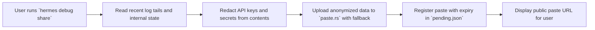
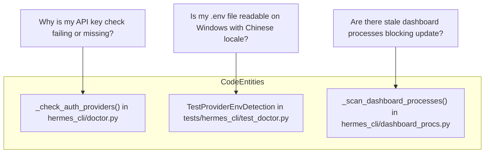
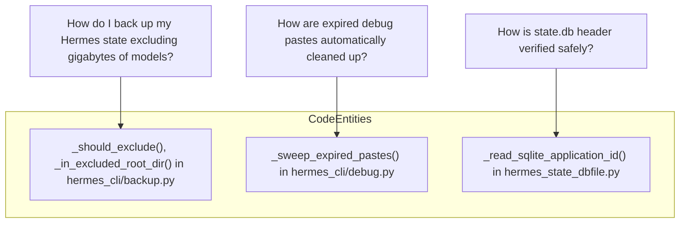

# Diagnostic Tools

<details>
<summary>Relevant source files</summary>

The following files were used as context for generating this wiki page:

- [agent/redact.py](agent/redact.py)
- [contributors/emails/daniil.grois@gmail.com](contributors/emails/daniil.grois@gmail.com)
- [evals/cli_deferred_notice.py](evals/cli_deferred_notice.py)
- [hermes_cli/backup.py](hermes_cli/backup.py)
- [hermes_cli/backup_restore.py](hermes_cli/backup_restore.py)
- [hermes_cli/banner.py](hermes_cli/banner.py)
- [hermes_cli/cli_auto_maintenance.py](hermes_cli/cli_auto_maintenance.py)
- [hermes_cli/debug.py](hermes_cli/debug.py)
- [hermes_cli/doctor.py](hermes_cli/doctor.py)
- [hermes_cli/doctor_config.py](hermes_cli/doctor_config.py)
- [hermes_cli/doctor_connectivity.py](hermes_cli/doctor_connectivity.py)
- [hermes_cli/doctor_live.py](hermes_cli/doctor_live.py)
- [hermes_cli/doctor_platform.py](hermes_cli/doctor_platform.py)
- [hermes_cli/doctor_report.py](hermes_cli/doctor_report.py)
- [hermes_cli/doctor_state.py](hermes_cli/doctor_state.py)
- [hermes_cli/doctor_tools.py](hermes_cli/doctor_tools.py)
- [hermes_cli/dump.py](hermes_cli/dump.py)
- [hermes_cli/model_catalog.py](hermes_cli/model_catalog.py)
- [hermes_cli/model_cost_guard.py](hermes_cli/model_cost_guard.py)
- [hermes_cli/model_search.py](hermes_cli/model_search.py)
- [hermes_cli/model_selection_guards.py](hermes_cli/model_selection_guards.py)
- [hermes_state_dbfile.py](hermes_state_dbfile.py)
- [hermes_state_lockguard.py](hermes_state_lockguard.py)
- [scripts/build_model_catalog.py](scripts/build_model_catalog.py)
- [scripts/dump_desktop_slash_registry.py](scripts/dump_desktop_slash_registry.py)
- [scripts/gen-bootstrap-pins.py](scripts/gen-bootstrap-pins.py)
- [scripts/gen_gateway_contracts.py](scripts/gen_gateway_contracts.py)
- [tests/agent/test_gemini_key_surface_guidance.py](tests/agent/test_gemini_key_surface_guidance.py)
- [tests/agent/test_openai_ultrafast.py](tests/agent/test_openai_ultrafast.py)
- [tests/agent/test_redact.py](tests/agent/test_redact.py)
- [tests/gateway/test_model_command_async_offload.py](tests/gateway/test_model_command_async_offload.py)
- [tests/gateway/test_model_command_custom_providers.py](tests/gateway/test_model_command_custom_providers.py)
- [tests/hermes_cli/test_backup.py](tests/hermes_cli/test_backup.py)
- [tests/hermes_cli/test_banner.py](tests/hermes_cli/test_banner.py)
- [tests/hermes_cli/test_cli_new_session.py](tests/hermes_cli/test_cli_new_session.py)
- [tests/hermes_cli/test_context_cache_switch_guard.py](tests/hermes_cli/test_context_cache_switch_guard.py)
- [tests/hermes_cli/test_custom_provider_model_switch.py](tests/hermes_cli/test_custom_provider_model_switch.py)
- [tests/hermes_cli/test_debug.py](tests/hermes_cli/test_debug.py)
- [tests/hermes_cli/test_desktop_slash_registry.py](tests/hermes_cli/test_desktop_slash_registry.py)
- [tests/hermes_cli/test_doctor.py](tests/hermes_cli/test_doctor.py)
- [tests/hermes_cli/test_doctor_audit_remedy.py](tests/hermes_cli/test_doctor_audit_remedy.py)
- [tests/hermes_cli/test_doctor_github_token_probe.py](tests/hermes_cli/test_doctor_github_token_probe.py)
- [tests/hermes_cli/test_doctor_live.py](tests/hermes_cli/test_doctor_live.py)
- [tests/hermes_cli/test_fts_optimize_notice.py](tests/hermes_cli/test_fts_optimize_notice.py)
- [tests/hermes_cli/test_gemini_express_key_probes.py](tests/hermes_cli/test_gemini_express_key_probes.py)
- [tests/hermes_cli/test_list_picker_providers.py](tests/hermes_cli/test_list_picker_providers.py)
- [tests/hermes_cli/test_model_catalog.py](tests/hermes_cli/test_model_catalog.py)
- [tests/hermes_cli/test_model_cost_guard.py](tests/hermes_cli/test_model_cost_guard.py)
- [tests/hermes_cli/test_model_search_alias_dedup.py](tests/hermes_cli/test_model_search_alias_dedup.py)
- [tests/hermes_cli/test_models_dev_preferred_merge.py](tests/hermes_cli/test_models_dev_preferred_merge.py)
- [tests/hermes_cli/test_opencode_go_in_model_list.py](tests/hermes_cli/test_opencode_go_in_model_list.py)
- [tests/hermes_cli/test_provider_live_curated_merge.py](tests/hermes_cli/test_provider_live_curated_merge.py)
- [tests/hermes_cli/test_restore_source_integrity.py](tests/hermes_cli/test_restore_source_integrity.py)
- [tests/hermes_cli/test_snapshot_restore_oauth.py](tests/hermes_cli/test_snapshot_restore_oauth.py)
- [tests/hermes_state/__init__.py](tests/hermes_state/__init__.py)
- [tests/hermes_state/_wal_generation_harness.py](tests/hermes_state/_wal_generation_harness.py)
- [tests/hermes_state/test_deleted_wal_generation_guard.py](tests/hermes_state/test_deleted_wal_generation_guard.py)
- [tests/hermes_state/test_lockguard_fcntl_tolerance.py](tests/hermes_state/test_lockguard_fcntl_tolerance.py)
- [tests/hermes_state/test_retired_wal_generation_capture.py](tests/hermes_state/test_retired_wal_generation_capture.py)
- [tests/hermes_state/test_state_db_stats.py](tests/hermes_state/test_state_db_stats.py)
- [tests/hermes_state/test_wal_lock_guard.py](tests/hermes_state/test_wal_lock_guard.py)
- [tests/hermes_state/test_wal_lock_guard_lifecycle.py](tests/hermes_state/test_wal_lock_guard_lifecycle.py)
- [tests/tools/test_browser_redact_depth.py](tests/tools/test_browser_redact_depth.py)
- [tests/tools/test_startup_latency_regressions.py](tests/tools/test_startup_latency_regressions.py)
- [tests/tools/test_subagent_steer.py](tests/tools/test_subagent_steer.py)
- [tests/tui_gateway/contracts/__init__.py](tests/tui_gateway/contracts/__init__.py)
- [tui_gateway/contracts/__init__.py](tui_gateway/contracts/__init__.py)
- [tui_gateway/contracts/base.py](tui_gateway/contracts/base.py)
- [tui_gateway/contracts/registry.py](tui_gateway/contracts/registry.py)
- [website/docs/reference/model-catalog.md](website/docs/reference/model-catalog.md)
- [website/docs/user-guide/configuring-models.md](website/docs/user-guide/configuring-models.md)
- [website/i18n/zh-Hans/docusaurus-plugin-content-docs/current/reference/model-catalog.md](website/i18n/zh-Hans/docusaurus-plugin-content-docs/current/reference/model-catalog.md)

</details>


## Purpose and Scope

This page documents the diagnostic, verification, backup, and debugging subsystems of Hermes Agent. These tools provide comprehensive observability into the agent's runtime health, configuration, environment compatibility, API connectivity, and credential status. Additionally, they enable repair of detected issues (`hermes doctor --fix`), state backup and restoration, project verification (`hermes verify`), and shareable debug trace collection.

---

## 1. Doctor Subsystem (`hermes doctor`)

`hermes doctor` is the core diagnostic CLI command that performs a comprehensive health check of the Hermes Agent install. It runs a sequence of modular checks, each producing detailed output about detected issues or telemetry, and optionally attempts repairs with the `--fix` flag.

### Architecture and Implementation

The entrypoint for the doctor command is in the `hermes_cli/doctor.py` module. It defines the main function `run_doctor()` which orchestrates running a fixed series of individual diagnostics defined in the tuple `DOCTOR_CHECKS`. Each item in `DOCTOR_CHECKS` is either a tuple of a section title and a check function or a bare check function that optionally prints its own section header. Checks return a `Finding` object accumulating issues and info messages.

Check implementations are organized into several submodules with focused responsibilities:

- **`doctor_config.py`**: Validates config files like `.env`, `config.yaml`, detects configuration drift, deprecated keys (including Relay plugin retirement), MCP server security settings, session timer resets, and xAI model retirement information. [hermes_cli/doctor.py:27-35]()

- **`doctor_platform.py`**: Verifies the Python environment, SSL certificate/trust store correctness, gateway supervision and running status, installed required packages, command availability, and security advisories. [hermes_cli/doctor.py:36-44]()

- **`doctor_tools.py`**: Checks availability and usability of external tools (Git, ripgrep, Node.js, browser tooling), terminal backends, npm audit status, and toolset readiness. [hermes_cli/doctor.py:45-51]()

- **`doctor_state.py`**: Checks the directory structure under `HERMES_HOME`, profiles, memory provider configuration, SQLite state DB health (including FTS tables, wal size), cron jobs, checkpoints, and skills hub sync state. [hermes_cli/doctor.py:52-60]()

- **`doctor_connectivity.py`**: Runs parallel API probing against all configured LLM providers, including OAuth status snapshots and HTTP probe results. [hermes_cli/doctor.py:24-25]()

`hermes doctor` loads environment variables from the user's `.env` file early (via `load_hermes_dotenv` [hermes_cli/doctor.py:19-20]()) to ensure API key checks work and then walks the ordered checks for reporting.

### Example: OAuth Provider Status Check

A representative check is `_check_auth_providers()` [hermes_cli/doctor.py:71-85]() which snapshots the OAuth login status for various providers (Nous Portal, OpenAI Codex CLI, MiniMax OAuth, xAI OAuth). This check runs without refreshing tokens to avoid side effects. It prints human-readable "logged in" or "not logged in" rows with error details if available. This function is decorated with `@doctor_check()` and appends issues to the overall finding object.

### Data Flow Summary

- `run_doctor()` initializes environment and executes each check in sequence.
- Each check prints diagnostic rows and returns a `Finding` with issues.
- Issues may suggest configuration fixes or system operation actions.
- If `--fix` is used, applicable checks attempt automatic remediation.
- The aggregated report is printed with colored symbols and formatted sections.

---

### Doctor Execution Flow Diagram

```mermaid
graph TD
    User["User runs `hermes doctor`"] --> RunDoctor["`run_doctor()` in hermes_cli/doctor.py"]
    RunDoctor --> LoadEnv["Load ~/.hermes/.env (API keys etc)"]
    RunDoctor --> WalkChecks["Iterate over `DOCTOR_CHECKS` tuple"]

    WalkChecks --> ConfigChecks["Config Checks (doctor_config.py)"]
    WalkChecks --> PlatformChecks["Platform Checks (doctor_platform.py)"]
    WalkChecks --> ToolsChecks["Tools Checks (doctor_tools.py)"]
    WalkChecks --> StateChecks["State Checks (doctor_state.py)"]
    WalkChecks --> ConnectivityChecks["API Probes (doctor_connectivity.py)"]

    subgraph Checks["Each emits `Finding` objects"]
        ConfigChecks
        PlatformChecks
        ToolsChecks
        StateChecks
        ConnectivityChecks
    end

    Checks --> Report["Aggregate and print findings"]
```
Sources: [hermes_cli/doctor.py:1-127](), [hermes_cli/doctor_report.py](), [hermes_cli/doctor_config.py](), [hermes_cli/doctor_platform.py](), [hermes_cli/doctor_tools.py](), [hermes_cli/doctor_state.py](), [hermes_cli/doctor_connectivity.py]()

---

## 2. Status, Dump, and Debug Utilities

Hermes Agent provides runtime introspection tools useful for real-time troubleshooting without the overhead of full doctor runs.

### 2.1 `hermes status`

Implemented in `hermes_cli/status.py`, this command reports a concise summary of the current runtime environment:

- Active LLM model and backend provider  
- Terminal backend configuration  
- API key presence and OAuth provider login statuses  
- Gateway supervision and process monitoring info  
- Emergency stop states (global ESTOP flags)  
- Platform adapter enablement and media transmission details  

The output uses a structured format with ✓/✗ marks for easy scanning and flags notable conditions like gateway not running or unconfigured providers.

### 2.2 `hermes dump`

The dump command gathers and prints detailed environment and configuration snapshots, including:

- Git commit SHA and date of local source [hermes_cli/dump.py:54-72]()
- `.env` contents compared to actual environment variables [hermes_cli/dump.py:17-41]()
- Installed skill counts and integration status [hermes_cli/dump.py:117-120]()
- Runtime info such as scheduled cron jobs and profile details [hermes_cli/dump.py:123-136]()
- Platform environment variables and third-party tool availability mappings [hermes_cli/dump.py:139-145]()

This helps identify drift between user settings and runtime behavior, and detects environment mismatches.

### 2.3 `hermes debug share`

Found in `hermes_cli/debug.py`, this tool collects recent logs and other status snapshots to upload a redacted anonymized archive for developer troubleshooting via paste services:

- Reads recent log files and internal state dump files under `HERMES_HOME/pastes/`  
- Applies regex- and registry-based redaction for all registered vault secrets, API keys, and potentially sensitive tokens [hermes_cli/debug.py:19]()
- Posts the resulting sanitized content to configured paste services such as `paste.rs` or `dpaste.com` with proper user agent and HTTP headers [hermes_cli/debug.py:28-30]()
- Schedules automatic deletion of paste.rs uploads after 6 hours, tracking deletion tokens via `pending.json` [hermes_cli/debug.py:32-33](), [hermes_cli/debug.py:42-43]()
- Returns a publicly shareable URL to the user with privacy notices about uploaded content [hermes_cli/debug.py:122-140]()

This significantly reduces the friction of sharing complex diagnostic information safely.

---

### Debug Share Flow Diagram



Sources: [hermes_cli/dump.py](), [hermes_cli/debug.py](), [hermes_cli/status.py]()

---

## 3. Backup and Restore Subsystem (`hermes backup` / `hermes import`)

Hermes supports state durability mechanisms to back up and restore user profiles, sessions, skills, and runtime state in disaster or migration scenarios.

### 3.1 Implementation Overview

The backup logic is implemented primarily in `hermes_cli/backup.py`. It manages:

- Full or partial snapshotting of the `HERMES_HOME` directory or selected profiles  
- Exclusion filtering of large or regenerable runtime artifacts to conserve archive size and prevent corruption [hermes_cli/backup.py:72-140]()
- Preservation of file permissions and metadata within ZIP archives  
- Safe single-writer locking against concurrent backup/import operations  
- Resumable and atomic extraction of archives to prevent partial restores from corrupting state

### 3.2 Exclusion and Inclusion Rules

Backup excludes several types of directories and files to keep archive size and restore safety manageable:

| Excluded Directory/File             | Reason                                                              | Source Location                           |
|-----------------------------------|---------------------------------------------------------------------|------------------------------------------|
| `hermes-agent/`                   | The source code repo is excluded—users re-clone for updates       | [hermes_cli/backup.py:72-74]()           |
| `__pycache__/`                    | Bytecode caches regenerate on demand                               | [hermes_cli/backup.py:74]()               |
| `.git/` nested repos              | Should not exist in profiles; excluded for safety                  | [hermes_cli/backup.py:75]()               |
| `node_modules/`                   | JavaScript dependencies are rebuilt                                | [hermes_cli/backup.py:76]()               |
| `backups/`, `state-snapshots/`   | To avoid recursive backups of backups                              | [hermes_cli/backup.py:77-78]()            |
| `checkpoints/`                   | Session history cache, regenerated                                | [hermes_cli/backup.py:79]()               |
| `browser-profiles/`, `browser-profile/` | Live browser profiles locked during run, should not backup    | [hermes_cli/backup.py:80-82]()            |
| `.venv`, `venv`, `site-packages` | Python virtual environments rebuilt on demand                       | [hermes_cli/backup.py:86-87]()            |
| `.cache`, `.tox`, `.pytest_cache`, `.mypy_cache`, `.ruff_cache` | Tool/build caches regenerated                              | [hermes_cli/backup.py:88-89]()            |
| SQLite sidecar files (e.g., `.db-wal`, `.db-shm`, `.db-journal`) | Transient DB parts cause database corruption if archived | [hermes_cli/backup.py:120-123]()          |
| Files like `.backup.lock`, `gateway.pid`, `cron.pid` | Runtime lock or PID files excluded                              | [hermes_cli/backup.py:126-127]()          |

Certain durable cache subdirectories such as media delivered by the gateway (`images`, `audio`, `screenshots`, `citations`) are explicitly included in backup archives [hermes_cli/backup.py:106-107]().

Registry-managed runtime root directories (like `models/`, `runtimes/`, and `node/`) are excluded at the profile root to avoid archiving gigabytes of re-downloadable models and binaries [hermes_cli/backup.py:93-95]().

### 3.3 Backup Locking

A global `.backup.lock` lockfile within the Hermes home directory is taken using platform-appropriate advisory file locking to prevent concurrent backups or imports from corrupting the data store during these critical operations. The lock persists for the entire backup or restore duration and guarantees single-writer exclusivity.

---

### Backup Subsystem Directory Exclusion Diagram

```mermaid
flowchart TD
    Backup["`hermes backup` collects files"] --> ExclusionFilter["_should_exclude() and _in_excluded_root_dir() checks"]

    subgraph ExcludedDirs
        HA["hermes-agent/"]
        PyCache["__pycache__/"]
        NodeModules["node_modules/"]
        Backups["backups/", "state-snapshots/"]
        Checkpoints["checkpoints/"]
        BrowserProfiles["browser-profiles/", "browser-profile/"]
        VirtualEnv[".venv, venv, site-packages"]
        Caches[".cache, .tox, .pytest_cache"]
        SQLiteSidecars["*.db-wal, *.db-shm, *.db-journal"]
    end

    ExclusionFilter -->|Excluded| ExcludedDirs
    ExclusionFilter -->|Included| IncludedFiles["State DB, skills/, profiles/, logs/, media caches"]

    IncludedFiles --> Archive["Create compressed backup archive"]
```

Sources: [hermes_cli/backup.py:60-160]()

---

## 4. Project Verification Subsystem (`hermes verify`)

The verification subsystem, invoked via `hermes verify`, performs static and dynamic validations of Hermes projects or skill repositories before their promotion or batch execution.

Although we do not have a dedicated file snippet for this subsystem here, it is integrated with the broader CLI source and agent skill system. It checks:

- Syntax correctness and semantic validations for skills  
- Tool invocation correctness and approval flow  
- Compliance and safety of skill configurations

This subsystem shares architectural patterns with the doctor and toolchecking modules to provide consistent feedback on project health.

---

## 5. Natural Language to Code Entity Mappings

To assist developers and maintainers in connecting conceptual topics to concrete code implementations, below are key mappings that bridge system functionality to code entities.

### 5.1 OAuth and API Key Status Diagnostics



Sources: [hermes_cli/doctor.py:69-92](), [tests/hermes_cli/test_doctor.py:117-126](), [hermes_cli/dashboard_procs.py:73-107]()

---

### 5.2 Backup, Debug Paste, and State DB Integrity



Sources: [hermes_cli/backup.py:69-75](), [hermes_cli/debug.py:59-95](), [hermes_state_dbfile.py:117-125]()

---

# Summary Table of Major Diagnostic Components

| Component          | CLI Command              | Key Implementation Files             | Responsibilities                              |
|--------------------|--------------------------|------------------------------------|----------------------------------------------|
| Doctor             | `hermes doctor`          | `hermes_cli/doctor.py` + submodules | Incremental config, environment, API, state checks with fixes |
| Status             | `hermes status`          | `hermes_cli/status.py`              | Fast snapshot of runtime health and gateway process |
| Dump               | `hermes dump`            | `hermes_cli/dump.py`                | Environment and config dumps for diagnostic insight |
| Debug Share        | `hermes debug share`     | `hermes_cli/debug.py`               | Gather and redact debug logs and metadata, upload share URLs |
| Backup & Restore   | `hermes backup`, `hermes import` | `hermes_cli/backup.py`           | Full backup and restore with exclusions and locking |
| Verify             | `hermes verify`          | Integrated in `hermes_cli` and `agent/verify` | Project correctness, codebase validation, skill checks |

---

This comprehensive diagnostic framework ensures Hermes Agent installations remain robust, secure, and maintainable, aiding operators and developers in troubleshooting and system health monitoring.

---

Sources:  
[hermes_cli/doctor.py:1-127](), [hermes_cli/doctor_report.py](), [hermes_cli/doctor_config.py](), [hermes_cli/doctor_platform.py](), [hermes_cli/doctor_tools.py](), [hermes_cli/doctor_state.py](), [hermes_cli/doctor_connectivity.py](),  
[hermes_cli/dump.py](), [hermes_cli/debug.py](), [hermes_cli/status.py](), [hermes_cli/backup.py:1-160](), [tests/hermes_cli/test_doctor.py:117-126](), [hermes_state_dbfile.py:117-125]()