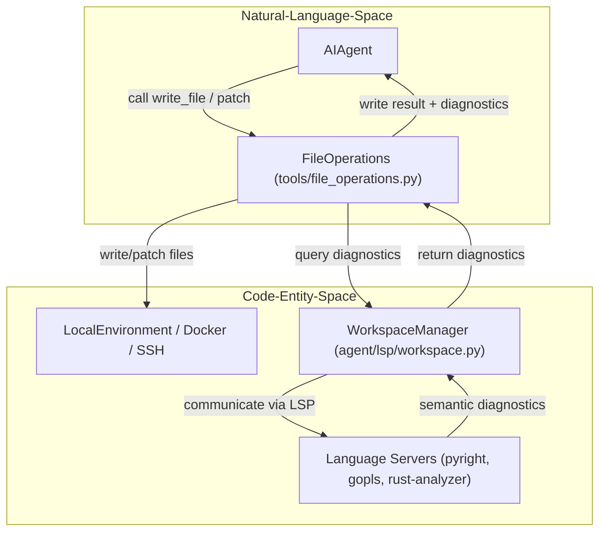
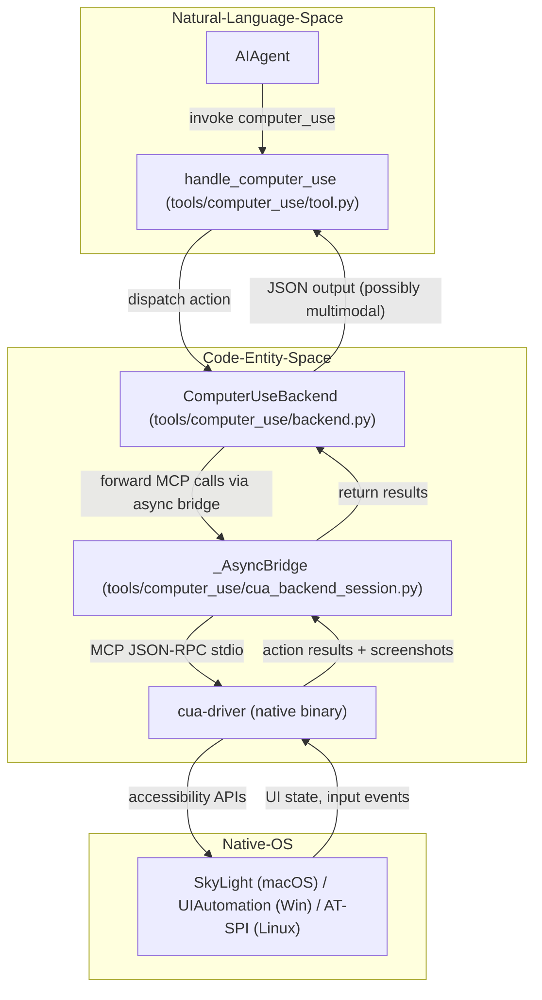

# LSP and Computer Use

Relevant source files

The following files were used as context for generating this wiki page:

- [agent/anthropic_adapter.py](agent/anthropic_adapter.py)
- [agent/anthropic_endpoints.py](agent/anthropic_endpoints.py)
- [agent/anthropic_message_convert.py](agent/anthropic_message_convert.py)
- [agent/anthropic_thinking_policy.py](agent/anthropic_thinking_policy.py)
- [agent/anthropic_thinking_replay.py](agent/anthropic_thinking_replay.py)
- [agent/file_safety.py](agent/file_safety.py)
- [agent/image_eviction_policy.py](agent/image_eviction_policy.py)
- [agent/runtime_self_protection.py](agent/runtime_self_protection.py)
- [agent/search_policy.py](agent/search_policy.py)
- [agent/skill_bundles.py](agent/skill_bundles.py)
- [agent/subdirectory_hints.py](agent/subdirectory_hints.py)
- [agent/terminal_env_provider.py](agent/terminal_env_provider.py)
- [agent/transcription_provider.py](agent/transcription_provider.py)
- [contributors/emails/dickson.neoh@gmail.com](contributors/emails/dickson.neoh@gmail.com)
- [evals/anthropic_proxy_thinking_replay.py](evals/anthropic_proxy_thinking_replay.py)
- [hermes_cli/subcommands/computer_use.py](hermes_cli/subcommands/computer_use.py)
- [skills/autonomous-ai-agents/computer-use/SKILL.md](skills/autonomous-ai-agents/computer-use/SKILL.md)
- [tests/agent/lsp/test_shell_linter_lsp_skip.py](tests/agent/lsp/test_shell_linter_lsp_skip.py)
- [tests/agent/test_anthropic_adapter.py](tests/agent/test_anthropic_adapter.py)
- [tests/agent/test_anthropic_preserved_thinking_replay.py](tests/agent/test_anthropic_preserved_thinking_replay.py)
- [tests/agent/test_anthropic_signed_platform_replay.py](tests/agent/test_anthropic_signed_platform_replay.py)
- [tests/agent/test_anthropic_thinking_disable.py](tests/agent/test_anthropic_thinking_disable.py)
- [tests/agent/test_deepseek_anthropic_thinking.py](tests/agent/test_deepseek_anthropic_thinking.py)
- [tests/agent/test_file_safety.py](tests/agent/test_file_safety.py)
- [tests/agent/test_file_safety_credentials.py](tests/agent/test_file_safety_credentials.py)
- [tests/agent/test_file_safety_write_credentials.py](tests/agent/test_file_safety_write_credentials.py)
- [tests/agent/test_image_eviction_policy.py](tests/agent/test_image_eviction_policy.py)
- [tests/agent/test_outbound_stale_vision.py](tests/agent/test_outbound_stale_vision.py)
- [tests/agent/test_runtime_self_protection.py](tests/agent/test_runtime_self_protection.py)
- [tests/agent/test_skill_bundles.py](tests/agent/test_skill_bundles.py)
- [tests/agent/test_subdirectory_hints.py](tests/agent/test_subdirectory_hints.py)
- [tests/computer_use/test_cua_no_overlay.py](tests/computer_use/test_cua_no_overlay.py)
- [tests/computer_use/test_cua_spawn_env_sanitization.py](tests/computer_use/test_cua_spawn_env_sanitization.py)
- [tests/computer_use/test_cua_wayland_env.py](tests/computer_use/test_cua_wayland_env.py)
- [tests/computer_use/test_cua_wsl_manifest_path.py](tests/computer_use/test_cua_wsl_manifest_path.py)
- [tests/computer_use/test_doctor.py](tests/computer_use/test_doctor.py)
- [tests/file_write_observer.py](tests/file_write_observer.py)
- [tests/gateway/test_startup_environment_probe.py](tests/gateway/test_startup_environment_probe.py)
- [tests/hermes_cli/test_bundles.py](tests/hermes_cli/test_bundles.py)
- [tests/tools/test_audio_container.py](tests/tools/test_audio_container.py)
- [tests/tools/test_binary_document_write_guard.py](tests/tools/test_binary_document_write_guard.py)
- [tests/tools/test_computer_use.py](tests/tools/test_computer_use.py)
- [tests/tools/test_computer_use_ax_walk_bound.py](tests/tools/test_computer_use_ax_walk_bound.py)
- [tests/tools/test_computer_use_capture_self_window.py](tests/tools/test_computer_use_capture_self_window.py)
- [tests/tools/test_computer_use_cua_0_10_permissions.py](tests/tools/test_computer_use_cua_0_10_permissions.py)
- [tests/tools/test_computer_use_cua_0_9.py](tests/tools/test_computer_use_cua_0_9.py)
- [tests/tools/test_computer_use_cua_backend_linux.py](tests/tools/test_computer_use_cua_backend_linux.py)
- [tests/tools/test_computer_use_doctor_stale_units.py](tests/tools/test_computer_use_doctor_stale_units.py)
- [tests/tools/test_computer_use_screenshot_dedup.py](tests/tools/test_computer_use_screenshot_dedup.py)
- [tests/tools/test_container_cwd_sanitize.py](tests/tools/test_container_cwd_sanitize.py)
- [tests/tools/test_cross_profile_guard.py](tests/tools/test_cross_profile_guard.py)
- [tests/tools/test_file_operations.py](tests/tools/test_file_operations.py)
- [tests/tools/test_file_operations_delete.py](tests/tools/test_file_operations_delete.py)
- [tests/tools/test_file_operations_edge_cases.py](tests/tools/test_file_operations_edge_cases.py)
- [tests/tools/test_file_read_guards.py](tests/tools/test_file_read_guards.py)
- [tests/tools/test_file_staleness.py](tests/tools/test_file_staleness.py)
- [tests/tools/test_file_state_registry.py](tests/tools/test_file_state_registry.py)
- [tests/tools/test_file_tools.py](tests/tools/test_file_tools.py)
- [tests/tools/test_file_tools_cwd_resolution.py](tests/tools/test_file_tools_cwd_resolution.py)
- [tests/tools/test_file_tools_live.py](tests/tools/test_file_tools_live.py)
- [tests/tools/test_file_tools_tilde_profile.py](tests/tools/test_file_tools_tilde_profile.py)
- [tests/tools/test_file_write_safety.py](tests/tools/test_file_write_safety.py)
- [tests/tools/test_fuzzy_match.py](tests/tools/test_fuzzy_match.py)
- [tests/tools/test_interrupted_command_cwd.py](tests/tools/test_interrupted_command_cwd.py)
- [tests/tools/test_known_file_write_baseline.py](tests/tools/test_known_file_write_baseline.py)
- [tests/tools/test_line_ending_preservation.py](tests/tools/test_line_ending_preservation.py)
- [tests/tools/test_macos_protected_search.py](tests/tools/test_macos_protected_search.py)
- [tests/tools/test_modal_sandbox_fixes.py](tests/tools/test_modal_sandbox_fixes.py)
- [tests/tools/test_patch_already_applied.py](tests/tools/test_patch_already_applied.py)
- [tests/tools/test_patch_parser.py](tests/tools/test_patch_parser.py)
- [tests/tools/test_read_loop_detection.py](tests/tools/test_read_loop_detection.py)
- [tests/tools/test_read_shell_line_clamp.py](tests/tools/test_read_shell_line_clamp.py)
- [tests/tools/test_resolve_path.py](tests/tools/test_resolve_path.py)
- [tests/tools/test_search_budget_truncation.py](tests/tools/test_search_budget_truncation.py)
- [tests/tools/test_search_files_engine_selection.py](tests/tools/test_search_files_engine_selection.py)
- [tests/tools/test_search_hidden_dirs.py](tests/tools/test_search_hidden_dirs.py)
- [tests/tools/test_search_native_rg.py](tests/tools/test_search_native_rg.py)
- [tests/tools/test_search_zero_match_and_multipath.py](tests/tools/test_search_zero_match_and_multipath.py)
- [tests/tools/test_session_cwd_store.py](tests/tools/test_session_cwd_store.py)
- [tests/tools/test_terminal_plugin_cwd_and_streams.py](tests/tools/test_terminal_plugin_cwd_and_streams.py)
- [tests/tools/test_terminal_task_cwd.py](tests/tools/test_terminal_task_cwd.py)
- [tests/tools/test_terminal_yield_to_background.py](tests/tools/test_terminal_yield_to_background.py)
- [tests/tools/test_unicode_tag_strip.py](tests/tools/test_unicode_tag_strip.py)
- [tests/tools/test_write_deny.py](tests/tools/test_write_deny.py)
- [tools/ansi_strip.py](tools/ansi_strip.py)
- [tools/audio_container.py](tools/audio_container.py)
- [tools/binary_extensions.py](tools/binary_extensions.py)
- [tools/bot_desktop/placement.py](tools/bot_desktop/placement.py)
- [tools/computer_use/__init__.py](tools/computer_use/__init__.py)
- [tools/computer_use/backend.py](tools/computer_use/backend.py)
- [tools/computer_use/cua_backend.py](tools/computer_use/cua_backend.py)
- [tools/computer_use/cua_backend_capture.py](tools/computer_use/cua_backend_capture.py)
- [tools/computer_use/cua_backend_daemon.py](tools/computer_use/cua_backend_daemon.py)
- [tools/computer_use/cua_backend_driver.py](tools/computer_use/cua_backend_driver.py)
- [tools/computer_use/cua_backend_input.py](tools/computer_use/cua_backend_input.py)
- [tools/computer_use/cua_backend_parse.py](tools/computer_use/cua_backend_parse.py)
- [tools/computer_use/cua_backend_session.py](tools/computer_use/cua_backend_session.py)
- [tools/computer_use/doctor.py](tools/computer_use/doctor.py)
- [tools/computer_use/permissions.py](tools/computer_use/permissions.py)
- [tools/computer_use/schema.py](tools/computer_use/schema.py)
- [tools/computer_use/tool.py](tools/computer_use/tool.py)
- [tools/computer_use_tool.py](tools/computer_use_tool.py)
- [tools/file_operations.py](tools/file_operations.py)
- [tools/file_operations_common.py](tools/file_operations_common.py)
- [tools/file_operations_lint.py](tools/file_operations_lint.py)
- [tools/file_operations_search.py](tools/file_operations_search.py)
- [tools/file_state.py](tools/file_state.py)
- [tools/file_tools.py](tools/file_tools.py)
- [tools/file_tools_paths.py](tools/file_tools_paths.py)
- [tools/file_tools_read_tracking.py](tools/file_tools_read_tracking.py)
- [tools/file_tools_write_guards.py](tools/file_tools_write_guards.py)
- [tools/fuzzy_match.py](tools/fuzzy_match.py)
- [tools/hook_output_spill.py](tools/hook_output_spill.py)
- [tools/patch_parser.py](tools/patch_parser.py)
- [tools/terminal_tool.py](tools/terminal_tool.py)
- [tools/terminal_tool_backends.py](tools/terminal_tool_backends.py)
- [tools/terminal_tool_config.py](tools/terminal_tool_config.py)
- [website/docs/developer-guide/terminal-environment-plugin.md](website/docs/developer-guide/terminal-environment-plugin.md)
- [website/docs/user-guide/features/computer-use.md](website/docs/user-guide/features/computer-use.md)

This page documents two advanced capabilities within the Hermes Agent framework that bridge the gap between text-based reasoning and environment-aware execution:

1. **Language Server Protocol (LSP) Integration**: Wiring semantic diagnostics from language servers into file modification tools such as `write_file` and `patch`.
2. **Computer Use Tool**: A universal cross-platform desktop control tool leveraging `cua-driver` to enable GUI automation on macOS, Windows, and Linux.

---

## Language Server Protocol (LSP) Integration

Hermes Agent integrates Language Server Protocol (LSP) semantic diagnostics directly into its file manipulation tools, providing real-time semantic feedback and error reporting after every file write or patch operation. This integration improves the agent’s ability to detect and repair code issues dynamically during interaction.

### Integration Details and Data Flow

- The file operations interface (`FileOperations`), defined in `tools/file_operations.py:98-136`, provides abstract methods like `write_file`, `patch_replace`, and `patch_v4a`.
- These methods invoke the LSP workspace manager after carrying out file modifications.
- The workspace manager (`agent/lsp/workspace.py`) maintains active language server connections for configured projects and retrieves semantic diagnostics (errors and warnings) scoped precisely to lines and character positions.
- The diagnostics are incorporated into the returned result objects (`WriteResult`, `PatchResult`) as an `lsp_diagnostics` field, making them accessible to the agent for further reasoning.

### Core Components

| Component                | Role                                                         | Key Location              |
|--------------------------|--------------------------------------------------------------|---------------------------|
| `write_file` & `patch_*` | Methods performing file modifications and returning results including diagnostics | `tools/file_operations.py:110-120` |
| Workspace Manager        | Manages LSP sessions, communicates with language servers, returns diagnostics | `agent/lsp/workspace.py` _(not shown)_ |
| Language Server Clients   | External LSP servers like Pyright, gopls, rust-analyzer providing semantic diagnostics | External LSP servers       |

### Diagram: LSP Feedback Loop in File Operations

Title: "LSP Feedback Loop in File Operations"

Sources: `tools/file_operations.py:98-136`

---

## Computer Use (Cross-Platform Desktop Control)

The `computer_use` tool enables agents to programmatically manipulate the desktop UI on macOS, Windows, and Linux using the `cua-driver` accessibility automation protocol, allowing fine-grained control over GUI elements and applications.

### Architecture and Core Implementation

- The primary interface is the `computer_use` tool entrypoint in `tools/computer_use/tool.py:1-110`.
- Underneath, the `ComputerUseBackend` interface (`tools/computer_use/backend.py`) abstracts platform-specific implementations and communicates asynchronously with the native `cua-driver` binary.
- This native driver acts as a bridge to OS accessibility frameworks:
  - **macOS**: Utilizes private SkyLight Accessibility APIs (`AX`).
  - **Windows**: Employs UIAutomation and synthetic input injection.
  - **Linux**: Uses AT-SPI together with virtual input utilities.
- A persistent background thread uses an MCP (Modular Control Protocol) async bridge (`_AsyncBridge` in `tools/computer_use/cua_backend_session.py`) to manage stdio JSON-RPC communication with `cua-driver`.

### Backend and Session Components

| Component              | Role                                                       | Location                       |
|------------------------|------------------------------------------------------------|-------------------------------|
| `computer_use` tool    | Entry point, dispatches commands and manages approval       | `tools/computer_use/tool.py:1-110` |
| `ComputerUseBackend`   | Abstract backend interface, dispatches commands to bridge   | `tools/computer_use/backend.py` _(not shown)_ |
| `_AsyncBridge`         | Async MCP session managing stdio JSON-RPC with `cua-driver`| `tools/computer_use/cua_backend_session.py` |
| `cua-driver` binary    | Native bridge to OS accessibility APIs and input control   | External native binary        |

### Invocation and Execution Flow Diagram

Title: "Computer Use Invocation and Execution Flow"

Sources: `tools/computer_use/tool.py:1-110`, `tools/computer_use/cua_backend.py:1-120`

---

## Safety, Permissions, and Diagnostics

To prevent destructive or risky actions, `computer_use` enforces layered safeguards:

- **Hardblocked Key Combos:** Disallowed destructive shortcuts (e.g., macOS logout combos, Windows lock) are explicitly blocked before backend calls `[tools/computer_use/tool.py:44-49]()`.
- **Dangerous Typed Patterns:** Commands exhibiting dangerous shell patterns (e.g., `curl ... | bash`, fork bombs) are blocked upfront `[tools/computer_use/tool.py:52-54]()`.
- **Request Approval:** A configurable approval callback prompts for permission before dangerous actions `[tools/computer_use/tool.py:35-40]()`.
- **Immutable Permission Modes:** Configured via `computer_use.permission_mode` (`standard` or `bounded`) `[tools/computer_use/cua_backend.py:72-77]()`.
- **macOS TCC Permissions:** Verified via `hermes computer-use doctor` `[tools/computer_use/doctor.py]()`.

### Screenshot Deduplication

`computer_use` maintains a per-session deduplication cache for screenshots to avoid resending identical images repeatedly. Identical consecutive captures of the same target suppress image data and deliver only textual metadata, optimizing bandwidth and token usage `[tools/computer_use/tool.py:94-110]()`.

Sources: `[tools/computer_use/tool.py:35-110]()`, `[tools/computer_use/cua_backend.py:72-77]`, `[tools/computer_use/doctor.py]()`