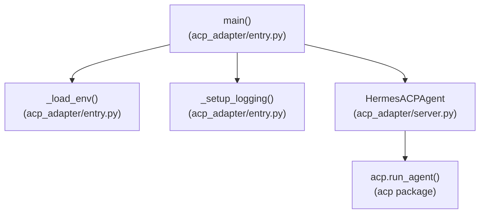
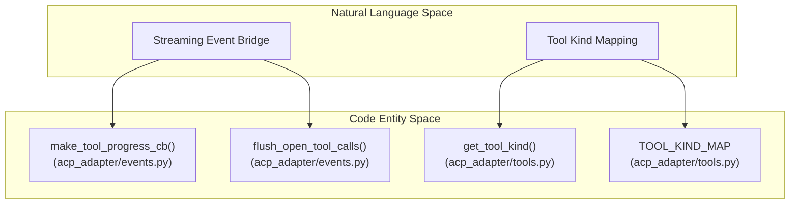
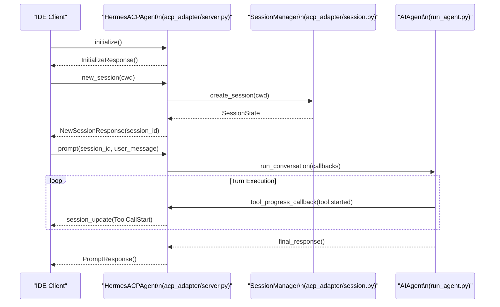

# ACP Server and IDE Integration

Relevant source files

The following files were used as context for generating this wiki page:

- [acp_adapter/auth.py](acp_adapter/auth.py)
- [acp_adapter/commands.py](acp_adapter/commands.py)
- [acp_adapter/edit_approval.py](acp_adapter/edit_approval.py)
- [acp_adapter/entry.py](acp_adapter/entry.py)
- [acp_adapter/events.py](acp_adapter/events.py)
- [acp_adapter/permissions.py](acp_adapter/permissions.py)
- [acp_adapter/provenance.py](acp_adapter/provenance.py)
- [acp_adapter/server.py](acp_adapter/server.py)
- [acp_adapter/session.py](acp_adapter/session.py)
- [acp_adapter/tools.py](acp_adapter/tools.py)
- [agent/memory_manager_tools.py](agent/memory_manager_tools.py)
- [contributors/emails/contact@nytemode.com](contributors/emails/contact@nytemode.com)
- [tests/acp_adapter/test_acp_commands.py](tests/acp_adapter/test_acp_commands.py)
- [tests/acp_adapter/test_acp_dashboard_model_switch_validation.py](tests/acp_adapter/test_acp_dashboard_model_switch_validation.py)
- [tests/acp_adapter/test_events.py](tests/acp_adapter/test_events.py)
- [tests/acp_adapter/test_permissions.py](tests/acp_adapter/test_permissions.py)
- [tests/acp_adapter/test_server.py](tests/acp_adapter/test_server.py)
- [tests/acp_adapter/test_session.py](tests/acp_adapter/test_session.py)
- [tests/agent/test_builtin_memory_disabled_surface.py](tests/agent/test_builtin_memory_disabled_surface.py)
- [tests/agent/test_concurrent_interrupt.py](tests/agent/test_concurrent_interrupt.py)
- [tests/hermes_cli/test_ensure_acp_launcher.py](tests/hermes_cli/test_ensure_acp_launcher.py)
- [tests/tools/test_find_shell.py](tests/tools/test_find_shell.py)
- [website/docs/developer-guide/acp-internals.md](website/docs/developer-guide/acp-internals.md)
- [website/docs/user-guide/features/acp.md](website/docs/user-guide/features/acp.md)
- [website/i18n/zh-Hans/docusaurus-plugin-content-docs/current/user-guide/features/acp.md](website/i18n/zh-Hans/docusaurus-plugin-content-docs/current/user-guide/features/acp.md)

This page documents the Agent Client Protocol (ACP) server implementation in Hermes Agent, located under `acp_adapter/`. It covers the core protocol server (`HermesACPAgent`), session lifecycle and persistence (`SessionState`, `SessionManager`), pre-execution edit approvals (`EditProposal`), dangerous command permissions, streaming event bridging, slash commands, and IDE integration workflows [acp_adapter/server.py:1-43](), [acp_adapter/session.py:1-167](), [website/docs/user-guide/features/acp.md:1-58]().

---

## 1. Architecture and Boot Flow

Hermes Agent implements the Agent Client Protocol (ACP) to expose its capabilities as a backend AI agent for IDEs and AI-native editors like VS Code and Zed. The core ACP server functionality is driven by `HermesACPAgent` (`acp_adapter/server.py`), which conforms to the `acp.Agent` protocol interface, managing sessions, authenticating clients, and forwarding prompt interactions to underlying synchronous `AIAgent` instances [acp_adapter/server.py:18-43](), [website/docs/developer-guide/acp-internals.md:1-50]().

The boot flow starts through `acp_adapter/entry.py`, which loads environment variables from `~/.hermes/.env`, redirects all logging to `stderr` (preserving `stdout` strictly for ACP JSON-RPC streams), handles CLI flags (`--version`, `--check`, `--setup`, `--setup-browser`), and boots the stdio protocol loop via `acp.run_agent()` [acp_adapter/entry.py:1-176](), [website/docs/developer-guide/acp-internals.md:21-34]().

Sources: [acp_adapter/server.py:18-43](), [acp_adapter/entry.py:1-176](), [website/docs/developer-guide/acp-internals.md:21-34]()

---

## 2. Session Management and Persistence

Sessions represent active conversations tied to an editor working directory (`cwd`). Each session is tracked in-memory by `SessionState` and managed via `SessionManager`, while persisting transcripts to the shared SQLite database (`~/.hermes/state.db`) so they survive process restarts and remain discoverable via session search [acp_adapter/session.py:1-160](), [website/docs/developer-guide/acp-internals.md:60-82]().

### `SessionState` Fields and Lifecycle

- `session_id`: Unique string identifier for the session [acp_adapter/session.py:135]()
- `agent`: The underlying synchronous `AIAgent` instance [acp_adapter/session.py:136]()
- `cwd`: Editor working directory normalized for tool execution [acp_adapter/session.py:137]()
- `model`: Active model identifier [acp_adapter/session.py:138]()
- `history`: List of message dictionaries preserving the conversation transcript [acp_adapter/session.py:139]()
- `runtime_lock`: Threading lock serializing turn execution and slash commands [acp_adapter/session.py:148]()
- `cancel_event`: Threading event signaling interrupts or user cancellation [acp_adapter/session.py:140]()
- `command_op`: Flag indicating a state-mutating slash command (`/reset`, `/compress`, `/model`) is in flight [acp_adapter/session.py:146]()
- `queued_prompts`: Prompts queued while the session is busy [acp_adapter/session.py:147]()

When Hermes runs inside Windows Subsystem for Linux (WSL) while editors send native Windows paths (e.g. `E:\Projects`), `_translate_acp_cwd()` and `_normalize_cwd_for_compare()` convert drive paths into POSIX WSL mount forms (`/mnt/e/Projects`), ensuring that workspace checks and terminal subprocesses align correctly [acp_adapter/session.py:27-55]().

Sources: [acp_adapter/session.py:1-167](), [tests/acp_adapter/test_session.py:31-60]()

---

## 3. Tool System Integration and Streaming Events

Hermes tools are mapped to ACP `ToolKind` enumerations (`read`, `edit`, `search`, `execute`, `fetch`, `other`, `think`) inside `acp_adapter/tools.py` [acp_adapter/tools.py:15-66]().

### Event Bridging and FIFO Tool Queues
Because `AIAgent` executes synchronously in worker threads while ACP I/O runs on the main asyncio event loop, `acp_adapter/events.py` bridges callback events into asynchronous `session_update` notifications [acp_adapter/events.py:1-70](). 

`make_tool_progress_cb()` tracks tool call IDs using FIFO queues per tool name. This guarantees that parallel or repeated same-name tool invocations correctly pair their `tool.started` notifications with their specific `tool.completed` results [acp_adapter/events.py:70-150](). Any tool calls left unclosed at the end of a turn are automatically flushed and marked as abandoned or failed via `flush_open_tool_calls()` [acp_adapter/events.py:97-116]().

Sources: [acp_adapter/tools.py:15-66](), [acp_adapter/events.py:1-150]()

---

## 4. Edit Approval, Permissions, and Gating

Hermes integrates with ACP to manage user approval workflows for file modifications and dangerous terminal commands.

### Edit Approval (`acp_adapter/edit_approval.py`)
File mutation operations (`write_file`, `patch`) generate `EditProposal` objects encapsulating target paths, old text, and proposed new text [acp_adapter/edit_approval.py:25-36]().
- **Context Binding**: An `EditApprovalRequester` callback is bound via the `ContextVar` `_EDIT_APPROVAL_REQUESTER` for the duration of an ACP agent run [acp_adapter/edit_approval.py:41-55]().
- **Auto-Approval Policies**: Policies such as `ask`, `workspace_session`, and `session` dictate when edits bypass prompting. Sensitive targets (e.g., `.env`, `.ssh/`) always trigger explicit editor prompts regardless of policy [acp_adapter/edit_approval.py:144-167]().

### Permission Requests (`acp_adapter/permissions.py`)
Dangerous terminal commands invoke `make_approval_callback()`, translating Hermes approval results (`once`, `session`, `always`, `deny`) into ACP `PermissionOption` structures rendered as permission UI cards inside the IDE [acp_adapter/permissions.py:17-140](). Timeouts and bridge failures default to denying execution [acp_adapter/permissions.py:77-114]().

Sources: [acp_adapter/edit_approval.py:25-167](), [acp_adapter/permissions.py:17-140]()

---

## 5. IDE Integration Flow and Slash Commands

The sequence below outlines the message exchange between an ACP-compatible editor client and Hermes ACPAgent during session initialization and prompt execution:

### Slash Commands (`acp_adapter/commands.py`)
`HermesACPAgent` inherits `SlashCommandsMixin` to handle headless slash commands (`/help`, `/model`, `/tools`, `/context`, `/reset`, `/compress`, `/steer`, `/queue`, `/version`) [acp_adapter/commands.py:43-70](). State-mutating commands (`/reset`, `/compress`, `/model`) acquire a runtime lock to prevent concurrent turn interleaving [acp_adapter/commands.py:34-41]().

Sources: [acp_adapter/server.py:18-350](), [acp_adapter/session.py:131-167](), [acp_adapter/commands.py:43-125]()