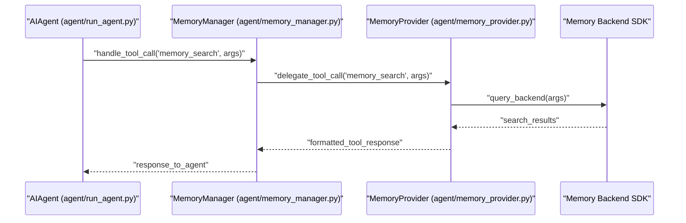

# Plugins and Memory Providers

<details>
<summary>Relevant source files</summary>

The following files were used as context for generating this wiki page:

- [agent/memory_manager.py](agent/memory_manager.py)
- [agent/memory_provider.py](agent/memory_provider.py)
- [agent/shell_hooks.py](agent/shell_hooks.py)
- [hermes_cli/agent_plugins.py](hermes_cli/agent_plugins.py)
- [hermes_cli/hooks.py](hermes_cli/hooks.py)
- [hermes_cli/mcp_picker.py](hermes_cli/mcp_picker.py)
- [hermes_cli/mcp_security.py](hermes_cli/mcp_security.py)
- [hermes_cli/memory_oauth.py](hermes_cli/memory_oauth.py)
- [hermes_cli/memory_provider_migration.py](hermes_cli/memory_provider_migration.py)
- [hermes_cli/middleware.py](hermes_cli/middleware.py)
- [hermes_cli/plugin_oauth.py](hermes_cli/plugin_oauth.py)
- [hermes_cli/plugin_provider_requests.py](hermes_cli/plugin_provider_requests.py)
- [hermes_cli/plugin_validate.py](hermes_cli/plugin_validate.py)
- [hermes_cli/plugin_validate_desktop.py](hermes_cli/plugin_validate_desktop.py)
- [hermes_cli/plugins.py](hermes_cli/plugins.py)
- [hermes_cli/plugins_cmd.py](hermes_cli/plugins_cmd.py)
- [hermes_cli/plugins_cmd_catalog.py](hermes_cli/plugins_cmd_catalog.py)
- [hermes_cli/plugins_cmd_install.py](hermes_cli/plugins_cmd_install.py)
- [hermes_cli/plugins_cmd_remove.py](hermes_cli/plugins_cmd_remove.py)
- [hermes_cli/plugins_cmd_update.py](hermes_cli/plugins_cmd_update.py)
- [hermes_cli/plugins_cmd_update_all.py](hermes_cli/plugins_cmd_update_all.py)
- [hermes_cli/plugins_discovery.py](hermes_cli/plugins_discovery.py)
- [hermes_cli/plugins_dispatch.py](hermes_cli/plugins_dispatch.py)
- [hermes_cli/plugins_ledger.py](hermes_cli/plugins_ledger.py)
- [hermes_cli/plugins_loader.py](hermes_cli/plugins_loader.py)
- [hermes_cli/plugins_manifest.py](hermes_cli/plugins_manifest.py)
- [hermes_cli/plugins_state.py](hermes_cli/plugins_state.py)
- [hermes_cli/plugins_transaction.py](hermes_cli/plugins_transaction.py)
- [hermes_cli/plugins_updates.py](hermes_cli/plugins_updates.py)
- [hermes_cli/subcommands/plugins.py](hermes_cli/subcommands/plugins.py)
- [optional-skills/autonomous-ai-agents/honcho/SKILL.md](optional-skills/autonomous-ai-agents/honcho/SKILL.md)
- [plugin-catalog/README.md](plugin-catalog/README.md)
- [tests/agent/test_memory_migration_notifications.py](tests/agent/test_memory_migration_notifications.py)
- [tests/agent/test_memory_provider.py](tests/agent/test_memory_provider.py)
- [tests/agent/test_memory_stalled_background_call.py](tests/agent/test_memory_stalled_background_call.py)
- [tests/agent/test_moa_quiet_reference_output.py](tests/agent/test_moa_quiet_reference_output.py)
- [tests/agent/test_post_compaction_hook.py](tests/agent/test_post_compaction_hook.py)
- [tests/agent/test_pre_compress_checkpoint_contract.py](tests/agent/test_pre_compress_checkpoint_contract.py)
- [tests/agent/test_shell_hooks.py](tests/agent/test_shell_hooks.py)
- [tests/agent/test_streaming_context_scrubber.py](tests/agent/test_streaming_context_scrubber.py)
- [tests/gateway/test_agent_cache_memory_lifecycle.py](tests/gateway/test_agent_cache_memory_lifecycle.py)
- [tests/gateway/test_vision_memory_leak.py](tests/gateway/test_vision_memory_leak.py)
- [tests/gateway/test_weak_credential_guard.py](tests/gateway/test_weak_credential_guard.py)
- [tests/hermes_cli/test_agent_plugins.py](tests/hermes_cli/test_agent_plugins.py)
- [tests/hermes_cli/test_hooks_cli.py](tests/hermes_cli/test_hooks_cli.py)
- [tests/hermes_cli/test_mcp_security.py](tests/hermes_cli/test_mcp_security.py)
- [tests/hermes_cli/test_memory_provider_migration.py](tests/hermes_cli/test_memory_provider_migration.py)
- [tests/hermes_cli/test_plugin_dependency_consent.py](tests/hermes_cli/test_plugin_dependency_consent.py)
- [tests/hermes_cli/test_plugin_hook_failure_reporting.py](tests/hermes_cli/test_plugin_hook_failure_reporting.py)
- [tests/hermes_cli/test_plugin_install_ref.py](tests/hermes_cli/test_plugin_install_ref.py)
- [tests/hermes_cli/test_plugin_loader_module_eviction.py](tests/hermes_cli/test_plugin_loader_module_eviction.py)
- [tests/hermes_cli/test_plugin_module_eviction_race.py](tests/hermes_cli/test_plugin_module_eviction_race.py)
- [tests/hermes_cli/test_plugin_oauth.py](tests/hermes_cli/test_plugin_oauth.py)
- [tests/hermes_cli/test_plugin_scan_dunder_dirs.py](tests/hermes_cli/test_plugin_scan_dunder_dirs.py)
- [tests/hermes_cli/test_plugin_uninstall_windows_live.py](tests/hermes_cli/test_plugin_uninstall_windows_live.py)
- [tests/hermes_cli/test_plugin_validate.py](tests/hermes_cli/test_plugin_validate.py)
- [tests/hermes_cli/test_plugins.py](tests/hermes_cli/test_plugins.py)
- [tests/hermes_cli/test_plugins_catalog_requires_hermes.py](tests/hermes_cli/test_plugins_catalog_requires_hermes.py)
- [tests/hermes_cli/test_plugins_check_updates.py](tests/hermes_cli/test_plugins_check_updates.py)
- [tests/hermes_cli/test_plugins_cmd.py](tests/hermes_cli/test_plugins_cmd.py)
- [tests/hermes_cli/test_plugins_cmd_catalog.py](tests/hermes_cli/test_plugins_cmd_catalog.py)
- [tests/hermes_cli/test_plugins_cmd_enable_disable_nested.py](tests/hermes_cli/test_plugins_cmd_enable_disable_nested.py)
- [tests/hermes_cli/test_plugins_loader.py](tests/hermes_cli/test_plugins_loader.py)
- [tests/hermes_cli/test_plugins_update_all.py](tests/hermes_cli/test_plugins_update_all.py)
- [tests/hermes_cli/test_web_memory_user_dir_provider.py](tests/hermes_cli/test_web_memory_user_dir_provider.py)
- [tests/plugins/test_memory_hook_registration.py](tests/plugins/test_memory_hook_registration.py)
- [tests/pm/test_plugin_declarations.py](tests/pm/test_plugin_declarations.py)
- [tests/providers/fake_pkce_idp.py](tests/providers/fake_pkce_idp.py)
- [website/docs/developer-guide/memory-provider-plugin.md](website/docs/developer-guide/memory-provider-plugin.md)
- [website/docs/developer-guide/middleware.md](website/docs/developer-guide/middleware.md)
- [website/docs/developer-guide/plugins/catalog-submission.md](website/docs/developer-guide/plugins/catalog-submission.md)
- [website/docs/developer-guide/plugins/index.md](website/docs/developer-guide/plugins/index.md)
- [website/docs/user-guide/features/honcho.md](website/docs/user-guide/features/honcho.md)
- [website/docs/user-guide/features/hooks.md](website/docs/user-guide/features/hooks.md)
- [website/docs/user-guide/features/memory-providers.md](website/docs/user-guide/features/memory-providers.md)
- [website/docs/user-guide/features/plugin-catalog.md](website/docs/user-guide/features/plugin-catalog.md)
- [website/docs/user-guide/features/plugins.md](website/docs/user-guide/features/plugins.md)
- [website/i18n/zh-Hans/docusaurus-plugin-content-docs/current/developer-guide/memory-provider-plugin.md](website/i18n/zh-Hans/docusaurus-plugin-content-docs/current/developer-guide/memory-provider-plugin.md)
- [website/i18n/zh-Hans/docusaurus-plugin-content-docs/current/user-guide/features/memory-providers.md](website/i18n/zh-Hans/docusaurus-plugin-content-docs/current/user-guide/features/memory-providers.md)

</details>


## Purpose and Scope

This page documents the Hermes plugin system with a focus on the `MemoryProvider` abstract base class (ABC), bundled memory plugins, plugin discovery mechanisms, lifecycle hooks, dashboard authentication plugins, the plugin catalog, and specialty plugins. It explains how plugins extend and integrate with the Hermes agent core, particularly by augmenting memory capabilities, tools, lifecycle events, and dashboard authentication. The page details key classes, data flows, and extension points to aid developers and advanced users in understanding and developing Hermes plugins.

Sources: [hermes_cli/plugins.py:1-133](), [website/docs/developer-guide/plugins/index.md:1-56]()

---

## Plugin System Architecture

Hermes features a modular plugin system enabling extensibility by adding custom tools, hooks, commands, and integrations without modifying the core source code [website/docs/user-guide/features/plugins.md:10-16]().

### Plugin Sources and Discovery

Plugins can be sourced from multiple prioritized locations with later entries overriding earlier ones on key collisions:

1. **Bundled plugins:** Reside in the Hermes repo under `plugins/` (or configured via `HERMES_BUNDLED_PLUGINS`) [hermes_cli/plugins.py:67-74](). Memory and context-engine plugins have their own discovery paths here [hermes_cli/plugins.py:1-9]().  
2. **User plugins:** Installed in `~/.hermes/plugins/<plugin_name>/` [website/docs/user-guide/features/plugins.md:21-29]().  
3. **Project plugins:** Optionally enabled by setting the environment variable `HERMES_ENABLE_PROJECT_PLUGINS=true` [hermes_cli/plugins.py:1-9](). Discovered under `.hermes/plugins/<plugin_name>/` in the project directory [hermes_cli/plugins.py:1-9](). Disabled by default for security.  
4. **Pip packages:** Installed Python packages exposing the `hermes_agent.plugins` entry point group [hermes_cli/plugins.py:1-9]().

Each directory plugin requires a `plugin.yaml` manifest with metadata and a Python package exposing a `register(ctx)` function in `__init__.py` which binds runtime extensions like tools and hooks via the `PluginContext` API [hermes_cli/plugins.py:1-9]().

Sources: [hermes_cli/plugins.py:1-74](), [website/docs/user-guide/features/plugins.md:10-29]()

### Key Classes and Components

- **`PluginManager`**  
  Manages plugin discovery, loading, enabling/disabling, and lifecycle events [hermes_cli/plugins.py:1-65](). Merges all plugin sources, controls overrides, and exposes registered tools and hooks [hermes_cli/plugins.py:1-65]().  
- **`PluginContext`**  
  Passed to each plugin's `register` function; used to register tools, hooks, commands, and middleware callbacks within the agent runtime [hermes_cli/plugins.py:1-9]().  
- **`register(ctx)`**  
  The canonical plugin entry function implemented by each plugin's `__init__.py` to declare capabilities and register runtime features [hermes_cli/plugins.py:1-9]().

Sources: [hermes_cli/plugins.py:1-65]()

### Plugin Lifecycle and Tool Registration

Plugins register callable tools through `ctx.register_tool()`, exposing JSON schema and handler functions usable by the LLM or agent [website/docs/user-guide/features/plugins.md:101-108](). Hooks such as `pre_tool_call` and `post_tool_call` are registered similarly with `ctx.register_hook()` to intercept lifecycle events [website/docs/user-guide/features/plugins.md:101-108](). Plugins can also register slash commands, platform adapters, memory providers, context compressors, and middleware layers [website/docs/user-guide/features/plugins.md:101-124](). Loading is bounded per plugin via `run_with_load_deadline()` in `hermes_cli/plugins_loader.py` to prevent startup hangs [hermes_cli/plugins_loader.py:106-154]().

Sources: [website/docs/user-guide/features/plugins.md:101-124](), [hermes_cli/plugins_loader.py:106-154]()

### Plugin System Entity Diagram

```mermaid
graph TD
    subgraph "Natural Language Space"
        Plugin[""Plugin directory or pip package""]
        Tool[""Custom Tool (JSON schema + handler)""]
        Hook[""Lifecycle Hook (pre/post events)""]
    end

    subgraph "Code Entity Space"
        PM[""PluginManager (hermes_cli/plugins.py)""]
        PC[""PluginContext (hermes_cli/plugins.py)""]
        REG[""register(ctx) in __init__.py""]
        TR[""tools.registry (tools/registry.py)""]
        
        Plugin -- "discovered by" --> PM
        PM -- "creates and manages" --> PC
        PM -- "load calls" --> REG
        REG -- "ctx.register_tool()" --> PC
        PC -- "registers with" --> TR
        REG -- "ctx.register_hook()" --> PC
        PC -- "updates state in" --> PM
    end
```

Sources: [hermes_cli/plugins.py:1-133](), [website/docs/user-guide/features/plugins.md:10-31]()

---

## Memory Providers & Bundled Memory Plugins

Hermes supports extensible persistent memory via the `MemoryProvider` abstract base class (ABC), enabling advanced backends beyond the default `MEMORY.md` and `USER.md` files [agent/memory_provider.py:1-163]().

### `MemoryProvider` Abstract Base Class (ABC)

- Defines standard interface methods used by the agent core lifecycle:  
  - `initialize()` — initialize backend resources [agent/memory_provider.py:1-163]().  
  - `prefetch()` — read memory before turn to speed up access [agent/memory_provider.py:1-163]().  
  - `sync_turn()` — save memory changes after each turn [agent/memory_provider.py:1-163]().  
  - `on_session_end()` — handle session teardown [agent/memory_provider.py:1-163]().  
  - `on_pre_compress()` — called before context compression steps [agent/memory_provider.py:1-163]().  
  - `shutdown()` — cleanly close provider on exit [agent/memory_provider.py:1-163]().  
- Implements default no-op versions for convenience; plugins override selectively [agent/memory_provider.py:1-163]().  
- Provides tool schemas exposing memory query and update operations to the LLM [agent/memory_provider.py:1-163]().  
- Located in `agent/memory_provider.py` [agent/memory_provider.py:1-163]().  
- External memory plugins implement this ABC to integrate backends like vector DBs, knowledge graphs, or SQLite [agent/memory_provider.py:1-163]().

Sources: [agent/memory_provider.py:1-163]()

### MemoryManager: Fan-out to Providers

- The `MemoryManager` holds all active memory providers, always including the built-in provider plus optionally one external plugin provider [agent/memory_manager.py:1-163]().  
- It fans out memory lifecycle calls to all providers, coordinating synchronous or asynchronous updates [agent/memory_manager.py:1-163]().  
- Aggregates all tools exposed by providers to merge them into the agent tool schema [agent/memory_manager.py:1-163]().  
- Respects config gating to expose or hide memory provider tools [agent/memory_manager.py:1-163]().  
- Implements error handling to avoid blocking the main agent loop [agent/memory_manager.py:1-163]().  
- Located in `agent/memory_manager.py` [agent/memory_manager.py:1-163]().

Sources: [agent/memory_manager.py:1-163]()

### Bundled Memory Plugins

Hermes ships with several advanced memory backend plugins, often distributed via the plugin catalog at `plugins/memory/` [website/docs/user-guide/features/plugin-catalog.md:10-21]():

| Provider       | Description                                                       | Location                      |
|----------------|-------------------------------------------------------------------|-------------------------------|
| **Honcho**     | AI-native memory with dialectic querying, user modeling          | `plugins/memory/honcho/` (catalog) |
| **OpenViking** | Hierarchical tiered memory with semantic search and summaries    | `plugins/memory/openviking/` [plugins/memory/openviking/__init__.py:1-132]() |
| **Hindsight**  | Knowledge-graph, entity resolution multi-method memory backend   | `plugins/memory/hindsight/` (catalog) |
| **RetainDB**   | SQLite relational memory backend with TTL and offline sync       | `plugins/memory/retaindb/` (catalog) |
| **ByteRover**  | Lightweight fast vector memory backend                            | `plugins/memory/byterover/` (catalog) |
| **Supermemory**| Webpage extraction and indexing memory backend                   | `plugins/memory/supermemory/` (catalog) |
| **Mem0**       | Adaptive vector/graph memory system                               | Bundled internally             |
| **Holographic**| Holographic associative memory backend                            | Bundled internally             |

Sources: [website/docs/user-guide/features/plugin-catalog.md:10-21](), [plugins/memory/openviking/__init__.py:1-132]()

### Memory Provider Execution Flow



Sources: [agent/memory_provider.py:1-163](), [agent/memory_manager.py:1-163]()

---

## Plugin Hooks, Middleware, and Dashboard Authentication Plugins

### Plugin Hooks

Plugins register callback functions to lifecycle events enumerated in the `VALID_HOOKS` set in the plugin system [hermes_cli/plugins.py:107-133]():

- **Tool Call Hooks:**  
  - `pre_tool_call`: invoked before any tool execution, can block or modify calls [hermes_cli/plugins.py:107-133]().  
  - `post_tool_call`: invoked after a tool returns [hermes_cli/plugins.py:107-133]().  
- **Transform Hooks:**  
  - `transform_llm_output`, `transform_tool_result`, `transform_terminal_output`: allow plugins to modify LLM or tool results [hermes_cli/plugins.py:107-133]().  
- **LLM Call Hooks:**  
  - `pre_llm_call`, `post_llm_call` run before and after LLM completions [hermes_cli/plugins.py:107-133]().  
- **Streaming Hooks:**  
  - `on_stream_start`, `on_stream_delta`, `on_stream_end`, `on_interim_message` observe tokens in streaming mode [hermes_cli/plugins.py:107-133]().  
- **Session Lifecycle Hooks:**  
  - `on_session_start`, `on_session_end`, `on_session_reset`, `on_session_finalize` notify about session events [hermes_cli/plugins.py:107-133]().  
- **Verification Hook:**  
  - `pre_verify` controls code verification phases [hermes_cli/plugins.py:107-133]().  
- **API Request Hooks:**  
  - `pre_api_request`, `post_api_request`, `api_request_error` observe LLM API calls [hermes_cli/plugins.py:107-133]().  
- **Auxiliary Call Hooks:**  
  - `pre_auxiliary_call`, `post_auxiliary_call` for side-channel LLM requests [hermes_cli/plugins.py:107-133]().  
- **Error Classification Transform:**  
  - `transform_api_error_classification` can classify and adjust error handling for API calls [hermes_cli/plugins.py:107-133]().  

All hooks run in-process asynchronously or synchronously, errors are caught and logged without crashing the agent [website/docs/user-guide/features/hooks.md:18-82](). Timeouts and execution bounds are enforced via `hermes_cli/plugins_dispatch.py` [hermes_cli/plugins_dispatch.py:42-50]().

Sources: [hermes_cli/plugins.py:107-133](), [website/docs/user-guide/features/hooks.md:18-82](), [hermes_cli/plugins_dispatch.py:42-50]()

### Middleware System

Plugins can also register middleware handlers affecting:

- **LLM Request Middleware:** Modify or augment LLM completion requests before sending to providers [tests/hermes_cli/test_plugins.py:27-32]().  
- **Tool Request Middleware:** Transform or enrich arguments before calling tools [tests/hermes_cli/test_plugins.py:27-32]().  
- **Execution Callbacks Middleware:** Wrap the execution flow for LLM completions and tool calls, enabling before/after logic injection [tests/hermes_cli/test_plugins.py:27-32]().

Middleware layers are executed in a strict predefined order, enabling layered extension pipelines for advanced interception or modification of runtime behavior [hermes_cli/middleware.py]().

Sources: [hermes_cli/middleware.py](), [tests/hermes_cli/test_plugins.py:27-32]()

### Dashboard Authentication Plugins

Hermes supports special `dashboard_auth` plugins that customize FastAPI-based dashboard authentication flows [website/docs/developer-guide/plugins/index.md:29-30]():

- Implement custom login/SSO workflows, OAuth integrations, or additional safety gates [website/docs/developer-guide/plugins/index.md:29-30]().  
- Used to tailor agent tenant login and security to organizational requirements [website/docs/developer-guide/plugins/index.md:29-30]().  
- Loaded as part of the dashboard plugin system, independent from runtime agent plugins [website/docs/developer-guide/plugins/index.md:29-30]().

Sources: [website/docs/developer-guide/plugins/index.md:29-30]()

---

## Plugin Catalog and Specialty Plugins

### Plugin Catalog

Hermes manages a curated plugin catalog with robust lifecycle management [website/docs/user-guide/features/plugin-catalog.md:10-34]():

- Supports browsing, installing, updating, enabling, disabling, and removing plugins via the CLI command `hermes plugins` [hermes_cli/plugins_cmd.py:1-6](), [website/docs/user-guide/features/plugin-catalog.md:10-15]().  
- Enforces security checks including manifest validation, scanning, and capability gating [website/docs/user-guide/features/plugin-catalog.md:77-83]().  
- Supports Python dependency provisioning and restricted tool override permissions to prevent malicious core tool replacement [website/docs/developer-guide/plugins/index.md:52-54]().  
- Maintains plugin enable state per profile and supports version pinning [website/docs/user-guide/features/plugin-catalog.md:47-52]().  
- Implements commands grouped by functionality, such as install, update, toggle, listing, and catalog operations [hermes_cli/plugins_cmd.py:1-56](), [hermes_cli/plugins_cmd_catalog.py:1-25]().

Sources: [website/docs/user-guide/features/plugin-catalog.md:10-83](), [hermes_cli/plugins_cmd.py:1-56](), [hermes_cli/plugins_cmd_catalog.py:1-25]()

### Specialty Plugins

Hermes ships and supports specialty plugins catering to domains like collaboration, observability, multimedia, and workflows [website/docs/user-guide/features/plugins.md:101-130]():

| Plugin Name        | Description                                               |
|--------------------|-----------------------------------------------------------|
| **Google Meet**    | Integration for calendar, presence, and transcription    |
| **Kanban**         | SQLite-backed Kanban task board for multi-agent/human task coordination |
| **Achievements**   | Gamification system tracking milestones and progress      |
| **Observability/Langfuse** | OpenTelemetry and Langfuse-based telemetry integration    |
| **Image Generation** | Unified backend interface for image synthesis services [website/docs/user-guide/features/plugins.md:116]() |
| **Video Generation** | Video media generation capabilities [website/docs/user-guide/features/plugins.md:117]() |
| **Spotify**        | Media playback control and catalog browsing                |
| **Disk Cleanup**   | Automated cleanup for cache and temporary file management  |
| **Security Guidance** | Real-time command risk assessment and approval workflows |
| **Teams Pipeline** | Microsoft Teams notifications and pipeline integration     |

Sources: [website/docs/user-guide/features/plugins.md:101-130]()

---

## Summary

Hermes Agent's plugin framework enables powerful extensibility via:

- The `PluginManager` orchestrating multi-source plugin discovery, enabling, and lifecycle management [hermes_cli/plugins.py:1-133]().  
- The `MemoryProvider` ABC and `MemoryManager` allowing integration of external persistent memory backends exposing LLM-accessible tools and session lifecycle hooks [agent/memory_provider.py:1-163](), [agent/memory_manager.py:1-163]().  
- A rich, flexible plugin hooks and middleware system letting plugins observe, modify, block, or augment agent operation flows [hermes_cli/plugins.py:107-133](), [hermes_cli/middleware.py]().  
- Dashboard-authentication plugins supporting customized login experiences for web dashboards [website/docs/developer-guide/plugins/index.md:29-30]().  
- A secure plugin catalog with comprehensive CLI commands for plugin lifecycle management and enforcement of capability-based security [website/docs/user-guide/features/plugin-catalog.md:10-83](), [hermes_cli/plugins_cmd.py:1-56]().  
- Specialty domain-specific plugins broadening agent capabilities in collaboration, observability, multimedia, and workflow integrations [website/docs/user-guide/features/plugins.md:101-130]().

This architecture provides a comprehensive and modular foundation for developing, deploying, and managing Hermes extensions and memory backends, empowering AI assistant customization at scale.

Sources: [hermes_cli/plugins.py:1-133](), [agent/memory_provider.py:1-163](), [agent/memory_manager.py:1-163](), [hermes_cli/middleware.py](), [website/docs/developer-guide/plugins/index.md:29-30](), [website/docs/user-guide/features/plugin-catalog.md:10-83](), [hermes_cli/plugins_cmd.py:1-56](), [website/docs/user-guide/features/plugins.md:101-130]()

# End of Page