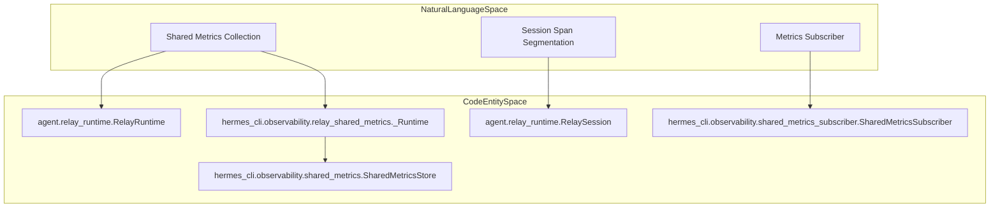
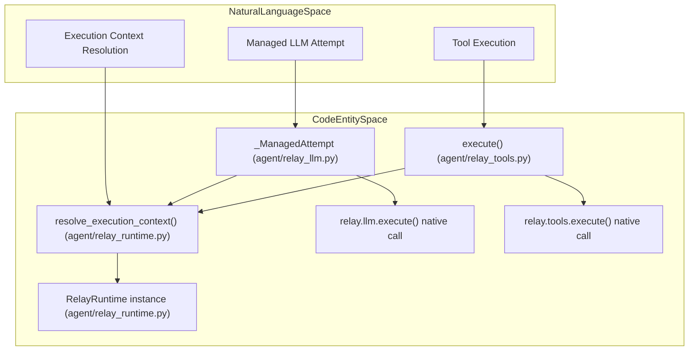

# Observability and Monitoring

Relevant source files

The following files were used as context for generating this wiki page:

- [agent/relay_llm.py](agent/relay_llm.py)
- [agent/relay_runtime.py](agent/relay_runtime.py)
- [agent/relay_tools.py](agent/relay_tools.py)
- [agent/transports/anthropic.py](agent/transports/anthropic.py)
- [hermes_cli/observability/relay_shared_metrics.py](hermes_cli/observability/relay_shared_metrics.py)
- [hermes_cli/observability/schemas/hermes.shared_metrics.v1.schema.json](hermes_cli/observability/schemas/hermes.shared_metrics.v1.schema.json)
- [hermes_cli/observability/schemas/hermes.shared_metrics.v3.schema.json](hermes_cli/observability/schemas/hermes.shared_metrics.v3.schema.json)
- [hermes_cli/observability/schemas/hermes.shared_metrics.v4.schema.json](hermes_cli/observability/schemas/hermes.shared_metrics.v4.schema.json)
- [hermes_cli/observability/shared_metrics.py](hermes_cli/observability/shared_metrics.py)
- [hermes_cli/observability/shared_metrics_catalog.py](hermes_cli/observability/shared_metrics_catalog.py)
- [hermes_cli/observability/shared_metrics_contract.py](hermes_cli/observability/shared_metrics_contract.py)
- [hermes_cli/observability/shared_metrics_engagement.py](hermes_cli/observability/shared_metrics_engagement.py)
- [hermes_cli/observability/shared_metrics_events.py](hermes_cli/observability/shared_metrics_events.py)
- [hermes_cli/observability/shared_metrics_fields.py](hermes_cli/observability/shared_metrics_fields.py)
- [hermes_cli/observability/shared_metrics_model.py](hermes_cli/observability/shared_metrics_model.py)
- [hermes_cli/observability/shared_metrics_snapshot.py](hermes_cli/observability/shared_metrics_snapshot.py)
- [hermes_cli/observability/shared_metrics_subscriber.py](hermes_cli/observability/shared_metrics_subscriber.py)
- [hermes_cli/relay_plugin_migrate.py](hermes_cli/relay_plugin_migrate.py)
- [scripts/smoke_nemo_relay_shared_metrics.py](scripts/smoke_nemo_relay_shared_metrics.py)
- [tests/agent/test_anthropic_mcp_prefix_strip.py](tests/agent/test_anthropic_mcp_prefix_strip.py)
- [tests/agent/test_anthropic_message_stop.py](tests/agent/test_anthropic_message_stop.py)
- [tests/agent/test_auxiliary_relay.py](tests/agent/test_auxiliary_relay.py)
- [tests/agent/test_relay_llm.py](tests/agent/test_relay_llm.py)
- [tests/agent/test_relay_runtime_plugins.py](tests/agent/test_relay_runtime_plugins.py)
- [tests/agent/test_relay_tools.py](tests/agent/test_relay_tools.py)
- [tests/agent/transports/test_transport.py](tests/agent/transports/test_transport.py)
- [tests/hermes_cli/test_relay_plugin_migrate.py](tests/hermes_cli/test_relay_plugin_migrate.py)
- [tests/hermes_cli/test_relay_shared_metrics.py](tests/hermes_cli/test_relay_shared_metrics.py)
- [tests/hermes_cli/test_relay_shared_metrics_runtime.py](tests/hermes_cli/test_relay_shared_metrics_runtime.py)
- [tests/hermes_cli/test_shared_metrics_compression_outcome.py](tests/hermes_cli/test_shared_metrics_compression_outcome.py)
- [tests/hermes_cli/test_shared_metrics_engagement.py](tests/hermes_cli/test_shared_metrics_engagement.py)
- [tests/hermes_cli/test_shared_metrics_model_attribution.py](tests/hermes_cli/test_shared_metrics_model_attribution.py)
- [tests/hermes_cli/test_shared_metrics_update_stop_reasons.py](tests/hermes_cli/test_shared_metrics_update_stop_reasons.py)
- [website/docs/developer-guide/relay-shared-metrics.md](website/docs/developer-guide/relay-shared-metrics.md)

This section documents the comprehensive observability and monitoring system within Hermes Agent, focusing on the OTLP/OpenTelemetry gateway monitoring, NeMo Relay shared-metrics integration, Langfuse observability plugin, `relay_llm` and `relay_tools` instrumentation, cron health telemetry, and the content-free telemetry export contract.

---

## Purpose and Scope

Hermes Agent implements a telemetry framework designed to monitor AI agent operation, provider interactions, tool executions, and system health with minimal overhead. The system integrates:

- **OpenTelemetry Protocol (OTLP) exports** for gateway runtime metrics.
- **NeMo Relay shared-metrics** integration delivering rich scope and event telemetry.
- **Langfuse plugin** providing detailed telemetry aggregation and tracing.
- Instrumentation in `agent/relay_llm.py` and `agent/relay_tools.py` capturing model and tool call metrics within Relay sessions.
- Health telemetry of background cron jobs.
- A **privacy-preserving telemetry export contract** that excludes user content from exported metrics while recording comprehensive metadata and aggregates.

---

## 1. OTLP/OpenTelemetry Gateway Monitoring System

The Hermes messaging gateway exports telemetry metrics using the OpenTelemetry Protocol (OTLP), enabling integration with observability backends like Prometheus, Jaeger, or commercial APMs.

### Implementation Highlights

- The gateway collects runtime metrics, including request latencies, success/failure counts, and resource usage.
- Metrics are encoded into OTLP protobuf format and sent asynchronously.
- The code managing thread pools for time-bounded scope operations uses daemon threads ensuring no blocking of interpreter exit, as seen in `_new_scope_op_executor` and `_scope_op_executor` in `agent/relay_runtime.py` [agent/relay_runtime.py:60-68]().

Sources: [agent/relay_runtime.py:60-68]()

---

## 2. NeMo Relay Shared-Metrics Integration

Hermes integrates the **NeMo Relay** native runtime (version `>=0.10,<0.11`) as a core observability runtime component offering rich in-process telemetry with scope-based tracking [website/docs/developer-guide/relay-shared-metrics.md:1-34]().

### Runtime Behavior & Configuration

- Supported platforms use a native wheel from NVIDIA's [NeMo Relay](https://github.com/NVIDIA/NeMo-Relay) [website/docs/developer-guide/relay-shared-metrics.md:30-37]().
- On unsupported platforms, a no-op Relay runtime maintains API compatibility but disables scope/event emission [website/docs/developer-guide/relay-shared-metrics.md:8-16]().
- Shared metrics collection is opt-in via profile config: `telemetry.shared_metrics.enabled: true` [website/docs/developer-guide/relay-shared-metrics.md:67-74]().
- Relay uses process-wide plugin configuration files (`plugins.toml`) [website/docs/developer-guide/relay-shared-metrics.md:79-86](). The environment variable `HERMES_NEMO_RELAY_PLUGINS_TOML` selects an explicit configuration file [website/docs/developer-guide/relay-shared-metrics.md:21-25,87-92]().
- Run `hermes doctor` to inspect resolved configuration files and plugin states [website/docs/developer-guide/relay-shared-metrics.md:93-96]().

### Session-Span Segmentation for Long-Running Sessions

Relay scopes session spans explicitly. Because gateway sessions may remain open for extended periods, Hermes optionally segments session spans after:

- Context compaction (`on_compaction` flag) [website/docs/developer-guide/relay-shared-metrics.md:98-116]().
- A configurable number of turns (`max_turns`) [website/docs/developer-guide/relay-shared-metrics.md:98-116]().

Segmented session spans share the same `session_id` and add metadata keys: `hermes.session.segment` and `hermes.session.segment_reason` [website/docs/developer-guide/relay-shared-metrics.md:117-119]().

### Core Classes and Data Flow

| Natural Language Entity        | Code Entity                                                                       |
|-------------------------------|----------------------------------------------------------------------------------|
| Shared Metrics Collection      | `hermes_cli.observability.relay_shared_metrics._Runtime`                         |
| Session & Turn Scope Handling  | `agent.relay_runtime.RelaySession`, `agent.relay_runtime.RelayRuntime`           |
| Metrics Durable Storage        | `hermes_cli.observability.shared_metrics.SharedMetricsStore`                     |
| Metrics Subscriber             | `hermes_cli.observability.shared_metrics_subscriber.SharedMetricsSubscriber`     |

Diagram: Shared Metrics and Relay Subsystems Architecture

Sources: [website/docs/developer-guide/relay-shared-metrics.md:1-147](), [agent/relay_runtime.py:1-172](), [hermes_cli/observability/shared_metrics.py:1-180]()

---

## 3. Langfuse Observability Plugin

Hermes includes an optional Langfuse observability plugin (`plugins/observability/langfuse/`) that enriches telemetry with detailed trace information and aggregated metadata.

### Core Functionality

- Tracks root span context, active LLM generations, queued tool spans, and subagent-related spans.
- Uses a `TraceState` dataclass to manage telemetry state across the lifespan of a session.
- Supports privacy modes controlled by the `HERMES_LANGFUSE_CAPTURE` environment variable (`metadata`, `sanitized`, `full`).
- Wraps telemetry calls with a failsafe context manager to ensure observability errors never impact the runtime.

Sources: [plugins/observability/langfuse/__init__.py:1-171]()

---

## 4. Instrumentation in `relay_llm.py` and `relay_tools.py`

Hermes instruments model calls and tool executions within the NeMo Relay runtime to emit telemetry accurately correlated to active Relay sessions.

### `agent/relay_llm.py`

- Defines `_ManagedAttempt`, a class representing a fully managed Relay LLM call attempt [agent/relay_llm.py:55-72]().
- It resolves the Relay execution context with `resolve_execution_context(session_id)` from `relay_runtime` [agent/relay_llm.py:64-69]().
- Operation names are canonicalized based on API mode for Relay protocol consistency (`openai.chat_completions`, `openai.responses`, `anthropic.messages`) [agent/relay_llm.py:31-46]().
- Manages lifecycle of Relay calls with context propagation, recording raw and processed responses, and handling both synchronous and asynchronous calls [agent/relay_llm.py:90-148]().

### `agent/relay_tools.py`

- Wraps tool executions within Relay "tool" scopes via `execute()` [agent/relay_tools.py:16-23]().
- Resolves the Relay execution context similarly to `relay_llm.py` [agent/relay_tools.py:21-22]().
- Runs tool callbacks in isolated contexts to prevent event loop conflicts [agent/relay_tools.py:27-35]().
- Provides utility functions `_jsonable` to convert results to JSON-safe forms and `_json_equal` for value comparisons that handle JSON objects accurately [agent/relay_tools.py:73-101]().

### Instrumentation Data Flow

Diagram: Relay LLM and Tool Execution Instrumentation Flow

Sources: [agent/relay_llm.py:31-152](), [agent/relay_tools.py:16-106](), [agent/relay_runtime.py:71-73]()

---

## 5. Cron Health and Scheduled Task Telemetry

Hermes tracks the health and execution consistency of cron jobs and scheduled tasks which are key to autonomous system operation.

- Job starts, completions, failures, and related incidents are recorded in an execution ledger.
- Background job health indicators surface in diagnostic tools such as `hermes doctor`.
- Token usage metrics and skill invocation statistics from insight aggregations feed into monitoring dashboards.

Sources: [agent/insights.py:1-147](), [hermes_cli/observability/shared_metrics.py:1-180]()

---

## 6. Content-Free Telemetry Export Contract & Usage Pricing

Hermes enforces a strict **content-free** telemetry export policy to preserve user privacy:

- No user prompts, conversation messages, or detailed tool arguments are exported.
- Only metadata such as model names, operation types, token counts, success/failure outcomes are reported.
- `SharedMetricsStore` persists these aggregates in an SQLite database supporting export packages [hermes_cli/observability/shared_metrics.py:51-83]().
- Metrics are recorded by the Relay subscriber implementation `SharedMetricsSubscriber` which consumes runtime events.

### Durable Metrics Storage Highlights

| Feature                  | Description                                         |
|--------------------------|-----------------------------------------------------|
| Storage Backend          | SQLite with schema versioning and migration support |
| Export Packaging         | JSON payload packages for upload/export             |
| Consent & Retention      | Explicit consent windows tracked, with retention policies  |
| Incremental Counter Aggregates | Supports atomic increments for metrics               |

Sources: [hermes_cli/observability/shared_metrics.py:1-180](), [hermes_cli/observability/relay_shared_metrics.py:160-170]()

---

# Summary

Hermes Agent's observability and monitoring system combines:

- OTLP/OpenTelemetry gateway monitoring conforming to industry standards.
- Native NeMo Relay runtime integration for detailed, scope-based shared metrics.
- Langfuse plugin for enriched tracing and telemetry visualization.
- Relay-scoped instrumentation in LLM and tool execution adapters for precise call metrics.
- Monitoring of cron task health and execution consistency.
- A strict, content-free telemetry export contract safeguarding user data privacy.

---

# References for Further Exploration

- `agent/relay_runtime.py` lines 1-172
- `agent/relay_llm.py` lines 1-152
- `agent/relay_tools.py` lines 1-71
- `hermes_cli/observability/relay_shared_metrics.py` lines 1-183
- `hermes_cli/observability/shared_metrics.py` lines 1-180
- `website/docs/developer-guide/relay-shared-metrics.md` lines 1-147
- `plugins/observability/langfuse/__init__.py` lines 1-171

Sources:  
[agent/relay_runtime.py:1-172](),  
[agent/relay_llm.py:1-152](),  
[agent/relay_tools.py:1-71](),  
[hermes_cli/observability/relay_shared_metrics.py:1-183](),  
[hermes_cli/observability/shared_metrics.py:1-180](),  
[website/docs/developer-guide/relay-shared-metrics.md:1-147](),  
[plugins/observability/langfuse/__init__.py:1-171]()