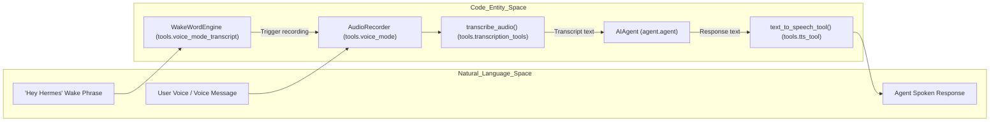
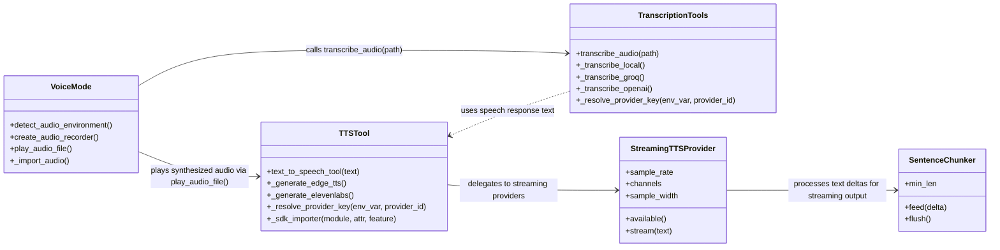

# Voice and TTS

Relevant source files

The following files were used as context for generating this wiki page:

- [hermes_cli/profile_identity.py](hermes_cli/profile_identity.py)
- [hermes_cli/voice.py](hermes_cli/voice.py)
- [scripts/ci/list_os_marked_tests.py](scripts/ci/list_os_marked_tests.py)
- [tests/_fixtures/__init__.py](tests/_fixtures/__init__.py)
- [tests/_fixtures/env_filter.py](tests/_fixtures/env_filter.py)
- [tests/_fixtures/platform_gating.py](tests/_fixtures/platform_gating.py)
- [tests/ci/test_list_os_marked_tests.py](tests/ci/test_list_os_marked_tests.py)
- [tests/gateway/test_pm_activation.py](tests/gateway/test_pm_activation.py)
- [tests/git_safety.py](tests/git_safety.py)
- [tests/hermes_cli/test_graphical_browser_detection.py](tests/hermes_cli/test_graphical_browser_detection.py)
- [tests/hermes_cli/test_plugins_update_sync.py](tests/hermes_cli/test_plugins_update_sync.py)
- [tests/hermes_cli/test_profile_rename_checkpoints.py](tests/hermes_cli/test_profile_rename_checkpoints.py)
- [tests/hermes_cli/test_update_fleet_incomplete_warning.py](tests/hermes_cli/test_update_fleet_incomplete_warning.py)
- [tests/hermes_cli/test_update_launchd_fleet_restart.py](tests/hermes_cli/test_update_launchd_fleet_restart.py)
- [tests/hermes_cli/test_update_launchd_restart_verification.py](tests/hermes_cli/test_update_launchd_restart_verification.py)
- [tests/hermes_cli/test_update_launchd_unloaded_gateway.py](tests/hermes_cli/test_update_launchd_unloaded_gateway.py)
- [tests/hermes_cli/test_venv_sync.py](tests/hermes_cli/test_venv_sync.py)
- [tests/hermes_cli/test_venv_sync_currency.py](tests/hermes_cli/test_venv_sync_currency.py)
- [tests/hermes_cli/test_voice_wrapper.py](tests/hermes_cli/test_voice_wrapper.py)
- [tests/test_git_safety_boundary.py](tests/test_git_safety_boundary.py)
- [tests/test_live_system_guard.py](tests/test_live_system_guard.py)
- [tests/test_os_marker_gating.py](tests/test_os_marker_gating.py)
- [tests/test_platforms_marker.py](tests/test_platforms_marker.py)
- [tests/tools/test_tts_macos_output.py](tests/tools/test_tts_macos_output.py)
- [tests/tools/test_voice_cli_integration.py](tests/tools/test_voice_cli_integration.py)
- [tests/tools/test_voice_mode.py](tests/tools/test_voice_mode.py)
- [tests/tools/test_voice_stop_phrase.py](tests/tools/test_voice_stop_phrase.py)
- [tests/tools/test_voice_tts_echo_guard.py](tests/tools/test_voice_tts_echo_guard.py)
- [tools/checkpoint_manager_profile_rename.py](tools/checkpoint_manager_profile_rename.py)
- [tools/voice_mode.py](tools/voice_mode.py)

This page provides a high-level overview of the voice interaction and speech synthesis capabilities within Hermes Agent. The system enables real-time voice input and output in the CLI and other platforms, supporting push-to-talk and continuous voice modes, multi-provider speech-to-text transcription, multi-provider text-to-speech synthesis with streaming support, and a web platform adapter for browser-based voice interaction.

---

## Overview of Voice Capabilities

Hermes bridges "Natural Language Space"—the spoken and heard audio—with "Code Entity Space"—its internal agent classes and tools—via a modular voice processing pipeline. Core components include wake-word detection engines, audio recorders, transcription backends, the AI agent language model, and text-to-speech synthesizers.

| Feature                  | Description                                                                                       | Key Code Entities                                            |
|--------------------------|---------------------------------------------------------------------------------------------------|--------------------------------------------------------------|
| **Voice Mode**           | Real-time push-to-talk or continuous voice interaction in CLI and Discord voice channels, including wake-word activation and per-chat voice state.          | `tools.voice_mode` module [tools/voice_mode.py:1-183]()       |
| **Speech-to-Text (STT)** | Multi-provider transcription supporting local and cloud models including Whisper, Groq, OpenAI, Mistral, xAI, ElevenLabs, and command/plugin providers.                  | `tools.transcription_tools` [tools/transcription_tools.py:1-40]() |
| **Text-to-Speech (TTS)** | Multi-provider speech synthesis with Edge TTS (default free), ElevenLabs, OpenAI, Mistral, Gemini, xAI, MiniMax, plus local NeuTTS, KittenTTS, Piper, and command/plugin providers, supporting streaming TTS with barge-in. | `tools.tts_tool` [tools/tts_tool.py:1-9]()             |
| **Wake-Word Detection**  | On-device wake phrase detection allowing hands-free voice mode activation.                                 | `tools.voice_mode_transcript` [tools/voice_mode_transcript.py:3-3]() |

### Voice Pipeline Architecture

*Diagram: Voice Input and Output Pipeline Bridging Natural Language to Code Entities*

This pipeline demonstrates how Hermes listens for voice input, detects wake words, records audio, sends it to transcription backends, processes the text through the AI agent, and finally converts responses back to speech.

Sources: [tools/voice_mode.py:1-183](), [tools/transcription_tools.py:1-40](), [tools/tts_tool.py:1-9]() , [tools/voice_mode_transcript.py:3-3]()

---

## Voice Mode

Voice Mode provides interactive spoken conversations primarily in the Hermes CLI, with extensions such as Discord voice channel integration and specialized per-chat voice settings.

- **Activation and Control:** Voice mode can be enabled or disabled via commands (`/voice on`, `/voice off`). The CLI manages the voice state, including TTS playback and push-to-talk recording, coordinating audio capture and transcription asynchronously [hermes_cli.voice, tests/tools/test_voice_cli_integration.py:84-99]().

- **Audio Capture:** Audio recording is done at 16 kHz, mono, using `sounddevice` with lazy imports to prevent import issues on headless or containerized environments. The recorder supports silence detection with configurable thresholds for automatic stopping of recording after extended silence [tools/voice_mode.py:32-38,45-48]().

- **Environment Awareness:** The voice system detects environment constraints such as SSH sessions without sound servers, container runtimes, WSL, and active PulseAudio or PipeWire servers, enabling voice only when full audio input/output functionality is available [tools/voice_mode.py:147-174]().

- **Push-to-Talk and Continuous Modes:** Hermes supports both push-to-talk and continuous listening. Wake word detection can automatically trigger recording. The CLI normalizes and formats voice activation keys to maintain consistent keybindings across platforms and runtimes, avoiding conflicts with reserved input keys on macOS and other environments [hermes_cli/voice.py:20-110]().

For an in-depth explanation of voice mode including wakeword detection, Discord voice integration, the STT pipeline, and chat-specific voice configurations, see the child page [Voice Mode](#11.1).

Sources: [tools/voice_mode.py:32-38,45-48,147-174](), [hermes_cli/voice.py:20-110](), [tests/tools/test_voice_cli_integration.py:84-99]()

---

## TTS and Transcription

Hermes Agent provides a versatile text-to-speech and speech-to-text subsystem with multiple providers and streaming capabilities.

### Speech-to-Text (STT)

- The transcription tools module unifies multiple backends, including local Whisper variants and cloud APIs (Groq, OpenAI, Mistral Voxtral, xAI Grok, ElevenLabs). It also supports command and plugin-based custom transcriptions [tools/transcription_tools.py:1-40]().

- Local models are loaded lazily and unloaded when idle to manage resource usage efficiently. Cloud providers require API keys resolved from environment or config secrets via a shared provider resolution system.

### Text-to-Speech (TTS)

- The TTS system includes providers such as Edge TTS (free default), ElevenLabs, OpenAI TTS, Mistral, Gemini, xAI, MiniMax, and local synths like NeuTTS, KittenTTS, and Piper. Configuration is driven by user config, with support for specifying voices, output formats, and synthesis options [tools/tts_tool.py:1-9]().

- Streaming TTS support produces real-time audio chunks in 16-bit PCM format, enabling low-latency speech playback with barge-in capabilities. Streaming providers process text in sentence chunks for natural spoken flow [tools/tts_streaming.py:1-10,49-63]().

- Hermes performs pre-synthesis text normalization including stripping Markdown syntax to enhance speech clarity [tests/tools/test_voice_cli_integration.py:49-56]().

### Code Entity Relationships in Voice and TTS

This diagram illustrates key code entities and their interactions in the voice processing, transcription, and TTS playback layers.

For comprehensive technical coverage of all TTS providers, streaming synthesis mechanics, detailed transcription implementations, and the web platform adapter enabling browser-based voice features, see the child page [TTS and Transcription](#11.2).

Sources: [tools/tts_tool.py:1-9](), [tools/transcription_tools.py:1-40](), [tools/tts_streaming.py:1-10,49-63](), [tests/tools/test_voice_cli_integration.py:49-56]()

---

This overview sketches the architectural and code relationships for voice capture, transcription, and speech synthesis in Hermes Agent. To explore these subsystems in detail, consult the linked child pages:

- [Voice Mode](#11.1) — Voice mode activation, wakewords, Discord voice integration, STT pipeline, and per-chat voice settings.
- [TTS and Transcription](#11.2) — TTS synthesis backends, streaming TTS, transcription tool implementations, and the web platform voice adapter.

---

Sources:  
[tools/voice_mode.py:1-183](), [hermes_cli/voice.py:20-110](), [tools/transcription_tools.py:1-40](), [tools/tts_tool.py:1-9](), [tools/tts_streaming.py:1-10,49-63](), [tests/tools/test_voice_cli_integration.py:49-99](), [tools/voice_mode_transcript.py:3-3]()