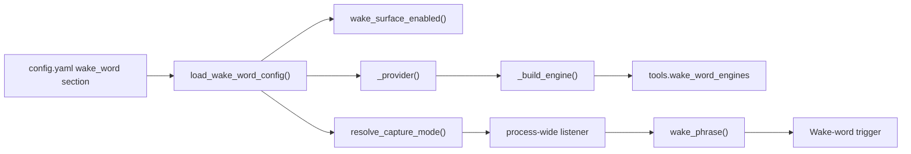
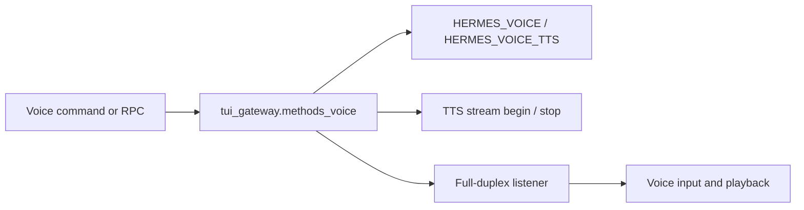
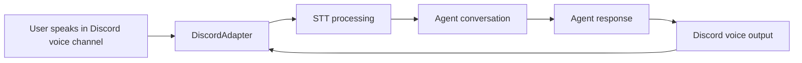
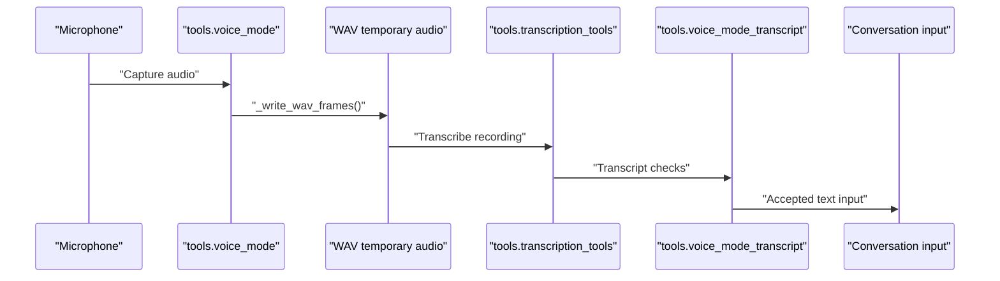
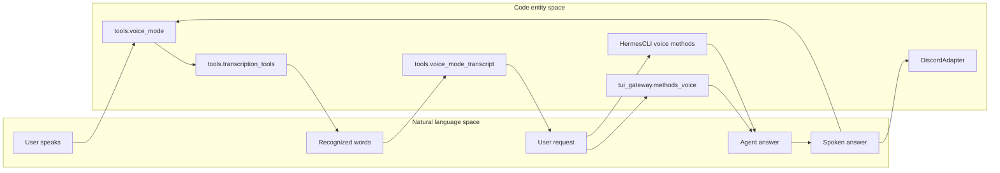
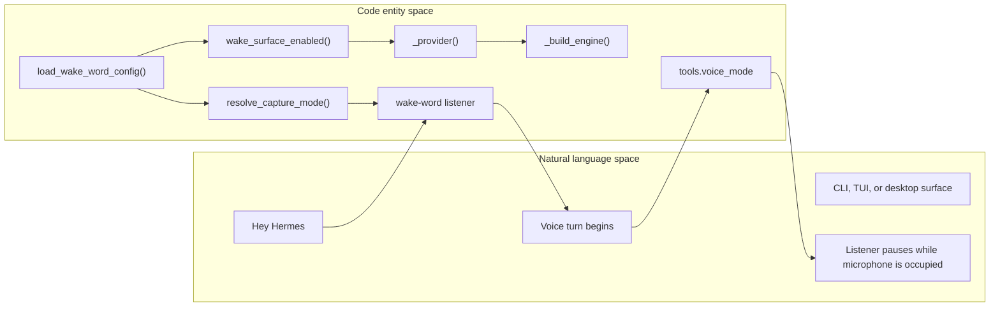

# Voice Mode

Relevant source files

The following files were used as context for generating this wiki page:

- [.python-version](.python-version)
- [agent/background_review.py](agent/background_review.py)
- [hermes_cli/profile_identity.py](hermes_cli/profile_identity.py)
- [hermes_cli/voice.py](hermes_cli/voice.py)
- [hermes_cli/write_approval_commands.py](hermes_cli/write_approval_commands.py)
- [scripts/ci/list_os_marked_tests.py](scripts/ci/list_os_marked_tests.py)
- [tests/_fixtures/__init__.py](tests/_fixtures/__init__.py)
- [tests/_fixtures/env_filter.py](tests/_fixtures/env_filter.py)
- [tests/_fixtures/platform_gating.py](tests/_fixtures/platform_gating.py)
- [tests/ci/test_list_os_marked_tests.py](tests/ci/test_list_os_marked_tests.py)
- [tests/gateway/test_pm_activation.py](tests/gateway/test_pm_activation.py)
- [tests/git_safety.py](tests/git_safety.py)
- [tests/hermes_cli/test_graphical_browser_detection.py](tests/hermes_cli/test_graphical_browser_detection.py)
- [tests/hermes_cli/test_plugins_update_sync.py](tests/hermes_cli/test_plugins_update_sync.py)
- [tests/hermes_cli/test_profile_rename_checkpoints.py](tests/hermes_cli/test_profile_rename_checkpoints.py)
- [tests/hermes_cli/test_update_fleet_incomplete_warning.py](tests/hermes_cli/test_update_fleet_incomplete_warning.py)
- [tests/hermes_cli/test_update_launchd_fleet_restart.py](tests/hermes_cli/test_update_launchd_fleet_restart.py)
- [tests/hermes_cli/test_update_launchd_restart_verification.py](tests/hermes_cli/test_update_launchd_restart_verification.py)
- [tests/hermes_cli/test_update_launchd_unloaded_gateway.py](tests/hermes_cli/test_update_launchd_unloaded_gateway.py)
- [tests/hermes_cli/test_venv_sync.py](tests/hermes_cli/test_venv_sync.py)
- [tests/hermes_cli/test_venv_sync_currency.py](tests/hermes_cli/test_venv_sync_currency.py)
- [tests/hermes_cli/test_voice_wrapper.py](tests/hermes_cli/test_voice_wrapper.py)
- [tests/hermes_state/test_search_or_relaxed_fallback.py](tests/hermes_state/test_search_or_relaxed_fallback.py)
- [tests/test_git_safety_boundary.py](tests/test_git_safety_boundary.py)
- [tests/test_live_system_guard.py](tests/test_live_system_guard.py)
- [tests/test_os_marker_gating.py](tests/test_os_marker_gating.py)
- [tests/test_platforms_marker.py](tests/test_platforms_marker.py)
- [tests/tools/test_memory_patch_action.py](tests/tools/test_memory_patch_action.py)
- [tests/tools/test_memory_tool.py](tests/tools/test_memory_tool.py)
- [tests/tools/test_session_search.py](tests/tools/test_session_search.py)
- [tests/tools/test_session_search_readonly.py](tests/tools/test_session_search_readonly.py)
- [tests/tools/test_skill_pending_diff_batch.py](tests/tools/test_skill_pending_diff_batch.py)
- [tests/tools/test_threat_patterns.py](tests/tools/test_threat_patterns.py)
- [tests/tools/test_translate_execute_context.py](tests/tools/test_translate_execute_context.py)
- [tests/tools/test_tts_macos_output.py](tests/tools/test_tts_macos_output.py)
- [tests/tools/test_voice_cli_integration.py](tests/tools/test_voice_cli_integration.py)
- [tests/tools/test_voice_mode.py](tests/tools/test_voice_mode.py)
- [tests/tools/test_voice_stop_phrase.py](tests/tools/test_voice_stop_phrase.py)
- [tests/tools/test_voice_tts_echo_guard.py](tests/tools/test_voice_tts_echo_guard.py)
- [tests/tools/test_wake_word.py](tests/tools/test_wake_word.py)
- [tests/tools/test_wake_word_stream_recovery.py](tests/tools/test_wake_word_stream_recovery.py)
- [tests/tools/test_working_diff.py](tests/tools/test_working_diff.py)
- [tests/tools/test_write_approval.py](tests/tools/test_write_approval.py)
- [tools/checkpoint_manager_profile_rename.py](tools/checkpoint_manager_profile_rename.py)
- [tools/memory_tool.py](tools/memory_tool.py)
- [tools/memory_tool_store.py](tools/memory_tool_store.py)
- [tools/session_search_tool.py](tools/session_search_tool.py)
- [tools/threat_patterns.py](tools/threat_patterns.py)
- [tools/voice_mode.py](tools/voice_mode.py)
- [tools/voice_mode_transcript.py](tools/voice_mode_transcript.py)
- [tools/wake_word.py](tools/wake_word.py)
- [tools/wake_word_engines.py](tools/wake_word_engines.py)
- [tools/wakewords/README.md](tools/wakewords/README.md)
- [tools/working_diff.py](tools/working_diff.py)
- [tools/write_approval.py](tools/write_approval.py)
- [website/docs/user-guide/features/memory.md](website/docs/user-guide/features/memory.md)
- [website/docs/user-guide/features/wake-word.md](website/docs/user-guide/features/wake-word.md)

## Purpose and scope

Voice mode connects microphone capture, speech-to-text (STT), agent input, and optional spoken output. This page distinguishes CLI push-to-talk voice mode from the always-on wake-word listener and summarizes gateway and Discord voice integration. [tools/voice_mode.py:1-6](), [tools/wake_word.py:1-8]()

Sources: [tools/voice_mode.py:1-6](), [tools/wake_word.py:1-8]()

---

## Overview

CLI voice mode captures audio and passes it to STT; the resulting text can be submitted as conversation input. Spoken output is an optional, separate capability. Audio capture and wake-word detection both use 16 kHz mono audio, but have separate control loops: wake-word detection is designed to remain available while idle, whereas a voice turn uses the microphone for recording. The wake-word listener can be paused while a voice turn holds the microphone and resumed afterward. [tools/voice_mode.py:1-6](), [tools/voice_mode.py:31-38](), [tools/wake_word.py:1-8](), [tools/wake_word.py:36-47]()

| Component | Responsibility |
|---|---|
| `tools.voice_mode` | CLI-oriented recording, WAV handling, audio availability checks, and playback support. [tools/voice_mode.py:1-6](), [tools/voice_mode.py:41-61](), [tools/voice_mode.py:76-103]() |
| `tools.wake_word` | Wake-word configuration, capture-mode selection, engine selection, and process-wide listener ownership. [tools/wake_word.py:1-8](), [tools/wake_word.py:59-91](), [tools/wake_word.py:94-160]() |
| `tools.voice_mode_transcript` | Transcript-related configuration and helpers imported by voice mode, including stop-phrase and hallucination checks. [tools/voice_mode.py:27-29]() |
| CLI voice state | CLI methods route `/voice` commands and track voice recording and playback state. [tests/tools/test_voice_cli_integration.py:15-44](), [tests/tools/test_voice_cli_integration.py:86-139]() |

Sources: [tools/voice_mode.py:1-6](), [tools/voice_mode.py:27-61](), [tools/wake_word.py:1-8](), [tools/wake_word.py:59-160](), [tests/tools/test_voice_cli_integration.py:15-44]()

---

## Voice mode activation and audio capture

The CLI accepts `/voice on` to enable voice mode; its command handler also routes other voice subcommands. Before enabling, the CLI checks voice requirements and audio-environment availability. [tests/tools/test_voice_cli_integration.py:86-139]()

The capture implementation uses `sounddevice` and `numpy` through `_import_audio()`, which imports them lazily and asks `pm` to ensure the `audio-io` extra when needed. Lazy imports avoid initializing audio dependencies merely because the module was imported, which is relevant in headless environments. [tools/voice_mode.py:41-61]()

The recording format constants are 16 kHz, mono, `int16`, with two bytes per sample. The module defines an RMS silence threshold of 200 and a three-second silence duration for automatic stopping. [tools/voice_mode.py:31-38]()

| Capture detail | Implementation |
|---|---|
| Input rate | `SAMPLE_RATE = 16000`, described as Whisper’s native rate. [tools/voice_mode.py:31-35]() |
| Audio representation | One channel, `int16` samples, two-byte sample width. [tools/voice_mode.py:31-35]() |
| Silence handling | `SILENCE_RMS_THRESHOLD` and `SILENCE_DURATION_SECONDS` define the module’s silence thresholds. [tools/voice_mode.py:36-38]() |
| WAV output | `_write_wav_frames()` writes mono PCM frames at the supplied sample rate into WAV format. [tools/voice_mode.py:90-97]() |
| Temporary audio | `_TEMP_DIR` points to a temporary `hermes_voice` directory; `_unlink_quietly()` provides best-effort cleanup for temporary paths. [tools/voice_mode.py:38](), [tools/voice_mode.py:99-103]() |

Audio availability is checked through `_audio_available()` and `_audio_unavailable_reason()`. Import failures and missing PortAudio are treated separately; the latter requires a system library rather than a Python package install. [tools/voice_mode.py:106-152]()

Sources: [tools/voice_mode.py:1-6](), [tools/voice_mode.py:31-38](), [tools/voice_mode.py:41-61](), [tools/voice_mode.py:90-103]()

---

## Wake-word detection

Wake-word listening is implemented separately from the CLI recording path. `tools.wake_word` describes a shared listener for CLI, TUI, and desktop GUI surfaces, with one process-wide owner. The listener captures audio on a daemon thread and exposes pause/resume behavior so it does not compete with a voice turn for the same microphone. [tools/wake_word.py:1-8](), [tools/wake_word.py:69-71]()

Configuration is loaded from the `wake_word` section by `load_wake_word_config()`. Its defaults disable wake-word listening and select automatic surface, capture, and provider behavior; the default human-facing phrase is `hey hermes`. [tools/wake_word.py:73-100](), [tools/wake_word.py:142-145]()

| Setting or helper | Role |
|---|---|
| `enabled` | Defaults to `False`. [tools/wake_word.py:77-81]() |
| `surface` | Determines which surface is eligible; `wake_surface_enabled()` applies the configured surface gate. [tools/wake_word.py:77-81](), [tests/tools/test_wake_word.py:46-58]() |
| `phrase` | Human-facing phrase label, defaulting to `hey hermes`. [tools/wake_word.py:83-91](), [tools/wake_word.py:142-145]() |
| `provider` | `auto` resolves according to supported wake-word extras and `_PROVIDER_PREFERENCE`. [tools/wake_word.py:59-66](), [tools/wake_word.py:117-125]() |
| `capture` | `resolve_capture_mode()` chooses local or client capture, with optional surface preference and local-device checks. [tools/wake_word.py:73-80](), [tools/wake_word.py:148-160]() |
| `sensitivity` | Parsed and clamped to the range 0.0–1.0. [tools/wake_word.py:133-135]() |
| `confirmation_frames` | Consecutive over-threshold frames required to fire; clamped to 1–10. [tools/wake_word.py:49-52](), [tools/wake_word.py:137-140]() |

The provider map includes Porcupine, Sherpa/KWS aliases, and OpenWakeWord aliases. The bundled wake-word model is named `hey_hermes`; the module resolves its file under `tools/wakewords/`. [tools/wake_word.py:59-66](), [tools/wake_word.py:83-91]()

### Wake-word configuration and code entities

Sources: [tools/wake_word.py:25-33](), [tools/wake_word.py:59-100](), [tools/wake_word.py:117-160](), [tests/tools/test_wake_word.py:46-58](), [tests/tools/test_wake_word.py:106-131]()

---

## Gateway voice management

Gateway voice behavior is controlled through `tui_gateway/methods_voice.py`. The existing implementation describes process-level `HERMES_VOICE` and `HERMES_VOICE_TTS` flags, voice command handling, and streaming TTS lifecycle functions. The full-duplex listener is responsible for coordinating listening and playback behavior. [tui_gateway/methods_voice.py:16-58](), [tui_gateway/methods_voice.py:103-170]()

Sources: [tui_gateway/methods_voice.py:16-58](), [tui_gateway/methods_voice.py:103-170]()

---

## Discord voice channel integration

The Discord platform adapter provides voice-channel integration through `plugins/platforms/discord/adapter.py`. The adapter’s voice handling connects channel audio input to transcription and supports spoken bot output; the gateway’s voice command path separately manages voice state and streaming behavior. [plugins/platforms/discord/adapter.py:1-146](), [tui_gateway/methods_voice.py:103-170]()

Discord voice integration should be understood as a platform-specific path, not as the same microphone recorder used by the CLI. CLI capture uses `tools.voice_mode`; Discord voice is owned by the Discord adapter. [tools/voice_mode.py:1-6](), [plugins/platforms/discord/adapter.py:1-146]()

Sources: [plugins/platforms/discord/adapter.py:1-146](), [tools/voice_mode.py:1-6]()

---

## Speech-to-text pipeline

The voice-mode module identifies `tools.transcription_tools` as the STT integration. The module also imports `_voice_config`, `is_voice_stop_phrase`, and `is_whisper_hallucination` from `tools.voice_mode_transcript`, establishing the transcript utility boundary. [tools/voice_mode.py:1-6](), [tools/voice_mode.py:27-29]()

The visible implementation writes WAV data as mono PCM with the supplied sample rate. The STT component then receives audio for transcription; transcript filtering or stop-phrase decisions belong to the transcript helper layer. [tools/voice_mode.py:76-97](), [tools/voice_mode.py:27-29]()

Sources: [tools/voice_mode.py:1-6](), [tools/voice_mode.py:27-29](), [tools/voice_mode.py:76-103]()

---

## Per-chat voice settings and CLI keybindings

CLI voice state includes flags for voice mode, TTS, recording, processing, and continuous operation, along with synchronization and playback-related fields. The CLI integration tests also verify that `/voice on` invokes the enable path and that voice-mode activation checks the audio environment and requirements. [tests/tools/test_voice_cli_integration.py:15-44](), [tests/tools/test_voice_cli_integration.py:86-139]()

Voice configuration includes a `beep_enabled` setting and recording parameters such as `silence_threshold`, `silence_duration`, and `max_recording_seconds`; the tests exercise the path from config into recording behavior. [tests/tools/test_voice_cli_integration.py:142-187](), [tests/tools/test_voice_cli_integration.py:189-196]()

The CLI wrapper also provides helpers for normalizing the configured record key into prompt-toolkit syntax and formatting it for status display. [hermes_cli/voice.py:57-110]()

Per-chat voice preferences are distinct from the process-wide wake-word listener configuration. The wake-word module loads a `wake_word` configuration section, while the CLI voice path reads the `voice` settings used for recording and beeps. [tools/wake_word.py:94-100](), [tests/tools/test_voice_cli_integration.py:142-187]()

| Setting/state | Scope and use |
|---|---|
| `voice.beep_enabled` | Controls whether the recording-start beep is played. [tests/tools/test_voice_cli_integration.py:142-187]() |
| `voice.silence_threshold` | Recording silence threshold passed through the CLI recording setup. [tests/tools/test_voice_cli_integration.py:150-172]() |
| `voice.silence_duration` | Silence duration passed through the CLI recording setup. [tests/tools/test_voice_cli_integration.py:150-172]() |
| `voice.max_recording_seconds` | A tested recording limit whose config wiring is explicitly covered. [tests/tools/test_voice_cli_integration.py:189-196]() |
| Voice record key | Normalized for prompt-toolkit and formatted for CLI status output. [hermes_cli/voice.py:57-110]() |

Sources: [tests/tools/test_voice_cli_integration.py:15-44](), [tests/tools/test_voice_cli_integration.py:86-196](), [hermes_cli/voice.py:57-110](), [tools/wake_word.py:94-100]()

---

## Key code entities

| Entity | Responsibility |
|---|---|
| `_import_audio()` | Ensures and imports the `audio-io` dependencies lazily. [tools/voice_mode.py:41-61]() |
| `_write_wav_frames()` | Writes raw mono PCM frames to WAV format. [tools/voice_mode.py:90-97]() |
| `_audio_available()` | Reports whether audio dependencies and the audio backend are available. [tools/voice_mode.py:106-122]() |
| `load_wake_word_config()` | Loads and shape-checks the `wake_word` configuration section. [tools/wake_word.py:94-100]() |
| `_provider()` | Resolves a configured or automatically selected wake-word provider. [tools/wake_word.py:117-125]() |
| `resolve_capture_mode()` | Chooses local or client capture for a wake-word listener arm. [tools/wake_word.py:148-160]() |
| `wake_phrase()` | Returns the configured phrase label, defaulting to `hey hermes`. [tools/wake_word.py:142-145]() |
| `_handle_voice_command` | Routes CLI voice subcommands; `/voice on` invokes the enable path. [tests/tools/test_voice_cli_integration.py:86-101]() |

Sources: [tools/voice_mode.py:41-61](), [tools/voice_mode.py:90-122](), [tools/wake_word.py:94-160](), [tests/tools/test_voice_cli_integration.py:86-101]()

---

## End-to-end voice flow: language and code entities

Sources: [tools/voice_mode.py:1-6](), [tools/voice_mode.py:27-29](), [tests/tools/test_voice_cli_integration.py:86-139](), [tui_gateway/methods_voice.py:103-170](), [plugins/platforms/discord/adapter.py:1-146]()

### Wake-word activation: language and code entities

Sources: [tools/wake_word.py:1-8](), [tools/wake_word.py:94-160](), [tests/tools/test_wake_word.py:46-58](), [tests/tools/test_wake_word.py:106-119]()

---

## Sources

- [tools/voice_mode.py:1-152]()
- [tools/wake_word.py:1-160]()
- [tests/tools/test_voice_cli_integration.py:15-196]()
- [tests/tools/test_wake_word.py:26-131]()
- [tui_gateway/methods_voice.py:16-170]()
- [plugins/platforms/discord/adapter.py:1-146]()
- [hermes_cli/voice.py:57-110]()