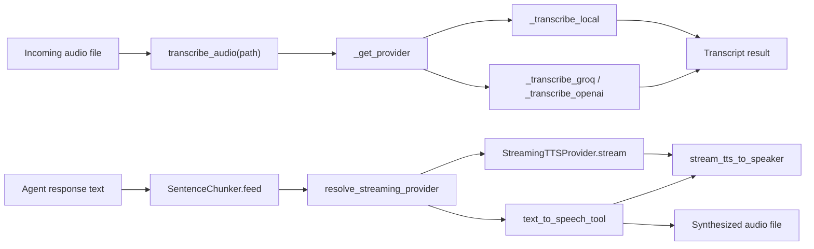
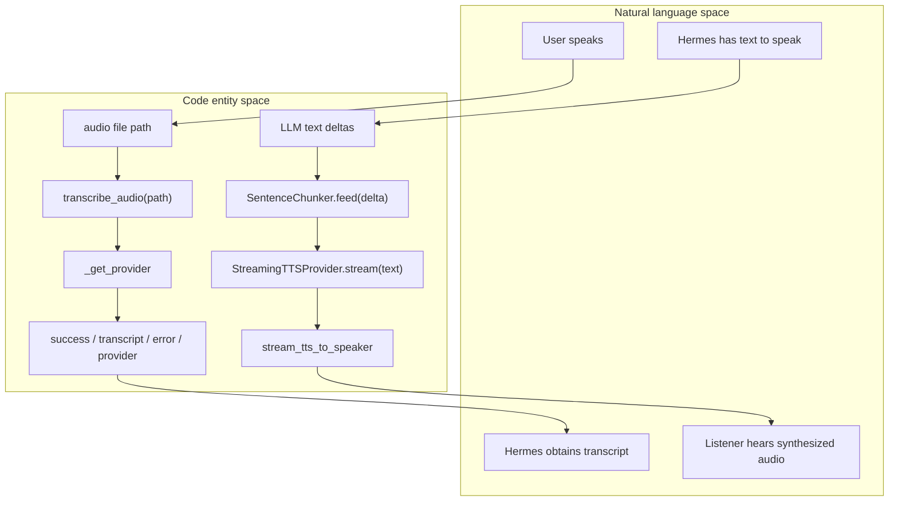
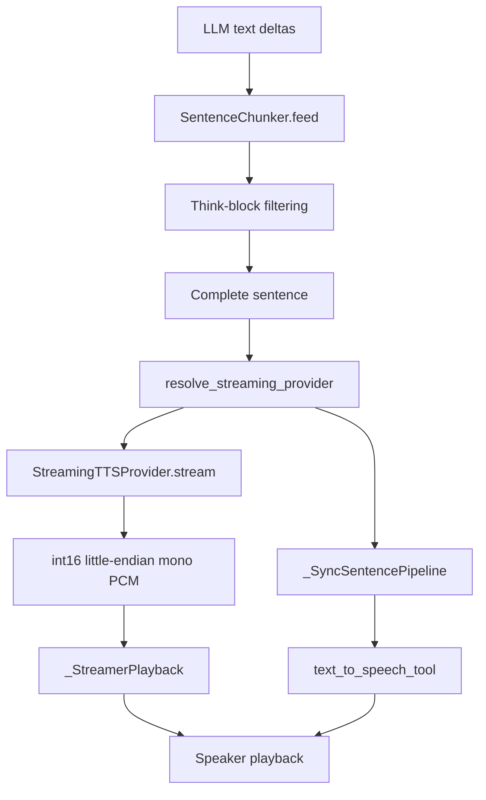

# TTS and Transcription

Relevant source files

The following files were used as context for generating this wiki page:

- [agent/tts_provider.py](agent/tts_provider.py)
- [tests/hermes_cli/test_stt_picker.py](tests/hermes_cli/test_stt_picker.py)
- [tests/hermes_cli/test_web_server_tts_lease.py](tests/hermes_cli/test_web_server_tts_lease.py)
- [tests/tools/test_transcription.py](tests/tools/test_transcription.py)
- [tests/tools/test_transcription_dotenv_fallback.py](tests/tools/test_transcription_dotenv_fallback.py)
- [tests/tools/test_transcription_tools.py](tests/tools/test_transcription_tools.py)
- [tests/tools/test_tts_command_providers.py](tests/tools/test_tts_command_providers.py)
- [tests/tools/test_tts_deepinfra.py](tests/tools/test_tts_deepinfra.py)
- [tests/tools/test_tts_dotenv_fallback.py](tests/tools/test_tts_dotenv_fallback.py)
- [tests/tools/test_tts_gemini.py](tests/tools/test_tts_gemini.py)
- [tests/tools/test_tts_lifecycle_leases.py](tests/tools/test_tts_lifecycle_leases.py)
- [tests/tools/test_tts_mistral.py](tests/tools/test_tts_mistral.py)
- [tests/tools/test_tts_piper.py](tests/tools/test_tts_piper.py)
- [tests/tools/test_tts_plugin_dispatch.py](tests/tools/test_tts_plugin_dispatch.py)
- [tests/tools/test_tts_streaming.py](tests/tools/test_tts_streaming.py)
- [tools/transcription_audio.py](tools/transcription_audio.py)
- [tools/transcription_cloud.py](tools/transcription_cloud.py)
- [tools/transcription_command.py](tools/transcription_command.py)
- [tools/transcription_common.py](tools/transcription_common.py)
- [tools/transcription_local.py](tools/transcription_local.py)
- [tools/transcription_tools.py](tools/transcription_tools.py)
- [tools/tts_command_provider.py](tools/tts_command_provider.py)
- [tools/tts_streaming.py](tools/tts_streaming.py)
- [tools/tts_tool.py](tools/tts_tool.py)
- [tools/tts_tool_delivery.py](tools/tts_tool_delivery.py)
- [tools/tts_tool_lifecycle.py](tools/tts_tool_lifecycle.py)
- [tools/tts_tool_local.py](tools/tts_tool_local.py)
- [tools/tts_tool_openai.py](tools/tts_tool_openai.py)
- [tools/tts_tool_plugins.py](tools/tts_tool_plugins.py)
- [tools/tts_tool_providers.py](tools/tts_tool_providers.py)
- [tools/tts_tool_speaker.py](tools/tts_tool_speaker.py)
- [tools/xai_http.py](tools/xai_http.py)
- [website/docs/developer-guide/streaming-tts.md](website/docs/developer-guide/streaming-tts.md)
- [website/docs/user-guide/features/tts.md](website/docs/user-guide/features/tts.md)

## Purpose and scope

This page documents Hermes Agent’s text-to-speech (TTS) synthesis, sentence-based streaming speech, speech-to-text (STT) transcription, and the available browser-voice integration seam. TTS and STT share provider-secret resolution patterns but have separate configuration, provider dispatch, and audio-processing paths. [tools/tts_tool.py:1-8]() [tools/transcription_tools.py:1-9]()

Sources: [tools/tts_tool.py:1-8]() [tools/transcription_tools.py:1-9]()

---

## Architecture and data flow

Incoming audio is dispatched through the transcription subsystem; outgoing text is synthesized by the TTS subsystem. For streaming speech, `SentenceChunker` turns text deltas into complete utterances, and the speaker pipeline either consumes PCM chunks from a streaming provider or synthesizes each sentence through the regular TTS tool. [tools/transcription_tools.py:1-9]() [tools/tts_streaming.py:1-9]() [tools/tts_tool_speaker.py:1-8]()

### Audio pipeline data flow

Sources: [tools/transcription_tools.py:1-9]() [tools/tts_streaming.py:1-9]() [tools/tts_tool_speaker.py:1-8]()

### Natural-language concepts mapped to code entities

Sources: [tools/transcription_tools.py:1-9]() [tools/tts_streaming.py:1-9]() [tools/tts_streaming.py:75-145]() [tools/tts_tool_speaker.py:1-8]()

---

## Text-to-speech synthesis backends

`tools.tts_tool` owns TTS configuration resolution, built-in provider dispatch, output policy, and registration. Backend implementations are split among provider, local, OpenAI-compatible, command-provider, and plugin modules. The built-in provider set includes Edge, ElevenLabs, OpenAI, DeepInfra, MiniMax, Mistral, Gemini, xAI, NeuTTS, KittenTTS, and Piper. [tools/tts_tool.py:1-8]() [tools/tts_tool.py:38-53]()

### Provider overview

| Provider | Implementation module | Notes |
|---|---|---|
| Edge | `tools.tts_tool_providers` | Free default provider. [tools/tts_tool.py:1-8]() |
| ElevenLabs | `tools.tts_tool_providers` | Cloud provider; SDK import is lazy. [tools/tts_tool.py:45-50]() [tools/tts_tool.py:57-79]() |
| OpenAI | `tools.tts_tool_openai` | OpenAI audio backend; also used for the managed `nous` selection. [tools/tts_tool.py:1-8]() [tools/tts_tool.py:52-53]() [tools/tts_tool.py:145-150]() |
| DeepInfra | `tools.tts_tool_openai` | OpenAI-compatible backend module. [tools/tts_tool.py:52-53]() |
| MiniMax | `tools.tts_tool_providers` | Cloud provider with runtime resolution support. [tools/tts_tool.py:45-47]() |
| Mistral | `tools.tts_tool_providers` | Cloud provider. [tools/tts_tool.py:45-47]() |
| Gemini | `tools.tts_tool_providers` | Cloud provider. [tools/tts_tool.py:45-47]() |
| xAI | `tools.tts_tool_providers` | Cloud provider. [tools/tts_tool.py:45-47]() |
| NeuTTS | `tools.tts_tool_local` | Local synthesis backend. [tools/tts_tool.py:48-48]() |
| KittenTTS | `tools.tts_tool_local` | Local synthesis backend. [tools/tts_tool.py:48-48]() |
| Piper | `tools.tts_tool_local` | Local synthesis backend. [tools/tts_tool.py:48-48]() |
| Command provider | `tools.tts_command_provider` | User-configured command providers are supported alongside built-ins. [tools/tts_tool.py:1-8]() [tools/tts_tool.py:38-40]() |
| Plugin provider | `tools.tts_tool_plugins` | Plugin providers have dedicated dispatch and availability checks. [tools/tts_tool.py:49-51]() |

Sources: [tools/tts_tool.py:1-8]() [tools/tts_tool.py:38-53]()

### Configuration, credentials, and imports

`_load_tts_config()` reads the `tts` section from the CLI configuration and returns an empty mapping if configuration cannot be loaded. `_get_provider()` selects the configured provider or the free `edge` default; the managed `nous` selection is mapped to the OpenAI path. [tools/tts_tool.py:104-105]() [tools/tts_tool.py:133-150]()

`_resolve_provider_key()` delegates provider-secret lookup to `resolve_provider_secret`. The TTS streaming module also routes its key lookups through the TTS key resolver, with a configuration helper fallback if that resolution raises. [tools/tts_tool.py:32-35]() [tools/tts_streaming.py:32-44]()

Provider SDKs are imported lazily through `_sdk_importer()`. When a provider declares a package-management feature, the importer attempts `pm.ensure_import()` before importing the SDK; installation failure does not prevent the subsequent import attempt. [tools/tts_tool.py:55-79]()

The `tts` configuration can include provider-specific settings and a global speed value. The user guide documents settings for streaming sentence length, provider voice/model choices, local model options, and endpoint overrides. [website/docs/user-guide/features/tts.md:46-114]()

### Output encoding and delivery

`OPUS_VOICE_PLATFORMS` identifies Telegram, Matrix, Feishu, WhatsApp, and Signal as platforms whose voice-bubble delivery requires Ogg/Opus. The TTS module describes Opus output for voice-bubble platforms and MP3 elsewhere; output construction, conversion, and container repair are delegated to `tools.tts_tool_delivery`. [tools/tts_tool.py:1-8]() [tools/tts_tool.py:42-44]() [tools/tts_tool.py:152-154]()

The provider module bounds upstream response reads to 16 MiB, reads streamed HTTP bodies in chunks, and closes responses after reading. This limits the amount of audio data accepted from a provider response. [tools/tts_tool_providers.py:1-7]() [tools/tts_tool_providers.py:57-58]() [tools/tts_tool_providers.py:86-126]()

Sources: [tools/tts_tool.py:32-53]() [tools/tts_tool.py:55-79]() [tools/tts_tool.py:104-154]() [tools/tts_tool_providers.py:57-58]() [tools/tts_tool_providers.py:86-126]() [website/docs/user-guide/features/tts.md:46-114]()

---

## Streaming TTS and speaker-side pipeline

Streaming TTS separates provider PCM generation from sentence buffering and playback. `tools.tts_streaming` owns the provider half; `tools.tts_tool_speaker` owns the speaker-side queue and playback pipeline. A provider that supports chunked audio can start playback while a sentence is being generated. Providers without a chunked API use the regular TTS synthesis path once each sentence is ready. [tools/tts_streaming.py:1-9]() [tools/tts_tool_speaker.py:1-8]()

### Streaming flow

Sources: [tools/tts_streaming.py:1-9]() [tools/tts_streaming.py:75-145]() [tools/tts_tool_speaker.py:1-8]() [tools/tts_tool_speaker.py:100-154]()

### `SentenceChunker`

`SentenceChunker` incrementally collects deltas and emits text at sentence boundaries: punctuation followed by whitespace, or a blank line. It strips configured reasoning-tag blocks, waits if a reasoning tag is still open, and merges fragments shorter than `min_len` into later text. `from_config()` reads `tts.streaming.min_len`, defaulting to 20 and enforcing a minimum of 1. [tools/tts_streaming.py:66-109]()

At end of text or on a flush, `flush()` drains the remaining buffer. If the buffer contains an unterminated reasoning block, it removes that block and does not speak its contents. [tools/tts_streaming.py:111-118]()

### Provider interface and resolution

`StreamingTTSProvider` defines an abstract `available()` check and a `stream(text)` iterator that yields raw, little-endian, int16 mono PCM chunks. Its default format is 24 kHz, one channel, and two bytes per sample. A provider may update its sample rate after the stream begins, so consumers should determine the actual rate after retrieving the first chunk. [tools/tts_streaming.py:120-145]()

Provider classes register through `register(name)`, which stores them in `_REGISTRY`. Plugin TTS providers can join the PCM streaming path by declaring `streams_pcm` and `stream_sample_rate`. A selected non-streaming provider is not silently replaced with a different provider just to enable streaming. [tools/tts_streaming.py:1-9]() [tools/tts_streaming.py:147-154]() [tests/tools/test_tts_streaming.py:88-93]()

### Playback paths and interruption

The speaker pipeline has two paths:

- `_StreamerPlayback` handles registered chunked streamers with a PCM playback worker.
- `_SyncSentencePipeline` handles other providers by submitting per-sentence calls to `text_to_speech_tool` on a single-thread executor and playing results in order. Its bounded queue limits lookahead and provides backpressure. [tools/tts_tool_speaker.py:1-8]() [tools/tts_tool_speaker.py:100-124]()

For the synchronous path, the pipeline checks the JSON result from `text_to_speech_tool` for reported `file_path` or `file_paths` artifacts. This lets playback use the actual non-empty file produced when a provider or delivery conversion writes to a path different from the requested temporary path. [tools/tts_tool_speaker.py:77-97]() [tools/tts_tool_speaker.py:126-154]()

`mark_speech_interrupted()` and `take_speech_interrupted()` implement a one-shot interruption latch with a 120-second time-to-live. The module documents that a recent interruption can be used to annotate the next model-bound message without persisting the note in conversation history. [tools/tts_streaming.py:47-64]()

Sources: [tools/tts_streaming.py:47-71]() [tools/tts_streaming.py:75-154]() [tools/tts_tool_speaker.py:1-8]() [tools/tts_tool_speaker.py:77-154]() [tests/tools/test_tts_streaming.py:88-93]()

---

## TTS lifecycle and lease management

The TTS subsystem includes a separate lifecycle module, `tools.tts_tool_lifecycle`, and lifecycle lease tests. The provided source excerpts do not show the lifecycle module’s implementation or its lease API, so details such as acquisition, release, and provider-unload behavior cannot be specified here. [tools/tts_tool.py:1-8]() [tests/tools/test_tts_lifecycle_leases.py:1-1]()

Sources: [tools/tts_tool.py:1-8]() [tests/tools/test_tts_lifecycle_leases.py:1-1]()

---

## Speech-to-text transcription tools

`tools.transcription_tools` owns STT provider resolution and dispatch, the cached local model, and idle-unload state. Its module-level contract describes `transcribe_audio(path)` as returning a result containing `success` and `transcript`, with optional `error` and `provider` fields. Backends are split across common, audio, local, cloud, and command modules. [tools/transcription_tools.py:1-9]()

### Provider overview

| Provider | Backend category | Notes |
|---|---|---|
| `local` | Local model | Uses faster-whisper by default. [tools/transcription_tools.py:1-9]() |
| `local_command` | Local command | Runs a configured local transcription command. [tools/transcription_tools.py:1-9]() |
| `groq` | Cloud | Cloud STT provider. [tools/transcription_tools.py:1-9]() |
| `openai` | Cloud | Also services the managed `nous` selection. [tools/transcription_tools.py:1-9]() |
| `mistral` | Cloud | Cloud STT provider. [tools/transcription_tools.py:1-9]() |
| `xai` | Cloud | Cloud STT provider. [tools/transcription_tools.py:1-9]() |
| `elevenlabs` | Cloud | Cloud STT provider. [tools/transcription_tools.py:1-9]() |
| `deepinfra` | Cloud | Cloud STT provider. [tools/transcription_tools.py:1-9]() |
| Configured command | User-defined command | User-declared command providers are supported. [tools/transcription_tools.py:1-9]() |
| Plugin provider | Plugin | Plugin providers are dispatched through the command/provider integration. [tools/transcription_tools.py:40-46]() |

Sources: [tools/transcription_tools.py:1-9]() [tools/transcription_tools.py:40-46]()

### Configuration and provider selection

`_load_stt_config()` reads the `stt` configuration section and returns an empty mapping if loading fails. `is_stt_enabled()` treats STT as enabled by default unless the configuration says otherwise. `_resolve_stt_language()` checks provider-specific language settings first, then the shared STT language setting, then `HERMES_LOCAL_STT_LANGUAGE`; if none is set, it returns `None` so the provider can auto-detect. [tools/transcription_tools.py:86-114]()

API-key resolution uses `resolve_provider_secret` through `_resolve_provider_key()`. The transcription module documents the resolver’s sources as configuration, environment and `.env`, and the credential pool. [tools/transcription_tools.py:51-55]()

Provider-selection tests establish that auto-detection prefers local faster-whisper when available, and that an explicitly selected local backend does not silently fall back to a cloud provider if local transcription is unavailable. [tests/tools/test_transcription_tools.py:138-149]() [tests/tools/test_transcription.py:32-55]()

### Local transcription and resource management

The local backend supports faster-whisper and a `local_command` path. `_try_lazy_install_stt()` can attempt to install the `stt-whisper` feature from an action path, and its documentation states that the install is gated by `security.allow_lazy_installs`. The local command resolver checks `HERMES_LOCAL_STT_COMMAND`, then a managed whisper.cpp command, then a discovered Whisper binary. [tools/transcription_local.py:62-76]() [tools/transcription_local.py:93-115]()

The transcription facade stores the local model in `_local_model` and protects check-then-load access with `_local_model_lock`. Its idle-unload state includes a watcher thread and a configurable timeout policy to release the model after inactivity. [tools/transcription_tools.py:67-83]()

Local language hints are normalized to Whisper language codes; unsupported or malformed hints are omitted so the backend can fall back safely. [tools/transcription_local.py:31-59]()

### Audio preparation and cloud requests

The facade imports shared validation and preprocessing helpers, including audio validation, CAF conversion, preparation for transcription, and cloud silence trimming. It also imports chunking helpers for inputs that exceed upload limits. [tools/transcription_tools.py:30-33]()

For cloud backends that use the OpenAI SDK request shape, `_with_openai_client()` creates and closes a client and applies configured timeout and retry values. It maps permission, provider-response, connection, timeout, and API errors into the shared result envelope. Groq’s handler resolves credentials and language, adjusts incompatible model selections, submits the audio file, and normalizes the returned transcript. [tools/transcription_cloud.py:41-81]() [tools/transcription_cloud.py:98-124]()

Sources: [tools/transcription_tools.py:30-55]() [tools/transcription_tools.py:67-114]() [tools/transcription_local.py:31-59]() [tools/transcription_local.py:62-115]() [tools/transcription_cloud.py:41-81]() [tools/transcription_cloud.py:98-124]() [tests/tools/test_transcription.py:32-55]() [tests/tools/test_transcription_tools.py:138-149]()

---

## Web platform adapter and browser-based voice

The available sources identify a shared sentence cutter for the speaker pipeline and a “speak-stream WebSocket” surface, indicating that the browser-facing streaming path shares the same sentence-boundary and reasoning-tag behavior as the speaker pipeline. [tools/tts_streaming.py:3-9]() [tools/tts_streaming.py:75-78]()

The provided source excerpts do not include the web platform adapter, its route definitions, browser audio transport, or its inbound microphone/transcription handler. Therefore, the adapter’s message formats, WebSocket lifecycle, and browser-side audio processing cannot be detailed from these sources. [tools/tts_streaming.py:75-78]() [tools/transcription_tools.py:1-9]()

Sources: [tools/tts_streaming.py:3-9]() [tools/tts_streaming.py:75-78]() [tools/transcription_tools.py:1-9]()