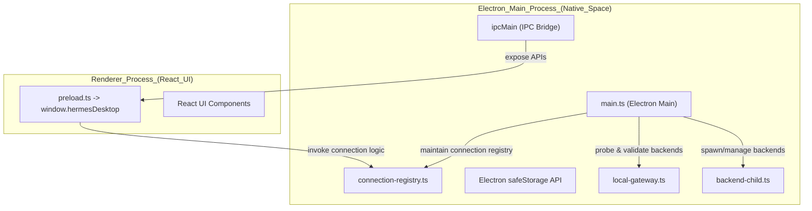
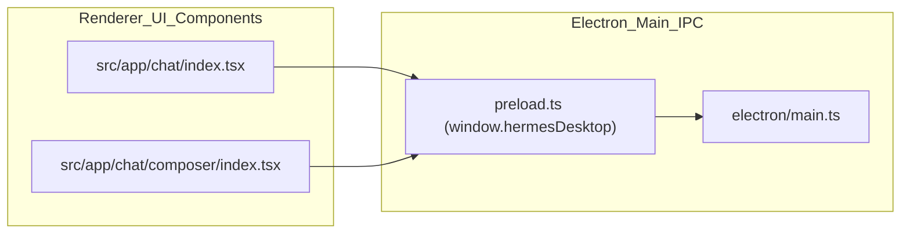

# Desktop App

Relevant source files

The following files were used as context for generating this wiki page:

- [apps/desktop/electron/connection-registry.test.ts](apps/desktop/electron/connection-registry.test.ts)
- [apps/desktop/electron/connection-registry.ts](apps/desktop/electron/connection-registry.ts)
- [apps/desktop/electron/hud-cursor.test.ts](apps/desktop/electron/hud-cursor.test.ts)
- [apps/desktop/electron/hud-cursor.ts](apps/desktop/electron/hud-cursor.ts)
- [apps/desktop/electron/hud-ipc.ts](apps/desktop/electron/hud-ipc.ts)
- [apps/desktop/electron/main.ts](apps/desktop/electron/main.ts)
- [apps/desktop/electron/preload.ts](apps/desktop/electron/preload.ts)
- [apps/desktop/src/app/chat/composer/index.tsx](apps/desktop/src/app/chat/composer/index.tsx)
- [apps/desktop/src/app/chat/composer/types.ts](apps/desktop/src/app/chat/composer/types.ts)
- [apps/desktop/src/app/chat/index.tsx](apps/desktop/src/app/chat/index.tsx)
- [apps/desktop/src/app/chat/sidebar/gateway-group-model.test.ts](apps/desktop/src/app/chat/sidebar/gateway-group-model.test.ts)
- [apps/desktop/src/app/chat/sidebar/gateway-group-model.ts](apps/desktop/src/app/chat/sidebar/gateway-group-model.ts)
- [apps/desktop/src/app/chat/sidebar/gateway-group-preferences.test.ts](apps/desktop/src/app/chat/sidebar/gateway-group-preferences.test.ts)
- [apps/desktop/src/app/chat/sidebar/gateway-group-preferences.ts](apps/desktop/src/app/chat/sidebar/gateway-group-preferences.ts)
- [apps/desktop/src/app/chat/sidebar/gateway-groups-drag.test.tsx](apps/desktop/src/app/chat/sidebar/gateway-groups-drag.test.tsx)
- [apps/desktop/src/app/chat/sidebar/gateway-groups.test.tsx](apps/desktop/src/app/chat/sidebar/gateway-groups.test.tsx)
- [apps/desktop/src/app/chat/sidebar/gateway-groups.tsx](apps/desktop/src/app/chat/sidebar/gateway-groups.tsx)
- [apps/desktop/src/app/chat/sidebar/reorderable-list.tsx](apps/desktop/src/app/chat/sidebar/reorderable-list.tsx)
- [apps/desktop/src/app/chat/sidebar/session-row-rename-drag.test.tsx](apps/desktop/src/app/chat/sidebar/session-row-rename-drag.test.tsx)
- [apps/desktop/src/app/contrib/latest-actions.test.ts](apps/desktop/src/app/contrib/latest-actions.test.ts)
- [apps/desktop/src/app/contrib/latest-actions.ts](apps/desktop/src/app/contrib/latest-actions.ts)
- [apps/desktop/src/app/contrib/surfaces.test.tsx](apps/desktop/src/app/contrib/surfaces.test.tsx)
- [apps/desktop/src/app/contrib/surfaces.tsx](apps/desktop/src/app/contrib/surfaces.tsx)
- [apps/desktop/src/app/contrib/types.ts](apps/desktop/src/app/contrib/types.ts)
- [apps/desktop/src/app/hud/click-through.test.ts](apps/desktop/src/app/hud/click-through.test.ts)
- [apps/desktop/src/app/hud/click-through.ts](apps/desktop/src/app/hud/click-through.ts)
- [apps/desktop/src/app/hud/composer-drag.test.ts](apps/desktop/src/app/hud/composer-drag.test.ts)
- [apps/desktop/src/app/hud/composer-drag.ts](apps/desktop/src/app/hud/composer-drag.ts)
- [apps/desktop/src/app/hud/glass.test.tsx](apps/desktop/src/app/hud/glass.test.tsx)
- [apps/desktop/src/app/hud/glass.ts](apps/desktop/src/app/hud/glass.ts)
- [apps/desktop/src/app/hud/hud-shell.tsx](apps/desktop/src/app/hud/hud-shell.tsx)
- [apps/desktop/src/app/hud/resize-handle.test.ts](apps/desktop/src/app/hud/resize-handle.test.ts)
- [apps/desktop/src/app/hud/resize-handle.ts](apps/desktop/src/app/hud/resize-handle.ts)
- [apps/desktop/src/app/hud/transcript-band.test.tsx](apps/desktop/src/app/hud/transcript-band.test.tsx)
- [apps/desktop/src/app/hud/transcript-band.ts](apps/desktop/src/app/hud/transcript-band.ts)
- [apps/desktop/src/app/settings/connections-registry.test.tsx](apps/desktop/src/app/settings/connections-registry.test.tsx)
- [apps/desktop/src/app/settings/connections-registry.tsx](apps/desktop/src/app/settings/connections-registry.tsx)
- [apps/desktop/src/global.d.ts](apps/desktop/src/global.d.ts)
- [apps/desktop/src/i18n/ar.ts](apps/desktop/src/i18n/ar.ts)
- [apps/desktop/src/i18n/de.ts](apps/desktop/src/i18n/de.ts)
- [apps/desktop/src/i18n/en.ts](apps/desktop/src/i18n/en.ts)
- [apps/desktop/src/i18n/es.ts](apps/desktop/src/i18n/es.ts)
- [apps/desktop/src/i18n/fr.ts](apps/desktop/src/i18n/fr.ts)
- [apps/desktop/src/i18n/ja.ts](apps/desktop/src/i18n/ja.ts)
- [apps/desktop/src/i18n/ru.ts](apps/desktop/src/i18n/ru.ts)
- [apps/desktop/src/i18n/types.ts](apps/desktop/src/i18n/types.ts)
- [apps/desktop/src/i18n/zh-hant.ts](apps/desktop/src/i18n/zh-hant.ts)
- [apps/desktop/src/i18n/zh.ts](apps/desktop/src/i18n/zh.ts)
- [apps/desktop/src/lib/platform.ts](apps/desktop/src/lib/platform.ts)
- [apps/desktop/src/styles.css](apps/desktop/src/styles.css)
- [locales/_keys.desktop.json](locales/_keys.desktop.json)
- [website/docs/user-guide/desktop.md](website/docs/user-guide/desktop.md)
- [website/docs/user-guide/multi-connection-desktop.md](website/docs/user-guide/multi-connection-desktop.md)

The Hermes Desktop application is a native, cross-platform shell built on Electron that provides a high-performance graphical interface for the Hermes Agent core. It unifies the same agent that powers the CLI and gateway, sharing configuration, sessions, skills, and model interactions. The desktop app manages backend lifecycle, multi-profile connections, secure token storage, rich UI rendering, and system integration deep within the Electron environment [website/docs/user-guide/desktop.md:3-11]().

This page offers a high-level overview of the Desktop App’s architecture, gateway connection model, profile management, and bootstrapping via installers. Detailed explanations of the Electron main process, React frontend, and windowing surfaces are provided in respective child pages:

- [Electron Shell and Gateway Connection](#12.1)
- [Desktop UI Components](#12.2)
- [HUD, Panes, and Window Management](#12.3)

---

## System Architecture

Hermes Desktop cleanly separates platform-native processes from the renderer UI to maintain security, performance, and modularity [apps/desktop/electron/preload.ts:1-34]().

### Process Model and Responsibilities

| Process / Component           | Role                                                                                                               | Key Code Entities and Locations                        |
|------------------------------|--------------------------------------------------------------------------------------------------------------------|--------------------------------------------------------|
| **Electron Main Process**     | Native shell integration: manages gateway backend lifecycle (local/remote/ssh/cloud), connection registry, secure token storage, WebSocket health probes, OAuth network hooks, desktop updates, and plugin SDK support. | `apps/desktop/electron/main.ts:1-42`()  |
| **Renderer Process (React UI)**| Hosts React frontend: chat UI, session management, command palette, profile switching, and gateway wiring. Communicates with main process via IPC bridge exposed in preload. | `apps/desktop/electron/preload.ts:28-124](), `apps/desktop/src/global.d.ts:33-135`() |
| **Bootstrap Installer**       | Lightweight native bootstrap installer for first-time installs and dependency provisioning before launching Hermes Desktop native shell. | `apps/desktop/electron/main.ts:110-118`()      |

### Desktop App Architecture Diagram

This architecture ensures secure bridging of UI and native backend lifecycles and supports sophisticated multi-profile and multi-backend scenarios.

Sources: [apps/desktop/electron/main.ts:1-42](), [apps/desktop/electron/preload.ts:28-124]()

---

## Core Functional Areas

### 1. Electron Shell and Gateway Connection

The Electron main process is the desktop application's native core that manages:

- **Backend Child Processes:** Spawning and monitoring Hermes agent gateway backends locally or handling remote backend connections transparently [apps/desktop/electron/main.ts:1-67]().
- **Multi-Connection Registry:** Tracks multiple backend profiles—local, remote HTTP(S), SSH, or cloud-hosted—with distinct authentication and routing [apps/desktop/electron/main.ts:140-192]().
- **Gateway WebSocket Probe:** Implements health checks on backend gateway availability and authentication status to maintain connectivity and react to failures early [apps/desktop/electron/main.ts:150-185]().
- **Secure Token Storage:** Uses Electron’s `safeStorage` API to encrypt and store credentials locally [apps/desktop/electron/main.ts:37]().
- **IPC Bridge and API Exposure:** Exposes a set of IPC methods bridged through the Electron preload script (`window.hermesDesktop`) to allow renderer processes to request backend connections, revalidate state, and manage session windows [apps/desktop/electron/preload.ts:28-72]().

For detailed implementation, refer to [Electron Shell and Gateway Connection](#12.1).

Sources: [apps/desktop/electron/main.ts:1-67](), [apps/desktop/electron/preload.ts:28-72]()

---

### 2. Desktop UI Components and Profile Management

The renderer hosts the React-based user interface, providing a modern chat-centric experience:

- **Chat Composer and Rich Editor:** Featuring streaming AI responses, structured real-time tool outputs, Markdown-compatible editing, and drag/drop attachments [website/docs/user-guide/desktop.md:43-56]().
- **Session Sidebar and Action Hooks:** Allows managing concurrent conversations and interacting via prompts and commands.
- **Profile Switcher:** Logical abstraction encapsulating backend gateway connections, isolating backend URLs, authentication tokens, and routing preferences [apps/desktop/src/global.d.ts:33-50]().
- **Localization and i18n:** Fully supported across multiple languages using structural dictionaries under `apps/desktop/src/i18n/` [apps/desktop/src/i18n/types.ts:1-35]().

For comprehensive coverage of React components, profile workflows, and UI hooks, see [Desktop UI Components](#12.2).

Sources: [apps/desktop/src/global.d.ts:33-50](), [apps/desktop/src/i18n/types.ts:1-35](), [website/docs/user-guide/desktop.md:43-56]()

---

### 3. HUD, Panes, and Window Management

Hermes Desktop supports advanced windowing on multiple operating systems with features including:

- **Chrome-less HUD Shell:** Floating translucent chat windows with platform-native glass effects [apps/desktop/electron/preload.ts:123-130]().
- **Quick Entry Overlay:** Lightweight global hotkey invoked prompt input accessible above other applications [apps/desktop/src/global.d.ts:23-27]().
- **Pet Overlay:** An animated desktop mascot capable of drag, focus management, and state updates [apps/desktop/electron/preload.ts:92-119]().
- **Pop-Out Browser Windows:** Enables detaching chat-preview tabs as independent native OS windows with bidirectional state syncing [apps/desktop/electron/preload.ts:96-108]().

See [HUD, Panes, and Window Management](#12.3) for a full technical treatment.

Sources: [apps/desktop/electron/preload.ts:92-130](), [apps/desktop/src/global.d.ts:23-27]()

---

## UI Component to Code Entity Mapping

This diagram bridges natural language UI concepts to concrete code entities and Electron IPC layers:

- React UI components invoke methods exposed on `window.hermesDesktop` via IPC.
- The Electron main process handles backend lifecycle and connection routing.

Sources: [apps/desktop/electron/preload.ts:28-72](), [apps/desktop/electron/main.ts:1-42]()

---

## References and Further Reading

- Detailed Electron main process integration and gateway connection management: [Electron Shell and Gateway Connection](#12.1)
- React UI architecture and state management: [Desktop UI Components](#12.2)
- Windowing, overlays, HUD, and pane engine internals: [HUD, Panes, and Window Management](#12.3)
- Localization messages live under `apps/desktop/src/i18n/` covering multiple languages [apps/desktop/src/i18n/types.ts:1-35]()

---

Sources:  
[apps/desktop/electron/main.ts:1-42](),  
[apps/desktop/electron/preload.ts:28-124](),  
[apps/desktop/src/global.d.ts:33-135](),  
[apps/desktop/src/i18n/types.ts:1-35](),  
[website/docs/user-guide/desktop.md:3-11]()