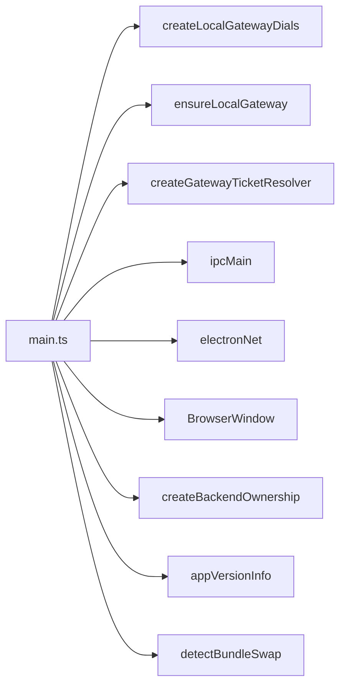
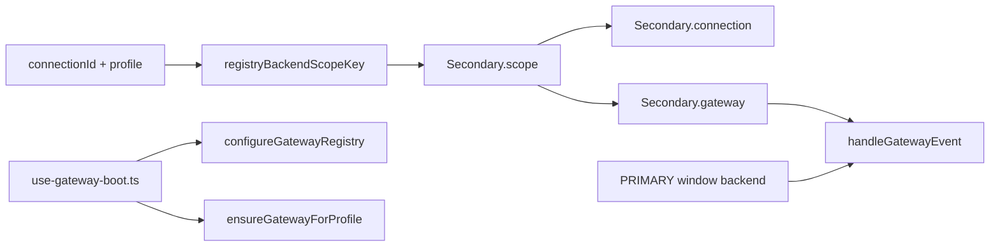
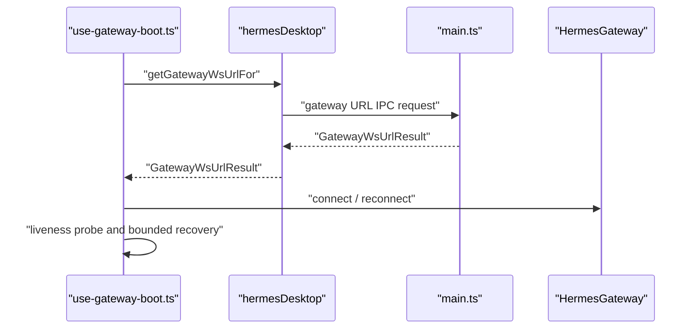
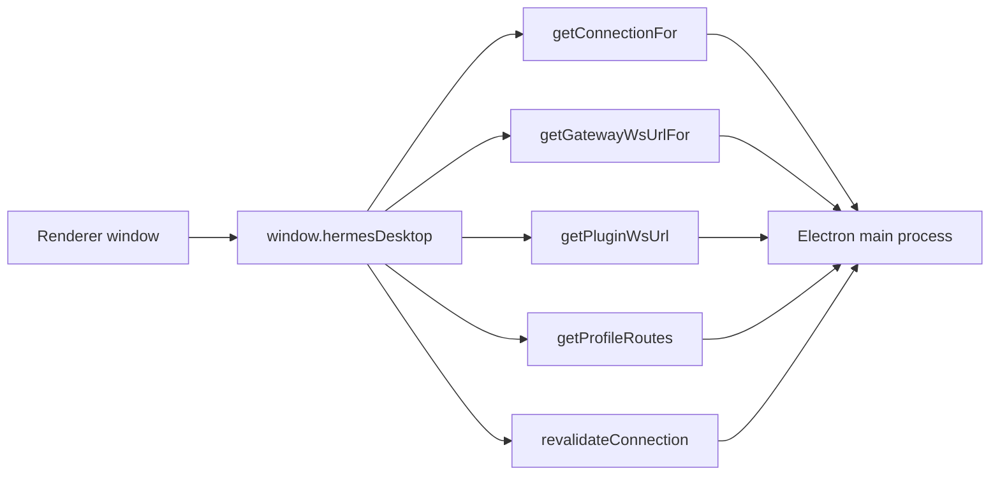
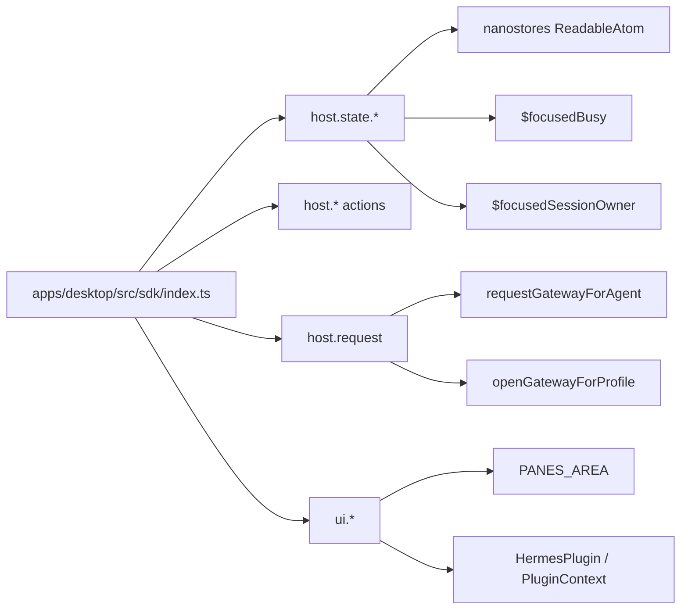

# Electron Shell and Gateway Connection

Relevant source files

The following files were used as context for generating this wiki page:

- [apps/desktop/e2e/peer-device-reset.spec.ts](apps/desktop/e2e/peer-device-reset.spec.ts)
- [apps/desktop/electron/bundle-skew.test.ts](apps/desktop/electron/bundle-skew.test.ts)
- [apps/desktop/electron/bundle-skew.ts](apps/desktop/electron/bundle-skew.ts)
- [apps/desktop/electron/connection-registry.test.ts](apps/desktop/electron/connection-registry.test.ts)
- [apps/desktop/electron/connection-registry.ts](apps/desktop/electron/connection-registry.ts)
- [apps/desktop/electron/desktop-plugin-install.test.ts](apps/desktop/electron/desktop-plugin-install.test.ts)
- [apps/desktop/electron/desktop-plugin-install.ts](apps/desktop/electron/desktop-plugin-install.ts)
- [apps/desktop/electron/desktop-plugins-root.test.ts](apps/desktop/electron/desktop-plugins-root.test.ts)
- [apps/desktop/electron/desktop-plugins-root.ts](apps/desktop/electron/desktop-plugins-root.ts)
- [apps/desktop/electron/local-gateway-deadline.test.ts](apps/desktop/electron/local-gateway-deadline.test.ts)
- [apps/desktop/electron/local-gateway-python-bundled.test.ts](apps/desktop/electron/local-gateway-python-bundled.test.ts)
- [apps/desktop/electron/local-gateway-python-launcher-argv.test.ts](apps/desktop/electron/local-gateway-python-launcher-argv.test.ts)
- [apps/desktop/electron/local-gateway-python-runtime.test.ts](apps/desktop/electron/local-gateway-python-runtime.test.ts)
- [apps/desktop/electron/local-gateway-python.test.ts](apps/desktop/electron/local-gateway-python.test.ts)
- [apps/desktop/electron/local-gateway-python.ts](apps/desktop/electron/local-gateway-python.ts)
- [apps/desktop/electron/local-gateway-unsafe-path.test.ts](apps/desktop/electron/local-gateway-unsafe-path.test.ts)
- [apps/desktop/electron/local-gateway.test-helpers.ts](apps/desktop/electron/local-gateway.test-helpers.ts)
- [apps/desktop/electron/local-gateway.test.ts](apps/desktop/electron/local-gateway.test.ts)
- [apps/desktop/electron/local-gateway.ts](apps/desktop/electron/local-gateway.ts)
- [apps/desktop/electron/main.ts](apps/desktop/electron/main.ts)
- [apps/desktop/electron/no-console-git.test.ts](apps/desktop/electron/no-console-git.test.ts)
- [apps/desktop/electron/no-console-git.ts](apps/desktop/electron/no-console-git.ts)
- [apps/desktop/electron/plugin-profile-routes.test.ts](apps/desktop/electron/plugin-profile-routes.test.ts)
- [apps/desktop/electron/plugin-profile-routes.ts](apps/desktop/electron/plugin-profile-routes.ts)
- [apps/desktop/electron/preload.ts](apps/desktop/electron/preload.ts)
- [apps/desktop/scripts/desktop-update-ui.test.mjs](apps/desktop/scripts/desktop-update-ui.test.mjs)
- [apps/desktop/src/api/canonical-ambiguous-owner-reconcile.test.ts](apps/desktop/src/api/canonical-ambiguous-owner-reconcile.test.ts)
- [apps/desktop/src/api/canonical-attach-snapshot.test.ts](apps/desktop/src/api/canonical-attach-snapshot.test.ts)
- [apps/desktop/src/api/canonical-create-options.test.ts](apps/desktop/src/api/canonical-create-options.test.ts)
- [apps/desktop/src/api/canonical-model-confirm.test.tsx](apps/desktop/src/api/canonical-model-confirm.test.tsx)
- [apps/desktop/src/api/canonical-profile-route.test.ts](apps/desktop/src/api/canonical-profile-route.test.ts)
- [apps/desktop/src/api/canonical-protocol.test.ts](apps/desktop/src/api/canonical-protocol.test.ts)
- [apps/desktop/src/api/canonical-protocol.ts](apps/desktop/src/api/canonical-protocol.ts)
- [apps/desktop/src/api/canonical-retained-mutation-stale.test.ts](apps/desktop/src/api/canonical-retained-mutation-stale.test.ts)
- [apps/desktop/src/api/canonical-rewind-lost-reply.test.ts](apps/desktop/src/api/canonical-rewind-lost-reply.test.ts)
- [apps/desktop/src/api/client.ts](apps/desktop/src/api/client.ts)
- [apps/desktop/src/app/capabilities/plugins/plugin-packages.test.ts](apps/desktop/src/app/capabilities/plugins/plugin-packages.test.ts)
- [apps/desktop/src/app/capabilities/plugins/plugin-packages.ts](apps/desktop/src/app/capabilities/plugins/plugin-packages.ts)
- [apps/desktop/src/app/gateway/hooks/use-gateway-boot.test.tsx](apps/desktop/src/app/gateway/hooks/use-gateway-boot.test.tsx)
- [apps/desktop/src/app/gateway/hooks/use-gateway-boot.ts](apps/desktop/src/app/gateway/hooks/use-gateway-boot.ts)
- [apps/desktop/src/app/gateway/hooks/use-gateway-request.test.ts](apps/desktop/src/app/gateway/hooks/use-gateway-request.test.ts)
- [apps/desktop/src/app/gateway/hooks/use-gateway-request.ts](apps/desktop/src/app/gateway/hooks/use-gateway-request.ts)
- [apps/desktop/src/app/profiles/create-profile-dialog.test.tsx](apps/desktop/src/app/profiles/create-profile-dialog.test.tsx)
- [apps/desktop/src/app/session/hooks/use-busy-input-mode.test.tsx](apps/desktop/src/app/session/hooks/use-busy-input-mode.test.tsx)
- [apps/desktop/src/app/session/hooks/use-busy-input-mode.ts](apps/desktop/src/app/session/hooks/use-busy-input-mode.ts)
- [apps/desktop/src/app/session/hooks/use-prompt-actions/slash-session-commands.test.tsx](apps/desktop/src/app/session/hooks/use-prompt-actions/slash-session-commands.test.tsx)
- [apps/desktop/src/app/session/hooks/use-prompt-actions/slash-session-commands.ts](apps/desktop/src/app/session/hooks/use-prompt-actions/slash-session-commands.ts)
- [apps/desktop/src/app/session/hooks/use-session-actions/ambient-local-owner.test.tsx](apps/desktop/src/app/session/hooks/use-session-actions/ambient-local-owner.test.tsx)
- [apps/desktop/src/app/session/hooks/use-session-list-actions.test.tsx](apps/desktop/src/app/session/hooks/use-session-list-actions.test.tsx)
- [apps/desktop/src/app/session/hooks/use-session-list-actions.ts](apps/desktop/src/app/session/hooks/use-session-list-actions.ts)
- [apps/desktop/src/app/settings/connections-registry.test.tsx](apps/desktop/src/app/settings/connections-registry.test.tsx)
- [apps/desktop/src/app/settings/connections-registry.tsx](apps/desktop/src/app/settings/connections-registry.tsx)
- [apps/desktop/src/app/shell/hooks/use-statusbar-items.test.tsx](apps/desktop/src/app/shell/hooks/use-statusbar-items.test.tsx)
- [apps/desktop/src/app/shell/hooks/use-statusbar-items.tsx](apps/desktop/src/app/shell/hooks/use-statusbar-items.tsx)
- [apps/desktop/src/app/shell/statusbar-controls.tsx](apps/desktop/src/app/shell/statusbar-controls.tsx)
- [apps/desktop/src/app/shell/statusbar-visibility.test.tsx](apps/desktop/src/app/shell/statusbar-visibility.test.tsx)
- [apps/desktop/src/app/updates-overlay.tsx](apps/desktop/src/app/updates-overlay.tsx)
- [apps/desktop/src/components/ui/sandboxed-frame.test.tsx](apps/desktop/src/components/ui/sandboxed-frame.test.tsx)
- [apps/desktop/src/components/ui/sandboxed-frame.tsx](apps/desktop/src/components/ui/sandboxed-frame.tsx)
- [apps/desktop/src/components/update-status.test.tsx](apps/desktop/src/components/update-status.test.tsx)
- [apps/desktop/src/components/update-status.tsx](apps/desktop/src/components/update-status.tsx)
- [apps/desktop/src/contrib/plugin.test.ts](apps/desktop/src/contrib/plugin.test.ts)
- [apps/desktop/src/contrib/plugin.ts](apps/desktop/src/contrib/plugin.ts)
- [apps/desktop/src/contrib/plugins-store.ts](apps/desktop/src/contrib/plugins-store.ts)
- [apps/desktop/src/contrib/plugins.ts](apps/desktop/src/contrib/plugins.ts)
- [apps/desktop/src/contrib/runtime-loader.test.ts](apps/desktop/src/contrib/runtime-loader.test.ts)
- [apps/desktop/src/contrib/runtime-loader.ts](apps/desktop/src/contrib/runtime-loader.ts)
- [apps/desktop/src/global.d.ts](apps/desktop/src/global.d.ts)
- [apps/desktop/src/hermes.test.ts](apps/desktop/src/hermes.test.ts)
- [apps/desktop/src/i18n/ar.ts](apps/desktop/src/i18n/ar.ts)
- [apps/desktop/src/i18n/de.ts](apps/desktop/src/i18n/de.ts)
- [apps/desktop/src/i18n/en.ts](apps/desktop/src/i18n/en.ts)
- [apps/desktop/src/i18n/es.ts](apps/desktop/src/i18n/es.ts)
- [apps/desktop/src/i18n/fr.ts](apps/desktop/src/i18n/fr.ts)
- [apps/desktop/src/i18n/ja.ts](apps/desktop/src/i18n/ja.ts)
- [apps/desktop/src/i18n/ru.ts](apps/desktop/src/i18n/ru.ts)
- [apps/desktop/src/i18n/types.ts](apps/desktop/src/i18n/types.ts)
- [apps/desktop/src/i18n/zh-hant.ts](apps/desktop/src/i18n/zh-hant.ts)
- [apps/desktop/src/i18n/zh.ts](apps/desktop/src/i18n/zh.ts)
- [apps/desktop/src/lib/gateway-ws-url.test.ts](apps/desktop/src/lib/gateway-ws-url.test.ts)
- [apps/desktop/src/lib/gateway-ws-url.ts](apps/desktop/src/lib/gateway-ws-url.ts)
- [apps/desktop/src/lib/statusbar.test.ts](apps/desktop/src/lib/statusbar.test.ts)
- [apps/desktop/src/lib/with-timeout.test.ts](apps/desktop/src/lib/with-timeout.test.ts)
- [apps/desktop/src/lib/with-timeout.ts](apps/desktop/src/lib/with-timeout.ts)
- [apps/desktop/src/plugins/hermes-bots/reclaim-refresh-in-place.test.ts](apps/desktop/src/plugins/hermes-bots/reclaim-refresh-in-place.test.ts)
- [apps/desktop/src/sdk/bridge.test.ts](apps/desktop/src/sdk/bridge.test.ts)
- [apps/desktop/src/sdk/bridge.ts](apps/desktop/src/sdk/bridge.ts)
- [apps/desktop/src/sdk/host-state.test.ts](apps/desktop/src/sdk/host-state.test.ts)
- [apps/desktop/src/sdk/index.test.ts](apps/desktop/src/sdk/index.test.ts)
- [apps/desktop/src/sdk/index.ts](apps/desktop/src/sdk/index.ts)
- [apps/desktop/src/sdk/open-session-refresh-in-place.test.ts](apps/desktop/src/sdk/open-session-refresh-in-place.test.ts)
- [apps/desktop/src/sdk/profile-routing.test.ts](apps/desktop/src/sdk/profile-routing.test.ts)
- [apps/desktop/src/store/connection-registry-state.ts](apps/desktop/src/store/connection-registry-state.ts)
- [apps/desktop/src/store/connections-new-chat-route.test.ts](apps/desktop/src/store/connections-new-chat-route.test.ts)
- [apps/desktop/src/store/connections.test.ts](apps/desktop/src/store/connections.test.ts)
- [apps/desktop/src/store/connections.ts](apps/desktop/src/store/connections.ts)
- [apps/desktop/src/store/gateway-activation-prune-lease.test.ts](apps/desktop/src/store/gateway-activation-prune-lease.test.ts)
- [apps/desktop/src/store/gateway-connection-lifecycle.test.ts](apps/desktop/src/store/gateway-connection-lifecycle.test.ts)
- [apps/desktop/src/store/gateway-connection-scope.test.ts](apps/desktop/src/store/gateway-connection-scope.test.ts)
- [apps/desktop/src/store/gateway-foreground-retention.test.ts](apps/desktop/src/store/gateway-foreground-retention.test.ts)
- [apps/desktop/src/store/gateway-profile-request.test.ts](apps/desktop/src/store/gateway-profile-request.test.ts)
- [apps/desktop/src/store/gateway-secondary-open-check.test.ts](apps/desktop/src/store/gateway-secondary-open-check.test.ts)
- [apps/desktop/src/store/gateway-shared-remote.test.ts](apps/desktop/src/store/gateway-shared-remote.test.ts)
- [apps/desktop/src/store/gateway-switch.test.ts](apps/desktop/src/store/gateway-switch.test.ts)
- [apps/desktop/src/store/gateway-switch.ts](apps/desktop/src/store/gateway-switch.ts)
- [apps/desktop/src/store/gateway.test.ts](apps/desktop/src/store/gateway.test.ts)
- [apps/desktop/src/store/gateway.ts](apps/desktop/src/store/gateway.ts)
- [apps/desktop/src/store/kanban-connection-scope.test.ts](apps/desktop/src/store/kanban-connection-scope.test.ts)
- [apps/desktop/src/store/profile-agent-activation.test.ts](apps/desktop/src/store/profile-agent-activation.test.ts)
- [apps/desktop/src/store/profile-select-source.test.ts](apps/desktop/src/store/profile-select-source.test.ts)
- [apps/desktop/src/store/profile.test.ts](apps/desktop/src/store/profile.test.ts)
- [apps/desktop/src/store/profile.ts](apps/desktop/src/store/profile.ts)
- [apps/desktop/src/store/projects-connection-tag.test.ts](apps/desktop/src/store/projects-connection-tag.test.ts)
- [apps/desktop/src/store/projects.test.ts](apps/desktop/src/store/projects.test.ts)
- [apps/desktop/src/store/projects.ts](apps/desktop/src/store/projects.ts)
- [apps/desktop/src/store/session-owner-resolution.test.ts](apps/desktop/src/store/session-owner-resolution.test.ts)
- [apps/desktop/src/store/session-owner-resolution.ts](apps/desktop/src/store/session-owner-resolution.ts)
- [apps/desktop/src/store/session-states-foreground-scopes.test.ts](apps/desktop/src/store/session-states-foreground-scopes.test.ts)
- [apps/desktop/src/store/session-states-reconnect.test.ts](apps/desktop/src/store/session-states-reconnect.test.ts)
- [apps/desktop/src/store/statusbar-prefs.test.ts](apps/desktop/src/store/statusbar-prefs.test.ts)
- [apps/desktop/src/store/statusbar-prefs.ts](apps/desktop/src/store/statusbar-prefs.ts)
- [apps/desktop/src/store/updates-backend-check.test.ts](apps/desktop/src/store/updates-backend-check.test.ts)
- [apps/desktop/src/store/updates.test.ts](apps/desktop/src/store/updates.test.ts)
- [apps/desktop/src/store/updates.ts](apps/desktop/src/store/updates.ts)
- [apps/shared/src/websocket-url.ts](apps/shared/src/websocket-url.ts)
- [contributors/emails/yl.tilly.everhome@gmail.com](contributors/emails/yl.tilly.everhome@gmail.com)
- [gateway/runtime_bootstrap.py](gateway/runtime_bootstrap.py)
- [hermes_cli/dashboard_auth/native_http.py](hermes_cli/dashboard_auth/native_http.py)
- [hermes_cli/gitlock.py](hermes_cli/gitlock.py)
- [hermes_cli/plugins_cmd_capabilities.py](hermes_cli/plugins_cmd_capabilities.py)
- [hermes_cli/source_check.py](hermes_cli/source_check.py)
- [hermes_cli/update_cmd_check.py](hermes_cli/update_cmd_check.py)
- [hermes_cli/update_downgrade_guard.py](hermes_cli/update_downgrade_guard.py)
- [hermes_cli/update_serve_resume.py](hermes_cli/update_serve_resume.py)
- [hermes_cli/web_routers/_common.py](hermes_cli/web_routers/_common.py)
- [hermes_cli/web_routers/actions.py](hermes_cli/web_routers/actions.py)
- [hermes_cli/web_routers/analytics.py](hermes_cli/web_routers/analytics.py)
- [hermes_cli/web_routers/audio.py](hermes_cli/web_routers/audio.py)
- [hermes_cli/web_routers/config_env.py](hermes_cli/web_routers/config_env.py)
- [hermes_cli/web_routers/memory_providers.py](hermes_cli/web_routers/memory_providers.py)
- [hermes_cli/web_routers/oauth.py](hermes_cli/web_routers/oauth.py)
- [locales/_keys.desktop.json](locales/_keys.desktop.json)
- [scripts/desktop-update/marker-claim.ps1](scripts/desktop-update/marker-claim.ps1)
- [scripts/desktop-update/marker.ps1](scripts/desktop-update/marker.ps1)
- [scripts/desktop-update/marker.sh](scripts/desktop-update/marker.sh)
- [scripts/desktop-update/posix.sh](scripts/desktop-update/posix.sh)
- [scripts/desktop-update/repro.sh](scripts/desktop-update/repro.sh)
- [scripts/desktop-update/serve-ui.py](scripts/desktop-update/serve-ui.py)
- [scripts/desktop-update/ui.html](scripts/desktop-update/ui.html)
- [scripts/desktop-update/update-job.ps1](scripts/desktop-update/update-job.ps1)
- [scripts/desktop-update/windows.ps1](scripts/desktop-update/windows.ps1)
- [skills/autonomous-ai-agents/hermes-agent/references/desktop-plugins.md](skills/autonomous-ai-agents/hermes-agent/references/desktop-plugins.md)
- [skills/productivity/google-workspace/references/daily-brief.md](skills/productivity/google-workspace/references/daily-brief.md)
- [tests/acp_adapter/test_gateway_tool_projection.py](tests/acp_adapter/test_gateway_tool_projection.py)
- [tests/fixtures/legacy_desktop/update-marker-be3fd671.mts](tests/fixtures/legacy_desktop/update-marker-be3fd671.mts)
- [tests/gateway/test_native_config_owner_scope.py](tests/gateway/test_native_config_owner_scope.py)
- [tests/gateway/test_native_profile_registry_grant.py](tests/gateway/test_native_profile_registry_grant.py)
- [tests/gateway/test_session_busy_compression_refusal.py](tests/gateway/test_session_busy_compression_refusal.py)
- [tests/gateway/test_session_create_tier_cwd.py](tests/gateway/test_session_create_tier_cwd.py)
- [tests/hermes_cli/test_desktop_swap_crash_recovery.py](tests/hermes_cli/test_desktop_swap_crash_recovery.py)
- [tests/hermes_cli/test_gitlock.py](tests/hermes_cli/test_gitlock.py)
- [tests/hermes_cli/test_gitlock_tmp_packs.py](tests/hermes_cli/test_gitlock_tmp_packs.py)
- [tests/hermes_cli/test_models_analytics_dedup.py](tests/hermes_cli/test_models_analytics_dedup.py)
- [tests/hermes_cli/test_shallow_boundary_repair.py](tests/hermes_cli/test_shallow_boundary_repair.py)
- [tests/hermes_cli/test_shallow_graft_prune.py](tests/hermes_cli/test_shallow_graft_prune.py)
- [tests/hermes_cli/test_source_check.py](tests/hermes_cli/test_source_check.py)
- [tests/hermes_cli/test_tag_fetch_partial_clone.py](tests/hermes_cli/test_tag_fetch_partial_clone.py)
- [tests/hermes_cli/test_update_downgrade_guard.py](tests/hermes_cli/test_update_downgrade_guard.py)
- [tests/hermes_cli/test_update_shallow_heal.py](tests/hermes_cli/test_update_shallow_heal.py)
- [tests/hermes_cli/test_web_analytics_corrupt_store.py](tests/hermes_cli/test_web_analytics_corrupt_store.py)
- [tests/hermes_cli/test_web_oauth_dispatch.py](tests/hermes_cli/test_web_oauth_dispatch.py)
- [tests/hermes_cli/test_web_server_speak_stream.py](tests/hermes_cli/test_web_server_speak_stream.py)
- [tests/scripts/desktop_update/legacy_desktop_reader.py](tests/scripts/desktop_update/legacy_desktop_reader.py)
- [tests/scripts/desktop_update/lineage_rule_cases.py](tests/scripts/desktop_update/lineage_rule_cases.py)
- [tests/scripts/desktop_update/test_desktop_update_gateway_flag.py](tests/scripts/desktop_update/test_desktop_update_gateway_flag.py)
- [tests/scripts/desktop_update/test_desktop_update_posix_handoff_protocol.py](tests/scripts/desktop_update/test_desktop_update_posix_handoff_protocol.py)
- [tests/scripts/desktop_update/test_desktop_update_posix_marker.py](tests/scripts/desktop_update/test_desktop_update_posix_marker.py)
- [tests/scripts/desktop_update/test_desktop_update_posix_marker_corpus.py](tests/scripts/desktop_update/test_desktop_update_posix_marker_corpus.py)
- [tests/scripts/desktop_update/test_desktop_update_windows_commit_outcome.py](tests/scripts/desktop_update/test_desktop_update_windows_commit_outcome.py)
- [tests/scripts/desktop_update/test_desktop_update_windows_handoff_lineage.py](tests/scripts/desktop_update/test_desktop_update_windows_handoff_lineage.py)
- [tests/scripts/desktop_update/test_desktop_update_windows_marker.py](tests/scripts/desktop_update/test_desktop_update_windows_marker.py)
- [tests/scripts/desktop_update/test_desktop_update_windows_marker_lock.py](tests/scripts/desktop_update/test_desktop_update_windows_marker_lock.py)
- [tests/scripts/desktop_update/test_desktop_update_windows_marker_ops.py](tests/scripts/desktop_update/test_desktop_update_windows_marker_ops.py)
- [tests/scripts/desktop_update/test_handoff_delegate_publication.py](tests/scripts/desktop_update/test_handoff_delegate_publication.py)
- [tests/scripts/desktop_update/windows_handoff_support.py](tests/scripts/desktop_update/windows_handoff_support.py)
- [website/docs/developer-guide/desktop-plugin-sdk.md](website/docs/developer-guide/desktop-plugin-sdk.md)
- [website/docs/user-guide/skills/bundled/productivity/productivity-google-workspace.md](website/docs/user-guide/skills/bundled/productivity/productivity-google-workspace.md)

## Purpose and scope

This page documents the Electron desktop shell’s connection-facing architecture: the main-process responsibilities visible in the supplied source, the renderer’s multi-connection gateway registry, the preload IPC contract, and the plugin SDK surface. The supplied main-process excerpt shows its imports and initial setup, rather than the later implementations of IPC handlers, OAuth request handling, updater flows, or connection-registry operations. Those areas are described only to the extent supported by the available source. [apps/desktop/electron/main.ts:1-192]() [apps/desktop/src/global.d.ts:33-76]() [apps/desktop/src/store/gateway.ts:36-105]() [apps/desktop/src/sdk/index.ts:1-20]()

Sources: [apps/desktop/electron/main.ts:1-192]() [apps/desktop/src/global.d.ts:33-76]() [apps/desktop/src/store/gateway.ts:36-105]() [apps/desktop/src/sdk/index.ts:1-20]()

---

## 1. Electron Main Process and Lifecycle Management

### Responsibilities and implementation

`apps/desktop/electron/main.ts` is the Electron main-process module. Its imports show the range of native and backend concerns coordinated there: Electron app and window APIs, IPC, networking, system integration, local-gateway helpers, backend lifecycle utilities, connection configuration, and update-related modules. [apps/desktop/electron/main.ts:1-42]() [apps/desktop/electron/main.ts:45-87]() [apps/desktop/electron/main.ts:119-145]()

| Concern | Code entities visible in the main-process module |
|---|---|
| Local gateway setup and dialing | `createLocalGatewayDials`, `ensureLocalGateway`, `localGatewayDial`, `redialLocalGateway`, `runGatewayEnsure` [apps/desktop/electron/main.ts:3-9]() |
| Backend lifecycle and ownership | `stopBackendChildImpl`, `waitForBackendExit`, `createBackendOwnership`, `createBackendShutdownCoordinator` [apps/desktop/electron/main.ts:67-86]() |
| Connection routing and normalization | `buildGatewayWsUrl`, `connectionScopeKey`, `resolveProfileApiRequest`, `resolveProfileBackendRoute`, `normalizeSshConfig` [apps/desktop/electron/main.ts:147-180]() |
| Electron facilities | `app`, `BrowserWindow`, `net as electronNet`, `ipcMain`, `protocol`, `safeStorage`, and related APIs [apps/desktop/electron/main.ts:19-42]() |
| Update-related modules | `appVersionInfo`, `runAppInstallerChecker`, and bundle-swap helpers [apps/desktop/electron/main.ts:56-66]() [apps/desktop/electron/main.ts:119-125]() |

The excerpt shows `localGatewayDials` being created and configures a Python gateway ticket client with `createGatewayTicketResolver`. The resolver’s callback invokes `ensureRuntime(await resolveHermesBackend([]), () => undefined)` and uses `resolveHermesCwd` as the working-directory resolver. [apps/desktop/electron/main.ts:3-9]()

The imported `BrowserWindow`, `ipcMain`, and `electronNet` APIs establish that the main process is equipped to coordinate windows, IPC, and network operations. The available excerpt does not show the corresponding handler implementations, so it does not establish specific lifecycle sequences or security policies for those operations. [apps/desktop/electron/main.ts:19-42]()

Sources: [apps/desktop/electron/main.ts:1-9]() [apps/desktop/electron/main.ts:19-42]() [apps/desktop/electron/main.ts:45-87]() [apps/desktop/electron/main.ts:119-125]() [apps/desktop/electron/main.ts:147-180]()

### Main-process responsibilities mapped to code entities

**Diagram: Electron shell names mapped to imported main-process entities**

The diagram maps system-level responsibilities to identifiers in the main-process imports; it does not imply call order beyond the explicitly shown ticket-client initialization. [apps/desktop/electron/main.ts:1-9]() [apps/desktop/electron/main.ts:19-42]() [apps/desktop/electron/main.ts:56-87]() [apps/desktop/electron/main.ts:119-125]()

Sources: [apps/desktop/electron/main.ts:1-9]() [apps/desktop/electron/main.ts:19-42]() [apps/desktop/electron/main.ts:56-87]() [apps/desktop/electron/main.ts:119-125]()

---

## 2. Multi-Connection Registry (Local / Remote / SSH / Cloud)

### Connection model

The main-process imports expose connection-routing concepts including `connectionScopeKey`, `normalizeConnectionInput`, `normalizeRegistry`, `resolveProfileBackendRoute`, and `resolveProfileApiRequest`. They also include SSH normalization and cloud discovery helpers. These names indicate that connection identity and profile routing are handled as distinct concerns, but the supplied excerpt does not include the registry implementation or prove the details of its persistence and mutation behavior. [apps/desktop/electron/main.ts:132-180]() [apps/desktop/electron/main.ts:183-192]()

The renderer’s `store/gateway.ts` describes a registry that supports a primary gateway and secondary sockets. The primary is the window’s active backend; secondary connections are retained for profiles with live work. Registry configuration includes an optional `activeConnectionId` getter, connection-change callbacks, and scoped server-request handling. [apps/desktop/src/store/gateway.ts:36-45]() [apps/desktop/src/store/gateway.ts:59-83]()

A secondary gateway records a scope, profile, optional `connectionId`, `HermesConnection`, gateway object, connection state, request count, reconnect state, and liveness-probe failures. The source explicitly identifies the scope as derived from `registryBackendScopeKey(connectionId, profile)`. [apps/desktop/src/store/gateway.ts:107-141]()

| Connection category | Evidence in the supplied source |
|---|---|
| Local | Main-process imports include local-gateway dialing and ensure helpers; renderer registry comments describe a local/legacy path. [apps/desktop/electron/main.ts:3-9]() [apps/desktop/src/store/gateway.ts:107-115]() |
| Remote | Main-process connection helpers include remote URL normalization and remote-profile routing. The renderer declares connection-qualified scopes and connection revalidation APIs. [apps/desktop/electron/main.ts:147-180]() [apps/desktop/src/global.d.ts:42-75]() |
| SSH | Main-process imports include `normalizeSshConfig`, SSH profile helpers, and SSH boot-failure classifiers. [apps/desktop/electron/main.ts:90-101]() [apps/desktop/electron/main.ts:147-180]() |
| Cloud | Main-process imports include `shouldAttemptCloudBootCascade`, `discoverWithTeamFallback`, and `createCloudSessionRecovery`. [apps/desktop/electron/main.ts:132-134]() |

### Registry routing and renderer ownership

The renderer registry is designed for concurrent profile activity: each active secondary socket can feed the shared gateway event handler, while the primary socket continues to own the window’s main backend route. The source calls out that events are session-keyed and that secondary sockets allow background sessions to continue streaming. [apps/desktop/src/store/gateway.ts:36-45]()

`use-gateway-boot.ts` imports the registry lifecycle functions, including `configureGatewayRegistry`, `ensureGatewayForProfile`, `disposeSecondariesForConnection`, `pruneSecondaryGateways`, and `reconnectSecondaryGateways`. This hook is the renderer-side integration point visible in the supplied code for boot and reconnect behavior. [apps/desktop/src/app/gateway/hooks/use-gateway-boot.ts:39-58]()

**Diagram: connection route from registry identity to gateway socket**

The `registryBackendScopeKey` relationship and primary/secondary roles are described in the renderer registry source; the hook’s registry integration is evidenced by its imports. [apps/desktop/src/store/gateway.ts:36-45]() [apps/desktop/src/store/gateway.ts:107-115]() [apps/desktop/src/app/gateway/hooks/use-gateway-boot.ts:39-58]()

Sources: [apps/desktop/electron/main.ts:90-101]() [apps/desktop/electron/main.ts:132-180]() [apps/desktop/electron/main.ts:183-192]() [apps/desktop/src/store/gateway.ts:36-45]() [apps/desktop/src/store/gateway.ts:59-83]() [apps/desktop/src/store/gateway.ts:107-141]() [apps/desktop/src/app/gateway/hooks/use-gateway-boot.ts:39-58]()

---

## 3. Gateway WebSocket Probe and Health Monitoring

### WebSocket URL and connection lifecycle

The main-process module imports `buildGatewayWsUrl`, `buildGatewayWsUrlWithTicket`, `resolveTestWsUrl`, and `gatewayWsUrlIpcResult`, along with gateway-auth classification helpers. The supplied excerpt establishes these as connection and authentication-related utilities used by the main-process module, but does not include their implementations or the probe’s call sequence. [apps/desktop/electron/main.ts:147-180]()

The preload-facing type contract exposes `getGatewayWsUrl` and an optional registry-scoped `getGatewayWsUrlFor`. Both return `GatewayWsUrlResult`, making WebSocket URL resolution an explicit boundary between renderer and main process. [apps/desktop/src/global.d.ts:46-76]()

On the renderer side, `use-gateway-boot.ts` imports `resolveDesktopGatewayWsUrl`, `HermesGateway`, reconnect helpers, and liveness-policy constants. It also imports the registry functions used to open, reconnect, and dispose primary and secondary gateway connections. [apps/desktop/src/app/gateway/hooks/use-gateway-boot.ts:17-26]() [apps/desktop/src/app/gateway/hooks/use-gateway-boot.ts:39-59]()

### Probe and recovery concepts

The supplied renderer boot source documents bounded liveness checks and reconnect behavior: a liveness probe has a timeout, repeated unanswered probes can trigger transport rebuilding, and reconnect attempts are bounded. It also defines a bounded remote-boot retry policy and distinguishes local failures and confirmed reauthentication failures from retryable remote boot failures. [apps/desktop/src/app/gateway/hooks/use-gateway-boot.ts:111-148]()

The registry’s secondary connection state includes a liveness-probe failure counter. Its comments describe applying a tolerance policy and resetting the counter after a successful probe or a fresh socket open. [apps/desktop/src/store/gateway.ts:135-141]()

**Diagram: gateway connection and recovery entities**

The IPC method names are declared by the renderer-facing `Window.hermesDesktop` contract, while the available main-process excerpt only shows related URL-building and authentication helpers as imports. The renderer boot source shows the gateway and recovery entities, but the exact IPC handler implementation is not included. [apps/desktop/src/global.d.ts:46-76]() [apps/desktop/electron/main.ts:147-180]() [apps/desktop/src/app/gateway/hooks/use-gateway-boot.ts:17-26]() [apps/desktop/src/app/gateway/hooks/use-gateway-boot.ts:111-148]()

Sources: [apps/desktop/electron/main.ts:147-180]() [apps/desktop/src/global.d.ts:46-76]() [apps/desktop/src/app/gateway/hooks/use-gateway-boot.ts:17-26]() [apps/desktop/src/app/gateway/hooks/use-gateway-boot.ts:111-148]() [apps/desktop/src/store/gateway.ts:135-141]()

---

## 4. Preload IPC Bridge and API Contracts

### Purpose and boundary

The renderer’s global type declaration defines `window.hermesDesktop` as the desktop bridge. Its API includes connection resolution, gateway WebSocket URL resolution, plugin WebSocket URL requests, profile routes, connection revalidation, and desktop window operations. The declaration describes the contract; the supplied preload file is listed but its implementation is not included in the provided contents. [apps/desktop/src/global.d.ts:33-76]() [apps/desktop/src/global.d.ts:78-119]()

Connection and routing methods include:

- `getConnection(profile?)`, for resolving the window’s backend or a named profile’s cached gateway descriptor. [apps/desktop/src/global.d.ts:35-40]()
- `getConnectionFor({connectionId, profile})`, for registry-scoped resolution, with an empty or local `connectionId` delegating to the legacy path. [apps/desktop/src/global.d.ts:41-45]()
- `getGatewayWsUrl(profile?)` and `getGatewayWsUrlFor({connectionId, profile})`, for primary or registry-scoped WebSocket URL resolution. [apps/desktop/src/global.d.ts:46-50]() [apps/desktop/src/global.d.ts:75-76]()
- `getProfileRoutes(profiles)`, which returns credential-free routes; the declaration states that endpoint and authentication material do not cross this IPC boundary. [apps/desktop/src/global.d.ts:63-67]()
- `revalidateConnection()`, which probes the cached primary backend and can drop an unreachable remote descriptor. [apps/desktop/src/global.d.ts:69-75]()

The bridge also exposes session-window, terminal, app-window, browser-window, and window-relay APIs. The declarations specify that session windows can be opened with a connection/profile route and that browser pop-outs notify the renderer when closed. [apps/desktop/src/global.d.ts:78-108]()

### Plugin WebSocket URL boundary

`getPluginWsUrl` is documented as returning a one-use plugin socket URL for a local gateway, returning `null` for other backends, or returning `{ refused: 'permission' }` when the main process refuses grant minting for a permission reason. Its payload includes `connectionId`, `profile`, `path`, and `pluginId`. [apps/desktop/src/global.d.ts:51-60]()

This bridge contract is important for routing: the renderer requests a scoped capability, while the declaration says that the native grant is attached by main to the local gateway dial rather than being exposed as a general endpoint credential. [apps/desktop/src/global.d.ts:51-60]()

**Diagram: renderer IPC contract mapped to code entities**

The method names and return-contract descriptions are declared in `global.d.ts`; the supplied excerpt does not include the corresponding preload implementation or main-process IPC handlers. [apps/desktop/src/global.d.ts:33-76]()

Sources: [apps/desktop/src/global.d.ts:33-76]() [apps/desktop/src/global.d.ts:78-108]()

---

## 5. OAuth Net-Request Handler and Desktop Updater

### OAuth and network request handling

The main-process imports include Electron’s `net as electronNet`, HTTP and HTTPS modules, gateway-auth helpers such as `authModeFromStatus`, `resolveAuthMode`, and `isGatewayAuthRejection`, and ticket-related helpers. These imports show that the main process contains the relevant network and authentication integration points. The provided excerpt does not show a `net.request` handler or establish the details of OAuth token injection, redirect processing, or refresh behavior. [apps/desktop/electron/main.ts:10-16]() [apps/desktop/electron/main.ts:19-42]() [apps/desktop/electron/main.ts:147-180]()

For gateway URL resolution, the source imports both ordinary and ticket-based URL builders. It also imports `createGatewayTicketResolver` and configures it at module initialization with a runtime resolver. [apps/desktop/electron/main.ts:3-9]() [apps/desktop/electron/main.ts:147-180]()

### Desktop updater and backend shutdown

The main-process imports update-related helpers including `appVersionInfo`, `assertSourceUpdateChannel`, `packagedReleaseChannel`, `runAppInstallerChecker`, and bundle-swap functions such as `detectBundleSwap` and `relaunchIntoSwappedBundle`. These are evidence of update and release-channel integration points, but the excerpt does not show the updater’s download, validation, or installation workflow. [apps/desktop/electron/main.ts:56-66]() [apps/desktop/electron/main.ts:119-125]()

Backend shutdown helpers are imported as `stopBackendChildImpl` and `waitForBackendExit`. The available source confirms these names and their main-process integration, but does not show their implementation or the exact shutdown ordering. [apps/desktop/electron/main.ts:67-68]()

| Area | Entities visible in the supplied source | Implementation detail not shown |
|---|---|---|
| Network transport | `electronNet`, `http`, `https`, `withRetry` [apps/desktop/electron/main.ts:10-16]() [apps/desktop/electron/main.ts:19-42]() [apps/desktop/electron/main.ts:47-55]() | Request interception and OAuth token policy |
| Gateway auth | `resolveAuthMode`, `authModeFromStatus`, `isGatewayAuthRejection` [apps/desktop/electron/main.ts:147-180]() | OAuth redirect and refresh flow |
| Updates | `runAppInstallerChecker`, `packagedReleaseChannel`, `detectBundleSwap` [apps/desktop/electron/main.ts:56-66]() [apps/desktop/electron/main.ts:119-125]() | Update download and application sequence |
| Shutdown | `stopBackendChildImpl`, `waitForBackendExit` [apps/desktop/electron/main.ts:67-68]() | Termination algorithm and lifecycle ordering |

Sources: [apps/desktop/electron/main.ts:3-9]() [apps/desktop/electron/main.ts:10-16]() [apps/desktop/electron/main.ts:19-42]() [apps/desktop/electron/main.ts:47-68]() [apps/desktop/electron/main.ts:119-125]() [apps/desktop/electron/main.ts:147-180]()

---

## 6. Plugin SDK

### Overview and delivery modes

The desktop plugin SDK is defined in `apps/desktop/src/sdk/index.ts` and describes itself as the plugin authoring language: plugin authors import the SDK rather than reaching into application internals. The source identifies two delivery modes: bundled plugins resolve the import through an alias, while a future runtime-fetched plugin host injects the SDK object as `window.__HERMES_PLUGIN_SDK__`. [apps/desktop/src/sdk/index.ts:1-10]()

The SDK describes four capability tiers:

| Tier | Purpose stated by the SDK |
|---|---|
| `host.state.*` | Read-only application state, exposed through nanostore atoms. [apps/desktop/src/sdk/index.ts:12-14]() |
| `host.*` actions | Curated safe actions, with toast and haptic given as examples. [apps/desktop/src/sdk/index.ts:14-15]() |
| `host.request` | Gateway JSON-RPC access, identified as the plugin’s primary backend capability. [apps/desktop/src/sdk/index.ts:16-17]() |
| `ui.*` | Design-language surface for native-looking plugin UI. [apps/desktop/src/sdk/index.ts:18-18]() |

### SDK composition and gateway access

The SDK entry point imports application APIs for sessions, profiles, gateway access, notifications, settings, and plugin routing. It exports pane, status-bar, and title-bar area constants, along with plugin contract types. [apps/desktop/src/sdk/index.ts:21-29]() [apps/desktop/src/sdk/index.ts:47-62]() [apps/desktop/src/sdk/index.ts:109-127]()

The SDK provides read-only views over live state using nanostores. For example, it derives focused-session busy and awaiting-response state from focused-session and primary-session atoms. The source also describes connection-qualified ownership of the focused chat so per-bot state follows the chat currently in focus rather than simply following the active gateway socket. [apps/desktop/src/sdk/index.ts:129-155]() [apps/desktop/src/sdk/index.ts:157-179]()

Gateway-related SDK imports include `openGatewayForAgent`, `openGatewayForProfile`, `requestGatewayForAgent`, `retainGatewayForAgent`, and `retainGatewayForRelay`. The SDK also imports profile and session-management helpers such as `ensureGatewayProfile`, `ensureGatewayAgent`, `selectProfile`, and `newSessionInProfile`. [apps/desktop/src/sdk/index.ts:54-79]()

**Diagram: plugin capability tiers mapped to SDK entities**

The capability tiers are named in the SDK documentation comments. The gateway and state identifiers are drawn from the SDK’s imports and declarations. [apps/desktop/src/sdk/index.ts:12-18]() [apps/desktop/src/sdk/index.ts:21-29]() [apps/desktop/src/sdk/index.ts:54-62]() [apps/desktop/src/sdk/index.ts:124-179]()

Sources: [apps/desktop/src/sdk/index.ts:1-18]() [apps/desktop/src/sdk/index.ts:21-29]() [apps/desktop/src/sdk/index.ts:47-79]() [apps/desktop/src/sdk/index.ts:109-179]()

---

## 7. Summary of key code entities

| Code entity | Role supported by the supplied source |
|---|---|
| `apps/desktop/electron/main.ts` | Electron main-process module importing local gateway, backend lifecycle, connection routing, Electron APIs, network, and update helpers. [apps/desktop/electron/main.ts:1-9]() [apps/desktop/electron/main.ts:19-42]() [apps/desktop/electron/main.ts:56-87]() |
| `createGatewayTicketResolver` | Creates the ticket resolver configured by the main-process module. [apps/desktop/electron/main.ts:5-9]() |
| `connectionScopeKey` / `normalizeRegistry` | Connection identity and registry normalization helpers imported by the main process. [apps/desktop/electron/main.ts:183-192]() |
| `configureGatewayRegistry` | Renderer gateway-registry configuration function imported by `use-gateway-boot.ts`. [apps/desktop/src/app/gateway/hooks/use-gateway-boot.ts:39-58]() |
| `Secondary` | Renderer registry entry holding scope, profile, connection, gateway, and reconnect/liveness state. [apps/desktop/src/store/gateway.ts:107-141]() |
| `window.hermesDesktop` | Typed renderer-to-main desktop API contract. [apps/desktop/src/global.d.ts:33-76]() |
| `use-gateway-boot.ts` | Renderer hook importing gateway boot, reconnect, and registry lifecycle functions. [apps/desktop/src/app/gateway/hooks/use-gateway-boot.ts:17-59]() |
| `apps/desktop/src/sdk/index.ts` | Plugin SDK entry point and capability-tier contract. [apps/desktop/src/sdk/index.ts:1-18]() |

Sources: [apps/desktop/electron/main.ts:1-9]() [apps/desktop/electron/main.ts:19-42]() [apps/desktop/electron/main.ts:56-87]() [apps/desktop/electron/main.ts:183-192]() [apps/desktop/src/store/gateway.ts:107-141]() [apps/desktop/src/global.d.ts:33-76]() [apps/desktop/src/app/gateway/hooks/use-gateway-boot.ts:17-59]() [apps/desktop/src/sdk/index.ts:1-18]()

---

The available source shows a clear separation of responsibilities: the Electron main process imports native, backend, network, and connection utilities; the renderer owns primary and secondary gateway lifecycle coordination; `window.hermesDesktop` defines the typed IPC boundary; and the plugin SDK offers a curated application and gateway surface. Details of individual IPC handlers, OAuth interception, updater execution, and the preload implementation require the corresponding implementation files, which were not included in the supplied contents. [apps/desktop/electron/main.ts:1-9]() [apps/desktop/electron/main.ts:19-42]() [apps/desktop/src/store/gateway.ts:36-45]() [apps/desktop/src/global.d.ts:33-76]() [apps/desktop/src/sdk/index.ts:1-18]()

Sources: [apps/desktop/electron/main.ts:1-9]() [apps/desktop/electron/main.ts:19-42]() [apps/desktop/src/store/gateway.ts:36-45]() [apps/desktop/src/global.d.ts:33-76]() [apps/desktop/src/sdk/index.ts:1-18]()