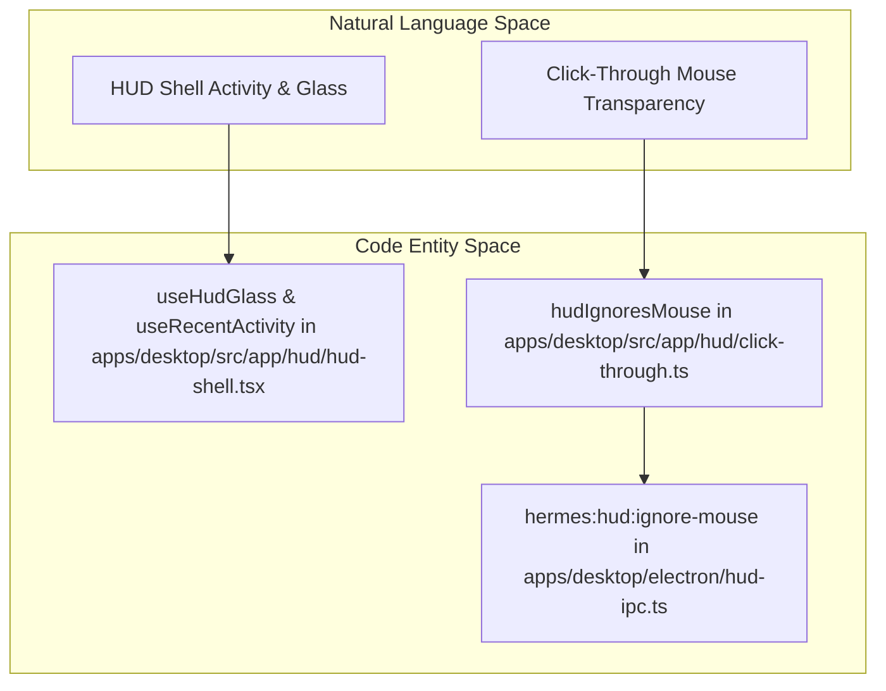
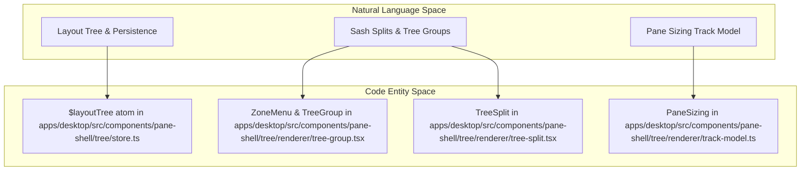

# HUD, Panes, and Window Management

Relevant source files

The following files were used as context for generating this wiki page:

- [apps/desktop/electron/hud-cursor.test.ts](apps/desktop/electron/hud-cursor.test.ts)
- [apps/desktop/electron/hud-cursor.ts](apps/desktop/electron/hud-cursor.ts)
- [apps/desktop/electron/hud-ipc.ts](apps/desktop/electron/hud-ipc.ts)
- [apps/desktop/scripts/prepare-dmgbuild.test.mjs](apps/desktop/scripts/prepare-dmgbuild.test.mjs)
- [apps/desktop/src/app/chat/composer/index.tsx](apps/desktop/src/app/chat/composer/index.tsx)
- [apps/desktop/src/app/chat/composer/types.ts](apps/desktop/src/app/chat/composer/types.ts)
- [apps/desktop/src/app/chat/index.tsx](apps/desktop/src/app/chat/index.tsx)
- [apps/desktop/src/app/chat/pane-mirror.ts](apps/desktop/src/app/chat/pane-mirror.ts)
- [apps/desktop/src/app/chat/route-tile-title.test.tsx](apps/desktop/src/app/chat/route-tile-title.test.tsx)
- [apps/desktop/src/app/chat/route-tile.tsx](apps/desktop/src/app/chat/route-tile.tsx)
- [apps/desktop/src/app/chat/session-tile.tsx](apps/desktop/src/app/chat/session-tile.tsx)
- [apps/desktop/src/app/chat/sidebar/gateway-group-model.test.ts](apps/desktop/src/app/chat/sidebar/gateway-group-model.test.ts)
- [apps/desktop/src/app/chat/sidebar/gateway-group-model.ts](apps/desktop/src/app/chat/sidebar/gateway-group-model.ts)
- [apps/desktop/src/app/chat/sidebar/gateway-group-preferences.test.ts](apps/desktop/src/app/chat/sidebar/gateway-group-preferences.test.ts)
- [apps/desktop/src/app/chat/sidebar/gateway-group-preferences.ts](apps/desktop/src/app/chat/sidebar/gateway-group-preferences.ts)
- [apps/desktop/src/app/chat/sidebar/gateway-groups-drag.test.tsx](apps/desktop/src/app/chat/sidebar/gateway-groups-drag.test.tsx)
- [apps/desktop/src/app/chat/sidebar/gateway-groups.test.tsx](apps/desktop/src/app/chat/sidebar/gateway-groups.test.tsx)
- [apps/desktop/src/app/chat/sidebar/gateway-groups.tsx](apps/desktop/src/app/chat/sidebar/gateway-groups.tsx)
- [apps/desktop/src/app/chat/sidebar/reorderable-list.tsx](apps/desktop/src/app/chat/sidebar/reorderable-list.tsx)
- [apps/desktop/src/app/chat/sidebar/session-row-rename-drag.test.tsx](apps/desktop/src/app/chat/sidebar/session-row-rename-drag.test.tsx)
- [apps/desktop/src/app/contrib/controller.tsx](apps/desktop/src/app/contrib/controller.tsx)
- [apps/desktop/src/app/contrib/latest-actions.test.ts](apps/desktop/src/app/contrib/latest-actions.test.ts)
- [apps/desktop/src/app/contrib/latest-actions.ts](apps/desktop/src/app/contrib/latest-actions.ts)
- [apps/desktop/src/app/contrib/surfaces.test.tsx](apps/desktop/src/app/contrib/surfaces.test.tsx)
- [apps/desktop/src/app/contrib/surfaces.tsx](apps/desktop/src/app/contrib/surfaces.tsx)
- [apps/desktop/src/app/contrib/types.ts](apps/desktop/src/app/contrib/types.ts)
- [apps/desktop/src/app/hud/click-through.test.ts](apps/desktop/src/app/hud/click-through.test.ts)
- [apps/desktop/src/app/hud/click-through.ts](apps/desktop/src/app/hud/click-through.ts)
- [apps/desktop/src/app/hud/composer-drag.test.ts](apps/desktop/src/app/hud/composer-drag.test.ts)
- [apps/desktop/src/app/hud/composer-drag.ts](apps/desktop/src/app/hud/composer-drag.ts)
- [apps/desktop/src/app/hud/glass.test.tsx](apps/desktop/src/app/hud/glass.test.tsx)
- [apps/desktop/src/app/hud/glass.ts](apps/desktop/src/app/hud/glass.ts)
- [apps/desktop/src/app/hud/hud-shell.tsx](apps/desktop/src/app/hud/hud-shell.tsx)
- [apps/desktop/src/app/hud/resize-handle.test.ts](apps/desktop/src/app/hud/resize-handle.test.ts)
- [apps/desktop/src/app/hud/resize-handle.ts](apps/desktop/src/app/hud/resize-handle.ts)
- [apps/desktop/src/app/hud/transcript-band.test.tsx](apps/desktop/src/app/hud/transcript-band.test.tsx)
- [apps/desktop/src/app/hud/transcript-band.ts](apps/desktop/src/app/hud/transcript-band.ts)
- [apps/desktop/src/app/routes.titlebar-clusters.test.ts](apps/desktop/src/app/routes.titlebar-clusters.test.ts)
- [apps/desktop/src/app/routes.ts](apps/desktop/src/app/routes.ts)
- [apps/desktop/src/app/routes.workspace-reveal.test.ts](apps/desktop/src/app/routes.workspace-reveal.test.ts)
- [apps/desktop/src/app/shell/titlebar-controls.test.tsx](apps/desktop/src/app/shell/titlebar-controls.test.tsx)
- [apps/desktop/src/app/shell/titlebar-controls.tsx](apps/desktop/src/app/shell/titlebar-controls.tsx)
- [apps/desktop/src/app/shell/titlebar.test.ts](apps/desktop/src/app/shell/titlebar.test.ts)
- [apps/desktop/src/app/shell/titlebar.ts](apps/desktop/src/app/shell/titlebar.ts)
- [apps/desktop/src/components/pane-shell/geometry.ts](apps/desktop/src/components/pane-shell/geometry.ts)
- [apps/desktop/src/components/pane-shell/tree/model.ts](apps/desktop/src/components/pane-shell/tree/model.ts)
- [apps/desktop/src/components/pane-shell/tree/pane-share-memory.test.ts](apps/desktop/src/components/pane-shell/tree/pane-share-memory.test.ts)
- [apps/desktop/src/components/pane-shell/tree/remove-pane.test.ts](apps/desktop/src/components/pane-shell/tree/remove-pane.test.ts)
- [apps/desktop/src/components/pane-shell/tree/renderer/drag-session.ts](apps/desktop/src/components/pane-shell/tree/renderer/drag-session.ts)
- [apps/desktop/src/components/pane-shell/tree/renderer/index.tsx](apps/desktop/src/components/pane-shell/tree/renderer/index.tsx)
- [apps/desktop/src/components/pane-shell/tree/renderer/main-placement-floor.test.tsx](apps/desktop/src/components/pane-shell/tree/renderer/main-placement-floor.test.tsx)
- [apps/desktop/src/components/pane-shell/tree/renderer/pane-body.tsx](apps/desktop/src/components/pane-shell/tree/renderer/pane-body.tsx)
- [apps/desktop/src/components/pane-shell/tree/renderer/panel-titlebar-lifecycle.test.tsx](apps/desktop/src/components/pane-shell/tree/renderer/panel-titlebar-lifecycle.test.tsx)
- [apps/desktop/src/components/pane-shell/tree/renderer/panel-titlebar.test.tsx](apps/desktop/src/components/pane-shell/tree/renderer/panel-titlebar.test.tsx)
- [apps/desktop/src/components/pane-shell/tree/renderer/panel-titlebar.ts](apps/desktop/src/components/pane-shell/tree/renderer/panel-titlebar.ts)
- [apps/desktop/src/components/pane-shell/tree/renderer/tab-strip-hide.test.tsx](apps/desktop/src/components/pane-shell/tree/renderer/tab-strip-hide.test.tsx)
- [apps/desktop/src/components/pane-shell/tree/renderer/track-model.ts](apps/desktop/src/components/pane-shell/tree/renderer/track-model.ts)
- [apps/desktop/src/components/pane-shell/tree/renderer/tree-group.test.tsx](apps/desktop/src/components/pane-shell/tree/renderer/tree-group.test.tsx)
- [apps/desktop/src/components/pane-shell/tree/renderer/tree-group.tsx](apps/desktop/src/components/pane-shell/tree/renderer/tree-group.tsx)
- [apps/desktop/src/components/pane-shell/tree/renderer/tree-node.tsx](apps/desktop/src/components/pane-shell/tree/renderer/tree-node.tsx)
- [apps/desktop/src/components/pane-shell/tree/renderer/tree-split-cascade-resize.test.tsx](apps/desktop/src/components/pane-shell/tree/renderer/tree-split-cascade-resize.test.tsx)
- [apps/desktop/src/components/pane-shell/tree/renderer/tree-split.tsx](apps/desktop/src/components/pane-shell/tree/renderer/tree-split.tsx)
- [apps/desktop/src/components/pane-shell/tree/store.ts](apps/desktop/src/components/pane-shell/tree/store.ts)
- [apps/desktop/src/components/ui/button.tsx](apps/desktop/src/components/ui/button.tsx)
- [apps/desktop/src/lib/platform.ts](apps/desktop/src/lib/platform.ts)
- [apps/desktop/src/styles.css](apps/desktop/src/styles.css)
- [contributors/emails/pry@privacydied.net](contributors/emails/pry@privacydied.net)
- [evals/update_check_ssh_pty.py](evals/update_check_ssh_pty.py)
- [hermes_cli/_subprocess_compat.py](hermes_cli/_subprocess_compat.py)
- [hermes_cli/dashboard_procs.py](hermes_cli/dashboard_procs.py)
- [hermes_cli/git_credentials.py](hermes_cli/git_credentials.py)
- [hermes_cli/main_dashboard.py](hermes_cli/main_dashboard.py)
- [hermes_cli/main_desktop.py](hermes_cli/main_desktop.py)
- [hermes_cli/main_tui_launch.py](hermes_cli/main_tui_launch.py)
- [hermes_cli/main_web_build.py](hermes_cli/main_web_build.py)
- [hermes_cli/win_pty_bridge.py](hermes_cli/win_pty_bridge.py)
- [hermes_cli/worktree_cmd.py](hermes_cli/worktree_cmd.py)
- [hermes_cli/worktree_gc.py](hermes_cli/worktree_gc.py)
- [hermes_cli/worktree_ops.py](hermes_cli/worktree_ops.py)
- [tests/hermes_cli/test_cron_parser_builder.py](tests/hermes_cli/test_cron_parser_builder.py)
- [tests/hermes_cli/test_dashboard_lifecycle_flags.py](tests/hermes_cli/test_dashboard_lifecycle_flags.py)
- [tests/hermes_cli/test_dashboard_unified_launch.py](tests/hermes_cli/test_dashboard_unified_launch.py)
- [tests/hermes_cli/test_gateway_launch_lifetime.py](tests/hermes_cli/test_gateway_launch_lifetime.py)
- [tests/hermes_cli/test_gui_command.py](tests/hermes_cli/test_gui_command.py)
- [tests/hermes_cli/test_noninteractive_git.py](tests/hermes_cli/test_noninteractive_git.py)
- [tests/hermes_cli/test_plugin_private_repo_auth.py](tests/hermes_cli/test_plugin_private_repo_auth.py)
- [tests/hermes_cli/test_serve_host_attach.py](tests/hermes_cli/test_serve_host_attach.py)
- [tests/hermes_cli/test_stale_pid_guard.py](tests/hermes_cli/test_stale_pid_guard.py)
- [tests/hermes_cli/test_taskkill_identity_windows_live.py](tests/hermes_cli/test_taskkill_identity_windows_live.py)
- [tests/hermes_cli/test_tui_exit_summary_short_id.py](tests/hermes_cli/test_tui_exit_summary_short_id.py)
- [tests/hermes_cli/test_tui_npm_install.py](tests/hermes_cli/test_tui_npm_install.py)
- [tests/hermes_cli/test_tui_worktree_clean_quit.py](tests/hermes_cli/test_tui_worktree_clean_quit.py)
- [tests/hermes_cli/test_update_stale_dashboard.py](tests/hermes_cli/test_update_stale_dashboard.py)
- [tests/hermes_cli/test_web_ui_build.py](tests/hermes_cli/test_web_ui_build.py)
- [tests/hermes_cli/test_worktree.py](tests/hermes_cli/test_worktree.py)
- [tests/hermes_cli/test_worktree_gc.py](tests/hermes_cli/test_worktree_gc.py)
- [tests/pm/test_dmgbuild_package.py](tests/pm/test_dmgbuild_package.py)
- [tests/security/test_gitspawn_config_injection.py](tests/security/test_gitspawn_config_injection.py)
- [tests/tools/test_delegation_recovery_diagnostics.py](tests/tools/test_delegation_recovery_diagnostics.py)
- [tests/tools/test_windows_native_support.py](tests/tools/test_windows_native_support.py)
- [tools/async_delegation_recovery_hints.py](tools/async_delegation_recovery_hints.py)
- [website/docs/user-guide/desktop.md](website/docs/user-guide/desktop.md)
- [website/docs/user-guide/multi-connection-desktop.md](website/docs/user-guide/multi-connection-desktop.md)

This page documents the desktop windowing surfaces in Hermes Agent, detailing the chrome-less Heads-Up Display (HUD) shell, overlay components, pop-out browser windows, the pane-shell tree layout engine, and global styling infrastructure.

---

## 1. HUD Shell and Behaviors

The HUD provides a compact, translucent chat band that floats above all other applications, offering quick glance and interaction capabilities without traditional window chrome.

### 1.1 Activity and Transcript Lifecycle

The HUD toggles between a minimalistic idle "Spotlight" entry bar and an expanded transcript panel showing conversation history. This dynamic visibility is managed via hooks in `apps/desktop/src/app/hud/hud-shell.tsx`:

- **`useRecentActivity`** watches for new or updated messages and maintains a 1100ms hold time (`HUD_RECENT_HOLD_MS`) to keep the transcript visible briefly after interaction or message arrival [apps/desktop/src/app/hud/hud-shell.tsx:25-130]().
- **`useHudHeld`** ensures persistent transcript visibility during busy states such as streaming message output, awaiting input prompts, or when the game overlay mode is active [apps/desktop/src/app/hud/hud-shell.tsx:155-160]().
  
This system selectively triggers re-renders and manipulates CSS states to craft smooth fade and dimming transitions without excess resource use or flicker.

Sources:
- `apps/desktop/src/app/hud/hud-shell.tsx:25-160`

### 1.2 Click-Through and Mouse Pass-Through Handling

Because the HUD uses Electron's `always-on-top` feature, it can block mouse events to windows beneath it. To solve this, `apps/desktop/src/app/hud/click-through.ts` implements logic that toggles the HUD window between a solid input-consuming mode and a mouse-transparent mode [apps/desktop/src/app/hud/click-through.ts:1-50]().

The core function `hudIgnoresMouse()` bases mouse transparency state on whether the composer input currently has keyboard focus, whether any overlay has focus outside the HUD shell, and the pointer target under the cursor [apps/desktop/src/app/hud/click-through.ts:1-60](). It dispatches IPC messages using `apps/desktop/electron/hud-ipc.ts` on channel `'hermes:hud:ignore-mouse'` to the main Electron process [apps/desktop/electron/hud-ipc.ts:1-100]().

Sources:
- `apps/desktop/src/app/hud/click-through.ts`
- `apps/desktop/electron/hud-ipc.ts`

### 1.3 Glass and Translucency Integration

The HUD surface simulates frosted glass using native OS-level visual effects (such as macOS `NSVisualEffectView` via Electron main process integration). The React hook `useHudGlass` observes compositor states and calls `window.hermesDesktop.hud.setFrost(true/false)` to apply vibrancy effects [apps/desktop/src/app/hud/glass.ts:1-128](), [apps/desktop/electron/hud-ipc.ts:1-168]().

Sources:
- `apps/desktop/src/app/hud/glass.ts:1-128`
- `apps/desktop/electron/hud-ipc.ts:1-168`

---

## 2. Overlays and Pop-Out Windows

Beyond the primary chat window and HUD shell, Hermes Agent supports additional surfaces:

- **Quick-Entry Overlay:** A global prompt input surface accessible by hotkey for rapid task submission.
- **Pet Overlay:** An animated pet companion rendered in its own overlay window with independent lifecycle management (`$petOverlayActive` in `apps/desktop/src/app/chat/index.tsx`) [apps/desktop/src/app/chat/index.tsx:34]().
- **Pop-Out Browser Windows:** These windows host isolated React roots, sharing origin and storage with the main app but omitting layout tree persistence to prevent overwriting user customizations (`isBrowserWindow()` or `isSecondaryWindow()` in `apps/desktop/src/components/pane-shell/tree/store.ts`) [apps/desktop/src/components/pane-shell/tree/store.ts:59-67]().

Sources:
- `apps/desktop/src/app/chat/index.tsx:34`
- `apps/desktop/src/components/pane-shell/tree/store.ts:59-67`

---

## 3. Pane-Shell Tree Layout Engine

Hermes Agent’s desktop UI uses a pane-shell tree layout system organizing windows into hierarchical splits, groups, and tabs [apps/desktop/src/components/pane-shell/tree/store.ts:1-80]().

### 3.1 Layout Tree and Persistence

- The layout is represented by a tree data structure of `LayoutNode`s holding splits and tab groups [apps/desktop/src/components/pane-shell/tree/model.ts:30-35]().
- The global layout store is a nanostores atom `$layoutTree` (`apps/desktop/src/components/pane-shell/tree/store.ts`) loading persisted JSON from local storage key `hermes.desktop.layoutTree.v2` [apps/desktop/src/components/pane-shell/tree/store.ts:66-79]().
- Secondary windows and browser pop-outs disable persistence writes [apps/desktop/src/components/pane-shell/tree/store.ts:59-67]().

Sources:
- `apps/desktop/src/components/pane-shell/tree/store.ts:1-80`
- `apps/desktop/src/components/pane-shell/tree/model.ts:30-35`

### 3.2 Structural Splits and Group Zones

- **`TreeSplit` Renderer:** Renders flex containers (row/column) hosting child layout nodes with sash-resizable seams [apps/desktop/src/components/pane-shell/tree/renderer/tree-split.tsx:1-120]().
- **`TreeGroup` Renderer:** Represents a zone with multiple panes displayed as a tab strip plus active content, supporting tab stacking, minimize toggles, and right-click zone context menus [apps/desktop/src/components/pane-shell/tree/renderer/tree-group.tsx:1-140]().

Sources:
- `apps/desktop/src/components/pane-shell/tree/renderer/tree-split.tsx:1-120`
- `apps/desktop/src/components/pane-shell/tree/renderer/tree-group.tsx:1-140`

### 3.3 Track Model for Pane Sizing

The pane layout sizing uses a track model defined in `apps/desktop/src/components/pane-shell/tree/renderer/track-model.ts`:
- **Fixed Tracks:** Zones with explicit CSS width/height clamp (sidebars) keep their declared size [apps/desktop/src/components/pane-shell/tree/renderer/track-model.ts:31-36]().
- **Flexible Tracks:** Zones without explicit sizing share leftover space proportionally via weights [apps/desktop/src/components/pane-shell/tree/renderer/track-model.ts:5-8]().
- **Collapsed Size:** Tool panels use `COLLAPSED_ZONE_PX = 28px` to shrink to a minimal rail strip [apps/desktop/src/components/pane-shell/tree/renderer/track-model.ts:29-30]().

Sources:
- `apps/desktop/src/components/pane-shell/tree/renderer/track-model.ts:1-45`

---

## 4. Global Styles and Theme Variables

Global desktop styles reside in `apps/desktop/src/styles.css` using Tailwind CSS v4, custom variants, and imported font rules [apps/desktop/src/styles.css:1-118]().

### 4.1 Animation and Accessibility Gates

The stylesheet enforces accessibility queries via media queries:
- **Reduced Motion:** `@media (prefers-reduced-motion: reduce)` zeroes out animation and transition durations app-wide [apps/desktop/src/styles.css:24-33]().
- **Reduced Transparency:** `@media (prefers-reduced-transparency: reduce)` drops CSS `backdrop-filter` frost effects to preserve frame budgets on constrained systems [apps/desktop/src/styles.css:58-65]().
- **Animation Pausing:** `:root[data-renderer-animations-paused]` pauses decorative keyframes and shimmering effects when the window is hidden or backgrounded [apps/desktop/src/styles.css:70-89]().

Sources:
- `apps/desktop/src/styles.css:1-173`

---

## 5. System Architecture & Code Mappings

### 5.1 HUD and IPC Architecture

Sources:
- `apps/desktop/src/app/hud/hud-shell.tsx`
- `apps/desktop/src/app/hud/click-through.ts`
- `apps/desktop/electron/hud-ipc.ts`

### 5.2 Pane Tree and Track Model Architecture

Sources:
- `apps/desktop/src/components/pane-shell/tree/store.ts`
- `apps/desktop/src/components/pane-shell/tree/renderer/tree-group.tsx`
- `apps/desktop/src/components/pane-shell/tree/renderer/tree-split.tsx`
- `apps/desktop/src/components/pane-shell/tree/renderer/track-model.ts`

---

# Summary

Hermes Agent's desktop environment provides a chrome-less HUD shell with native glass translucency, secondary overlays and pop-out windows, a persistent pane-shell tree layout engine with hierarchical splits and tabbed groups, and a global styling system optimized for performance and accessibility.