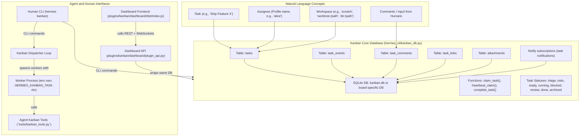

# Kanban Task Board

<details>
<summary>Relevant source files</summary>

The following files were used as context for generating this wiki page:

- [contributors/emails/robertlisowski57@gmail.com](contributors/emails/robertlisowski57@gmail.com)
- [hermes_cli/kanban.py](hermes_cli/kanban.py)
- [hermes_cli/kanban_db.py](hermes_cli/kanban_db.py)
- [hermes_cli/kanban_db_connect.py](hermes_cli/kanban_db_connect.py)
- [hermes_cli/kanban_db_dispatch.py](hermes_cli/kanban_db_dispatch.py)
- [hermes_cli/kanban_db_notify.py](hermes_cli/kanban_db_notify.py)
- [hermes_cli/kanban_db_workspace.py](hermes_cli/kanban_db_workspace.py)
- [hermes_cli/kanban_diagnostics.py](hermes_cli/kanban_diagnostics.py)
- [hermes_cli/kanban_ops.py](hermes_cli/kanban_ops.py)
- [hermes_cli/kanban_output.py](hermes_cli/kanban_output.py)
- [hermes_cli/kanban_parser.py](hermes_cli/kanban_parser.py)
- [hermes_cli/kanban_swarm.py](hermes_cli/kanban_swarm.py)
- [hermes_cli/kanban_transfer.py](hermes_cli/kanban_transfer.py)
- [hermes_cli/kanban_workflow.py](hermes_cli/kanban_workflow.py)
- [optional-skills/autonomous-ai-agents/agent-merge-conflict-arbiter/SKILL.md](optional-skills/autonomous-ai-agents/agent-merge-conflict-arbiter/SKILL.md)
- [plugins/kanban/dashboard/dist/index.js](plugins/kanban/dashboard/dist/index.js)
- [plugins/kanban/dashboard/dist/style.css](plugins/kanban/dashboard/dist/style.css)
- [plugins/kanban/dashboard/plugin_api.py](plugins/kanban/dashboard/plugin_api.py)
- [tests/hermes_cli/test_kanban_block_kinds.py](tests/hermes_cli/test_kanban_block_kinds.py)
- [tests/hermes_cli/test_kanban_cli.py](tests/hermes_cli/test_kanban_cli.py)
- [tests/hermes_cli/test_kanban_complete_live_claim_guard.py](tests/hermes_cli/test_kanban_complete_live_claim_guard.py)
- [tests/hermes_cli/test_kanban_core_functionality.py](tests/hermes_cli/test_kanban_core_functionality.py)
- [tests/hermes_cli/test_kanban_db.py](tests/hermes_cli/test_kanban_db.py)
- [tests/hermes_cli/test_kanban_diagnostics.py](tests/hermes_cli/test_kanban_diagnostics.py)
- [tests/hermes_cli/test_kanban_dispatch_claim_allowlist.py](tests/hermes_cli/test_kanban_dispatch_claim_allowlist.py)
- [tests/hermes_cli/test_kanban_gc_retention.py](tests/hermes_cli/test_kanban_gc_retention.py)
- [tests/hermes_cli/test_kanban_list_undecodable_text.py](tests/hermes_cli/test_kanban_list_undecodable_text.py)
- [tests/hermes_cli/test_kanban_notify.py](tests/hermes_cli/test_kanban_notify.py)
- [tests/hermes_cli/test_kanban_review_lifecycle.py](tests/hermes_cli/test_kanban_review_lifecycle.py)
- [tests/hermes_cli/test_kanban_review_lifecycle_complete.py](tests/hermes_cli/test_kanban_review_lifecycle_complete.py)
- [tests/hermes_cli/test_kanban_review_surfaces.py](tests/hermes_cli/test_kanban_review_surfaces.py)
- [tests/hermes_cli/test_kanban_swarm.py](tests/hermes_cli/test_kanban_swarm.py)
- [tests/hermes_cli/test_kanban_transfer.py](tests/hermes_cli/test_kanban_transfer.py)
- [tests/hermes_cli/test_kanban_watch_banner.py](tests/hermes_cli/test_kanban_watch_banner.py)
- [tests/hermes_cli/test_kanban_workflow.py](tests/hermes_cli/test_kanban_workflow.py)
- [tests/hermes_cli/test_kanban_worktree_teardown.py](tests/hermes_cli/test_kanban_worktree_teardown.py)
- [tests/plugins/test_kanban_dashboard_plugin.py](tests/plugins/test_kanban_dashboard_plugin.py)
- [tests/plugins/test_kanban_workflow_matrix.py](tests/plugins/test_kanban_workflow_matrix.py)
- [tests/tools/test_kanban_tools.py](tests/tools/test_kanban_tools.py)
- [tools/kanban_tools.py](tools/kanban_tools.py)
- [tools/kanban_tools_schemas.py](tools/kanban_tools_schemas.py)
- [website/docs/user-guide/features/kanban-worker-lanes.md](website/docs/user-guide/features/kanban-worker-lanes.md)
- [website/docs/user-guide/features/kanban.md](website/docs/user-guide/features/kanban.md)
- [website/i18n/zh-Hans/docusaurus-plugin-content-docs/current/user-guide/features/kanban-worker-lanes.md](website/i18n/zh-Hans/docusaurus-plugin-content-docs/current/user-guide/features/kanban-worker-lanes.md)
- [website/i18n/zh-Hans/docusaurus-plugin-content-docs/current/user-guide/features/kanban.md](website/i18n/zh-Hans/docusaurus-plugin-content-docs/current/user-guide/features/kanban.md)

</details>


The Hermes Kanban system is a durable, SQLite-backed task coordination framework designed for multi-profile and multi-project collaboration [website/docs/user-guide/features/kanban.md:3-12](). Unlike transient subagent delegations (e.g., `delegate_task`), Kanban persists tasks, state transitions, messages, and inter-agent communication in a shared database [website/docs/user-guide/features/kanban.md:11-100](). This design allows work to survive restarts, supports human intervention, and enables multiple agent roles to coordinate through a shared durable medium.

## System Architecture Overview

At the core, Kanban serves as a **cross-profile coordination primitive** consolidating work into a shared durable database [hermes_cli/kanban_db.py:1-12](). The default board database typically resides at:

```
~/.hermes/kanban.db
```

Additional boards can be managed under separate directories:

```
<root>/kanban/boards/<slug>/
```

This physical separation ensures that a worker on one board never sees tasks from another [hermes_cli/kanban_db.py:3-8](). The dispatcher injects the proper board context into workers, ensuring isolation and consistent task ownership.

Multiple interfaces and components interact with this core data layer:

- **SQLite-backed Kanban Core** (`hermes_cli/kanban_db.py`) manages the schema and concurrency primitives. Tables include `tasks`, `task_links`, `task_comments`, `task_events`, `task_runs`, `attachments`, and subscriptions for notifications. It employs Write-Ahead Logging (WAL) with `BEGIN IMMEDIATE` transactions and compare-and-swap logic on task `status` and `claim_lock` fields to serialize writers and maintain a consistent view [hermes_cli/kanban_db.py:1-12](). This layer supports full task lifecycle: create, claim, heartbeat, complete, and crash recovery.

- **Command-Line Interface (CLI)** (`hermes_cli/kanban.py`) exposes the kanban command (`hermes kanban ...`) which offers scripted and human interfaces to manipulate tasks. Subcommands include listing, creating, modifying, blocking, completing, garbage collection, dispatch control, and more. The CLI wraps the same Kanban DB layer for consistency [hermes_cli/kanban.py:1-150](). This interface suits automation, scripting, and direct human control.

- **Agent Toolset** (`tools/kanban_tools.py`) provides a structured tool-call surface for internal agent interactions with Kanban, avoiding fragile shell-outs to CLI commands. The toolset is dynamically injected into dispatcher-spawned workers or explicit orchestrator profiles. It supports JSON-based inputs/outputs for commands like `kanban_show`, `kanban_list`, `kanban_complete`, and lifecycle controls like `kanban_heartbeat` or `kanban_block`. The tools enforce guards to prevent delegated subagents from corrupting shared state [tools/kanban_tools.py:1-165]().

- **Dashboard Plugin** (`plugins/kanban/dashboard/plugin_api.py`) offers a web backend API mounted at `/api/plugins/kanban`. It exposes REST endpoints and WebSocket streams that mirror CLI operations while providing task event tailing for live updates. The frontend plugin JavaScript (`plugins/kanban/dashboard/dist/index.js`) implements a React UI with live drag-and-drop, filtering by tenant and assignee, markdown task body rendering, and a polished, interactive kanban board experience [plugins/kanban/dashboard/plugin_api.py:1-174](), [plugins/kanban/dashboard/dist/index.js:1-163]().

### Conceptual Mapping: Natural Language to Code Entities



This diagram bridges the natural-language concepts of task management with the core code entities and runtime actors. Tasks, assignees, and comments map onto specific database tables accessed via concurrency-safe primitives. Dispatcher and worker processes operate with injected environment context, calling Kanban tools internally. Human users and automated agents can operate through CLI commands or the Dashboard, all backed by the same persistent DB.

Sources:  
[hermes_cli/kanban_db.py:1-12](), [hermes_cli/kanban.py:1-150](), [tools/kanban_tools.py:1-165](),  
[plugins/kanban/dashboard/plugin_api.py:1-174](), [plugins/kanban/dashboard/dist/index.js:1-163](),  
[website/docs/user-guide/features/kanban.md:3-100]()

---

## Core Sub-Topics and Child Pages

This page provides a high-level architectural overview of the Kanban Task Board. Deep technical details and usage instructions live in the following child pages:

### 13.1 Kanban Core and CLI

Covers the internal SQLite schema, including tables for tasks, links, comments, events, runs, attachments, and notification subscriptions. Explains concurrency control via WAL, isolated transaction locking, and compare-and-swap semantics for key state transitions like claiming and completing tasks.

Describes the lifecycle of tasks: creation, claim, heartbeat maintenance, completion, blocking/unblocking, and crash detection. The CLI command suite (`hermes kanban ...`) is explained, mapping user commands to core operations. Notification subscription mechanics and crash-recovery guard rails are detailed.

For details, see [Kanban Core and CLI](#13.1).

### 13.2 Kanban Tools and Dashboard

Documents the structured `kanban_*` tools that agents use internally for stable, validated interaction with the Kanban board. This avoids fragile shell-outs and introduces per-call argument schemas, error handling, and delegation guards.

Explains how the FastAPI-powered dashboard plugin provides a comprehensive RESTful API and WebSocket event stream, allowing low-latency live update of the board state.

Describes the React-based dashboard UI plugin offering drag-and-drop task movement, tenant and assignee filtering, and rich task rendering.

Also covers multi-agent coordination skills provided by `kanban-worker` and `kanban-orchestrator` for distributed task execution and routing.

For details, see [Kanban Tools and Dashboard](#13.2).

---

This layered Kanban design delivers:

- **Durable, crash-resilient task coordination across multiple Hermes profiles and processes.**  
- **Unified, consistent task state shared between human operators and autonomous agents.**  
- **Isolated multi-board support with scoped access to prevent cross-contamination of task data.**  
- **Rich tooling interfaces for CLI automation, agent toolsets, and a real-time web dashboard UI.**

Together, these components enable scalable, observable, and human-friendly multi-agent collaboration workflows built around a robust Kanban task board.

---

Sources:  
[hermes_cli/kanban_db.py:1-12](), [hermes_cli/kanban.py:1-150](), [tools/kanban_tools.py:1-165](),  
[plugins/kanban/dashboard/plugin_api.py:1-174](), [plugins/kanban/dashboard/dist/index.js:1-163](),  
[website/docs/user-guide/features/kanban.md:3-100]()