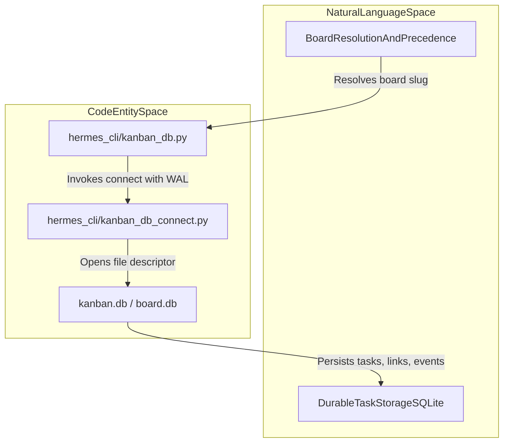
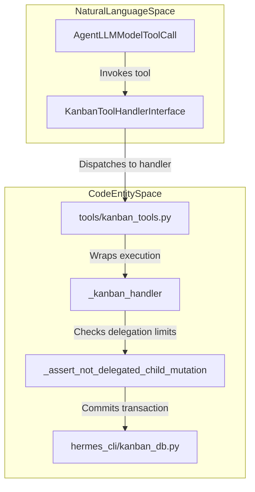

# Kanban Core and CLI

Relevant source files

The following files were used as context for generating this wiki page:

- [agent/managed_worker.py](agent/managed_worker.py)
- [contributors/emails/robertlisowski57@gmail.com](contributors/emails/robertlisowski57@gmail.com)
- [gateway/run_runtime.py](gateway/run_runtime.py)
- [gateway/session_db_recovery.py](gateway/session_db_recovery.py)
- [gateway/session_kanban.py](gateway/session_kanban.py)
- [gateway/session_managed_worker.py](gateway/session_managed_worker.py)
- [gateway/session_runtime_workers.py](gateway/session_runtime_workers.py)
- [gateway/session_tui_side.py](gateway/session_tui_side.py)
- [gateway/session_unattended_unknown.py](gateway/session_unattended_unknown.py)
- [gateway/session_worker_construct.py](gateway/session_worker_construct.py)
- [hermes_cli/gateway_chat_startup.py](hermes_cli/gateway_chat_startup.py)
- [hermes_cli/kanban.py](hermes_cli/kanban.py)
- [hermes_cli/kanban_db.py](hermes_cli/kanban_db.py)
- [hermes_cli/kanban_db_connect.py](hermes_cli/kanban_db_connect.py)
- [hermes_cli/kanban_db_dispatch.py](hermes_cli/kanban_db_dispatch.py)
- [hermes_cli/kanban_db_notify.py](hermes_cli/kanban_db_notify.py)
- [hermes_cli/kanban_db_workspace.py](hermes_cli/kanban_db_workspace.py)
- [hermes_cli/kanban_diagnostics.py](hermes_cli/kanban_diagnostics.py)
- [hermes_cli/kanban_ops.py](hermes_cli/kanban_ops.py)
- [hermes_cli/kanban_output.py](hermes_cli/kanban_output.py)
- [hermes_cli/kanban_owner_recovery.py](hermes_cli/kanban_owner_recovery.py)
- [hermes_cli/kanban_parser.py](hermes_cli/kanban_parser.py)
- [hermes_cli/kanban_swarm.py](hermes_cli/kanban_swarm.py)
- [hermes_cli/kanban_transfer.py](hermes_cli/kanban_transfer.py)
- [hermes_cli/kanban_worker_client.py](hermes_cli/kanban_worker_client.py)
- [hermes_cli/kanban_workflow.py](hermes_cli/kanban_workflow.py)
- [optional-skills/autonomous-ai-agents/agent-merge-conflict-arbiter/SKILL.md](optional-skills/autonomous-ai-agents/agent-merge-conflict-arbiter/SKILL.md)
- [plugins/kanban/dashboard/dist/index.js](plugins/kanban/dashboard/dist/index.js)
- [plugins/kanban/dashboard/dist/style.css](plugins/kanban/dashboard/dist/style.css)
- [plugins/kanban/dashboard/plugin_api.py](plugins/kanban/dashboard/plugin_api.py)
- [tests/gateway/fixtures/kanban_owner_probe.py](tests/gateway/fixtures/kanban_owner_probe.py)
- [tests/gateway/fixtures/kanban_recovery_probe.py](tests/gateway/fixtures/kanban_recovery_probe.py)
- [tests/gateway/fixtures/local_session_peer.py](tests/gateway/fixtures/local_session_peer.py)
- [tests/gateway/fixtures/session_policy_peer.py](tests/gateway/fixtures/session_policy_peer.py)
- [tests/gateway/test_api_pending_daemon.py](tests/gateway/test_api_pending_daemon.py)
- [tests/gateway/test_authority_turn_error_surface.py](tests/gateway/test_authority_turn_error_surface.py)
- [tests/gateway/test_docker_session_workspace.py](tests/gateway/test_docker_session_workspace.py)
- [tests/gateway/test_kanban_auto_decompose_secret_scope.py](tests/gateway/test_kanban_auto_decompose_secret_scope.py)
- [tests/gateway/test_kanban_finite_admission.py](tests/gateway/test_kanban_finite_admission.py)
- [tests/gateway/test_local_session.py](tests/gateway/test_local_session.py)
- [tests/gateway/test_managed_worker_bypass.py](tests/gateway/test_managed_worker_bypass.py)
- [tests/gateway/test_managed_worker_construct.py](tests/gateway/test_managed_worker_construct.py)
- [tests/gateway/test_managed_worker_finished_exit.py](tests/gateway/test_managed_worker_finished_exit.py)
- [tests/gateway/test_managed_worker_hard_stop_frame_fence.py](tests/gateway/test_managed_worker_hard_stop_frame_fence.py)
- [tests/gateway/test_managed_worker_kill_escalation.py](tests/gateway/test_managed_worker_kill_escalation.py)
- [tests/gateway/test_managed_worker_launch.py](tests/gateway/test_managed_worker_launch.py)
- [tests/gateway/test_managed_worker_reservation_off_loop.py](tests/gateway/test_managed_worker_reservation_off_loop.py)
- [tests/gateway/test_managed_worker_result_usage.py](tests/gateway/test_managed_worker_result_usage.py)
- [tests/gateway/test_managed_worker_route_key.py](tests/gateway/test_managed_worker_route_key.py)
- [tests/gateway/test_profile_authority_park_reason.py](tests/gateway/test_profile_authority_park_reason.py)
- [tests/gateway/test_run_runtime_hot_serve_cleanup.py](tests/gateway/test_run_runtime_hot_serve_cleanup.py)
- [tests/gateway/test_runtime_worker_shutdown.py](tests/gateway/test_runtime_worker_shutdown.py)
- [tests/gateway/test_session_config_loaders.py](tests/gateway/test_session_config_loaders.py)
- [tests/gateway/test_session_db_handle_sharing.py](tests/gateway/test_session_db_handle_sharing.py)
- [tests/gateway/test_session_db_recovery.py](tests/gateway/test_session_db_recovery.py)
- [tests/gateway/test_session_kanban.py](tests/gateway/test_session_kanban.py)
- [tests/gateway/test_session_kanban_run_off_loop.py](tests/gateway/test_session_kanban_run_off_loop.py)
- [tests/gateway/test_session_tui_side.py](tests/gateway/test_session_tui_side.py)
- [tests/gateway/test_unknown_automation_settles.py](tests/gateway/test_unknown_automation_settles.py)
- [tests/hermes_cli/gateway_client_options.py](tests/hermes_cli/gateway_client_options.py)
- [tests/hermes_cli/test_gateway_chat_native.py](tests/hermes_cli/test_gateway_chat_native.py)
- [tests/hermes_cli/test_gateway_chat_unknown.py](tests/hermes_cli/test_gateway_chat_unknown.py)
- [tests/hermes_cli/test_gateway_first_run_live.py](tests/hermes_cli/test_gateway_first_run_live.py)
- [tests/hermes_cli/test_gateway_startup_validation.py](tests/hermes_cli/test_gateway_startup_validation.py)
- [tests/hermes_cli/test_kanban_block_kinds.py](tests/hermes_cli/test_kanban_block_kinds.py)
- [tests/hermes_cli/test_kanban_cli.py](tests/hermes_cli/test_kanban_cli.py)
- [tests/hermes_cli/test_kanban_complete_live_claim_guard.py](tests/hermes_cli/test_kanban_complete_live_claim_guard.py)
- [tests/hermes_cli/test_kanban_core_functionality.py](tests/hermes_cli/test_kanban_core_functionality.py)
- [tests/hermes_cli/test_kanban_db.py](tests/hermes_cli/test_kanban_db.py)
- [tests/hermes_cli/test_kanban_diagnostics.py](tests/hermes_cli/test_kanban_diagnostics.py)
- [tests/hermes_cli/test_kanban_dispatch_claim_allowlist.py](tests/hermes_cli/test_kanban_dispatch_claim_allowlist.py)
- [tests/hermes_cli/test_kanban_gc_retention.py](tests/hermes_cli/test_kanban_gc_retention.py)
- [tests/hermes_cli/test_kanban_list_undecodable_text.py](tests/hermes_cli/test_kanban_list_undecodable_text.py)
- [tests/hermes_cli/test_kanban_managed_result_pid.py](tests/hermes_cli/test_kanban_managed_result_pid.py)
- [tests/hermes_cli/test_kanban_notify.py](tests/hermes_cli/test_kanban_notify.py)
- [tests/hermes_cli/test_kanban_owner_receipt_reclaim.py](tests/hermes_cli/test_kanban_owner_receipt_reclaim.py)
- [tests/hermes_cli/test_kanban_review_lifecycle.py](tests/hermes_cli/test_kanban_review_lifecycle.py)
- [tests/hermes_cli/test_kanban_review_lifecycle_complete.py](tests/hermes_cli/test_kanban_review_lifecycle_complete.py)
- [tests/hermes_cli/test_kanban_review_surfaces.py](tests/hermes_cli/test_kanban_review_surfaces.py)
- [tests/hermes_cli/test_kanban_swarm.py](tests/hermes_cli/test_kanban_swarm.py)
- [tests/hermes_cli/test_kanban_transfer.py](tests/hermes_cli/test_kanban_transfer.py)
- [tests/hermes_cli/test_kanban_watch_banner.py](tests/hermes_cli/test_kanban_watch_banner.py)
- [tests/hermes_cli/test_kanban_worker_admission_wait.py](tests/hermes_cli/test_kanban_worker_admission_wait.py)
- [tests/hermes_cli/test_kanban_worker_spawn_toolsets.py](tests/hermes_cli/test_kanban_worker_spawn_toolsets.py)
- [tests/hermes_cli/test_kanban_workflow.py](tests/hermes_cli/test_kanban_workflow.py)
- [tests/hermes_cli/test_kanban_worktree_teardown.py](tests/hermes_cli/test_kanban_worktree_teardown.py)
- [tests/hermes_cli/test_runtime_maintenance_exclusion.py](tests/hermes_cli/test_runtime_maintenance_exclusion.py)
- [tests/hermes_cli/test_safe_mode.py](tests/hermes_cli/test_safe_mode.py)
- [tests/plugins/test_kanban_dashboard_plugin.py](tests/plugins/test_kanban_dashboard_plugin.py)
- [tests/plugins/test_kanban_workflow_matrix.py](tests/plugins/test_kanban_workflow_matrix.py)
- [tests/tools/test_kanban_tools.py](tests/tools/test_kanban_tools.py)
- [tools/kanban_tools.py](tools/kanban_tools.py)
- [tools/kanban_tools_schemas.py](tools/kanban_tools_schemas.py)
- [tools/terminal_tool_lifecycle.py](tools/terminal_tool_lifecycle.py)
- [ui-tui/src/__tests__/canonicalSideAgents.test.ts](ui-tui/src/__tests__/canonicalSideAgents.test.ts)
- [website/docs/user-guide/features/kanban-worker-lanes.md](website/docs/user-guide/features/kanban-worker-lanes.md)
- [website/docs/user-guide/features/kanban.md](website/docs/user-guide/features/kanban.md)
- [website/i18n/zh-Hans/docusaurus-plugin-content-docs/current/user-guide/features/kanban-worker-lanes.md](website/i18n/zh-Hans/docusaurus-plugin-content-docs/current/user-guide/features/kanban-worker-lanes.md)
- [website/i18n/zh-Hans/docusaurus-plugin-content-docs/current/user-guide/features/kanban.md](website/i18n/zh-Hans/docusaurus-plugin-content-docs/current/user-guide/features/kanban.md)

The Kanban system in Hermes Agent is a durable, SQLite-backed task board designed for multi-profile and multi-project task coordination between agents and humans [website/docs/user-guide/features/kanban.md:7-12](). Unlike ephemeral subagent delegation via `delegate_task`, Kanban provides a resilient state machine for tasks that survive process restarts, support human-in-the-loop interventions, and maintain a durable audit trail [website/docs/user-guide/features/kanban.md:32-54](). This page documents the core storage layer (`kanban_db`), the task lifecycle mechanics, the CLI interface, tool bindings, and crash-recovery procedures.

---

## Kanban Database Schema and Architecture

The Kanban core engine resides in `hermes_cli/kanban_db.py`, interacting with SQLite databases located under `<root>/kanban.db` (for the default board) or isolated board paths under `<root>/kanban/boards/<slug>/` [hermes_cli/kanban_db.py:1-13]().

### Board Resolution Hierarchy

When an operation references a Kanban board, physical board resolution proceeds through a strict precedence order:
1. Explicit `board=` argument passed by callers or CLI flags [hermes_cli/kanban_db.py:3-9]().
2. The `HERMES_KANBAN_BOARD` environment variable [hermes_cli/kanban_db.py:5-9]().
3. The `HERMES_KANBAN_DB` environment variable (pins a direct file path) [hermes_cli/kanban_db.py:5-9]().
4. The active slug stored in `<root>/kanban/current` [hermes_cli/kanban_db.py:5-9]().
5. Fallback to the `"default"` board [hermes_cli/kanban_db.py:3-6]().

Dispatched workers (`HERMES_KANBAN_TASK`), delegated children, and gateway watchers enforce physical isolation by pinning `HERMES_KANBAN_DB`, preventing workers from accessing other boards [hermes_cli/kanban_db.py:5-9](). Additionally, every connection applies `_lossy_text` as its `text_factory` to gracefully handle any malformed UTF-8 sequences without crashing query execution [hermes_cli/kanban_db.py:40-51]().

### Core Schema Entities

The database structure is composed of several primary tables:

| Table | Description |
| :--- | :--- |
| `tasks` | Primary task records (`id`, `title`, `body`, `assignee`, `status`, `priority`, `claim_lock`, `claim_expires`, timestamps, workspace attributes) [tests/hermes_cli/test_kanban_db.py:109-125]() |
| `task_links` | Parent-child dependency edges controlling readiness and cascading status unblocking [website/docs/user-guide/features/kanban.md:63-64]() |
| `task_comments` | Append-only discussion comments linked to tasks |
| `task_events` | Immutable log of all state transitions, claims, releases, and diagnostic actions [plugins/kanban/dashboard/plugin_api.py:4-8]() |
| `task_runs` | Detailed metrics and execution results per worker invocation run |
| `attachments` | Files and links associated with tasks, constrained by `KANBAN_ATTACHMENT_MAX_BYTES` (25MiB) [hermes_cli/kanban_db.py:135-135]() |
| `notify_subs` | Subscription endpoints and cursor checkpoints for external messaging platforms [tests/hermes_cli/test_kanban_core_functionality.py:104-150]() |

### Concurrency and Consistency

Concurrency is managed via SQLite's Write-Ahead Logging (WAL) mode combined with `BEGIN IMMEDIATE` transactions [hermes_cli/kanban_db.py:1-12](). Atomic claims utilize compare-and-swap (CAS) checks against `tasks.status` and `tasks.claim_lock`, ensuring that conflicting concurrent worker claims fail gracefully without requiring complex distributed locks [hermes_cli/kanban_db.py:1-12]().

Diagram: Board Resolution and Storage Architecture

Sources: `hermes_cli/kanban_db.py:1-69`, `tests/hermes_cli/test_kanban_db.py:109-170`, `plugins/kanban/dashboard/plugin_api.py:1-50`

---

## Task Lifecycle and State Machine

Tasks progress through a defined set of statuses governed by dispatcher logic, agent tool calls, and user interactions [hermes_cli/kanban_db.py:106-107](), [website/docs/user-guide/features/kanban.md:30-35]().

### Canonical Statuses
- `triage`: Raw ideas or initial specifications requiring refinement [website/docs/user-guide/features/kanban.md:104-105]()
- `todo`: Tasks lacking assigned profiles or blocked on dependencies [website/docs/user-guide/features/kanban.md:106-106]()
- `scheduled`: Delayed tasks awaiting a future trigger time [tests/plugins/test_kanban_dashboard_plugin.py:137-160]()
- `ready`: Dependencies are resolved; awaiting worker claim [website/docs/user-guide/features/kanban.md:107-107]()
- `running`: Claimed and actively processed by an execution worker [website/docs/user-guide/features/kanban.md:108-108]()
- `blocked`: Suspended due to human input requirements, capability limits, or dependencies [website/docs/user-guide/features/kanban.md:109-109]()
- `review`: Code or output submitted; awaiting review and checks [website/docs/user-guide/features/kanban.md:110-110]()
- `done`: Successfully completed tasks [website/docs/user-guide/features/kanban.md:111-111]()
- `archived`: Soft-deleted records removed from default board views [website/docs/user-guide/features/kanban.md:112-112]()

### Block Reasons and Workspaces
When tasks enter `blocked`, a typed block reason from `VALID_BLOCK_KINDS` (`dependency`, `needs_input`, `capability`, `transient`) is recorded [hermes_cli/kanban_db.py:109-111](). Recurrence tracking (`BLOCK_RECURRENCE_LIMIT = 2`) prevents infinite unblock-reblock loops by rerouting thrashing tasks back to `triage` [hermes_cli/kanban_db.py:112-114](). Workspaces are categorized under `VALID_WORKSPACE_KINDS` (`scratch`, `worktree`, `dir`), isolating execution file spaces per task [hermes_cli/kanban_db.py:115-115](), [website/docs/user-guide/features/kanban.md:65-68]().

Sources: `hermes_cli/kanban_db.py:106-135`, `website/docs/user-guide/features/kanban.md:55-68`

---

## Claim, Heartbeat, Complete, and Crash Recovery

Worker assignment and fault tolerance are coordinated via explicit lifecycle transactions managed in `hermes_cli/kanban_db_dispatch.py` and `hermes_cli/kanban_db.py`.

### Atomic Claiming and Heartbeats
- **Claiming**: `claim_task(conn, task_id)` transitions a task from `ready` to `running` using CAS semantics on `claim_lock`, binding the task to a specific worker run ID [tests/hermes_cli/test_kanban_db.py:50-80]().
- **Heartbeat**: Workers invoke `kanban_heartbeat` regularly to push out `claim_expires`, signaling liveness to the dispatcher [tools/kanban_tools.py:130-160]().
- **Completion**: `complete_task` finalizes successful runs, records run statistics in `task_runs`, and promotes dependent downstream tasks to `ready` [tests/tools/test_kanban_tools.py:110-140]().

### Crash Detection and Respawn Guards
The dispatcher monitors worker processes and lease expirations during background ticks. If a worker process disappears or fails to heartbeat within `dispatch_stale_timeout_seconds`, the dispatcher reclaims the task [hermes_cli/kanban_db_dispatch.py:130-142](). 

The `DispatchResult` data structure aggregates metrics on reclaimed, promoted, spawned, auto-assigned, and crashed tasks [hermes_cli/kanban_db_dispatch.py:89-142](). Respawn guards inspect error signatures (such as quota walls matched by `_RESPAWN_BLOCKER_RE`) to automatically park tasks in `blocked` rather than triggering endless retry storms [hermes_cli/kanban_db_dispatch.py:54-77]().

Sources: `hermes_cli/kanban_db.py:1-12`, `hermes_cli/kanban_db_dispatch.py:1-143`, `tools/kanban_tools.py:130-160`

---

## Hermes Kanban CLI

The command-line interface for human operators and automation scripts is implemented in `hermes_cli/kanban.py` and structured via `hermes_cli/kanban_parser.py` [hermes_cli/kanban.py:1-36]().

### Command Structure
Key subcommands include:
- `create`: Instantiates new tasks with designated assignees, priorities, JSON metadata, and workspace settings [hermes_cli/kanban.py:80-95]()
- `list`: Filters tasks by status, tenant, and assignee with formatting options [hermes_cli/kanban.py:35-56]()
- `show`: Displays detailed task properties, history, comments, and runs [hermes_cli/kanban.py:30-34]()
- `claim`, `heartbeat`, `complete`: Manages manual task lifecycle transitions
- `daemon`, `dispatch`: Operates the background worker dispatcher and process daemon [hermes_cli/kanban_ops.py:32-34]()

The CLI handles board slug normalization, flag parsing for workspace overrides (`--workspace worktree:<path>`), and dispatcher liveness warnings via `_check_dispatcher_presence` [hermes_cli/kanban.py:60-135]().

Sources: `hermes_cli/kanban.py:1-150`, `hermes_cli/kanban_db.py:1-40`

---

## Agent Tool Integration

Agents interact with Kanban boards through structured tools defined in `tools/kanban_tools.py` rather than executing shell commands [tools/kanban_tools.py:1-7]().

### Gating and Security Checks
- **Toolset Gating**: Tools are hidden from normal chat sessions and exposed only when `HERMES_KANBAN_TASK` is set or the profile explicitly includes the `kanban` toolset [tools/kanban_tools.py:35-90]().
- **Delegation Protection**: `_assert_not_delegated_child_mutation` inspects `delegation_context` to reject state mutations originating from `delegate_task` child contexts, protecting durable state integrity [hermes_cli/kanban_db.py:138-151](), [tools/kanban_tools.py:73-90]().
- **Error Handling**: The `_kanban_handler` decorator wraps tool execution, ensuring that domain exceptions (`ValueError`, `_Reject`) translate cleanly into structured tool error messages [tools/kanban_tools.py:116-165]().

Diagram: Agent Tool Execution and Database Mutation Flow

Sources: `tools/kanban_tools.py:1-190`, `hermes_cli/kanban_db.py:135-151`

---

## Dashboard Backend and Notifications

The dashboard backend plugin (`plugins/kanban/dashboard/plugin_api.py`) exposes REST endpoints and real-time event feeds [plugins/kanban/dashboard/plugin_api.py:1-8]().

### REST API and Board Management
The API provides thin wrappers around `kanban_db` methods for task creation, inspection, and updates [plugins/kanban/dashboard/plugin_api.py:31-121](). Functions like `_resolve_board` and `_board_conn` validate board slugs and handle connection scoping safely across concurrent HTTP requests [plugins/kanban/dashboard/plugin_api.py:66-107]().

### WebSocket Live Event Streaming
Clients connect to `/api/plugins/kanban/events`, which tails the append-only `task_events` table under WAL mode to push live updates to the React frontend (`plugins/kanban/dashboard/dist/index.js`) without locking out concurrent writers [plugins/kanban/dashboard/plugin_api.py:4-8](), [plugins/kanban/dashboard/dist/index.js:1-12]().

Sources: `plugins/kanban/dashboard/plugin_api.py:1-121`, `plugins/kanban/dashboard/dist/index.js:1-20`