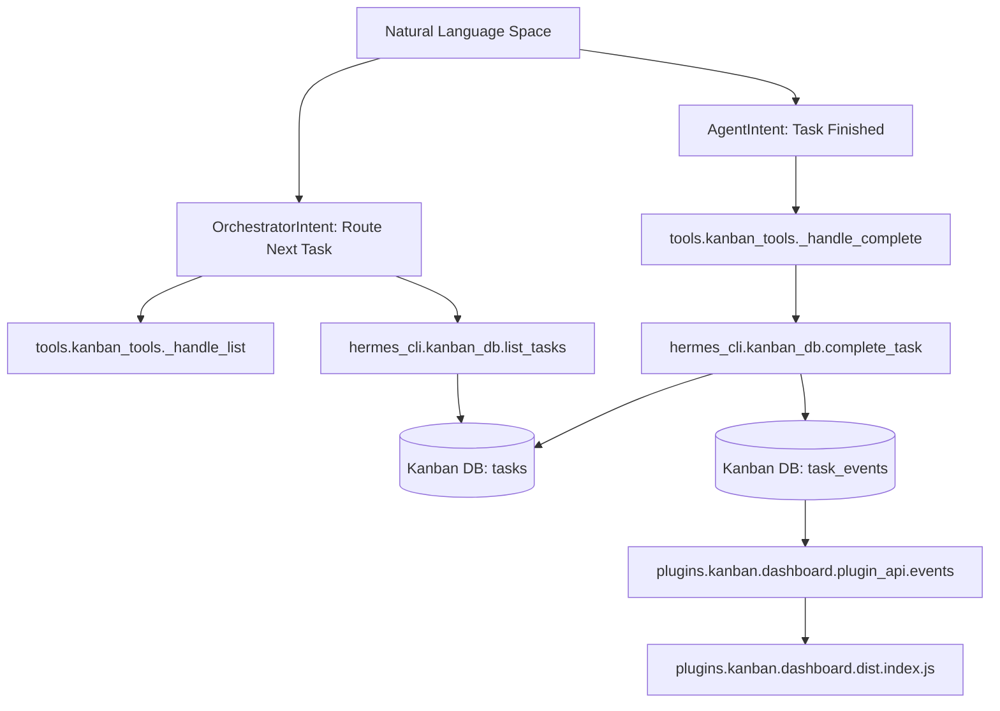
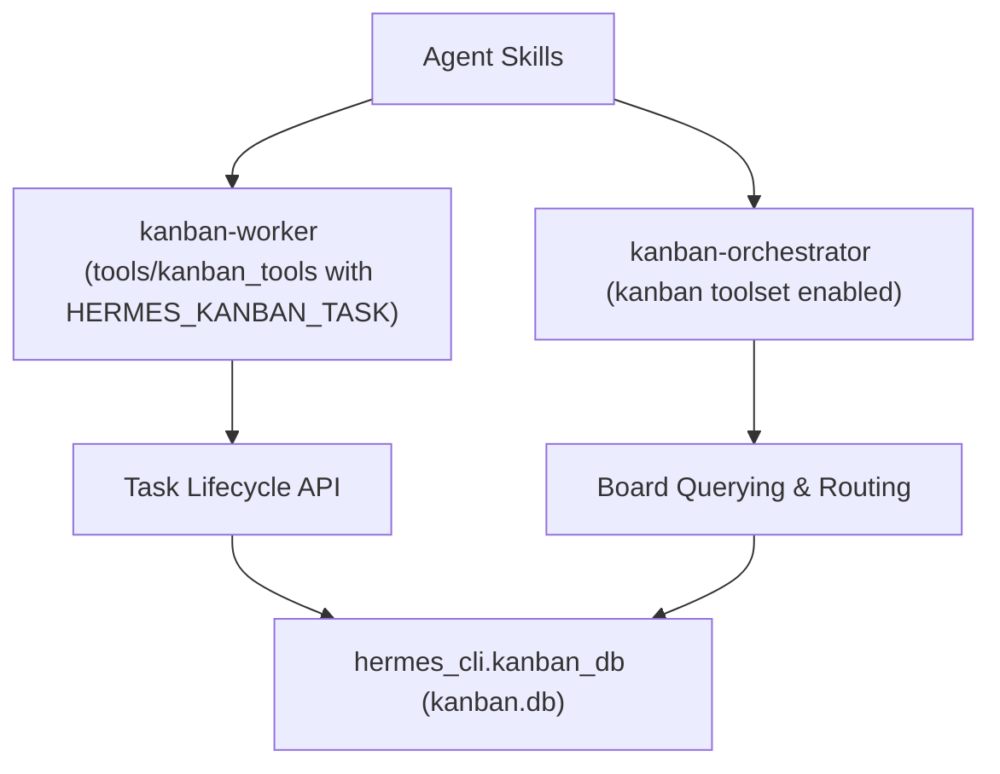
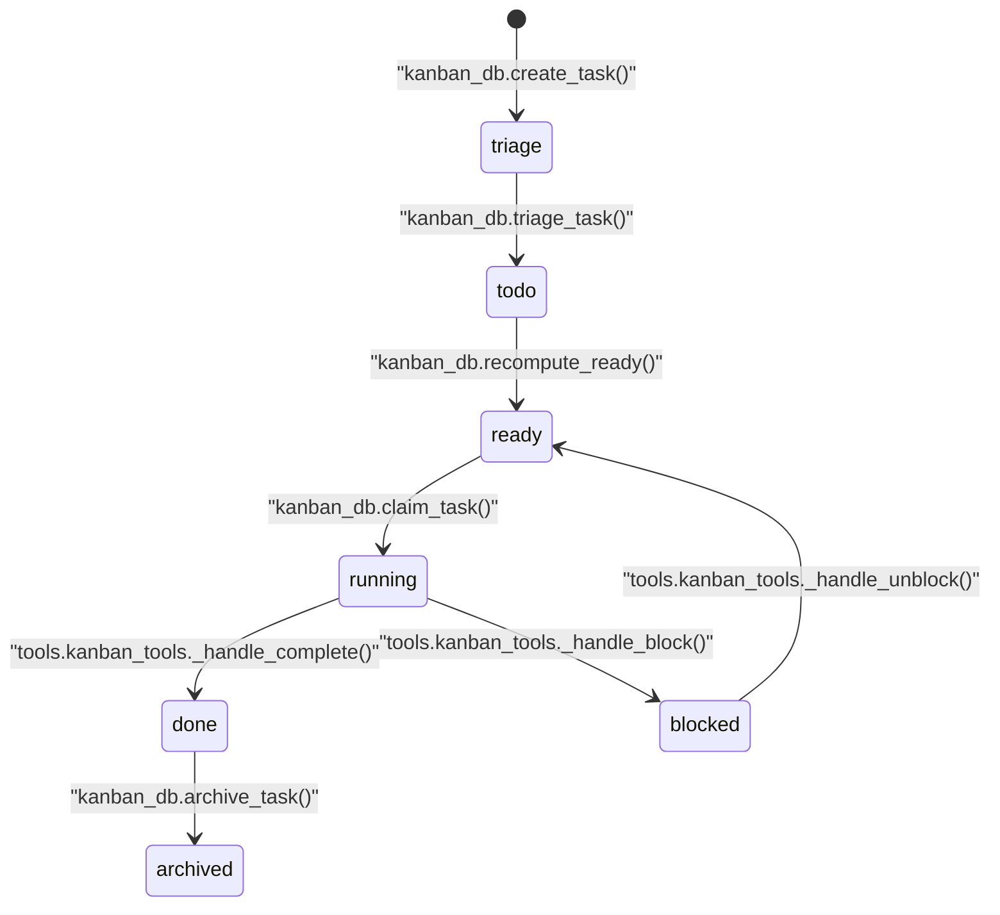

# Kanban Tools and Dashboard

Relevant source files

The following files were used as context for generating this wiki page:

- [agent/shell_hooks.py](agent/shell_hooks.py)
- [contributors/emails/robertlisowski57@gmail.com](contributors/emails/robertlisowski57@gmail.com)
- [hermes_cli/agent_plugins.py](hermes_cli/agent_plugins.py)
- [hermes_cli/hooks.py](hermes_cli/hooks.py)
- [hermes_cli/kanban.py](hermes_cli/kanban.py)
- [hermes_cli/kanban_db.py](hermes_cli/kanban_db.py)
- [hermes_cli/kanban_db_connect.py](hermes_cli/kanban_db_connect.py)
- [hermes_cli/kanban_db_dispatch.py](hermes_cli/kanban_db_dispatch.py)
- [hermes_cli/kanban_db_notify.py](hermes_cli/kanban_db_notify.py)
- [hermes_cli/kanban_db_workspace.py](hermes_cli/kanban_db_workspace.py)
- [hermes_cli/kanban_diagnostics.py](hermes_cli/kanban_diagnostics.py)
- [hermes_cli/kanban_ops.py](hermes_cli/kanban_ops.py)
- [hermes_cli/kanban_output.py](hermes_cli/kanban_output.py)
- [hermes_cli/kanban_parser.py](hermes_cli/kanban_parser.py)
- [hermes_cli/kanban_swarm.py](hermes_cli/kanban_swarm.py)
- [hermes_cli/kanban_transfer.py](hermes_cli/kanban_transfer.py)
- [hermes_cli/kanban_workflow.py](hermes_cli/kanban_workflow.py)
- [hermes_cli/mcp_picker.py](hermes_cli/mcp_picker.py)
- [hermes_cli/mcp_security.py](hermes_cli/mcp_security.py)
- [hermes_cli/memory_oauth.py](hermes_cli/memory_oauth.py)
- [hermes_cli/middleware.py](hermes_cli/middleware.py)
- [hermes_cli/plugin_oauth.py](hermes_cli/plugin_oauth.py)
- [hermes_cli/plugin_provider_requests.py](hermes_cli/plugin_provider_requests.py)
- [hermes_cli/plugin_validate.py](hermes_cli/plugin_validate.py)
- [hermes_cli/plugin_validate_desktop.py](hermes_cli/plugin_validate_desktop.py)
- [hermes_cli/plugins.py](hermes_cli/plugins.py)
- [hermes_cli/plugins_cmd.py](hermes_cli/plugins_cmd.py)
- [hermes_cli/plugins_cmd_catalog.py](hermes_cli/plugins_cmd_catalog.py)
- [hermes_cli/plugins_cmd_install.py](hermes_cli/plugins_cmd_install.py)
- [hermes_cli/plugins_cmd_remove.py](hermes_cli/plugins_cmd_remove.py)
- [hermes_cli/plugins_cmd_update.py](hermes_cli/plugins_cmd_update.py)
- [hermes_cli/plugins_cmd_update_all.py](hermes_cli/plugins_cmd_update_all.py)
- [hermes_cli/plugins_discovery.py](hermes_cli/plugins_discovery.py)
- [hermes_cli/plugins_dispatch.py](hermes_cli/plugins_dispatch.py)
- [hermes_cli/plugins_ledger.py](hermes_cli/plugins_ledger.py)
- [hermes_cli/plugins_loader.py](hermes_cli/plugins_loader.py)
- [hermes_cli/plugins_manifest.py](hermes_cli/plugins_manifest.py)
- [hermes_cli/plugins_state.py](hermes_cli/plugins_state.py)
- [hermes_cli/plugins_transaction.py](hermes_cli/plugins_transaction.py)
- [hermes_cli/plugins_updates.py](hermes_cli/plugins_updates.py)
- [hermes_cli/subcommands/plugins.py](hermes_cli/subcommands/plugins.py)
- [optional-skills/autonomous-ai-agents/agent-merge-conflict-arbiter/SKILL.md](optional-skills/autonomous-ai-agents/agent-merge-conflict-arbiter/SKILL.md)
- [plugin-catalog/README.md](plugin-catalog/README.md)
- [plugins/kanban/dashboard/dist/index.js](plugins/kanban/dashboard/dist/index.js)
- [plugins/kanban/dashboard/dist/style.css](plugins/kanban/dashboard/dist/style.css)
- [plugins/kanban/dashboard/plugin_api.py](plugins/kanban/dashboard/plugin_api.py)
- [tests/agent/test_post_compaction_hook.py](tests/agent/test_post_compaction_hook.py)
- [tests/agent/test_shell_hooks.py](tests/agent/test_shell_hooks.py)
- [tests/gateway/test_weak_credential_guard.py](tests/gateway/test_weak_credential_guard.py)
- [tests/hermes_cli/test_agent_plugins.py](tests/hermes_cli/test_agent_plugins.py)
- [tests/hermes_cli/test_hooks_cli.py](tests/hermes_cli/test_hooks_cli.py)
- [tests/hermes_cli/test_kanban_block_kinds.py](tests/hermes_cli/test_kanban_block_kinds.py)
- [tests/hermes_cli/test_kanban_cli.py](tests/hermes_cli/test_kanban_cli.py)
- [tests/hermes_cli/test_kanban_complete_live_claim_guard.py](tests/hermes_cli/test_kanban_complete_live_claim_guard.py)
- [tests/hermes_cli/test_kanban_core_functionality.py](tests/hermes_cli/test_kanban_core_functionality.py)
- [tests/hermes_cli/test_kanban_db.py](tests/hermes_cli/test_kanban_db.py)
- [tests/hermes_cli/test_kanban_diagnostics.py](tests/hermes_cli/test_kanban_diagnostics.py)
- [tests/hermes_cli/test_kanban_dispatch_claim_allowlist.py](tests/hermes_cli/test_kanban_dispatch_claim_allowlist.py)
- [tests/hermes_cli/test_kanban_gc_retention.py](tests/hermes_cli/test_kanban_gc_retention.py)
- [tests/hermes_cli/test_kanban_list_undecodable_text.py](tests/hermes_cli/test_kanban_list_undecodable_text.py)
- [tests/hermes_cli/test_kanban_notify.py](tests/hermes_cli/test_kanban_notify.py)
- [tests/hermes_cli/test_kanban_review_lifecycle.py](tests/hermes_cli/test_kanban_review_lifecycle.py)
- [tests/hermes_cli/test_kanban_review_lifecycle_complete.py](tests/hermes_cli/test_kanban_review_lifecycle_complete.py)
- [tests/hermes_cli/test_kanban_review_surfaces.py](tests/hermes_cli/test_kanban_review_surfaces.py)
- [tests/hermes_cli/test_kanban_swarm.py](tests/hermes_cli/test_kanban_swarm.py)
- [tests/hermes_cli/test_kanban_transfer.py](tests/hermes_cli/test_kanban_transfer.py)
- [tests/hermes_cli/test_kanban_watch_banner.py](tests/hermes_cli/test_kanban_watch_banner.py)
- [tests/hermes_cli/test_kanban_workflow.py](tests/hermes_cli/test_kanban_workflow.py)
- [tests/hermes_cli/test_kanban_worktree_teardown.py](tests/hermes_cli/test_kanban_worktree_teardown.py)
- [tests/hermes_cli/test_mcp_security.py](tests/hermes_cli/test_mcp_security.py)
- [tests/hermes_cli/test_plugin_dependency_consent.py](tests/hermes_cli/test_plugin_dependency_consent.py)
- [tests/hermes_cli/test_plugin_hook_failure_reporting.py](tests/hermes_cli/test_plugin_hook_failure_reporting.py)
- [tests/hermes_cli/test_plugin_install_ref.py](tests/hermes_cli/test_plugin_install_ref.py)
- [tests/hermes_cli/test_plugin_loader_module_eviction.py](tests/hermes_cli/test_plugin_loader_module_eviction.py)
- [tests/hermes_cli/test_plugin_module_eviction_race.py](tests/hermes_cli/test_plugin_module_eviction_race.py)
- [tests/hermes_cli/test_plugin_oauth.py](tests/hermes_cli/test_plugin_oauth.py)
- [tests/hermes_cli/test_plugin_scan_dunder_dirs.py](tests/hermes_cli/test_plugin_scan_dunder_dirs.py)
- [tests/hermes_cli/test_plugin_uninstall_windows_live.py](tests/hermes_cli/test_plugin_uninstall_windows_live.py)
- [tests/hermes_cli/test_plugin_validate.py](tests/hermes_cli/test_plugin_validate.py)
- [tests/hermes_cli/test_plugins.py](tests/hermes_cli/test_plugins.py)
- [tests/hermes_cli/test_plugins_catalog_requires_hermes.py](tests/hermes_cli/test_plugins_catalog_requires_hermes.py)
- [tests/hermes_cli/test_plugins_check_updates.py](tests/hermes_cli/test_plugins_check_updates.py)
- [tests/hermes_cli/test_plugins_cmd.py](tests/hermes_cli/test_plugins_cmd.py)
- [tests/hermes_cli/test_plugins_cmd_catalog.py](tests/hermes_cli/test_plugins_cmd_catalog.py)
- [tests/hermes_cli/test_plugins_cmd_enable_disable_nested.py](tests/hermes_cli/test_plugins_cmd_enable_disable_nested.py)
- [tests/hermes_cli/test_plugins_loader.py](tests/hermes_cli/test_plugins_loader.py)
- [tests/hermes_cli/test_plugins_update_all.py](tests/hermes_cli/test_plugins_update_all.py)
- [tests/hermes_cli/test_web_memory_user_dir_provider.py](tests/hermes_cli/test_web_memory_user_dir_provider.py)
- [tests/plugins/test_kanban_dashboard_plugin.py](tests/plugins/test_kanban_dashboard_plugin.py)
- [tests/plugins/test_kanban_workflow_matrix.py](tests/plugins/test_kanban_workflow_matrix.py)
- [tests/plugins/test_memory_hook_registration.py](tests/plugins/test_memory_hook_registration.py)
- [tests/pm/test_plugin_declarations.py](tests/pm/test_plugin_declarations.py)
- [tests/providers/fake_pkce_idp.py](tests/providers/fake_pkce_idp.py)
- [tests/tools/test_kanban_tools.py](tests/tools/test_kanban_tools.py)
- [tools/kanban_tools.py](tools/kanban_tools.py)
- [tools/kanban_tools_schemas.py](tools/kanban_tools_schemas.py)
- [website/docs/developer-guide/middleware.md](website/docs/developer-guide/middleware.md)
- [website/docs/developer-guide/plugins/catalog-submission.md](website/docs/developer-guide/plugins/catalog-submission.md)
- [website/docs/developer-guide/plugins/index.md](website/docs/developer-guide/plugins/index.md)
- [website/docs/user-guide/features/hooks.md](website/docs/user-guide/features/hooks.md)
- [website/docs/user-guide/features/kanban-worker-lanes.md](website/docs/user-guide/features/kanban-worker-lanes.md)
- [website/docs/user-guide/features/kanban.md](website/docs/user-guide/features/kanban.md)
- [website/docs/user-guide/features/plugin-catalog.md](website/docs/user-guide/features/plugin-catalog.md)
- [website/docs/user-guide/features/plugins.md](website/docs/user-guide/features/plugins.md)
- [website/i18n/zh-Hans/docusaurus-plugin-content-docs/current/user-guide/features/kanban-worker-lanes.md](website/i18n/zh-Hans/docusaurus-plugin-content-docs/current/user-guide/features/kanban-worker-lanes.md)
- [website/i18n/zh-Hans/docusaurus-plugin-content-docs/current/user-guide/features/kanban.md](website/i18n/zh-Hans/docusaurus-plugin-content-docs/current/user-guide/features/kanban.md)

This page documents the Hermes Kanban system's agent-facing tool interface, the web dashboard plugin backend (`plugins/kanban/dashboard/plugin_api.py`) and frontend SPA (`plugins/kanban/dashboard/dist/index.js`), and the specialized `kanban-worker` and `kanban-orchestrator` skills enabling multi-agent coordination and stateful task management.

---

## Agent Tool Interface (`kanban_tools`)

The Kanban integration provides structured agent tools implemented in [`tools/kanban_tools.py`](tools/kanban_tools.py) that allow worker and orchestrator agents to manipulate task lifecycles and query board state without invoking CLI commands or the dashboard UI directly. These tools offer a programmatic API for agents, tightly integrated with Kanban’s durable SQLite-backed task queue.

### Tool Visibility and Gating

The Kanban toolset is selectively registered in agent schemas based on runtime conditions to enforce a strict separation between worker-bound operations for single tasks and orchestrator operations with broad board visibility:

- **Worker Agent Mode:** When the environment variable `HERMES_KANBAN_TASK` is set (indicating a dispatcher-spawned worker tied to one task), only essential lifecycle mutation tools are injected:

  - `kanban_complete` — mark task complete
  - `kanban_block` — mark task blocked
  - `kanban_heartbeat` — send heartbeat to refresh claim
  - `kanban_comment` — post comments to a task

  Routing and enumeration tools like `kanban_list` and `kanban_unblock` are omitted to prevent unauthorized broad board mutations. This gating logic detects executor context and enforces restrictions by inspecting delegation context predicates and environment variables [tools/kanban_tools.py:37-90]().

- **Orchestrator Mode:** When the active profile explicitly enables the Kanban toolset in configuration (under `toolsets: ["kanban"]`) and the agent is not running under `HERMES_KANBAN_TASK`, the full set of Kanban tools—including board-wide enumeration and routing tools—are available to implement orchestrator workflows such as task routing, unblocking, and listing [tools/kanban_tools.py:37-53](), [tools/kanban_tools.py:74-103]().

- **Default Mode:** Normal Hermes chat sessions without Kanban context have no Kanban tools registered, preventing accidental mutations [tools/kanban_tools.py:37-53]().

### Mutation Restrictions for Delegate Child Contexts

Agent subprocesses spawned as `delegate_task` children inherit Kanban environment variables but are forbidden from mutating Kanban state directly. Mutation attempts in such delegate child contexts raise structured rejection errors:

- This avoids unsafe concurrent writes or circumventing dispatch rules. Delegated children report findings back but cannot mutate durable Kanban state — only the parent or a dispatcher worker makes those mutations.
- Enforcement occurs at both the tool layer (rejecting calls with `_Reject`) and in the Kanban DB mutation layer (`_assert_not_delegated_child_mutation`) [tools/kanban_tools.py:138-147](), [hermes_cli/kanban_db.py:138-150]().

Sources:
- [tools/kanban_tools.py:37-103]()
- [hermes_cli/kanban_db.py:138-150]()

---

### Core Tool Handlers

Key Kanban tools and their main handler functions (all within `tools/kanban_tools.py`) mainly delegate to durable `hermes_cli.kanban_db` API calls:

| Tool Name | Purpose | Implementation Reference |
| :-------------------- | :--------------------------------------------------- | :---------------------------------------------------------- |
| `kanban_show` | Retrieve detailed task metadata, comments, runs | `_handle_show` [tools/kanban_tools.py:172-184]() |
| `kanban_complete` | Mark task done with summary, metadata, attachments | `_handle_complete` [tools/kanban_tools.py:254-276]() |
| `kanban_block` | Block a task with a typed reason and message | `_handle_block` [tools/kanban_tools.py:280-301]() |
| `kanban_heartbeat` | Refresh heartbeat to extend task claim TTL | `_handle_heartbeat` [tools/kanban_tools.py:301-321]() |
| `kanban_list` | List and filter Kanban tasks by criteria | `_handle_list` [tools/kanban_tools.py:439-460]() |
| `kanban_unblock` | Unblock a blocked task, restoring ready state | `_handle_unblock` [tools/kanban_tools.py:350-370]() |

These handlers validate authorization and task ownership by inspecting environment variables and delegation context predicates. Validation failures raise the internal `_Reject` exception to surface structured tool errors preventing invalid state transitions or cross-run mutations [tools/kanban_tools.py:153-174]().

Sources:
- [tools/kanban_tools.py:153-370]()
- [tools/kanban_tools.py:439-460]()

---

### Goal Mode Integration and Judge Verification

Kanban task completion is tightly integrated with the goal mode acceptance mechanism:

- Tasks created with `goal_mode=True` invoke a judge function (`judge_goal` from `hermes_cli.goals`), which evaluates whether the task meets acceptance criteria [tools/kanban_tools.py:19]().
- During `kanban_complete`, the judge verdict must be `"accept"` to permit completing the task; a verdict of `"continue"` indicates more evidence is needed, blocking completion.
- This ensures objective, LLM-external verification gates task completion, preventing premature finishing and encouraging iterative improvement [tools/kanban_tools.py:210-238](), [tests/tools/test_kanban_tools.py:163-200]().

Sources:
- [tools/kanban_tools.py:19]()
- [tools/kanban_tools.py:210-238]()
- [tests/tools/test_kanban_tools.py:163-200]()

---

## Web Dashboard Plugin

The Kanban dashboard plugin integrates the Kanban task board into the Hermes Web UI, providing a live, interactive task board view synced with the Kanban SQLite DB and agent state.

### Backend API: `plugin_api.py`

- Exposes FastAPI handlers under the `/api/plugins/kanban/` router that wrap the same durable Kanban DB code paths used by CLI and gateway commands, so all data surfaces are consistent [plugins/kanban/dashboard/plugin_api.py:1-91]().
- Board query parameters undergo strict normalization and validation via `kanban_db._normalize_board_slug()`. Missing slugs default to the current active board; invalid or missing boards return HTTP 400 or 404 errors respectively, guarding input safety [plugins/kanban/dashboard/plugin_api.py:60-91]().
- The `/events` WebSocket endpoint streams real-time board update events by tailing the append-only `task_events` table using a short-polling WAL read method. This concurrency-safe design allows the dashboard to receive live updates without blocking Kanban DB writes.
- WebSocket upgrade requests are gated by the dashboard’s canonical WS auth logic, ensuring secure access control [plugins/kanban/dashboard/plugin_api.py:10-58]().

Sources:
- [plugins/kanban/dashboard/plugin_api.py:1-91]()

### Frontend SPA: `dist/index.js`

- A React single-page application renders the Kanban board with columns (`triage`, `todo`, `ready`, `running`, `blocked`, `review`, `done`) supporting drag-and-drop card reordering [tests/plugins/test_kanban_dashboard_plugin.py:66-81]().
- Cards show Markdown-formatted content and comments, sanitized using DOMPurify and parsed with the marked Markdown library.
- API errors trigger user-friendly alerts and banners to avoid exposing raw HTTP codes [plugins/kanban/dashboard/plugin_api.py:149-158]().
- Diagnostic banners alert operators about hallucination risks or other anomalies detected in task references [plugins/kanban/dashboard/plugin_api.py:123-128]().

Sources:
- [plugins/kanban/dashboard/plugin_api.py:123-158]()
- [tests/plugins/test_kanban_dashboard_plugin.py:66-81]()

---

## Multi-Agent Coordination and Skills

Kanban supports coordination of multiple Hermes agent profiles through a shared durable SQLite task queue. It enforces clear separation between worker agents and orchestrator agents.

Title: Natural Language Space to Code Entity Space Mapping

Sources:
- [tools/kanban_tools.py:254-276]()
- [tools/kanban_tools.py:439-460]()
- [hermes_cli/kanban_db.py:1-12]()
- [plugins/kanban/dashboard/plugin_api.py:1-91]()
- [plugins/kanban/dashboard/dist/index.js]()

### Kanban Worker and Orchestrator Skills

- **`kanban-worker` Skill:** Spawned by the Kanban dispatcher with `HERMES_KANBAN_TASK` set, worker agents run isolated lifecycles on single tasks, using lifecycle mutation tools (`kanban_complete`, `kanban_block`, `kanban_heartbeat`, `kanban_comment`) to persist progress and handle retries safely [tools/kanban_tools.py:136-141]().

- **`kanban-orchestrator` Skill:** Runs with the full Kanban toolset enabled, orchestrators enumerate (`kanban_list`), route, unblock tasks, and manage workflow pipelines for efficient multi-agent coordination [tools/kanban_tools.py:74-82]().

Title: Kanban Agent Skills Mapped to Code Entities

Sources:
- [tools/kanban_tools.py:74-82]()
- [tools/kanban_tools.py:136-141]()
- [hermes_cli/kanban_db.py:1-12]()

---

## Kanban Task Lifecycle State Machine

Tasks traverse a durable state machine stored in the Kanban SQLite DB. Transitions are strictly controlled via transactional locking and compare-and-swap (CAS) on key columns like `tasks.status` and `claim_lock`:

Title: Kanban Task Lifecycle State Machine

- Tasks start in `triage` on creation, then move through `todo` and `ready` based on dependencies and readiness conditions.
- A claimed task is in `running`, assigned exclusively to one worker agent.
- From `running`, tasks may be completed (`done`) or blocked with typed reasons (`dependency`, `needs_input`, `capability`, `transient`) [hermes_cli/kanban_db.py:106-111]().
- Block/unblock cycles are limited by recurrence counts to avoid infinite loops; exceeding limits re-routes tasks to `triage` [hermes_cli/kanban_db.py:110-115]().

Sources:
- [hermes_cli/kanban_db.py:6-12]()
- [hermes_cli/kanban_db.py:93]()
- [hermes_cli/kanban_db.py:106-115]()
- [tools/kanban_tools.py:254-276]()
- [tools/kanban_tools.py:280-301]()
- [tools/kanban_tools.py:350-370]()

---

## Diagnostics and Recovery Mechanisms

- **Hallucination Detection:** When task completion references phantom linked cards (nonexistent IDs), diagnostic events log these hallucinations. The dashboard shows these prominently as banners to alert operators and encourage model grounding improvements [plugins/kanban/dashboard/plugin_api.py:123-128]().
- **Crash and Stale Claim Reclaiming:** The Kanban dispatcher detects crashed or stale tasks by monitoring heartbeats and worker PID liveness. It reclaims such tasks to prevent the pipeline from stalling or losing progress [hermes_cli/kanban_db_dispatch.py:1-145]().
- **Unblock Loop Breaker:** To prevent infinite block/unblock cycles, unblock recurrence counts are tracked. Exceeding a limit routes tasks back to `triage` for manual intervention [hermes_cli/kanban_db.py:110-115]().
- **Notify Subscriptions:** Gateway-notifiable subscriptions receive event-driven alerts derived from the append-only `task_events` table [hermes_cli/kanban_db_notify.py](), [tests/hermes_cli/test_kanban_cli.py:110-200]().

Sources:
- [plugins/kanban/dashboard/plugin_api.py:123-128]()
- [hermes_cli/kanban_db_dispatch.py:1-145]()
- [hermes_cli/kanban_db.py:110-115]()
- [tests/hermes_cli/test_kanban_cli.py:110-200]()

---

## Sources

- `tools/kanban_tools.py:1-165`
- `hermes_cli/kanban_db.py:1-170`
- `hermes_cli/kanban_db_dispatch.py:1-145`
- `plugins/kanban/dashboard/plugin_api.py:1-172`
- `plugins/kanban/dashboard/dist/index.js`
- `tests/tools/test_kanban_tools.py:1-186`
- `tests/plugins/test_kanban_dashboard_plugin.py:1-181`
- `website/docs/user-guide/features/kanban.md:1-102`
- `hermes_cli/kanban.py:1-151`
- `hermes_cli/kanban_db_notify.py`
- `tests/hermes_cli/test_kanban_cli.py:110-200`