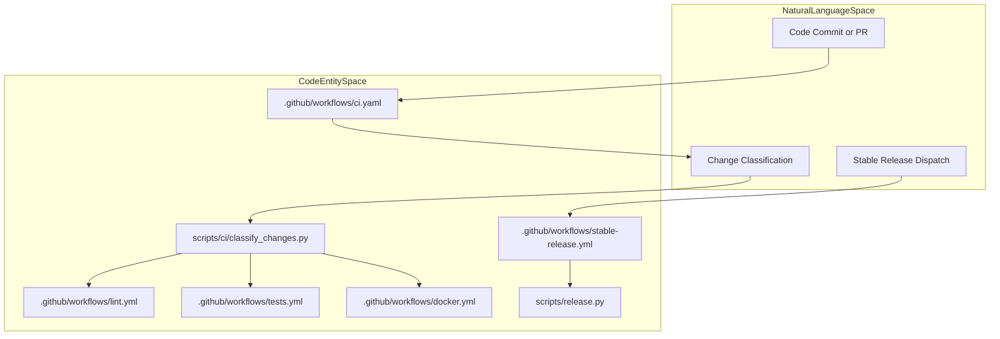
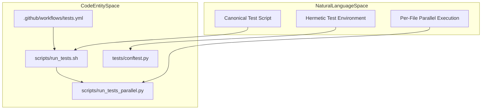

# Infrastructure and CI/CD

Relevant source files

The following files were used as context for generating this wiki page:

- [.github/CODEOWNERS](.github/CODEOWNERS)
- [.github/actionlint.yaml](.github/actionlint.yaml)
- [.github/actions/check-clean-worktree/action.yml](.github/actions/check-clean-worktree/action.yml)
- [.github/actions/detect-changes/action.yml](.github/actions/detect-changes/action.yml)
- [.github/actions/get-app-token/action.yml](.github/actions/get-app-token/action.yml)
- [.github/actions/nix-setup/action.yml](.github/actions/nix-setup/action.yml)
- [.github/workflows/catalog-tests.yml](.github/workflows/catalog-tests.yml)
- [.github/workflows/ci.yaml](.github/workflows/ci.yaml)
- [.github/workflows/contributor-check.yml](.github/workflows/contributor-check.yml)
- [.github/workflows/deploy-site.yml](.github/workflows/deploy-site.yml)
- [.github/workflows/desktop-bundled-release.yml](.github/workflows/desktop-bundled-release.yml)
- [.github/workflows/docker-lint.yml](.github/workflows/docker-lint.yml)
- [.github/workflows/docker.yml](.github/workflows/docker.yml)
- [.github/workflows/docs-site-checks.yml](.github/workflows/docs-site-checks.yml)
- [.github/workflows/history-check.yml](.github/workflows/history-check.yml)
- [.github/workflows/js-autofix.yml](.github/workflows/js-autofix.yml)
- [.github/workflows/label-rerun.yml](.github/workflows/label-rerun.yml)
- [.github/workflows/lint.yml](.github/workflows/lint.yml)
- [.github/workflows/live-providers.yml](.github/workflows/live-providers.yml)
- [.github/workflows/lockfile-diff.yml](.github/workflows/lockfile-diff.yml)
- [.github/workflows/nix.yml](.github/workflows/nix.yml)
- [.github/workflows/osv-scanner.yml](.github/workflows/osv-scanner.yml)
- [.github/workflows/profile-artifact-check.yml](.github/workflows/profile-artifact-check.yml)
- [.github/workflows/prompt-surface-diff.yml](.github/workflows/prompt-surface-diff.yml)
- [.github/workflows/remote-backends.yml](.github/workflows/remote-backends.yml)
- [.github/workflows/sandbox-image.yml](.github/workflows/sandbox-image.yml)
- [.github/workflows/skills-index-freshness.yml](.github/workflows/skills-index-freshness.yml)
- [.github/workflows/skills-index.yml](.github/workflows/skills-index.yml)
- [.github/workflows/stable-release-publication.yml](.github/workflows/stable-release-publication.yml)
- [.github/workflows/stable-release.yml](.github/workflows/stable-release.yml)
- [.github/workflows/supply-chain-audit.yml](.github/workflows/supply-chain-audit.yml)
- [.github/workflows/tests-os.yml](.github/workflows/tests-os.yml)
- [.github/workflows/tests.yml](.github/workflows/tests.yml)
- [.github/workflows/uv-lockfile-check.yml](.github/workflows/uv-lockfile-check.yml)
- [docker/sandbox-desktop-smoke.sh](docker/sandbox-desktop-smoke.sh)
- [docker/sandbox-desktop.Dockerfile](docker/sandbox-desktop.Dockerfile)
- [scripts/bundles/channel_artifacts.py](scripts/bundles/channel_artifacts.py)
- [scripts/bundles/release_artifacts.py](scripts/bundles/release_artifacts.py)
- [scripts/ci/catalog_test_files.py](scripts/ci/catalog_test_files.py)
- [scripts/ci/check_catalog_cors.py](scripts/ci/check_catalog_cors.py)
- [scripts/ci/check_profile_archive_boundary.py](scripts/ci/check_profile_archive_boundary.py)
- [scripts/ci/classify_changes.py](scripts/ci/classify_changes.py)
- [scripts/ci/prompt_surface.py](scripts/ci/prompt_surface.py)
- [scripts/ci/required_results.py](scripts/ci/required_results.py)
- [scripts/ci/start_test_sshd.sh](scripts/ci/start_test_sshd.sh)
- [scripts/ci/test_sshd_container_setup.sh](scripts/ci/test_sshd_container_setup.sh)
- [scripts/release.py](scripts/release.py)
- [scripts/releases/channel_releases.py](scripts/releases/channel_releases.py)
- [scripts/releases/channels.py](scripts/releases/channels.py)
- [scripts/releases/darwin.py](scripts/releases/darwin.py)
- [scripts/releases/entrypoint.py](scripts/releases/entrypoint.py)
- [scripts/releases/handoff.py](scripts/releases/handoff.py)
- [scripts/releases/r2.py](scripts/releases/r2.py)
- [scripts/releases/sequencer.py](scripts/releases/sequencer.py)
- [scripts/releases/stable.py](scripts/releases/stable.py)
- [scripts/releases/store.py](scripts/releases/store.py)
- [scripts/run_tests.sh](scripts/run_tests.sh)
- [scripts/run_tests_parallel.py](scripts/run_tests_parallel.py)
- [tests/ci/test_check_catalog_cors.py](tests/ci/test_check_catalog_cors.py)
- [tests/ci/test_classify_changes.py](tests/ci/test_classify_changes.py)
- [tests/ci/test_clean_worktree_check.py](tests/ci/test_clean_worktree_check.py)
- [tests/ci/test_desktop_release_tag_admission.py](tests/ci/test_desktop_release_tag_admission.py)
- [tests/ci/test_prompt_surface.py](tests/ci/test_prompt_surface.py)
- [tests/ci/test_required_results.py](tests/ci/test_required_results.py)
- [tests/ci/test_stable_release_graph.py](tests/ci/test_stable_release_graph.py)
- [tests/ci/test_update_ci_routing.py](tests/ci/test_update_ci_routing.py)
- [tests/ci/test_update_transitive_routing.py](tests/ci/test_update_transitive_routing.py)
- [tests/ci/workflow_steps.py](tests/ci/workflow_steps.py)
- [tests/conftest.py](tests/conftest.py)
- [tests/hermes_cli/test_reasoning_effort_menu.py](tests/hermes_cli/test_reasoning_effort_menu.py)
- [tests/scripts/install/test_install_ps1_native_calls.py](tests/scripts/install/test_install_ps1_native_calls.py)
- [tests/scripts/test_release_artifacts.py](tests/scripts/test_release_artifacts.py)
- [tests/scripts/test_release_channels.py](tests/scripts/test_release_channels.py)
- [tests/scripts/test_release_entrypoint.py](tests/scripts/test_release_entrypoint.py)
- [tests/scripts/test_release_handoff.py](tests/scripts/test_release_handoff.py)
- [tests/scripts/test_release_r2.py](tests/scripts/test_release_r2.py)
- [tests/scripts/test_release_sequencer.py](tests/scripts/test_release_sequencer.py)
- [tests/scripts/test_release_store.py](tests/scripts/test_release_store.py)
- [tests/scripts/test_run_tests_parallel.py](tests/scripts/test_run_tests_parallel.py)
- [tests/scripts/test_stable_release.py](tests/scripts/test_stable_release.py)
- [tests/test_basetemp_isolation.py](tests/test_basetemp_isolation.py)
- [tests/tools/test_browser_supervisor_capture.py](tests/tools/test_browser_supervisor_capture.py)
- [tests/tools/test_browser_supervisor_capture_dispatch.py](tests/tools/test_browser_supervisor_capture_dispatch.py)
- [tests/tools/test_docker_backend_real.py](tests/tools/test_docker_backend_real.py)
- [tests/website/test_fetch_plugin_stars.py](tests/website/test_fetch_plugin_stars.py)
- [tools/browser_supervisor_capture.py](tools/browser_supervisor_capture.py)
- [website/docs/developer-guide/stable-releases.md](website/docs/developer-guide/stable-releases.md)
- [website/scripts/fetch-plugin-stars.py](website/scripts/fetch-plugin-stars.py)
- [website/scripts/prebuild.mjs](website/scripts/prebuild.mjs)

The Hermes Agent framework is supported by a comprehensive infrastructure and CI/CD system that ensures robust, portable deployment, secure and reproducible builds, and thorough automated testing. This infrastructure integrates container technology, Nix-based packaging, GitHub Actions workflows, and parallel test execution to maintain high code quality and streamline release management.

The purpose of this page is to provide a high-level overview of Hermes' infrastructure, containerization, CI/CD pipelines, release mechanisms, and testing architecture. For deep technical details, configuration files, and step-by-step operator guides, refer to the designated child pages: [Docker Deployment](#14.1), [CI/CD and Release Management](#14.2), and [Testing Infrastructure](#14.3).

---

## 14.1 Docker Deployment

Hermes Agent is primarily containerized using Docker with a sophisticated multi-stage build process. A dedicated build stage compiles a pinned SQLite shared library version to avoid upstream WAL-reset corruption bugs present in Debian base images, ensuring stable database operations [Dockerfile:1-43]().

The runtime container employs `s6-overlay` as the init system (PID 1) to provide reliable UNIX signal handling, zombie process reaping, and supervision of multiple Hermes services, including the main agent, the dashboard service, and per-profile gateways. Environment variables like `PYTHONUNBUFFERED=1` and `PLAYWRIGHT_BROWSERS_PATH` are configured for correct Python logging behavior and chromium integration support [Dockerfile:118-122]().

A key bootstrap step inside the container is the `docker/stage2-hook.sh` script. Executed by s6-overlay after the supervision tree is live, it performs UID/GID remapping of the built-in `hermes` user according to container environment variables (`HERMES_UID`/`HERMES_GID`), replacing arbitrary `--user` flags that break s6 supervision. The script also handles ownership corrections on mounted volumes, config seeding, and skills synchronization [docker/stage2-hook.sh:1-18](), [docker/stage2-hook.sh:26-140]().

Service management inside the container leverages `hermes_cli/service_manager.py`, which abstracts lifecycle operations over a `ServiceManager` protocol supporting systemd, launchd, Windows services, and s6 [hermes_cli/service_manager.py:22-99](). Additionally, `hermes_cli/container_boot.py` implements startup reconciliation logic to restore per-profile gateway services [hermes_cli/container_boot.py:1-15]().

For in-depth details on the Docker image build, init system integration, stage2 hook logic, multi-container management, and in-container lifecycle control, see the child page [Docker Deployment](#14.1).

Sources:
[Dockerfile:1-43](), [Dockerfile:118-122](), [docker/stage2-hook.sh:1-18](), [docker/stage2-hook.sh:26-140](), [hermes_cli/service_manager.py:22-99](), [hermes_cli/container_boot.py:1-15]()

---

## 14.2 CI/CD and Release Management

Hermes maintains a sophisticated CI/CD pipeline orchestrated via GitHub Actions workflows and supporting Python automation scripts, ensuring reliable build/test automation, auditability, and streamlined release management.

Key aspects of the CI/CD and release system include:

- **Change Classification and Work Lanes:** The workflow orchestrator uses change classifiers in `scripts/ci/classify_changes.py` to route PR changes to specific test lanes (Python, frontend, Docker, Nix, E2E), optimizing CI duration while failing open [.github/workflows/ci.yaml:71-94](), [scripts/ci/classify_changes.py:1-84]().
- **Linting and Typing:** The `.github/workflows/lint.yml` workflow runs `ruff` and `ty` to perform Python code linting and static typing checks [.github/workflows/lint.yml:1-169]().
- **Supply Chain Security Audits:** Dedicated audit workflows scan PR diffs for risky supply chain signals and run OSV vulnerability database scans [.github/workflows/supply-chain-audit.yml:1-181](), [.github/workflows/osv-scanner.yml]().
- **Docker Build and Test:** Multi-architecture Docker image builds and integration tests are governed by `.github/workflows/docker.yml` [.github/workflows/docker.yml:1-160]().
- **Release Automation:** Stable and canary releases are driven by `scripts/release.py` and workflows like `.github/workflows/stable-release.yml` and `.github/workflows/desktop-bundled-release.yml`, handling tag admission, CalVer versioning, artifact staging on Cloudflare R2, and channel promotion [scripts/release.py:1-105](), [.github/workflows/stable-release.yml:1-69](), [.github/workflows/desktop-bundled-release.yml:1-86]().

For comprehensive documentation on GitHub Actions workflows, the CalVer release script, update fleet rollouts, and Nix packaging, see the child page [CI/CD and Release Management](#14.2).

### CI/CD Workflow and Release Integration

Title: "CI/CD Pipeline and Release Architecture"

Sources:
[scripts/release.py:1-105](), [.github/workflows/desktop-bundled-release.yml:1-86](), [.github/workflows/ci.yaml:71-94](), [.github/workflows/lint.yml:1-169](), [.github/workflows/docker.yml:1-160](), [scripts/ci/classify_changes.py:1-84](), [.github/workflows/stable-release.yml:1-69]()

---

## 14.3 Testing Infrastructure

Hermes' testing infrastructure supports both Python and JavaScript/TypeScript codebases with rigorous isolation, deterministic execution, and performance optimization.

- **Test Suite Layout:** Python tests reside under `tests/`, while JS/TS tests reside in `tests-js/` [.github/workflows/tests.yml:1-52]().
- **Hermetic Side-Effect Guards:** The `tests/conftest.py` module clears credential environment variables, sandboxes `HERMES_HOME` to per-test temporary directories, and sets deterministic environment flags (e.g., `TZ=UTC`, `PYTHONHASHSEED=0`) [tests/conftest.py:1-19]().
- **Parallel Test Execution:** The canonical test entrypoint `scripts/run_tests.sh` and parallel runner `scripts/run_tests_parallel.py` execute each test file in a separate isolated Python subprocess, bounding concurrency without relying on stateful `pytest-xdist` workers [scripts/run_tests_parallel.py:1-58](), [scripts/run_tests.sh:1-48]().

For detailed documentation of the test suite layout, hermetic fixtures, parallel runner scripts, e2e harnesses, integration with JS/TS tests, and concurrency setup, refer to the child page [Testing Infrastructure](#14.3).

### Testing Infrastructure and Subprocess Isolation

Title: "Testing Infrastructure and Isolation Architecture"

Sources:
[tests/conftest.py:1-19](), [scripts/run_tests_parallel.py:1-58](), [scripts/run_tests.sh:1-48](), [.github/workflows/tests.yml:1-52]()

---

# Summary

Hermes Agent’s infrastructure and CI/CD system cohesively enable:

- **Portable and robust container deployment** using Docker with `s6-overlay` supervision, UID/GID mapping, and internal service management.
- **Strong CI/CD automation** via GitHub Actions with reproducible `uv`-based dependency installs, supply-chain and security scanning, change classification, and release scripting with CalVer tagging.
- **Reliable and hermetic test execution** with per-file isolation, parallel subprocess orchestration for Python tests, JS/TS checks, and integrated caching.

For in-depth architecture, implementation details, configuration, and usage of these systems, follow the linked child pages:
- [Docker Deployment](#14.1)
- [CI/CD and Release Management](#14.2)
- [Testing Infrastructure](#14.3)

Sources:
[Dockerfile:1-43](), [Dockerfile:118-122](), [docker/stage2-hook.sh:1-18](), [docker/stage2-hook.sh:26-140](), [hermes_cli/service_manager.py:22-99](), [hermes_cli/container_boot.py:1-15](), [scripts/release.py:1-105](), [.github/workflows/desktop-bundled-release.yml:1-86](), [.github/workflows/ci.yaml:71-94](), [.github/workflows/lint.yml:1-169](), [.github/workflows/docker.yml:1-160](), [scripts/ci/classify_changes.py:1-84](), [.github/workflows/stable-release.yml:1-69](), [tests/conftest.py:1-19](), [scripts/run_tests_parallel.py:1-58](), [scripts/run_tests.sh:1-48](), [.github/workflows/tests.yml:1-52]()