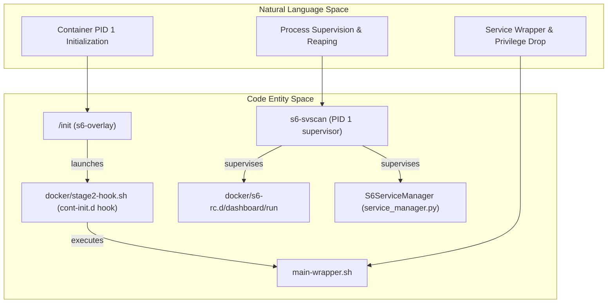
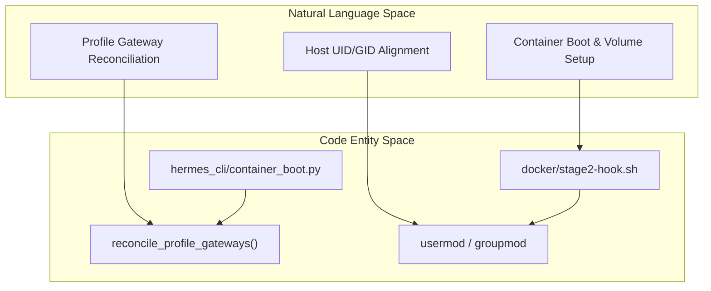

# Docker Deployment

<details>
<summary>Relevant source files</summary>

The following files were used as context for generating this wiki page:

- [.dockerignore](.dockerignore)
- [.gitignore](.gitignore)
- [.hadolint.yaml](.hadolint.yaml)
- [Dockerfile](Dockerfile)
- [contributors/emails/dstkwll@users.noreply.github.com](contributors/emails/dstkwll@users.noreply.github.com)
- [docker-compose.yml](docker-compose.yml)
- [docker/cont-init.d/02-reconcile-profiles](docker/cont-init.d/02-reconcile-profiles)
- [docker/entrypoint-dispatch.sh](docker/entrypoint-dispatch.sh)
- [docker/entrypoint.sh](docker/entrypoint.sh)
- [docker/main-wrapper.sh](docker/main-wrapper.sh)
- [docker/s6-rc.d/dashboard/run](docker/s6-rc.d/dashboard/run)
- [docker/stage2-hook.sh](docker/stage2-hook.sh)
- [hermes_cli/container_boot.py](hermes_cli/container_boot.py)
- [hermes_cli/copilot_auth.py](hermes_cli/copilot_auth.py)
- [hermes_cli/dashboard_register.py](hermes_cli/dashboard_register.py)
- [hermes_cli/main_profile_recovery.py](hermes_cli/main_profile_recovery.py)
- [hermes_cli/service_manager.py](hermes_cli/service_manager.py)
- [hermes_time.py](hermes_time.py)
- [registration_lifecycle.py](registration_lifecycle.py)
- [scripts/docker_rebootstrap_nous_session.py](scripts/docker_rebootstrap_nous_session.py)
- [setup.py](setup.py)
- [tests/cron/test_timezone.py](tests/cron/test_timezone.py)
- [tests/dashboard/test_ws_client_host.py](tests/dashboard/test_ws_client_host.py)
- [tests/docker/__init__.py](tests/docker/__init__.py)
- [tests/docker/conftest.py](tests/docker/conftest.py)
- [tests/docker/test_container_restart.py](tests/docker/test_container_restart.py)
- [tests/docker/test_dashboard.py](tests/docker/test_dashboard.py)
- [tests/docker/test_gateway_run_supervised.py](tests/docker/test_gateway_run_supervised.py)
- [tests/docker/test_interactive_logging.py](tests/docker/test_interactive_logging.py)
- [tests/docker/test_main_invocation.py](tests/docker/test_main_invocation.py)
- [tests/docker/test_profile_gateway.py](tests/docker/test_profile_gateway.py)
- [tests/docker/test_s6_profile_gateway_integration.py](tests/docker/test_s6_profile_gateway_integration.py)
- [tests/docker/test_tui_passthrough.py](tests/docker/test_tui_passthrough.py)
- [tests/docker/test_zombie_reaping.py](tests/docker/test_zombie_reaping.py)
- [tests/hermes_cli/test_apply_profile_override.py](tests/hermes_cli/test_apply_profile_override.py)
- [tests/hermes_cli/test_container_boot.py](tests/hermes_cli/test_container_boot.py)
- [tests/hermes_cli/test_copilot_auth.py](tests/hermes_cli/test_copilot_auth.py)
- [tests/hermes_cli/test_copilot_token_exchange.py](tests/hermes_cli/test_copilot_token_exchange.py)
- [tests/hermes_cli/test_credential_pool_off_loop.py](tests/hermes_cli/test_credential_pool_off_loop.py)
- [tests/hermes_cli/test_dashboard_register.py](tests/hermes_cli/test_dashboard_register.py)
- [tests/hermes_cli/test_doctor_terminal_backends.py](tests/hermes_cli/test_doctor_terminal_backends.py)
- [tests/hermes_cli/test_gateway_s6_dispatch.py](tests/hermes_cli/test_gateway_s6_dispatch.py)
- [tests/hermes_cli/test_profile_export_default_path.py](tests/hermes_cli/test_profile_export_default_path.py)
- [tests/hermes_cli/test_profiles_s6_hooks.py](tests/hermes_cli/test_profiles_s6_hooks.py)
- [tests/hermes_cli/test_service_manager.py](tests/hermes_cli/test_service_manager.py)
- [tests/hermes_cli/test_setup_terminal.py](tests/hermes_cli/test_setup_terminal.py)
- [tests/hermes_cli/test_terminal_backend_docker_probe.py](tests/hermes_cli/test_terminal_backend_docker_probe.py)
- [tests/hermes_cli/test_update_flat_install_state_gitignore.py](tests/hermes_cli/test_update_flat_install_state_gitignore.py)
- [tests/tools/test_docker_find.py](tests/tools/test_docker_find.py)
- [tests/tools/test_docker_rebootstrap_nous_session.py](tests/tools/test_docker_rebootstrap_nous_session.py)
- [tests/tools/test_stage2_hook_api_server_keygen.py](tests/tools/test_stage2_hook_api_server_keygen.py)
- [tests/tools/test_stage2_hook_nous_routing_env.py](tests/tools/test_stage2_hook_nous_routing_env.py)
- [tests/tools/test_stage2_hook_seed_one_symlinks.py](tests/tools/test_stage2_hook_seed_one_symlinks.py)
- [tests/tools/test_stage2_hook_symlink_chown.py](tests/tools/test_stage2_hook_symlink_chown.py)
- [tests/tui_gateway/test_cold_start_gil_stall.py](tests/tui_gateway/test_cold_start_gil_stall.py)
- [tests/tui_gateway/test_entry_sys_path.py](tests/tui_gateway/test_entry_sys_path.py)
- [tests/tui_gateway/test_subprocess_encoding.py](tests/tui_gateway/test_subprocess_encoding.py)
- [toolset_distributions.py](toolset_distributions.py)
- [website/docs/user-guide/docker.md](website/docs/user-guide/docker.md)
- [website/i18n/zh-Hans/docusaurus-plugin-content-docs/current/user-guide/docker.md](website/i18n/zh-Hans/docusaurus-plugin-content-docs/current/user-guide/docker.md)

</details>


This page documents the Docker-based deployment configuration for the Hermes Agent. It covers the `Dockerfile` build architecture, the `s6-overlay` process supervision system, the container bootstrap sequence (`docker/stage2-hook.sh`), profile gateway reconciliation (`hermes_cli/container_boot.py`), in-container service management via `hermes_cli/service_manager.py`, `docker-compose.yml` orchestration, and runtime operational patterns.

---

## 1. Overview and Scope

There are two primary ways Docker intersects with the Hermes Agent: running Hermes *inside* a container (the primary focus of this document), and utilizing Docker as a persistent terminal execution backend [website/docs/user-guide/docker.md:9-14](). 

The Hermes Docker deployment packages the agent into a stateless runtime container where all persistent user configurations, API keys, sessions, skills, and memories reside under a single mount point at `/opt/data` (`HERMES_HOME`) [website/docs/user-guide/docker.md:14](). This design enables seamless container upgrades without loss of state.

Sources: [website/docs/user-guide/docker.md:1-16]()

---

## 2. Build Architecture and Base Image (`Dockerfile`)

### Multi-Stage Build and Custom SQLite Compilation

The multi-stage `Dockerfile` begins with a pinned Debian 13 base (`debian:trixie-20261020@sha256:4c25275...`) in the `sqlite_build` stage [Dockerfile:8](). A custom SQLite shared library (`sqlite-autoconf` version `3530400`) is downloaded, verified against an explicit SHA256 sum, and compiled from source with multiple critical extensions enabled (FTS3/4/5, RTREE, GEOPOLY, MATH_FUNCTIONS, SECURE_DELETE, THREADSAFE, etc.) [Dockerfile:9-41]().

This custom SQLite build works around upstream WAL-reset corruption issues found in default system packages, ensuring database reliability for the agent's SQLite session and memory stores [Dockerfile:1-4]().

The runtime image copies the compiled SQLite shared library to `/usr/local/lib/`, links it as `libsqlite3.so.0` and `libsqlite3.so`, updates the dynamic linker via `ldconfig`, and executes a built-in Python validation snippet to verify FTS5 trigram capabilities [Dockerfile:47-117]().

Sources: [Dockerfile:1-118]()

---

## 3. Init System and Process Supervision (`s6-overlay`)

The container utilizes `s6-overlay` for process supervision, liveness monitoring, and non-blocking zombie reaping on incoming `SIGCHLD` signals [Dockerfile:64-70](). 

- **PID 1 (`/init`):** Launches `s6-svscan` as PID 1, which acts as the master process supervisor [Dockerfile:67-70]().
- **Supervised Services:** Manages the main Hermes gateway service and the optional web dashboard (`dashboard`) when enabled via `HERMES_DASHBOARD=1` [website/docs/user-guide/docker.md:117-129]().
- **Process Wrapper:** Executes services through `main-wrapper.sh` and `s6-setuidgid` to safely drop privileges from root to the unprivileged `hermes` user [docker/stage2-hook.sh:6-7]().

#### Diagram: Init System and Supervision Architecture



Sources: [Dockerfile:64-70](), [docker/stage2-hook.sh:1-16](), [hermes_cli/service_manager.py:32-53]()

---

## 4. Container Bootstrap Sequence (`docker/stage2-hook.sh`)

The `stage2-hook.sh` script runs as root during the container bootstrap phase under `/etc/cont-init.d/01-hermes-setup` [docker/stage2-hook.sh:9-15](). It handles:

1. **User Privilege Validation:** Rejects un-supported `--user` overrides to preserve root access required for remapping and volume ownership adjustments [docker/stage2-hook.sh:26-74]().
2. **Directory Initialization:** Ensures `$HERMES_HOME` (default `/opt/data`) exists and is correctly structured [docker/stage2-hook.sh:76-86]().
3. **UID/GID Remapping:** Consumes `HERMES_UID`/`HERMES_GID` (or `PUID`/`PGID` aliases) to align container runtime file permissions with host users via `usermod` and `groupmod` [docker/stage2-hook.sh:98-116]().
4. **Docker Socket Fixup:** Automatically detects bind-mounted host Docker socket GIDs and ensures matching group entries exist for the `hermes` user, supporting containerized Docker tool execution [docker/stage2-hook.sh:117-139]().

Sources: [docker/stage2-hook.sh:1-140]()

---

## 5. Profile Gateway Reconciliation (`container_boot.py`)

Because s6 service directories under `/run/service/` are ephemeral, Hermes dynamically reconciles per-profile s6 service slots at container boot from `$HERMES_HOME/profiles/` via `reconcile_profile_gateways()` in `hermes_cli/container_boot.py` [hermes_cli/container_boot.py:1-140]().

- **Profile Discovery:** Scans subdirectories containing a `SOUL.md` definition file [hermes_cli/container_boot.py:69-84]().
- **State Normalization:** Reads `gateway_state.json` files, mapping transient states like `"draining"` or `"degraded"` back to `"running"` to prevent mid-shutdown wedges [hermes_cli/container_boot.py:20-40]().
- **Multiplexing Control:** Registers a primary `gateway-default` slot while keeping secondary named profile slots marked down unless configured as standalone [hermes_cli/container_boot.py:100-140]().

#### Diagram: Lifecycle Boot and Reconciliation Architecture



Sources: [docker/stage2-hook.sh:1-140](), [hermes_cli/container_boot.py:1-140]()

---

## 6. In-Container Service Management (`hermes_cli/service_manager.py`)

The `hermes_cli.service_manager` module provides an abstract `ServiceManager` protocol implemented by multiple backend adapters, including `s6` for containerized deployments [hermes_cli/service_manager.py:1-53]().

### Protocol and Key Methods

- **Lifecycle Controls:** `start(name)`, `stop(name)`, `restart(name)`, `is_running(name) -> bool` [hermes_cli/service_manager.py:42-45]().
- **Runtime Registration (S6-only):** Supports `register_profile_gateway()`, `unregister_profile_gateway()`, and `list_profile_gateways()` [hermes_cli/service_manager.py:47-53]().
- **Init System Detection:** `detect_service_manager()` probes `/proc/1/comm` and `/run/s6/basedir` to safely identify active s6 supervisors even when running under unprivileged accounts [hermes_cli/service_manager.py:55-99]().

Sources: [hermes_cli/service_manager.py:1-244](), [tests/hermes_cli/test_service_manager.py:110-178]()

---

## 7. Orchestration and Runtime Operations

### Docker Compose Configuration (`docker-compose.yml`)

For multi-service setups or deployments featuring the web dashboard and API server, `docker-compose.yml` mounts the host data directory and exposes necessary ports:

```yaml
version: '3.8'
services:
  hermes:
    image: nousresearch/hermes-agent:latest
    container_name: hermes-agent
    restart: unless-stopped
    volumes:
      - ~/.hermes:/opt/data
      - /var/run/docker.sock:/var/run/docker.sock
    ports:
      - "8642:8642"
      - "9119:9119"
    environment:
      - HERMES_DASHBOARD=1
      - API_SERVER_ENABLED=true
      - API_SERVER_HOST=0.0.0.0
```

### Operational Best Practices

- **Data Persistence:** Always bind-mount a dedicated host directory to `/opt/data` to preserve configuration, logs, and session databases [website/docs/user-guide/docker.md:14]().
- **Signal Handling:** Use `docker stop` to trigger a graceful `SIGTERM` shutdown across s6-supervised child processes.
- **Log Management:** Gateway logs are directed to s6 logging facilities, while dashboard output streams directly into `docker logs` for ease of diagnosis [website/docs/user-guide/docker.md:117-131]().

Sources: [website/docs/user-guide/docker.md:1-134]()