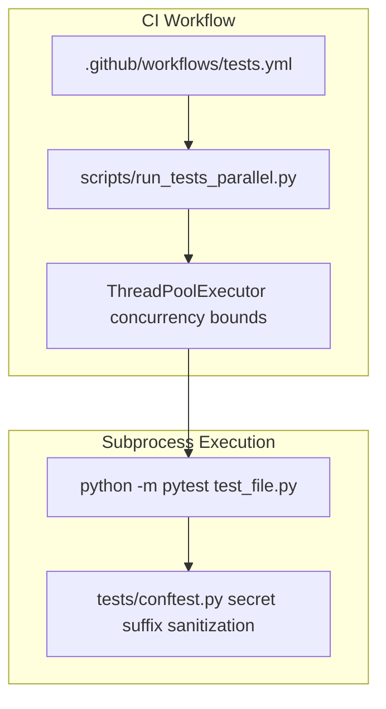
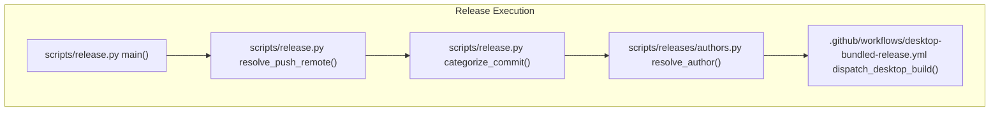
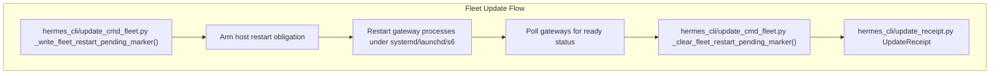
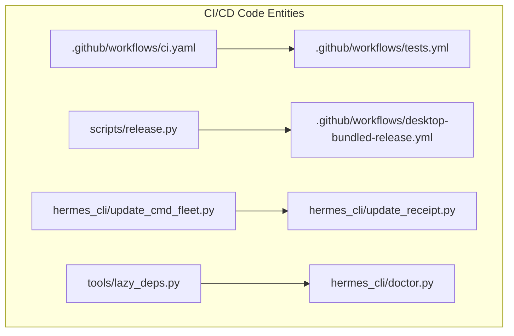

# CI/CD and Release Management

Relevant source files

The following files were used as context for generating this wiki page:

- [.github/workflows/desktop-bundled-release.yml](.github/workflows/desktop-bundled-release.yml)
- [.github/workflows/docker.yml](.github/workflows/docker.yml)
- [.github/workflows/sandbox-image.yml](.github/workflows/sandbox-image.yml)
- [.github/workflows/stable-release-publication.yml](.github/workflows/stable-release-publication.yml)
- [.github/workflows/stable-release.yml](.github/workflows/stable-release.yml)
- [contributors/emails/caseyrussell1976@gmail.com](contributors/emails/caseyrussell1976@gmail.com)
- [contributors/reattributed.tsv](contributors/reattributed.tsv)
- [docker/sandbox-desktop-smoke.sh](docker/sandbox-desktop-smoke.sh)
- [docker/sandbox-desktop.Dockerfile](docker/sandbox-desktop.Dockerfile)
- [evals/update_obligation_identity.py](evals/update_obligation_identity.py)
- [evals/update_unit_client_budget.py](evals/update_unit_client_budget.py)
- [hermes_cli/gateway_windows.py](hermes_cli/gateway_windows.py)
- [hermes_cli/gateway_windows_legacy.py](hermes_cli/gateway_windows_legacy.py)
- [hermes_cli/uninstall.py](hermes_cli/uninstall.py)
- [hermes_cli/update_abort_recovery.py](hermes_cli/update_abort_recovery.py)
- [hermes_cli/update_cmd_config.py](hermes_cli/update_cmd_config.py)
- [hermes_cli/update_cmd_fleet.py](hermes_cli/update_cmd_fleet.py)
- [hermes_cli/update_cmd_fleet_gatewayless.py](hermes_cli/update_cmd_fleet_gatewayless.py)
- [hermes_cli/update_cmd_fleet_verify.py](hermes_cli/update_cmd_fleet_verify.py)
- [hermes_cli/update_cmd_maint.py](hermes_cli/update_cmd_maint.py)
- [hermes_cli/update_cmd_posix_pause.py](hermes_cli/update_cmd_posix_pause.py)
- [hermes_cli/update_cmd_stale_survivors.py](hermes_cli/update_cmd_stale_survivors.py)
- [hermes_cli/update_cmd_windows.py](hermes_cli/update_cmd_windows.py)
- [hermes_cli/update_inventory.py](hermes_cli/update_inventory.py)
- [hermes_cli/update_pause_record.py](hermes_cli/update_pause_record.py)
- [hermes_cli/update_receipt.py](hermes_cli/update_receipt.py)
- [hermes_cli/update_serve_obligations.py](hermes_cli/update_serve_obligations.py)
- [hermes_cli/web_server_owner_exit.py](hermes_cli/web_server_owner_exit.py)
- [hermes_cli/web_server_skew_exit.py](hermes_cli/web_server_skew_exit.py)
- [hermes_cli/windows_ssh_runtime.py](hermes_cli/windows_ssh_runtime.py)
- [scripts/bundles/channel_artifacts.py](scripts/bundles/channel_artifacts.py)
- [scripts/bundles/release_artifacts.py](scripts/bundles/release_artifacts.py)
- [scripts/release.py](scripts/release.py)
- [scripts/releases/channel_releases.py](scripts/releases/channel_releases.py)
- [scripts/releases/channels.py](scripts/releases/channels.py)
- [scripts/releases/darwin.py](scripts/releases/darwin.py)
- [scripts/releases/entrypoint.py](scripts/releases/entrypoint.py)
- [scripts/releases/handoff.py](scripts/releases/handoff.py)
- [scripts/releases/r2.py](scripts/releases/r2.py)
- [scripts/releases/sequencer.py](scripts/releases/sequencer.py)
- [scripts/releases/stable.py](scripts/releases/stable.py)
- [scripts/releases/store.py](scripts/releases/store.py)
- [tests/agent/test_skill_inline_bash_windows.py](tests/agent/test_skill_inline_bash_windows.py)
- [tests/ci/test_desktop_release_tag_admission.py](tests/ci/test_desktop_release_tag_admission.py)
- [tests/ci/test_stable_release_graph.py](tests/ci/test_stable_release_graph.py)
- [tests/e2e/core/upgrade/git/test_hostile_lock.py](tests/e2e/core/upgrade/git/test_hostile_lock.py)
- [tests/e2e/core/upgrade/git/test_hostile_pause.py](tests/e2e/core/upgrade/git/test_hostile_pause.py)
- [tests/e2e/core/upgrade/hosts/test_hostile_pause_record.py](tests/e2e/core/upgrade/hosts/test_hostile_pause_record.py)
- [tests/gateway/test_host_rendezvous_windows.py](tests/gateway/test_host_rendezvous_windows.py)
- [tests/gateway/test_webhook_filter_interpreter.py](tests/gateway/test_webhook_filter_interpreter.py)
- [tests/hermes_cli/test_chat_q_exit_clear.py](tests/hermes_cli/test_chat_q_exit_clear.py)
- [tests/hermes_cli/test_fleet_config_migration_windows_live.py](tests/hermes_cli/test_fleet_config_migration_windows_live.py)
- [tests/hermes_cli/test_fleet_matrix_down_state.py](tests/hermes_cli/test_fleet_matrix_down_state.py)
- [tests/hermes_cli/test_fleet_matrix_self_restart_pending.py](tests/hermes_cli/test_fleet_matrix_self_restart_pending.py)
- [tests/hermes_cli/test_gateway_start_attestation.py](tests/hermes_cli/test_gateway_start_attestation.py)
- [tests/hermes_cli/test_gateway_windows.py](tests/hermes_cli/test_gateway_windows.py)
- [tests/hermes_cli/test_legacy_launchers_windows_live.py](tests/hermes_cli/test_legacy_launchers_windows_live.py)
- [tests/hermes_cli/test_manual_serve_deferral.py](tests/hermes_cli/test_manual_serve_deferral.py)
- [tests/hermes_cli/test_pending_supervisor_recovery.py](tests/hermes_cli/test_pending_supervisor_recovery.py)
- [tests/hermes_cli/test_relaunch_verify_budget_starts_at_respawn.py](tests/hermes_cli/test_relaunch_verify_budget_starts_at_respawn.py)
- [tests/hermes_cli/test_restart_plan_reconciliation.py](tests/hermes_cli/test_restart_plan_reconciliation.py)
- [tests/hermes_cli/test_serve_runtime_inventory.py](tests/hermes_cli/test_serve_runtime_inventory.py)
- [tests/hermes_cli/test_sibling_config_migration.py](tests/hermes_cli/test_sibling_config_migration.py)
- [tests/hermes_cli/test_ssh_ownership_endpoint.py](tests/hermes_cli/test_ssh_ownership_endpoint.py)
- [tests/hermes_cli/test_ssh_session_token_parser.py](tests/hermes_cli/test_ssh_session_token_parser.py)
- [tests/hermes_cli/test_update_cold_start_gateway_liveness.py](tests/hermes_cli/test_update_cold_start_gateway_liveness.py)
- [tests/hermes_cli/test_update_external_profile_reconciliation.py](tests/hermes_cli/test_update_external_profile_reconciliation.py)
- [tests/hermes_cli/test_update_fleet_check_fail_closed.py](tests/hermes_cli/test_update_fleet_check_fail_closed.py)
- [tests/hermes_cli/test_update_fleet_completion.py](tests/hermes_cli/test_update_fleet_completion.py)
- [tests/hermes_cli/test_update_fleet_probe_resume_token.py](tests/hermes_cli/test_update_fleet_probe_resume_token.py)
- [tests/hermes_cli/test_update_fleet_restart_pending.py](tests/hermes_cli/test_update_fleet_restart_pending.py)
- [tests/hermes_cli/test_update_fleet_snapshot_settle.py](tests/hermes_cli/test_update_fleet_snapshot_settle.py)
- [tests/hermes_cli/test_update_inventory.py](tests/hermes_cli/test_update_inventory.py)
- [tests/hermes_cli/test_update_no_gateway_restart.py](tests/hermes_cli/test_update_no_gateway_restart.py)
- [tests/hermes_cli/test_update_obligation_identity.py](tests/hermes_cli/test_update_obligation_identity.py)
- [tests/hermes_cli/test_update_pause_debt_windows_live.py](tests/hermes_cli/test_update_pause_debt_windows_live.py)
- [tests/hermes_cli/test_update_pause_record.py](tests/hermes_cli/test_update_pause_record.py)
- [tests/hermes_cli/test_update_pause_recover_backoff.py](tests/hermes_cli/test_update_pause_recover_backoff.py)
- [tests/hermes_cli/test_update_posix_pause.py](tests/hermes_cli/test_update_posix_pause.py)
- [tests/hermes_cli/test_update_receipt.py](tests/hermes_cli/test_update_receipt.py)
- [tests/hermes_cli/test_update_scoped_reconciliation.py](tests/hermes_cli/test_update_scoped_reconciliation.py)
- [tests/hermes_cli/test_update_stale_gateway_yield.py](tests/hermes_cli/test_update_stale_gateway_yield.py)
- [tests/hermes_cli/test_update_system_dashboard_unit.py](tests/hermes_cli/test_update_system_dashboard_unit.py)
- [tests/hermes_cli/test_update_unit_client_budget.py](tests/hermes_cli/test_update_unit_client_budget.py)
- [tests/hermes_cli/test_venv_sync_update_tree.py](tests/hermes_cli/test_venv_sync_update_tree.py)
- [tests/hermes_cli/test_web_server_owner_exit.py](tests/hermes_cli/test_web_server_owner_exit.py)
- [tests/hermes_cli/test_web_server_skew_exit.py](tests/hermes_cli/test_web_server_skew_exit.py)
- [tests/hermes_cli/test_windows_gateway_cold_start_desktop_lifecycle.py](tests/hermes_cli/test_windows_gateway_cold_start_desktop_lifecycle.py)
- [tests/hermes_cli/test_windows_relaunch_ready_poll.py](tests/hermes_cli/test_windows_relaunch_ready_poll.py)
- [tests/hermes_cli/test_windows_update_restart_reconciliation.py](tests/hermes_cli/test_windows_update_restart_reconciliation.py)
- [tests/scripts/install/test_install_ps1_skipsetup_alias.py](tests/scripts/install/test_install_ps1_skipsetup_alias.py)
- [tests/scripts/test_release_artifacts.py](tests/scripts/test_release_artifacts.py)
- [tests/scripts/test_release_channels.py](tests/scripts/test_release_channels.py)
- [tests/scripts/test_release_entrypoint.py](tests/scripts/test_release_entrypoint.py)
- [tests/scripts/test_release_handoff.py](tests/scripts/test_release_handoff.py)
- [tests/scripts/test_release_r2.py](tests/scripts/test_release_r2.py)
- [tests/scripts/test_release_sequencer.py](tests/scripts/test_release_sequencer.py)
- [tests/scripts/test_release_store.py](tests/scripts/test_release_store.py)
- [tests/scripts/test_stable_release.py](tests/scripts/test_stable_release.py)
- [website/docs/developer-guide/stable-releases.md](website/docs/developer-guide/stable-releases.md)
- [website/docs/user-guide/windows-native.md](website/docs/user-guide/windows-native.md)
- [website/i18n/zh-Hans/docusaurus-plugin-content-docs/current/getting-started/termux.md](website/i18n/zh-Hans/docusaurus-plugin-content-docs/current/getting-started/termux.md)
- [website/i18n/zh-Hans/docusaurus-plugin-content-docs/current/user-guide/windows-native.md](website/i18n/zh-Hans/docusaurus-plugin-content-docs/current/user-guide/windows-native.md)

This page documents the infrastructure supporting the Hermes Agent software lifecycle, detailing the GitHub Actions CI/CD workflows, the Calendar Versioning (CalVer) release script (`scripts/release.py`), update fleet rollout mechanisms (`hermes_cli/update_cmd_fleet.py`), contributor audit (`contributors/reattributed.tsv`), lazy dependency management, Nix packaging, and the security advisory system.

---

## Overview of CI/CD Workflows

The Hermes Agent project employs **GitHub Actions** as its continuous integration and delivery backbone. The workflows are structured to optimize build time and avoid unnecessary job runs by dynamically detecting changed code areas within a commit or pull request.

### Supply Chain and Reproducibility Controls

Key security and reproducibility controls implemented in the CI/CD process include:

- **Exact Dependency Pinning:** The `pyproject.toml` specifies dependencies with exact version pins (e.g., `openai==2.24.0`) avoiding any version ranges or approximate matches. This ensures that dependency updates cannot be automatically pulled in, reducing the risk of supply chain attack vectors [pyproject.toml:19-40]().

- **Restricted Python Versions:** The project targets Python >=3.11 and <3.15, primarily due to limitations or compatibility constraints of Rust-backed dependencies such as `pydantic-core` which require compiled wheels [pyproject.toml:8-15]().

- **Lockfile Management with `uv.lock`:** Hermes uses `uv.lock` for reproducible installs, locking all transitive dependencies exactly and including overrides for certain problematic dependencies [uv.lock:1-120]().

- **Nix Packaging:** Nix expressions in `nix/lib.nix` isolate rebuild scopes by language domain (Python or frontend), so only relevant parts are rebuilt on code changes. This avoids unnecessary environment rebuilds triggered by unrelated code edits [nix/lib.nix:8-11]().

Sources:
- `pyproject.toml`
- `uv.lock`
- `nix/lib.nix`

---

## Testing Infrastructure and Parallel Test Execution

Hermes orchestrates its test runs to maximize isolation and minimize state leakage by spawning each test file as a separate pytest subprocess via `scripts/run_tests_parallel.py`.

### Parallel Test Execution Architecture

- `scripts/run_tests_parallel.py` enumerates all test files under `tests/` and executes each in an isolated subprocess with bounded concurrency [scripts/run_tests_parallel.py:1-147]().
- Environment variable sanitization is enforced by fixtures in `tests/conftest.py` that clear keys matching secret suffixes [tests/conftest.py:5-15,70-143]().

Sources:
- `.github/workflows/tests.yml`
- `scripts/run_tests_parallel.py`
- `tests/conftest.py`

---

## Supply Chain Security and Auditing Mechanisms

Hermes includes rigorous static and dynamic supply chain security checks integrated into CI to detect suspicious code patterns or dependency alterations:

| Check Type | Description | Workflow Location |
|---|---|---|
| Scanning for `.pth` Files | Detect unauthorized `.pth` files executed on Python start | `.github/workflows/supply-chain-audit.yml:87-101` |
| Base64 + `exec` / `eval` | Searches for base64-encoded dynamic execution patterns | `.github/workflows/supply-chain-audit.yml:103-115` |
| Encoded Subprocess Calls | Detects obfuscated subprocess invocations (base64/chr) | `.github/workflows/supply-chain-audit.yml:117-129` |
| Exact Dependency Pins | Validates all pins in `pyproject.toml` | `pyproject.toml:19-39` |
| Security Diagnostic Checks | Runs `hermes doctor` checks including advisories and MCP state | `hermes_cli/doctor.py:100-140` |

Sources:
- `.github/workflows/supply-chain-audit.yml`
- `pyproject.toml`
- `hermes_cli/doctor.py`

---

## CalVer Release Management with `scripts/release.py`

Hermes Agent uses a **Calendar Versioning (CalVer)** scheme embedding a YYYY.MM.DD style version plus optional semantic suffixes, defined in `hermes_cli/__init__.py` and pinned in `pyproject.toml` [hermes_cli/__init__.py:6-7](), [pyproject.toml:5]().

The release lifecycle is automated by `scripts/release.py`:

### Release Script Code Entity Mapping

- **Contributor Attribution:** Uses frozen legacy author mappings combined with scanned contributor emails and override files like `contributors/reattributed.tsv` [scripts/release.py:46-94](), [contributors/reattributed.tsv:1-58]().
- **GitHub Workflow Dispatch:** Dispatches workflows such as `.github/workflows/desktop-bundled-release.yml` and `.github/workflows/stable-release.yml` [scripts/release.py:65-102](), [.github/workflows/desktop-bundled-release.yml:1-136]().

Sources:
- `scripts/release.py`
- `hermes_cli/__init__.py`
- `pyproject.toml`
- `contributors/reattributed.tsv`
- `.github/workflows/desktop-bundled-release.yml`

---

## Summary of GitHub Actions Workflows

| Workflow | Purpose | File Location |
|---|---|---|
| **CI** | Orchestrates other workflows based on detected changes | `.github/workflows/ci.yaml` |
| **Tests** | Run hermetic tests in parallel subprocesses | `.github/workflows/tests.yml` |
| **Lint** | Ruff linter and static type checks (via `ty`) | `.github/workflows/lint.yml` |
| **Supply Chain Audit** | Detect suspicious packages, encoded exec patterns | `.github/workflows/supply-chain-audit.yml` |
| **Docker Build** | Build, test, and publish Docker images | `.github/workflows/docker.yml` |
| **Deploy Site** | Build and deploy documentation and skill catalog | `.github/workflows/deploy-site.yml` |
| **Desktop Bundled Release** | Builds desktop installers for various platforms | `.github/workflows/desktop-bundled-release.yml` |
| **Stable Release** | Manages stable release promotion and publication | `.github/workflows/stable-release.yml` |

Sources:
- `.github/workflows/ci.yaml`
- `.github/workflows/tests.yml`
- `.github/workflows/lint.yml`
- `.github/workflows/supply-chain-audit.yml`
- `.github/workflows/docker.yml`
- `.github/workflows/deploy-site.yml`
- `.github/workflows/desktop-bundled-release.yml`
- `.github/workflows/stable-release.yml`
- `scripts/ci/classify_changes.py`

---

## Update Fleet Rollout and Restart Markers

During `hermes update`, Hermes orchestrates a controlled gateway fleet restart phase using `hermes_cli/update_cmd_fleet.py` and `hermes_cli/update_receipt.py`.

### Fleet Restart and Receipt Flow

- The `fleet_restart_pending` marker indicates that the host must restart gateways to deploy updated code [hermes_cli/update_cmd_fleet.py:27-79]().
- Restarts are supported across supervisors (`systemd`, `launchd`, `s6`) with bounded timeouts [hermes_cli/update_cmd_fleet.py:31-57]().
- Structured update receipts are managed via the `UpdateReceipt` class to record success or partial failure states [hermes_cli/update_receipt.py:1-28,145-161]().

Sources:
- `hermes_cli/update_cmd_fleet.py`
- `hermes_cli/update_receipt.py`
- `tests/hermes_cli/test_update_fleet_restart_pending.py`

---

## Lazy Dependency Management

Hermes implements a controlled lazy dependency installation system for optional feature or provider modules, minimizing install size.

- `tools/lazy_deps.py` defines the immutable dictionary `LAZY_DEPS`, mapping feature keys to exact pip requirement strings [tools/lazy_deps.py:1-26]().
- Lazy dependencies are installed into the active virtual environment or a durable target folder on demand.

Sources:
- `tools/lazy_deps.py`
- `tests/test_project_metadata.py`

---

## Security Advisory System and Diagnostics

- The `hermes doctor` diagnostic utility inspects SSL validity, configuration hygiene, MCP system diagnostics, and security advisories [hermes_cli/doctor.py:100-140]().
- UTF-8 encoding is enforced on stdout/stderr early in `hermes_cli/__init__.py` to prevent encoding exceptions [hermes_cli/__init__.py:10-45]().

Sources:
- `hermes_cli/doctor.py`
- `hermes_cli/__init__.py`

---

## Summary Diagram: Major Components in CI/CD and Release Management

Sources:
- `scripts/release.py:1-180`
- `hermes_cli/__init__.py:6-45`
- `pyproject.toml:5-40`
- `uv.lock:1-120`
- `.github/workflows/tests.yml`
- `scripts/run_tests_parallel.py:1-147`
- `tests/conftest.py:5-15,70-143`
- `.github/workflows/supply-chain-audit.yml:72-142`
- `hermes_cli/doctor.py:100-140`
- `hermes_cli/update_cmd_fleet.py:1-154`
- `hermes_cli/update_receipt.py:1-161`
- `tools/lazy_deps.py:1-26`
- `tests/test_project_metadata.py:105-153`
- `contributors/reattributed.tsv:1-58`
- `.github/workflows/desktop-bundled-release.yml:1-136`
- `.github/workflows/ci.yaml:1-147`
- `scripts/ci/classify_changes.py:1-124`
- `tests/hermes_cli/test_update_fleet_restart_pending.py:1-167`