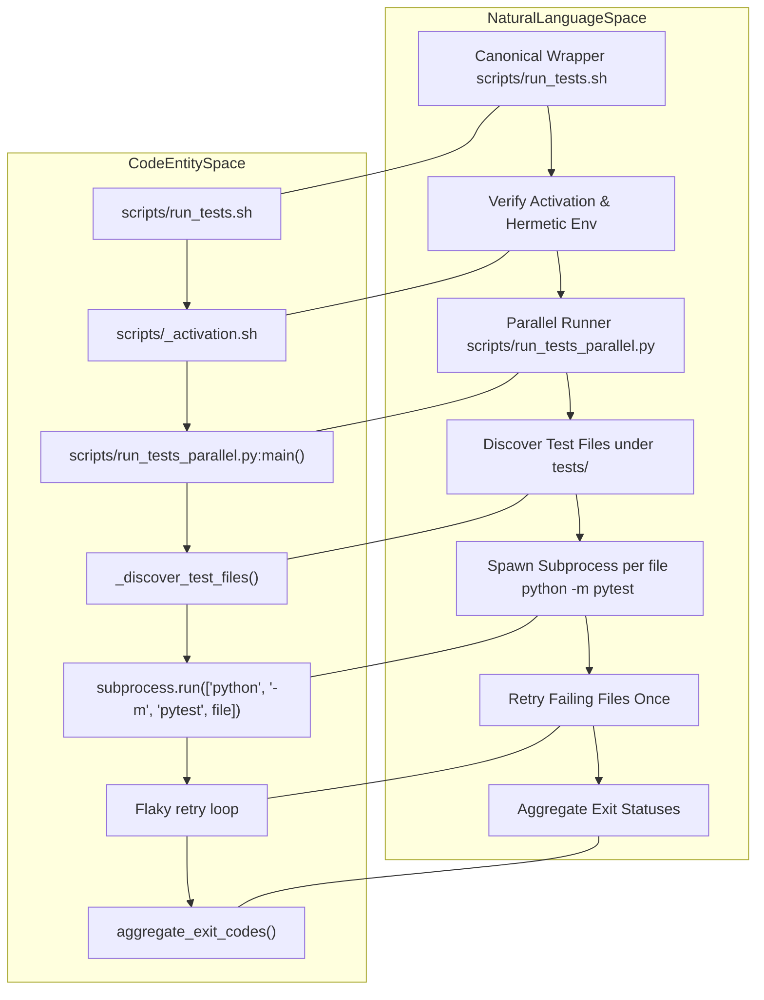
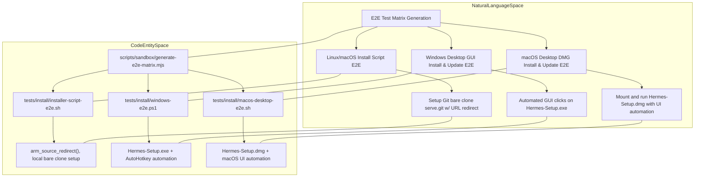
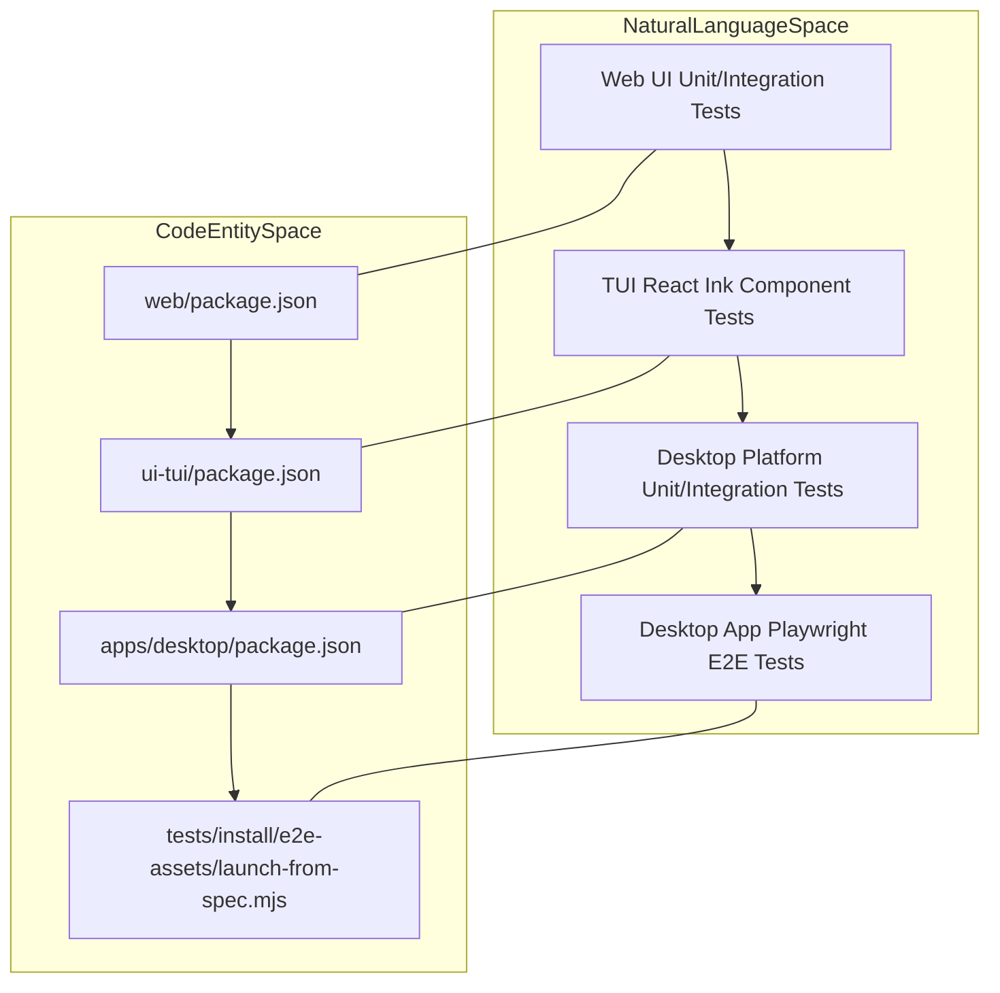

# Testing Infrastructure

Relevant source files

The following files were used as context for generating this wiki page:

- [.github/CODEOWNERS](.github/CODEOWNERS)
- [.github/actionlint.yaml](.github/actionlint.yaml)
- [.github/actions/check-clean-worktree/action.yml](.github/actions/check-clean-worktree/action.yml)
- [.github/actions/detect-changes/action.yml](.github/actions/detect-changes/action.yml)
- [.github/actions/e2e-screen-record/action.yml](.github/actions/e2e-screen-record/action.yml)
- [.github/actions/get-app-token/action.yml](.github/actions/get-app-token/action.yml)
- [.github/actions/nix-setup/action.yml](.github/actions/nix-setup/action.yml)
- [.github/workflows/catalog-tests.yml](.github/workflows/catalog-tests.yml)
- [.github/workflows/ci.yaml](.github/workflows/ci.yaml)
- [.github/workflows/contributor-check.yml](.github/workflows/contributor-check.yml)
- [.github/workflows/deploy-site.yml](.github/workflows/deploy-site.yml)
- [.github/workflows/docker-lint.yml](.github/workflows/docker-lint.yml)
- [.github/workflows/docs-site-checks.yml](.github/workflows/docs-site-checks.yml)
- [.github/workflows/history-check.yml](.github/workflows/history-check.yml)
- [.github/workflows/install-e2e-macos-run.yml](.github/workflows/install-e2e-macos-run.yml)
- [.github/workflows/install-e2e-run.yml](.github/workflows/install-e2e-run.yml)
- [.github/workflows/install-e2e-windows-run.yml](.github/workflows/install-e2e-windows-run.yml)
- [.github/workflows/install-e2e.yml](.github/workflows/install-e2e.yml)
- [.github/workflows/js-autofix.yml](.github/workflows/js-autofix.yml)
- [.github/workflows/label-rerun.yml](.github/workflows/label-rerun.yml)
- [.github/workflows/lint.yml](.github/workflows/lint.yml)
- [.github/workflows/live-providers.yml](.github/workflows/live-providers.yml)
- [.github/workflows/lockfile-diff.yml](.github/workflows/lockfile-diff.yml)
- [.github/workflows/nix.yml](.github/workflows/nix.yml)
- [.github/workflows/osv-scanner.yml](.github/workflows/osv-scanner.yml)
- [.github/workflows/profile-artifact-check.yml](.github/workflows/profile-artifact-check.yml)
- [.github/workflows/prompt-surface-diff.yml](.github/workflows/prompt-surface-diff.yml)
- [.github/workflows/remote-backends.yml](.github/workflows/remote-backends.yml)
- [.github/workflows/skills-index-freshness.yml](.github/workflows/skills-index-freshness.yml)
- [.github/workflows/skills-index.yml](.github/workflows/skills-index.yml)
- [.github/workflows/supply-chain-audit.yml](.github/workflows/supply-chain-audit.yml)
- [.github/workflows/tests-os.yml](.github/workflows/tests-os.yml)
- [.github/workflows/tests.yml](.github/workflows/tests.yml)
- [.github/workflows/uv-lockfile-check.yml](.github/workflows/uv-lockfile-check.yml)
- [apps/desktop/electron/updater/channel-artifact-lifetime.test.ts](apps/desktop/electron/updater/channel-artifact-lifetime.test.ts)
- [apps/desktop/electron/updater/channel-native.test.ts](apps/desktop/electron/updater/channel-native.test.ts)
- [apps/desktop/electron/updater/channel-windows-host.ts](apps/desktop/electron/updater/channel-windows-host.ts)
- [apps/desktop/electron/updater/index.ts](apps/desktop/electron/updater/index.ts)
- [apps/desktop/electron/updater/mac-client.ts](apps/desktop/electron/updater/mac-client.ts)
- [apps/desktop/src/app/settings/about-settings.test.tsx](apps/desktop/src/app/settings/about-settings.test.tsx)
- [scripts/ci/catalog_test_files.py](scripts/ci/catalog_test_files.py)
- [scripts/ci/check_catalog_cors.py](scripts/ci/check_catalog_cors.py)
- [scripts/ci/check_profile_archive_boundary.py](scripts/ci/check_profile_archive_boundary.py)
- [scripts/ci/classify_changes.py](scripts/ci/classify_changes.py)
- [scripts/ci/prompt_surface.py](scripts/ci/prompt_surface.py)
- [scripts/ci/required_results.py](scripts/ci/required_results.py)
- [scripts/ci/start_test_sshd.sh](scripts/ci/start_test_sshd.sh)
- [scripts/ci/test_sshd_container_setup.sh](scripts/ci/test_sshd_container_setup.sh)
- [scripts/run_tests.sh](scripts/run_tests.sh)
- [scripts/run_tests_parallel.py](scripts/run_tests_parallel.py)
- [scripts/sandbox/generate-e2e-matrix.mjs](scripts/sandbox/generate-e2e-matrix.mjs)
- [scripts/windows_e2e_harness.ps1](scripts/windows_e2e_harness.ps1)
- [tests-js/e2e-matrix-route.test.ts](tests-js/e2e-matrix-route.test.ts)
- [tests/ci/test_check_catalog_cors.py](tests/ci/test_check_catalog_cors.py)
- [tests/ci/test_classify_changes.py](tests/ci/test_classify_changes.py)
- [tests/ci/test_clean_worktree_check.py](tests/ci/test_clean_worktree_check.py)
- [tests/ci/test_prompt_surface.py](tests/ci/test_prompt_surface.py)
- [tests/ci/test_required_results.py](tests/ci/test_required_results.py)
- [tests/ci/test_update_ci_routing.py](tests/ci/test_update_ci_routing.py)
- [tests/ci/test_update_transitive_routing.py](tests/ci/test_update_transitive_routing.py)
- [tests/ci/workflow_steps.py](tests/ci/workflow_steps.py)
- [tests/conftest.py](tests/conftest.py)
- [tests/hermes_cli/test_reasoning_effort_menu.py](tests/hermes_cli/test_reasoning_effort_menu.py)
- [tests/install/README.md](tests/install/README.md)
- [tests/install/e2e-assets/drive-dmg-install.sh](tests/install/e2e-assets/drive-dmg-install.sh)
- [tests/install/e2e-assets/playback.html](tests/install/e2e-assets/playback.html)
- [tests/install/e2e-assets/ts-prefix.ps1](tests/install/e2e-assets/ts-prefix.ps1)
- [tests/install/e2e-assets/ts-prefix.sh](tests/install/e2e-assets/ts-prefix.sh)
- [tests/install/installer-script-e2e.sh](tests/install/installer-script-e2e.sh)
- [tests/install/macos-desktop-e2e.sh](tests/install/macos-desktop-e2e.sh)
- [tests/install/windows-e2e.ps1](tests/install/windows-e2e.ps1)
- [tests/scripts/install/test_dmg_install_driver.py](tests/scripts/install/test_dmg_install_driver.py)
- [tests/scripts/install/test_install_ps1_native_calls.py](tests/scripts/install/test_install_ps1_native_calls.py)
- [tests/scripts/test_run_tests_parallel.py](tests/scripts/test_run_tests_parallel.py)
- [tests/test_basetemp_isolation.py](tests/test_basetemp_isolation.py)
- [tests/tools/test_browser_supervisor_capture.py](tests/tools/test_browser_supervisor_capture.py)
- [tests/tools/test_browser_supervisor_capture_dispatch.py](tests/tools/test_browser_supervisor_capture_dispatch.py)
- [tests/tools/test_docker_backend_real.py](tests/tools/test_docker_backend_real.py)
- [tests/website/test_fetch_plugin_stars.py](tests/website/test_fetch_plugin_stars.py)
- [tools/browser_supervisor_capture.py](tools/browser_supervisor_capture.py)
- [website/scripts/fetch-plugin-stars.py](website/scripts/fetch-plugin-stars.py)
- [website/scripts/prebuild.mjs](website/scripts/prebuild.mjs)

This page details the testing infrastructure of the Hermes Agent codebase, covering the layout of test suites, hermetic side-effect guards, parallel test runner scripts, CI change classification, conformance and performance guard suites, install E2E harnesses, and the JavaScript/TypeScript test setups for the web, TUI, and desktop applications.

---

## Test Suite Layout

The Hermes Agent project organizes its tests into structured top-level directories separating backend Python logic from frontend JavaScript/TypeScript components:

| Directory | Scope |
|---|---|
| `tests/` | Python-based tests for core agent, CLI (`hermes_cli/`), gateway (`gateway/`), tools, and backend subsystems [scripts/run_tests_parallel.py:60](). |
| `tests-js/` | JavaScript/TypeScript unit and integration tests for shared frontend utilities and mock servers [tests/install/windows-e2e.ps1:113-120](). |
| `apps/desktop/e2e/` | Playwright end-to-end (E2E) tests targeting the Electron desktop application runtime. |
| `web/` | Vitest unit tests for the full-featured web application dashboard UI [package.json:6-11](). |
| `ui-tui/` | Vitest unit tests for the Terminal User Interface renderer package (`hermes-ink`). |

This separation ensures clear boundaries between backend and frontend testing responsibility, and facilitates suitable testing stacks per environment.

Sources: [scripts/run_tests_parallel.py:60](), [tests/install/windows-e2e.ps1:113-120](), [package.json:6-11]()

---

## Python Test Runner and Hermetic Guards

### Parallel Test Runner (`scripts/run_tests_parallel.py` and `scripts/run_tests.sh`)

Hermes employs a custom parallel test runner as a minimum-viable replacement for `pytest-xdist` to guarantee greater isolation, fronted by the canonical wrapper `scripts/run_tests.sh`:

- **Environment Activation & Re-execution**: `scripts/run_tests.sh` ensures that the suite runs under the checkout's isolated test environment (`pm.testenv`). If the environment is missing or stale, it automatically re-executes itself under `scripts/run-in-hermes-env` [scripts/run_tests.sh:41-78]().
- **Per-File Subprocess Isolation**: Each test file is executed as a separate Python process, running `python -m pytest <file>`. This avoids cross-file module-level state leakage that often causes flaky tests. Spawning subprocesses per file fits the time budget while providing a fresh Python interpreter per file [scripts/run_tests_parallel.py:4-16]().
- **Bounded Parallelism**: A thread pool executor caps concurrent test runs, defaulting to `os.cpu_count()`, or overridable via `HERMES_TEST_WORKERS` [scripts/run_tests_parallel.py:37](), [scripts/run_tests_parallel.py:136-138]().
- **Test Discovery and Filtering**: Tests are discovered under `tests/`. Slow integration or docker suites (`tests/e2e/`, `tests/integration/`, `tests/docker/`) are skipped by the parallel runner since those suites run on dedicated CI jobs [scripts/run_tests_parallel.py:114-132]().
- **File-Level Timeout & Flaky Retry**: Each test file has a configurable wall-clock timeout (default 300s). Files that fail on first attempt are retried once in a fresh subprocess; if the retry passes, the file is marked flaky but considered passing [scripts/run_tests_parallel.py:135-151]().
- **Duration Cache**: Per-file test durations are cached in `test_durations.json` (restored via GitHub Actions cache) to scale timeout heuristics and optimize suite splitting in CI [scripts/run_tests_parallel.py:82-103](), [.github/workflows/tests.yml:88-103]().

*Diagram: Bridging Parallel Test Runner Concepts to Key Code Entities*

Sources: [scripts/run_tests.sh:1-78](), [scripts/run_tests_parallel.py:1-148](), [.github/workflows/tests.yml:88-103]()

---

### Hermetic Side-Effect Guards (`tests/conftest.py`)

The file `tests/conftest.py` sets up fundamental test fixtures ensuring a hermetic, side-effect-free test environment:

- **Credential Environment Variable Scrubbing**: Environment variables ending in `_API_KEY`, `_TOKEN`, `_SECRET`, `_PASSWORD`, `_CREDENTIALS`, etc., are cleared before every test to prevent leaking local developer keys or CI secrets [tests/conftest.py:5-7]().
- **Isolated `HERMES_HOME` and Temp Directories**: `HERMES_HOME` and platform-default roots are isolated inside per-test tempdirs. Standard scratch temp variables pointing inside guarded roots are stripped [tests/conftest.py:8-11](), [tests/conftest.py:48-144]().
- **Deterministic Runtime Environment**: Runtime parameters are pinned (`TZ=UTC`, `LANG=C.UTF-8`, `PYTHONHASHSEED=0`) [tests/conftest.py:12-14]().
- **Early Logging Handler Isolation**: Sandboxing occurs before any test module is imported, preventing test logs from polluting the operator's real `~/.hermes/logs/agent.log` [tests/conftest.py:48-72]().
- **Version Info Caching**: `get_version_info()` is pre-seeded with a stable mock shape to avoid expensive git subprocess shells during test process startup [tests/conftest.py:38-46]().

Sources: [tests/conftest.py:1-144]()

---

## CI Change Classification and Orchestration

The Hermes CI pipeline relies on an intelligent change classifier (`scripts/ci/classify_changes.py`) integrated into `.github/workflows/ci.yaml`. This script inspects modified files in a PR or push and assigns boolean flags to specific CI work lanes (e.g., `python`, `frontend`, `docker`, `nix`, `e2e`, `catalog`, `remote_backends`).

- **Fail-Open Contract**: The classifier ensures it never skips a lane that a change could break. Denylists (`_PY_SKIP`) and cross-language contract dependencies (`_PY_RELEVANT_CONTRACT_FILES`) guarantee that configuration, generated schema JSONs, and documentation generators correctly re-arm the Python testing suites [scripts/ci/classify_changes.py:60-124]().
- **Workflow Orchestration**: `.github/workflows/ci.yaml` executes `detect-changes` once, routing affected suites in parallel, while branch protection aggregates results through an `all-checks-pass` gate [.github/workflows/ci.yaml:1-60]().

Sources: [scripts/ci/classify_changes.py:1-124](), [.github/workflows/ci.yaml:1-60]()

---

## Conformance, Performance Guards, and Install E2E Harnesses

### Install/Update End-to-End (E2E) Harnesses

The testing infrastructure includes system-level install and update E2E tests that validate upgrade paths for released versions to the current commit on real OSes, simulating user environments:

| Platform | Driver Script | Purpose |
|---|---|---|
| Linux/macOS | `tests/install/installer-script-e2e.sh` | Runs official shell installer scripts, using staged bare clone (`serve.git`) Git URL substitution (`url.<file://serve.git>.insteadOf`) to simulate real-world installs and updates without live network interference [tests/install/installer-script-e2e.sh:2-26](). |
| Windows | `tests/install/windows-e2e.ps1` | Automates GUI installation of the real `Hermes-Setup.exe` using AutoHotkey UI clicks, exercises update paths via the app's Settings UI, asserting the update workflow and relaunch works correctly [tests/install/windows-e2e.ps1:2-31](). |
| macOS Desktop | `tests/install/macos-desktop-e2e.sh` | Mounts the signed DMG installer and performs update validation through UI automation scripts [tests/install/macos-desktop-e2e.sh:2-38](). |

### Install/Update Test Matrix Generation

The combinatorial matrix of OS, install-method, and update-method paths is generated from a single source of truth in `scripts/sandbox/generate-e2e-matrix.mjs`. This matrix outputs leg definitions used by CI workflows to selectively run tests per platform and release tag [scripts/sandbox/generate-e2e-matrix.mjs:1-128](), [.github/workflows/install-e2e.yml:1-146]().

*Diagram: Bridging Deploy Install E2E Concepts to Automation Drivers*

Sources: [tests/install/windows-e2e.ps1:1-119](), [tests/install/installer-script-e2e.sh:1-120](), [tests/install/macos-desktop-e2e.sh:1-148](), [scripts/sandbox/generate-e2e-matrix.mjs:1-128](), [.github/workflows/install-e2e.yml:1-146]()

---

## JavaScript/TypeScript Test Setups

### Web and TUI

- The **Web** codebase uses Vitest for unit and integration tests on the full-featured React dashboard UI and frontend logic, defined in `web/package.json` [package.json:6-11]().
- The **Terminal User Interface (TUI)** (`ui-tui/`) uses Vitest to test React Ink components (`hermes-ink`), ensuring terminal UI behaviors are verified [package.json:6-11]().

### Desktop Application

- The Electron Desktop application (`apps/desktop/`) includes unit/functional tests and end-to-end Playwright tests located under `apps/desktop/e2e/`.
- Playwright E2E tests exercise the actual desktop runtime, enabling UI interaction automation, visual snapshot testing, and reproducible scenario playback using recorded launch specifications [tests/install/e2e-assets/launch-from-spec.mjs:1-81]().

*Diagram: Bridging JS/TS Testing Frameworks to Package Script Entities*

Sources: [tests/install/e2e-assets/launch-from-spec.mjs:1-81](), [web/package.json:6-11](), [apps/desktop/package.json:17-79]()

---

## Summary

The Hermes Agent testing infrastructure achieves high reliability and isolation through:
- Granular per-file parallelism via subprocess isolation (`scripts/run_tests_parallel.py` and `scripts/run_tests.sh`) [scripts/run_tests_parallel.py:4-16](), [scripts/run_tests.sh:1-78]().
- Hermetic environment configuration (`tests/conftest.py`) that eliminates credential leaks and production user state pollution [tests/conftest.py:1-144]().
- Intelligent change classification (`scripts/ci/classify_changes.py`) optimizing CI resource usage while preserving fail-open guarantees [scripts/ci/classify_changes.py:1-124]().
- Multi-language layered test setups for Python and JS/TS codebases.
- Comprehensive matrix-driven E2E install/update harnesses simulating authentic user workflows [tests/install/windows-e2e.ps1:2-31](), [tests/install/installer-script-e2e.sh:2-26]().

---

## Appendix: Key File References

| Topic | File Reference |
|---|---|
| Canonical parallel test wrapper | `scripts/run_tests.sh` |
| Parallel test runner script | `scripts/run_tests_parallel.py` |
| Test environment guards & fixtures | `tests/conftest.py` |
| CI change classification logic | `scripts/ci/classify_changes.py` |
| Windows Install E2E driver | `tests/install/windows-e2e.ps1` |
| POSIX Install E2E driver | `tests/install/installer-script-e2e.sh` |
| macOS Desktop Install E2E driver | `tests/install/macos-desktop-e2e.sh` |
| E2E Matrix Generator | `scripts/sandbox/generate-e2e-matrix.mjs` |

Sources: [scripts/run_tests.sh:1-35](), [scripts/run_tests_parallel.py:1-43](), [tests/conftest.py:1-19](), [scripts/ci/classify_changes.py:1-10]()

---

# END OF PAGE