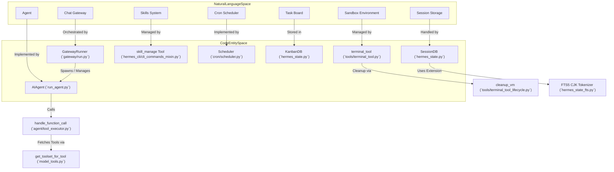
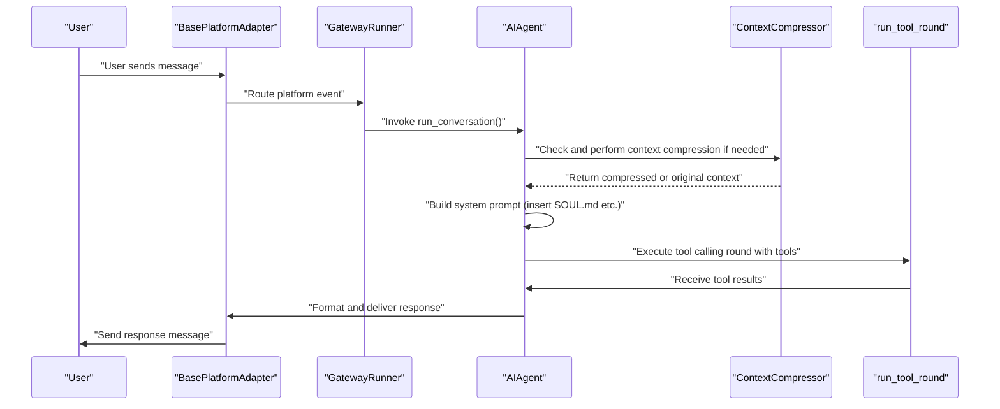

# Glossary

Relevant source files

The following files were used as context for generating this wiki page:

- [.github/workflows/bootstrap-installer.yml](.github/workflows/bootstrap-installer.yml)
- [agent/agent_init.py](agent/agent_init.py)
- [agent/agent_runtime_helpers.py](agent/agent_runtime_helpers.py)
- [agent/auxiliary_client.py](agent/auxiliary_client.py)
- [agent/chat_completion_helpers.py](agent/chat_completion_helpers.py)
- [agent/compaction_display.py](agent/compaction_display.py)
- [agent/compaction_events.py](agent/compaction_events.py)
- [agent/compression_facade.py](agent/compression_facade.py)
- [agent/context_compressor.py](agent/context_compressor.py)
- [agent/context_compressor_telemetry.py](agent/context_compressor_telemetry.py)
- [agent/conversation_compression.py](agent/conversation_compression.py)
- [agent/conversation_compression_archive.py](agent/conversation_compression_archive.py)
- [agent/conversation_compression_codex.py](agent/conversation_compression_codex.py)
- [agent/conversation_compression_manual.py](agent/conversation_compression_manual.py)
- [agent/conversation_compression_telemetry.py](agent/conversation_compression_telemetry.py)
- [agent/conversation_loop.py](agent/conversation_loop.py)
- [agent/micro_compaction.py](agent/micro_compaction.py)
- [agent/model_metadata_token_memo.py](agent/model_metadata_token_memo.py)
- [agent/relay_compaction.py](agent/relay_compaction.py)
- [agent/turn_context.py](agent/turn_context.py)
- [agent/turn_finalizer.py](agent/turn_finalizer.py)
- [apps/desktop/e2e/core/reply-painted-once.spec.ts](apps/desktop/e2e/core/reply-painted-once.spec.ts)
- [apps/desktop/src/app/session/hooks/use-message-stream/reused-final-after-tool.test.tsx](apps/desktop/src/app/session/hooks/use-message-stream/reused-final-after-tool.test.tsx)
- [apps/desktop/src/app/session/hooks/use-message-stream/test-harness.tsx](apps/desktop/src/app/session/hooks/use-message-stream/test-harness.tsx)
- [cli-config.yaml.example](cli-config.yaml.example)
- [cli.py](cli.py)
- [gateway/run.py](gateway/run.py)
- [gateway/session.py](gateway/session.py)
- [gateway/slash_commands.py](gateway/slash_commands.py)
- [hermes_cli/cli_commands_mixin.py](hermes_cli/cli_commands_mixin.py)
- [hermes_cli/commands.py](hermes_cli/commands.py)
- [hermes_cli/config.py](hermes_cli/config.py)
- [hermes_cli/config_defaults.py](hermes_cli/config_defaults.py)
- [hermes_cli/main.py](hermes_cli/main.py)
- [hermes_cli/setup.py](hermes_cli/setup.py)
- [hermes_constants.py](hermes_constants.py)
- [hermes_constants_scratch.py](hermes_constants_scratch.py)
- [hermes_constants_scratch_stuck.py](hermes_constants_scratch_stuck.py)
- [hermes_state.py](hermes_state.py)
- [run_agent.py](run_agent.py)
- [scripts/micro_compaction_report.py](scripts/micro_compaction_report.py)
- [scripts/releases/distance.py](scripts/releases/distance.py)
- [scripts/releases/stamping.py](scripts/releases/stamping.py)
- [scripts/termux/build_builder_image.sh](scripts/termux/build_builder_image.sh)
- [scripts/termux/build_deb.sh](scripts/termux/build_deb.sh)
- [scripts/termux/stage_runtime_libs.py](scripts/termux/stage_runtime_libs.py)
- [scripts/verify-bootstrap-version-stamp.py](scripts/verify-bootstrap-version-stamp.py)
- [scripts/write_install_stamp.py](scripts/write_install_stamp.py)
- [tests/agent/test_413_compression.py](tests/agent/test_413_compression.py)
- [tests/agent/test_auxiliary_client.py](tests/agent/test_auxiliary_client.py)
- [tests/agent/test_compaction_events.py](tests/agent/test_compaction_events.py)
- [tests/agent/test_compression_attempt_effect.py](tests/agent/test_compression_attempt_effect.py)
- [tests/agent/test_compression_attempt_telemetry.py](tests/agent/test_compression_attempt_telemetry.py)
- [tests/agent/test_compression_commit_fence_race.py](tests/agent/test_compression_commit_fence_race.py)
- [tests/agent/test_compression_concurrent_fork.py](tests/agent/test_compression_concurrent_fork.py)
- [tests/agent/test_compression_refusal_restores_transcript.py](tests/agent/test_compression_refusal_restores_transcript.py)
- [tests/agent/test_compression_stall_fallback.py](tests/agent/test_compression_stall_fallback.py)
- [tests/agent/test_compression_stall_interrupt.py](tests/agent/test_compression_stall_interrupt.py)
- [tests/agent/test_compressor_truncated_summary_guard.py](tests/agent/test_compressor_truncated_summary_guard.py)
- [tests/agent/test_context_compressor.py](tests/agent/test_context_compressor.py)
- [tests/agent/test_conversation_compression_manual.py](tests/agent/test_conversation_compression_manual.py)
- [tests/agent/test_empty_response_recovery_persistence.py](tests/agent/test_empty_response_recovery_persistence.py)
- [tests/agent/test_in_place_merged_user_rows.py](tests/agent/test_in_place_merged_user_rows.py)
- [tests/agent/test_message_sequence_repair.py](tests/agent/test_message_sequence_repair.py)
- [tests/agent/test_micro_compaction.py](tests/agent/test_micro_compaction.py)
- [tests/agent/test_proactive_prune_restart_safety.py](tests/agent/test_proactive_prune_restart_safety.py)
- [tests/agent/test_relay_compaction.py](tests/agent/test_relay_compaction.py)
- [tests/agent/test_relay_runtime_bounded_scope_ops.py](tests/agent/test_relay_runtime_bounded_scope_ops.py)
- [tests/agent/test_token_memo_release_on_close.py](tests/agent/test_token_memo_release_on_close.py)
- [tests/agent/test_tool_call_args_sanitizer.py](tests/agent/test_tool_call_args_sanitizer.py)
- [tests/agent/test_turn_finalizer_cleanup_guard.py](tests/agent/test_turn_finalizer_cleanup_guard.py)
- [tests/agent/test_turn_finalizer_final_response_persistence.py](tests/agent/test_turn_finalizer_final_response_persistence.py)
- [tests/agent/test_turn_finalizer_iteration_limit_exit.py](tests/agent/test_turn_finalizer_iteration_limit_exit.py)
- [tests/agent/test_unicode_ascii_codec.py](tests/agent/test_unicode_ascii_codec.py)
- [tests/cron/test_jobs_file_ownership.py](tests/cron/test_jobs_file_ownership.py)
- [tests/cron/test_jobs_shrink_merge.py](tests/cron/test_jobs_shrink_merge.py)
- [tests/gateway/test_api_server_compaction_projection.py](tests/gateway/test_api_server_compaction_projection.py)
- [tests/gateway/test_media_cache_cleanup_signature.py](tests/gateway/test_media_cache_cleanup_signature.py)
- [tests/gateway/test_queued_native_image_session_key.py](tests/gateway/test_queued_native_image_session_key.py)
- [tests/gateway/test_session.py](tests/gateway/test_session.py)
- [tests/hermes_cli/test_atomic_json_write.py](tests/hermes_cli/test_atomic_json_write.py)
- [tests/hermes_cli/test_commands.py](tests/hermes_cli/test_commands.py)
- [tests/hermes_cli/test_doctor_cache_hogs.py](tests/hermes_cli/test_doctor_cache_hogs.py)
- [tests/hermes_cli/test_ensure_hermes_home_uid.py](tests/hermes_cli/test_ensure_hermes_home_uid.py)
- [tests/hermes_cli/test_gateway_agent_compress.py](tests/hermes_cli/test_gateway_agent_compress.py)
- [tests/hermes_cli/test_kanban_comment_queries.py](tests/hermes_cli/test_kanban_comment_queries.py)
- [tests/scripts/test_install_stamp_distance.py](tests/scripts/test_install_stamp_distance.py)
- [tests/scripts/test_termux_build_driver.py](tests/scripts/test_termux_build_driver.py)
- [tests/scripts/test_verify_bootstrap_version_stamp.py](tests/scripts/test_verify_bootstrap_version_stamp.py)
- [tests/scripts/test_version_stamping.py](tests/scripts/test_version_stamping.py)
- [tests/scripts/test_write_install_stamp.py](tests/scripts/test_write_install_stamp.py)
- [tests/test_atomic_json_writers_unified.py](tests/test_atomic_json_writers_unified.py)
- [tests/test_atomic_replace_symlinks.py](tests/test_atomic_replace_symlinks.py)
- [tests/test_hermes_constants.py](tests/test_hermes_constants.py)
- [tests/test_scratch_dir.py](tests/test_scratch_dir.py)
- [tests/test_scratch_prune_undeletable.py](tests/test_scratch_prune_undeletable.py)
- [tests/test_scratch_scan_failures.py](tests/test_scratch_scan_failures.py)
- [tests/test_utils_atomic_roundtrip_yaml_save.py](tests/test_utils_atomic_roundtrip_yaml_save.py)
- [tests/tools/test_kanban_comment_injection.py](tests/tools/test_kanban_comment_injection.py)
- [tests/tools/test_kanban_persisted_identity.py](tests/tools/test_kanban_persisted_identity.py)
- [tests/tools/test_local_temp_dir.py](tests/tools/test_local_temp_dir.py)
- [tests/tui_gateway/test_manual_compress_history_fence.py](tests/tui_gateway/test_manual_compress_history_fence.py)
- [tests/tui_gateway/test_turn_payload_reused_final.py](tests/tui_gateway/test_turn_payload_reused_final.py)
- [ui-tui/src/__tests__/details.test.ts](ui-tui/src/__tests__/details.test.ts)
- [ui-tui/src/domain/details.ts](ui-tui/src/domain/details.ts)
- [utils.py](utils.py)
- [website/docs/developer-guide/context-compression-and-caching.md](website/docs/developer-guide/context-compression-and-caching.md)
- [website/docs/getting-started/quickstart.md](website/docs/getting-started/quickstart.md)
- [website/docs/integrations/providers.md](website/docs/integrations/providers.md)
- [website/docs/reference/cli-commands.md](website/docs/reference/cli-commands.md)
- [website/docs/reference/environment-variables.md](website/docs/reference/environment-variables.md)
- [website/docs/reference/slash-commands.md](website/docs/reference/slash-commands.md)
- [website/docs/user-guide/cli.md](website/docs/user-guide/cli.md)
- [website/docs/user-guide/configuration.md](website/docs/user-guide/configuration.md)
- [website/docs/user-guide/features/fallback-providers.md](website/docs/user-guide/features/fallback-providers.md)
- [website/docs/user-guide/messaging/index.md](website/docs/user-guide/messaging/index.md)
- [website/docs/user-guide/tui.md](website/docs/user-guide/tui.md)
- [website/i18n/zh-Hans/docusaurus-plugin-content-docs/current/getting-started/quickstart.md](website/i18n/zh-Hans/docusaurus-plugin-content-docs/current/getting-started/quickstart.md)
- [website/i18n/zh-Hans/docusaurus-plugin-content-docs/current/reference/environment-variables.md](website/i18n/zh-Hans/docusaurus-plugin-content-docs/current/reference/environment-variables.md)
- [website/i18n/zh-Hans/docusaurus-plugin-content-docs/current/user-guide/configuration.md](website/i18n/zh-Hans/docusaurus-plugin-content-docs/current/user-guide/configuration.md)
- [website/i18n/zh-Hans/docusaurus-plugin-content-docs/current/user-guide/features/fallback-providers.md](website/i18n/zh-Hans/docusaurus-plugin-content-docs/current/user-guide/features/fallback-providers.md)

This page defines codebase-specific terminology, architectural concepts, and domain jargon used throughout the Hermes Agent project. It serves as a technical reference for onboarding engineers to map natural language concepts to specific code entities and understand their detailed implementation, data flow, and code pointers.

---

## Core Architectural Terms

### 1. AIAgent
The core orchestration class managing conversation loops, tool executions, and agent state. It acts as the central reasoning engine of Hermes Agent.

- **Implementation:** The `AIAgent` class is defined in [run_agent.py:1-162](). It composes multiple mixins such as `ClientLifecycleMixin`, `InterruptControlMixin`, and `SessionPersistenceMixin` to cover aspects like lifecycle, error handling, session storage, and concurrency control.
- **Responsibilities:** Manages iterative conversation turns which include LLM model calls, tool invocations, session persistence, context construction, iteration budgeting, message sanitization, and error classification.
- **Conversation Loop:** The iterative turn execution logic is encapsulated in the `run_conversation()` method that drives a turn from user input to tool calls and finalizing output, including retry and interruption support [agent/conversation_loop.py:1-141]().
- **Agent Cache Management:** In the gateway context, a bounded LRU cache holds up to 128 active `AIAgent` instances keyed by session to optimize resource usage, evicting idle agents after 1 hour [gateway/run.py:49-52]().

Sources: [run_agent.py:1-162](), [agent/conversation_loop.py:1-141](), [gateway/run.py:49-52]()

### 2. Toolset
A configurable grouping of tools that the agent can execute. Toolsets enable modular and extensible capabilities, allowing mode-specific or platform-specific tool activation.

- **Implementation:** Managed dynamically in `run_agent.py`, toolsets are resolved via `get_toolset_for_tool()` which returns the toolset containing a requested tool by name [run_agent.py:103]().
- **Configuration:** Composed from configuration profiles and skills; agents acquire their available commands and capabilities via active toolsets.

Sources: [run_agent.py:103]()

### 3. Iteration Budget
A concurrency-safe counter limiting the maximum number of reasoning or tool call iterations per conversation turn to prevent runaway loops.

- **Implementation:** The `IterationBudget` class imported in `run_agent.py` [run_agent.py:91]() manages counting and enforcing iteration limits.
- **Functionality:** Supports sharing or partitioning budget across subagents and delegation tools to control overall reasoning steps.

Sources: [run_agent.py:91](), [agent/conversation_loop.py:15-70]()

### 4. Gateway
The messaging platform adapter system enabling Hermes to interact with multiple chat platforms (Telegram, Discord, Slack, WhatsApp, Matrix, and more).

- **Implementation:** The orchestration is done by the `GatewayRunner` class seen in [gateway/run.py:1-129](), responsible for starting platform adapters, managing their lifecycle, message routing, session expiry, multiplexing multiple profiles, and integrating cron jobs.
- **Platform Adapters:** Each chat service connects through specialized adapter classes implementing `BasePlatformAdapter`, providing streaming message delivery and message formatting.
- **Session Store:** The gateway stores chat session state and message history in a dedicated SQLite-backed session database integrated with `SessionDB` in [hermes_state.py]().

Sources: [gateway/run.py:1-129]()

### 5. Auxiliary Client
A secondary LLM client subsystem dedicated to auxiliary tasks outside the main conversation loop, such as image analysis, web extraction, and compression.

- **Implementation:** Implemented extensively in `agent/auxiliary_client.py`, it maintains task-specific provider resolution chains with fallback strategies, e.g., main provider → OpenRouter → Nous Portal → Anthropic → custom endpoints.
- **Routing Logic:** Includes provider/model overrides for specific auxiliary tasks, with HTTP 402 payment errors triggering fallback resolution.
- **Lazy Imports and Probes:** Supports lazy SDK client importing and availability probing context to optimize startup and error handling.

Sources: [agent/auxiliary_client.py:1-169]()

---

## Technical Mapping: From Concept to Code

This diagram bridges user-visible system concepts to codebase entities, aiding navigation and mental model alignment.

### System Entities and Code Classes

Sources: [run_agent.py:1-162](), [gateway/run.py:1-129](), [hermes_cli/cli_commands_mixin.py:30-50](), [hermes_state.py:1-151](), [hermes_state_fts.py:1-32](), [agent/tool_executor.py:1-100](), [model_tools.py:1-50](), [tools/terminal_tool_lifecycle.py:1-50]()

---

## Domain Jargon & Abbreviations

| Term                  | Definition                                                                                                               | Code Pointer                                      |
|-----------------------|--------------------------------------------------------------------------------------------------------------------------|-------------------------------------------------|
| **ACP**               | Agent Client Protocol — protocol for IDE/editor integration supporting session and edit synchronization communication.    | [hermes_cli/main.py:101-103]()                      |
| **Auxiliary Client**  | An LLM client subsystem for non-core tasks like vision, text compression, and web content extraction with fallback chains. | [agent/auxiliary_client.py:1-169]()               |
| **Context Compression**| Automatic summarization of chat history to fit token limits, implemented via the `ContextCompressor` class.               | [agent/conversation_compression.py:1-130]()      |
| **FTS5**              | SQLite Full-Text Search extension used for efficient, language-aware indexing of messages in sessions.                     | [hermes_state_fts.py:1-32]()                       |
| **Honcho**            | An AI-native memory provider featuring dialectic queries and prefetching mechanisms for improved agent memory.             | [agent/memory_provider.py:1-107]()                 |
| **Kanban**            | A multi-profile task board stored in SQLite enabling coordination between agents and humans for task management.           | [hermes_state.py:1-151]()                          |
| **SOUL.md**           | The primary agent persona definition file in Markdown, injected into the system prompt to define agent identity/personality. | [hermes_cli/default_soul.py:20-35]()               |
| **Slash Command**     | Commands starting with `/` used in CLI and messaging platforms to trigger special actions in the agent or gateway.          | [gateway/slash_commands.py:1-20]()                 |
| **TUI**               | Terminal User Interface — a React Ink based full-screen CLI frontend offering enhanced UI features versus prompt_toolkit.  | [cli.py:46-49]()                                    |
| **Trajectory**        | Detailed step-by-step logs of agent reasoning, decision-making, and tool calls, used for evaluation and training.           | [hermes_state.py:1-100]()                          |
| **WAL Mode**          | SQLite Write-Ahead Logging mode allowing concurrent read access and a single writer, used for session DB durability.        | [hermes_state_wal.py:1-57]()                        |

Sources: [hermes_cli/main.py:101-103](), [agent/auxiliary_client.py:1-169](), [agent/conversation_compression.py:1-130](), [hermes_state_fts.py:1-32](), [agent/memory_provider.py:1-107](), [hermes_state.py:1-151](), [hermes_cli/default_soul.py:20-35](), [gateway/slash_commands.py:1-20](), [cli.py:46-49](), [hermes_state_wal.py:1-57]()

---

## Data Flow: Message Processing

The diagram below illustrates the flow of a user message through the Gateway, through the agent conversation loop including compression, tool calling, and response delivery.

### Message Trajectory & Execution Flow

Sources: [run_agent.py:1-162](), [gateway/run.py:1-129](), [agent/conversation_loop.py:1-141]()

---

## Execution Environment Backends

Hermes Agent supports multiple backend execution environments that can be used to run commands or code from tools. These backends isolate, secure, or distribute execution as needed.

| Backend   | Description                                                         | Code Pointer                    |
|-----------|---------------------------------------------------------------------|--------------------------------|
| **local**  | Executes shell commands directly on the local machine environment.  | [run_agent.py:43-54]()          |
| **docker** | Runs commands inside Docker containers for isolation and uniformity.| [run_agent.py:43-54]()          |
| **ssh**    | Executes commands remotely via SSH connections.                     | [run_agent.py:43-54]()          |
| **modal**  | Executes code in serverless Modal cloud sandbox environments.       | [cli.py:40]()                |

- The active backend is determined by environment variables such as `TERMINAL_ENV` and user configuration profiles.

Sources: [run_agent.py:43-54](), [cli.py:40]()

---

## Configuration Hierarchy & Profiles

Hermes Agent resolves configuration settings via the following precedence order, ensuring predictable override semantics:

1. **CLI Arguments:** Immediate invocation-time overrides passed as flags.
2. **Config File (`config.yaml`):** Main user-editable file stored in `~/.hermes/config.yaml` [website/docs/user-guide/configuration.md:53-64]().
3. **Environment Variables (`.env`):** Sensitive secrets like API keys and tokens, loaded automatically from `~/.hermes/.env`.
4. **Built-in Defaults:** Hardcoded fallback values if no explicit user or environment settings exist.

Additional notes:

- OAuth credentials and provider tokens persist securely in `~/.hermes/auth.json` with file locking for concurrent access safety.
- Profiles allow multiple configurations for different work or deployment contexts, with active profile scoping configuration and environment variable resolution.

Sources: [website/docs/user-guide/configuration.md:53-64](), [run_agent.py:92-101]()

---

This glossary aims to help new engineers quickly understand and navigate the Hermes Agent codebase by connecting domain concepts to concrete code and architecture. For deeper exploration, see related section documentation linked in the project docs.