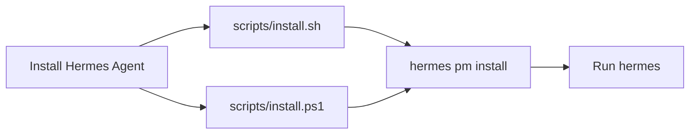
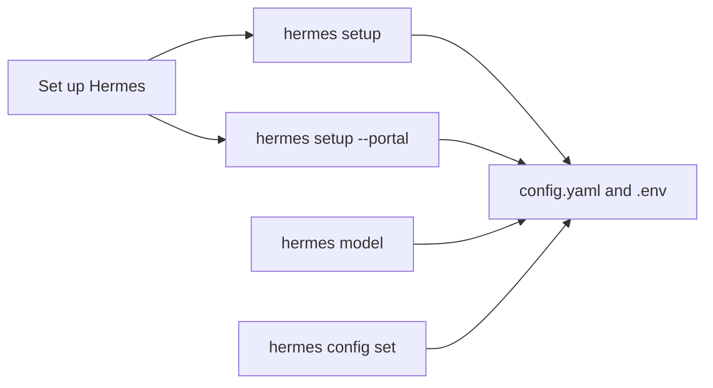
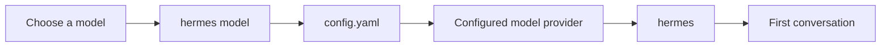

# Getting Started

Relevant source files

The following files were used as context for generating this wiki page:

- [.env.example](.env.example)
- [AGENTS.md](AGENTS.md)
- [CONTRIBUTING.es.md](CONTRIBUTING.es.md)
- [CONTRIBUTING.md](CONTRIBUTING.md)
- [README.md](README.md)
- [activate](activate)
- [activate.fish](activate.fish)
- [activate.ps1](activate.ps1)
- [hermes](hermes)
- [hermes_cli/subcommands/memory.py](hermes_cli/subcommands/memory.py)
- [scripts/_activation.sh](scripts/_activation.sh)
- [scripts/install.ps1](scripts/install.ps1)
- [scripts/install.sh](scripts/install.sh)
- [setup-hermes.sh](setup-hermes.sh)
- [tests/acp_adapter/test_edit_approval.py](tests/acp_adapter/test_edit_approval.py)
- [tests/hermes_cli/test_launcher.py](tests/hermes_cli/test_launcher.py)
- [tests/hermes_cli/test_setup_pin_values.py](tests/hermes_cli/test_setup_pin_values.py)
- [tests/install/e2e-assets/source-build-env.ps1](tests/install/e2e-assets/source-build-env.ps1)
- [tests/pm/activation_support.py](tests/pm/activation_support.py)
- [tests/pm/test_activate_fish.py](tests/pm/test_activate_fish.py)
- [tests/pm/test_activate_scripts.py](tests/pm/test_activate_scripts.py)
- [tests/pm/test_activation_runtime.py](tests/pm/test_activation_runtime.py)
- [tests/pm/test_environment_script.py](tests/pm/test_environment_script.py)
- [tests/pm/test_setup_lock_format.py](tests/pm/test_setup_lock_format.py)
- [tests/scripts/install/test_install_sh_repository_stage.py](tests/scripts/install/test_install_sh_repository_stage.py)
- [tests/scripts/test_install_ps1_desktop_stage.py](tests/scripts/test_install_ps1_desktop_stage.py)
- [tests/scripts/test_install_sh_launch_handoff.py](tests/scripts/test_install_sh_launch_handoff.py)
- [tests/scripts/test_install_stage_frames.py](tests/scripts/test_install_stage_frames.py)
- [tests/scripts/test_mint_launchers.py](tests/scripts/test_mint_launchers.py)
- [website/docs/developer-guide/contributing.md](website/docs/developer-guide/contributing.md)
- [website/docs/getting-started/installation.md](website/docs/getting-started/installation.md)
- [website/docs/getting-started/updating.md](website/docs/getting-started/updating.md)
- [website/i18n/zh-Hans/docusaurus-plugin-content-docs/current/developer-guide/contributing.md](website/i18n/zh-Hans/docusaurus-plugin-content-docs/current/developer-guide/contributing.md)

## Purpose and scope

This page outlines the path from installing Hermes Agent to starting a conversation. It connects installation, initial configuration, provider authentication, and model selection; the linked child pages cover each topic in detail. Hermes can be used through a CLI, TUI, messaging gateway, or desktop app, and supports multiple model providers. [README.md:19-31]()

Sources: [README.md:19-31]()

---

## 2.1 Installation

Choose an installation route for your platform: the source installer supports Linux, macOS, WSL2, and native Windows; Android users should use the Termux package, while macOS and Windows users can also choose desktop packages. Source installs bootstrap the checkout and hand dependency preparation to PM. [website/docs/getting-started/installation.md:16-33](), [website/docs/getting-started/installation.md:44-83]()

After installation, reload your shell if needed and run `hermes` to start chatting. Interactive installs also run setup stages; the installation guide describes how to run noninteractive and optional desktop-build stages. [website/docs/getting-started/installation.md:96-105](), [website/docs/getting-started/installation.md:126-133]()

For installation methods, dependency provisioning, updates, and platform considerations, see [Installation](#2.1).

Sources: [website/docs/getting-started/installation.md:16-33](), [website/docs/getting-started/installation.md:44-105](), [website/docs/getting-started/installation.md:126-153]()

### From install request to installer entry point

Sources: [scripts/install.sh:1-6](), [scripts/install.ps1:1-6](), [website/docs/getting-started/installation.md:126-133]()

---

## 2.2 Configuration and Setup

Hermes keeps user state under its Hermes home directory. The project guide identifies `config.yaml` as the settings file and `.env` as the place for secrets; the example environment file also notes that the default model is configured in `config.yaml`, not through `LLM_MODEL` in `.env`. [AGENTS.md:98-99](), [.env.example:19-22]()

Use `hermes setup` for initial configuration or to configure the Nous Portal path with `hermes setup --portal`. The installation guide also points to `hermes model`, `hermes config set`, and `hermes config get` for later changes. For the configuration hierarchy, profiles, and migrations, see [Configuration and Setup](#2.2). [website/docs/getting-started/installation.md:135-153]()

Sources: [AGENTS.md:98-99](), [.env.example:19-22](), [website/docs/getting-started/installation.md:135-153]()

### User setup mapped to configuration entry points

Sources: [website/docs/getting-started/installation.md:135-153](), [.env.example:19-22]()

---

## 2.3 Authentication and Providers

Hermes supports multiple model providers. The environment example documents API-key configuration for providers including OpenRouter, Fireworks AI, and Google AI Studio/Gemini, and notes that the default model belongs in `config.yaml`. [README.md:21-21](), [.env.example:5-22](), [.env.example:41-49]()

Authentication and provider selection are part of getting a model ready for the first conversation. For OAuth, provider resolution, credential pools, automatic detection, and external secret sources, see [Authentication and Providers](#2.3).

Sources: [README.md:21-21](), [.env.example:5-22](), [.env.example:41-49]()

---

## 2.4 Model Selection and Management

Choose a model with `hermes model` or configure the default during setup. Hermes supports models from multiple providers, so provider authentication and model selection are related setup steps. [README.md:21-21](), [website/docs/getting-started/installation.md:135-153]()

For model validation, context-length discovery, pricing and usage metadata, and the model catalog, see [Model Selection and Management](#2.4).

Sources: [README.md:21-21](), [website/docs/getting-started/installation.md:135-153]()

### From model choice to first conversation

Sources: [.env.example:19-22](), [website/docs/getting-started/installation.md:126-153]()

---

For detailed guidance, continue to [Installation](#2.1), [Configuration and Setup](#2.2), [Authentication and Providers](#2.3), and [Model Selection and Management](#2.4).

Sources: [website/docs/getting-started/installation.md:126-153](), [.env.example:19-22]()