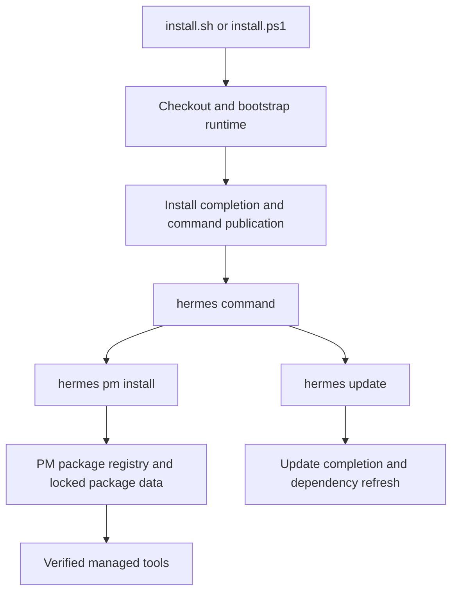
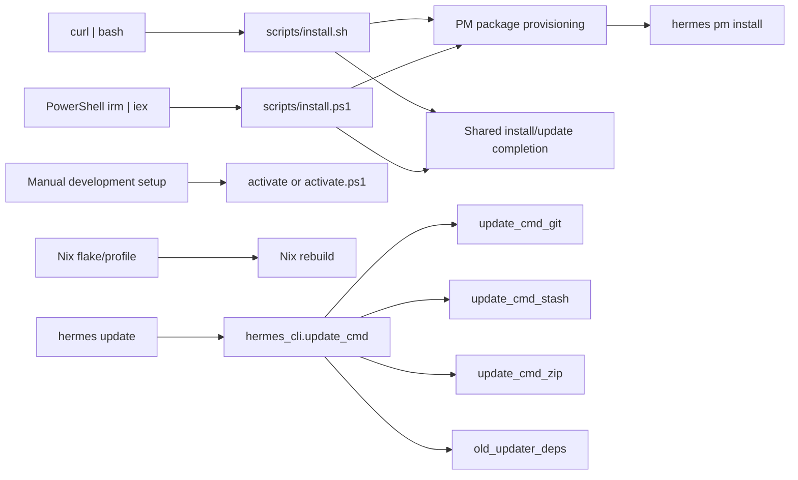
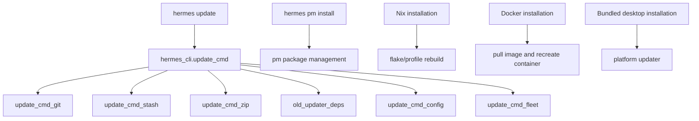

# Installation

<details>
<summary>Relevant source files</summary>

The following files were used as context for generating this wiki page:

- [.env.example](.env.example)
- [AGENTS.md](AGENTS.md)
- [CONTRIBUTING.es.md](CONTRIBUTING.es.md)
- [CONTRIBUTING.md](CONTRIBUTING.md)
- [README.md](README.md)
- [activate](activate)
- [activate.fish](activate.fish)
- [activate.ps1](activate.ps1)
- [agent/legacy_cli.py](agent/legacy_cli.py)
- [apps/desktop/electron/feature-flags.test.ts](apps/desktop/electron/feature-flags.test.ts)
- [apps/desktop/electron/feature-flags.ts](apps/desktop/electron/feature-flags.ts)
- [apps/desktop/src/store/local-models-flag.ts](apps/desktop/src/store/local-models-flag.ts)
- [contributors/emails/alan.harman-box@burningsuit.co.uk](contributors/emails/alan.harman-box@burningsuit.co.uk)
- [hermes](hermes)
- [hermes_cli/_early_recovery.py](hermes_cli/_early_recovery.py)
- [hermes_cli/_early_recovery_zip.py](hermes_cli/_early_recovery_zip.py)
- [hermes_cli/_old_updater.py](hermes_cli/_old_updater.py)
- [hermes_cli/_update_takeover.py](hermes_cli/_update_takeover.py)
- [hermes_cli/data_cleanup.py](hermes_cli/data_cleanup.py)
- [hermes_cli/managed_uv.py](hermes_cli/managed_uv.py)
- [hermes_cli/subcommands/memory.py](hermes_cli/subcommands/memory.py)
- [hermes_cli/update_cmd.py](hermes_cli/update_cmd.py)
- [hermes_cli/update_cmd_commit.py](hermes_cli/update_cmd_commit.py)
- [hermes_cli/update_cmd_git.py](hermes_cli/update_cmd_git.py)
- [hermes_cli/update_cmd_stash.py](hermes_cli/update_cmd_stash.py)
- [hermes_cli/update_cmd_zip.py](hermes_cli/update_cmd_zip.py)
- [hermes_cli/update_completion.py](hermes_cli/update_completion.py)
- [hermes_cli/update_finish.py](hermes_cli/update_finish.py)
- [hermes_cli/update_handoff.py](hermes_cli/update_handoff.py)
- [hermes_cli/update_host_obligation.py](hermes_cli/update_host_obligation.py)
- [pm/cli.py](pm/cli.py)
- [pm/defaults.py](pm/defaults.py)
- [pm/filesystem.py](pm/filesystem.py)
- [pm/install.py](pm/install.py)
- [pm/lock.json](pm/lock.json)
- [pm/lock.py](pm/lock.py)
- [pm/package.py](pm/package.py)
- [pm/packages.py](pm/packages.py)
- [pm/recovery.py](pm/recovery.py)
- [pm/security_packages.py](pm/security_packages.py)
- [pm/store.py](pm/store.py)
- [pm/update.py](pm/update.py)
- [scripts/_activation.sh](scripts/_activation.sh)
- [scripts/install.ps1](scripts/install.ps1)
- [scripts/install.sh](scripts/install.sh)
- [setup-hermes.sh](setup-hermes.sh)
- [tests/acp_adapter/test_edit_approval.py](tests/acp_adapter/test_edit_approval.py)
- [tests/agent/test_legacy_cli.py](tests/agent/test_legacy_cli.py)
- [tests/agent/test_relay_compaction_atof.py](tests/agent/test_relay_compaction_atof.py)
- [tests/gateway/test_multiplex_notice_egress_profile_adapter.py](tests/gateway/test_multiplex_notice_egress_profile_adapter.py)
- [tests/gateway/test_planned_restart_notice_multiplex.py](tests/gateway/test_planned_restart_notice_multiplex.py)
- [tests/hermes_cli/test_cmd_update.py](tests/hermes_cli/test_cmd_update.py)
- [tests/hermes_cli/test_data_uninstall.py](tests/hermes_cli/test_data_uninstall.py)
- [tests/hermes_cli/test_discard_lockfile_churn.py](tests/hermes_cli/test_discard_lockfile_churn.py)
- [tests/hermes_cli/test_early_recovery.py](tests/hermes_cli/test_early_recovery.py)
- [tests/hermes_cli/test_launcher.py](tests/hermes_cli/test_launcher.py)
- [tests/hermes_cli/test_local_legacy_engine.py](tests/hermes_cli/test_local_legacy_engine.py)
- [tests/hermes_cli/test_local_runtime_pm.py](tests/hermes_cli/test_local_runtime_pm.py)
- [tests/hermes_cli/test_old_updater_additional_shims.py](tests/hermes_cli/test_old_updater_additional_shims.py)
- [tests/hermes_cli/test_old_updater_main_shims.py](tests/hermes_cli/test_old_updater_main_shims.py)
- [tests/hermes_cli/test_old_updater_shims.py](tests/hermes_cli/test_old_updater_shims.py)
- [tests/hermes_cli/test_old_updater_takeover.py](tests/hermes_cli/test_old_updater_takeover.py)
- [tests/hermes_cli/test_setup_pin_values.py](tests/hermes_cli/test_setup_pin_values.py)
- [tests/hermes_cli/test_shared_profile_warning.py](tests/hermes_cli/test_shared_profile_warning.py)
- [tests/hermes_cli/test_update_autostash.py](tests/hermes_cli/test_update_autostash.py)
- [tests/hermes_cli/test_update_commit_obligations.py](tests/hermes_cli/test_update_commit_obligations.py)
- [tests/hermes_cli/test_update_completion_process.py](tests/hermes_cli/test_update_completion_process.py)
- [tests/hermes_cli/test_update_completion_routing.py](tests/hermes_cli/test_update_completion_routing.py)
- [tests/hermes_cli/test_update_config_migration_on_current.py](tests/hermes_cli/test_update_config_migration_on_current.py)
- [tests/hermes_cli/test_update_existing_branch_baseline.py](tests/hermes_cli/test_update_existing_branch_baseline.py)
- [tests/hermes_cli/test_update_fetch_failure_classifier.py](tests/hermes_cli/test_update_fetch_failure_classifier.py)
- [tests/hermes_cli/test_update_finish.py](tests/hermes_cli/test_update_finish.py)
- [tests/hermes_cli/test_update_fork_sync_identity.py](tests/hermes_cli/test_update_fork_sync_identity.py)
- [tests/hermes_cli/test_update_head_moved_gate.py](tests/hermes_cli/test_update_head_moved_gate.py)
- [tests/hermes_cli/test_update_host_obligation.py](tests/hermes_cli/test_update_host_obligation.py)
- [tests/hermes_cli/test_update_import_guard.py](tests/hermes_cli/test_update_import_guard.py)
- [tests/hermes_cli/test_update_interrupted_pull.py](tests/hermes_cli/test_update_interrupted_pull.py)
- [tests/hermes_cli/test_update_parked_branch_guard.py](tests/hermes_cli/test_update_parked_branch_guard.py)
- [tests/hermes_cli/test_update_post_commit_safety.py](tests/hermes_cli/test_update_post_commit_safety.py)
- [tests/hermes_cli/test_update_post_pull_syntax_guard.py](tests/hermes_cli/test_update_post_pull_syntax_guard.py)
- [tests/hermes_cli/test_update_products.py](tests/hermes_cli/test_update_products.py)
- [tests/hermes_cli/test_update_sqlite_remediation.py](tests/hermes_cli/test_update_sqlite_remediation.py)
- [tests/hermes_cli/test_update_target_identity.py](tests/hermes_cli/test_update_target_identity.py)
- [tests/hermes_cli/test_update_upstream_prompt_noninteractive.py](tests/hermes_cli/test_update_upstream_prompt_noninteractive.py)
- [tests/hermes_cli/test_update_venv_holder_retirement.py](tests/hermes_cli/test_update_venv_holder_retirement.py)
- [tests/hermes_cli/test_update_zip_completion.py](tests/hermes_cli/test_update_zip_completion.py)
- [tests/hermes_cli/test_update_zip_fallback_guards.py](tests/hermes_cli/test_update_zip_fallback_guards.py)
- [tests/hermes_cli/test_update_zip_release_preserve.py](tests/hermes_cli/test_update_zip_release_preserve.py)
- [tests/hermes_cli/test_update_zip_symlink_reject.py](tests/hermes_cli/test_update_zip_symlink_reject.py)
- [tests/hermes_cli/test_update_zip_two_phase.py](tests/hermes_cli/test_update_zip_two_phase.py)
- [tests/install/e2e-assets/source-build-env.ps1](tests/install/e2e-assets/source-build-env.ps1)
- [tests/pm/activation_support.py](tests/pm/activation_support.py)
- [tests/pm/test_activate_fish.py](tests/pm/test_activate_fish.py)
- [tests/pm/test_activate_scripts.py](tests/pm/test_activate_scripts.py)
- [tests/pm/test_activation_runtime.py](tests/pm/test_activation_runtime.py)
- [tests/pm/test_archive_safety.py](tests/pm/test_archive_safety.py)
- [tests/pm/test_baked_selection.py](tests/pm/test_baked_selection.py)
- [tests/pm/test_deb_safety.py](tests/pm/test_deb_safety.py)
- [tests/pm/test_environment_script.py](tests/pm/test_environment_script.py)
- [tests/pm/test_ffmpeg_resolution.py](tests/pm/test_ffmpeg_resolution.py)
- [tests/pm/test_filesystem_is_junction.py](tests/pm/test_filesystem_is_junction.py)
- [tests/pm/test_install_default_closure.py](tests/pm/test_install_default_closure.py)
- [tests/pm/test_installed_package.py](tests/pm/test_installed_package.py)
- [tests/pm/test_llamacpp_pins.py](tests/pm/test_llamacpp_pins.py)
- [tests/pm/test_lockfile_publication.py](tests/pm/test_lockfile_publication.py)
- [tests/pm/test_long_path_exits.py](tests/pm/test_long_path_exits.py)
- [tests/pm/test_npm_dist_tags.py](tests/pm/test_npm_dist_tags.py)
- [tests/pm/test_pm_core.py](tests/pm/test_pm_core.py)
- [tests/pm/test_python_release_identity.py](tests/pm/test_python_release_identity.py)
- [tests/pm/test_recovery.py](tests/pm/test_recovery.py)
- [tests/pm/test_retired_agent_browser.py](tests/pm/test_retired_agent_browser.py)
- [tests/pm/test_setup_lock_format.py](tests/pm/test_setup_lock_format.py)
- [tests/pm/test_store_extract.py](tests/pm/test_store_extract.py)
- [tests/pm/test_tree_digest_links.py](tests/pm/test_tree_digest_links.py)
- [tests/pm/test_update.py](tests/pm/test_update.py)
- [tests/pm/test_update_bootstrap_pins.py](tests/pm/test_update_bootstrap_pins.py)
- [tests/pm/test_update_request_reuse.py](tests/pm/test_update_request_reuse.py)
- [tests/scripts/install/test_install_ps1_managed_python_provenance.py](tests/scripts/install/test_install_ps1_managed_python_provenance.py)
- [tests/scripts/install/test_install_ps1_pinned_git_extract.py](tests/scripts/install/test_install_ps1_pinned_git_extract.py)
- [tests/scripts/install/test_install_sh_repository_stage.py](tests/scripts/install/test_install_sh_repository_stage.py)
- [tests/scripts/install/test_install_sh_reuse_supported_python.py](tests/scripts/install/test_install_sh_reuse_supported_python.py)
- [tests/scripts/test_install_ps1_desktop_stage.py](tests/scripts/test_install_ps1_desktop_stage.py)
- [tests/scripts/test_install_sh_launch_handoff.py](tests/scripts/test_install_sh_launch_handoff.py)
- [tests/scripts/test_install_stage_frames.py](tests/scripts/test_install_stage_frames.py)
- [tests/scripts/test_mint_launchers.py](tests/scripts/test_mint_launchers.py)
- [tests/tools/test_lazy_deps_runtime.py](tests/tools/test_lazy_deps_runtime.py)
- [tests/tools/test_send_message_multiplex_profile_adapter.py](tests/tools/test_send_message_multiplex_profile_adapter.py)
- [website/docs/developer-guide/contributing.md](website/docs/developer-guide/contributing.md)
- [website/docs/getting-started/installation.md](website/docs/getting-started/installation.md)
- [website/docs/getting-started/updating.md](website/docs/getting-started/updating.md)
- [website/docs/reference/package-management.md](website/docs/reference/package-management.md)
- [website/docs/user-guide/local-models.md](website/docs/user-guide/local-models.md)
- [website/i18n/zh-Hans/docusaurus-plugin-content-docs/current/developer-guide/contributing.md](website/i18n/zh-Hans/docusaurus-plugin-content-docs/current/developer-guide/contributing.md)

</details>


## Purpose and scope

This page describes the available Hermes Agent installation routes, the bootstrap’s division of work with the package manager (PM), update ownership, and platform-specific behavior. The standard source installers prepare the Hermes checkout and its runtime; PM provisions managed tools and other heavy dependencies. [scripts/install.sh:1-6]() [scripts/install.ps1:1-15]()

Sources: [scripts/install.sh:1-6](), [scripts/install.ps1:1-15]()

---

## Overview

Hermes can be installed from a shell or PowerShell bootstrap script, from a source checkout, through Nix, or through desktop distribution channels. These routes do not all have the same update mechanism: `hermes update` applies to managed source checkouts, while package-managed desktop applications, Docker, and Nix are updated through their respective distribution mechanisms. [README.md:35-68]() [website/docs/getting-started/updating.md:9-25]()

The source installer is staged. It can expose a manifest or run a named stage, and supports non-interactive operation and optional desktop building. It delegates heavy dependencies—including tool binaries, browsers, and Node.js—to PM rather than treating them as part of the initial checkout bootstrap. [scripts/install.sh:1-14]() [scripts/install.ps1:1-15]()

Sources: [README.md:35-68](), [scripts/install.sh:1-14](), [scripts/install.ps1:1-15](), [website/docs/getting-started/updating.md:9-25]()

### Installation routes at a glance

| Route | Intended use | Update ownership |
|---|---|---|
| `install.sh` via `curl | bash` | Linux, macOS, or WSL2 source installation. [README.md:35-41]() | `hermes update`. [website/docs/getting-started/updating.md:11-18]() |
| `install.ps1` via PowerShell | Native Windows source installation. [README.md:43-57]() | `hermes update`. [website/docs/getting-started/updating.md:11-18]() |
| Manual checkout and setup | Developer or custom source installation; use the repository’s setup workflow. [AGENTS.md:61-66]() | `hermes update` for a managed source checkout. [website/docs/getting-started/updating.md:11-18]() |
| Nix flake/profile | Declarative Nix installation. Update the flake/profile and rebuild. [website/docs/getting-started/updating.md:11-21]() | Nix rebuild, not `hermes update`. [website/docs/getting-started/updating.md:11-21]() |
| Desktop bootstrap installer | Desktop-oriented installation route; the source installers expose an optional desktop build stage. [scripts/install.sh:8-14]() [scripts/install.ps1:1-9]() | Depends on the resulting package; bundled desktop updates use their package updater. [website/docs/getting-started/updating.md:15-25]() |

Sources: [README.md:35-57](), [AGENTS.md:61-66](), [scripts/install.sh:1-14](), [scripts/install.ps1:1-9](), [website/docs/getting-started/updating.md:9-25]()

---

## Installation methods

### 1. Quick install: shell script

On Linux, macOS, or WSL2, the documented quick-install entry point is:

```bash
curl -fsSL https://hermes-agent.nousresearch.com/install.sh | bash
```

The script accepts options for channel, branch, commit, install directory, Hermes home, stage selection, JSON output, non-interactive operation, desktop inclusion, and skipping browser or computer-use installation. It validates the channel as `stable` or `main`; an explicit channel is persisted for later update behavior. [README.md:35-41]() [scripts/install.sh:23-39]() [scripts/install.sh:46-95]()

The installer exports `UV_NO_CONFIG=1` during bootstrap to prevent `uv` from loading configuration files from an unintended user home, including when invoked under `sudo -u`. Its comments note that PM’s environment synchronization applies its own isolation. [scripts/install.sh:17-21]()

The shell script describes its work as cloning the repository, acquiring `uv` and Python, and handing the checkout to the same completion path used by updates. Heavy tools and runtimes are delegated to `hermes pm install`. [scripts/install.sh:1-6]()

Sources: [README.md:35-41](), [scripts/install.sh:1-6](), [scripts/install.sh:17-21](), [scripts/install.sh:23-39](), [scripts/install.sh:46-95]()

### 2. Native Windows: PowerShell

Run the PowerShell bootstrap in a PowerShell session:

```powershell
iex (irm https://hermes-agent.nousresearch.com/install.ps1)
```

The Windows source installer defaults `HermesHome` to `%LOCALAPPDATA%\hermes` and places the checkout under `hermes-agent` within that home, unless environment variables or parameters override those paths. It also supports `-Channel`, `-Branch`, `-Commit`, `-Stage`, `-Manifest`, `-NonInteractive`, `-IncludeDesktop`, `-SkipBrowser`, and `-SkipComputerUse`. [README.md:43-57]() [scripts/install.ps1:23-49]()

The script pins bootstrap versions of `uv` and Git for supported Windows architectures and includes SHA-256 values for the corresponding archives. If Git is absent, the documented installer behavior stages verified Git for Windows in Hermes’ tool store rather than replacing system Git. [scripts/install.ps1:81-110]() [README.md:53-55]()

PowerShell’s invocation mode matters: the installer distinguishes execution as a script file from `irm | iex`, because calling `exit` from the latter could terminate the caller’s session. It also detects dot-sourcing so tests or embedding hosts can load function definitions without running installation side effects. [scripts/install.ps1:57-78]()

Sources: [README.md:43-57](), [scripts/install.ps1:23-49](), [scripts/install.ps1:57-78](), [scripts/install.ps1:81-110]()

### 3. Manual source installation

For development, the project’s contributor guide directs developers to activate the PM environment with the repository’s `activate` script, selecting the shell-specific variant where necessary. It recommends choosing an isolated `HERMES_HOME` or `HERMES_RUNTIME_DIR` first. [AGENTS.md:61-66]()

A manual setup should therefore follow the repository checkout’s documented developer workflow rather than assuming that a bare Python environment includes PM-managed tools. PM owns dependency and environment provisioning; its installation command is `hermes pm install`. [AGENTS.md:61-66]() [scripts/install.sh:1-6]()

Sources: [AGENTS.md:61-66](), [scripts/install.sh:1-6]()

### 4. Nix flake and profile

Nix installations have independent update ownership: update the flake or profile and rebuild it. `hermes update` is not the update mechanism for a Nix-managed installation. [website/docs/getting-started/updating.md:11-21]()

Sources: [website/docs/getting-started/updating.md:11-21]()

### 5. Desktop bootstrap and bundled applications

The source installers expose an optional desktop stage through `--include-desktop` or `-IncludeDesktop`. This is an installer stage option, not evidence that every desktop package uses the same installation or update mechanism. [scripts/install.sh:8-14]() [scripts/install.ps1:1-9]()

Bundled desktop update ownership varies by package: Windows sideload MSIX uses the desktop Update control and Windows App Installer, Microsoft Store packages update through the Store, and macOS bundled apps use the desktop Update control through `electron-updater`. Docker images and Nix installations also use their distribution-specific update process. [website/docs/getting-started/updating.md:11-25]()

Sources: [scripts/install.sh:8-14](), [scripts/install.ps1:1-9](), [website/docs/getting-started/updating.md:11-25]()

---

## Dependency provisioning

### Bootstrap versus PM-managed dependencies

The installer’s bootstrap responsibility is distinct from installing the full set of tools used by Hermes. The shell and PowerShell scripts describe PM as responsible for heavy dependencies, including tool binaries, browsers, and Node.js; after installation, PM can install managed packages. [scripts/install.sh:1-6]() [scripts/install.ps1:1-15]()

The shell installer includes `--skip-browser` and `--skip-computer-use`. These choices are recorded by PM so subsequent installs and `hermes update` preserve the opt-out. Users can opt back in with `hermes pm install chromium` or `hermes pm install cua-driver`, respectively. [scripts/install.sh:67-69]() [scripts/install.sh:81-86]()

On Windows, the bootstrap’s `uv` and Git downloads are pinned with platform-specific archive URLs and hashes. PM’s package implementation verifies staged binaries and performs a version smoke probe only for the native target; it does not execute cross-staged binaries. [scripts/install.ps1:81-110]() [pm/packages.py:65-118]()

Sources: [scripts/install.sh:1-6](), [scripts/install.sh:67-69](), [scripts/install.sh:81-86](), [scripts/install.ps1:81-110](), [pm/packages.py:65-118]()

### Dependency and install data flow

The flow below distinguishes the source bootstrap from PM’s later package provisioning. The code establishes the installer/PM boundary and the update completion handoff; it does not imply that every managed package is installed during the initial bootstrap. [scripts/install.sh:1-6]() [scripts/install.ps1:1-15]() [pm/packages.py:65-118]()

**Diagram: Source bootstrap and dependency provisioning**



Sources: [scripts/install.sh:1-6](), [scripts/install.ps1:1-15](), [pm/packages.py:1-3](), [pm/packages.py:65-118](), [website/docs/getting-started/updating.md:23-25]()

---

## The `hermes update` command

For a managed source checkout, use:

```bash
hermes update
```

The update method depends on how Hermes was installed. `hermes update` is for managed source checkouts; it does not rewrite package-owned application files. PM manages dependencies, while `hermes pm update` is a maintainer pin-update command rather than an application updater. [website/docs/getting-started/updating.md:9-31]()

The source installer and updater share a completion path, so installation and a finished update converge on command publication, product builds, and post-build maintenance. The update implementation is split into concern-specific modules re-exported through `hermes_cli.update_cmd`, including Git handling, stash handling, ZIP updates, dependency refresh, and gateway restart coordination. [scripts/install.sh:1-6]() [hermes_cli/update_cmd.py:1-5]() [hermes_cli/update_cmd.py:37-95]()

#### Update channels

The source installer accepts `stable` or `main`. The documented default for the official repository’s main line is stable releases; `main` tracks every commit. An explicit install channel is saved, and the installer’s help identifies `HERMES_INSTALL_CHANNEL` as the channel setting available for `irm | iex` on Windows. [scripts/install.sh:26-29]() [scripts/install.sh:72-86]() [scripts/install.ps1:18-22]()

For an installed source checkout, `hermes update --set-channel main` saves a channel choice, while `hermes update --channel main` applies a one-run choice. The selected channel is stored per install under `update.installs` in `config.yaml`. [website/docs/getting-started/updating.md:33-52]()

#### Update phases and safeguards

The update facade imports split modules for Git operations, local-change stashing, ZIP fallback, dependency refresh, configuration migration, validation, and gateway fleet restart. The facade’s imports show these module boundaries; the actual work is delegated to their implementations. [hermes_cli/update_cmd.py:37-115]()

Before an update replaces checkout content, the updater has mechanisms for preserving local changes and retaining rescue references. Tests exercise preservation of committed and untracked work, failure handling during reset, and rescue references under `refs/hermes-update-backups/`. [hermes_cli/update_cmd.py:78-85]() [tests/hermes_cli/test_update_autostash.py:20-82]()

On Windows, the update code includes Git-trampoline detection and real-Git lookup; tests verify the healthy-Git, broken-trampoline, and no-real-Git cases. [hermes_cli/update_cmd.py:96-105]() [tests/hermes_cli/test_cmd_update.py:19-107]()

Sources: [scripts/install.sh:1-6](), [scripts/install.sh:26-29](), [scripts/install.sh:72-86](), [scripts/install.ps1:18-22](), [hermes_cli/update_cmd.py:1-5](), [hermes_cli/update_cmd.py:37-115](), [tests/hermes_cli/test_update_autostash.py:20-82](), [tests/hermes_cli/test_cmd_update.py:19-107](), [website/docs/getting-started/updating.md:9-52]()

### Update ownership by installation type

| Installation | Update mechanism |
|---|---|
| Managed source checkout | `hermes update`. [website/docs/getting-started/updating.md:11-18]() |
| Windows sideload MSIX | Desktop Update control and Windows App Installer. [website/docs/getting-started/updating.md:15-19]() |
| Microsoft Store package | Microsoft Store. [website/docs/getting-started/updating.md:17-20]() |
| macOS bundled app | Desktop Update control through `electron-updater`. [website/docs/getting-started/updating.md:18-19]() |
| Docker image | Pull the selected image and recreate the container with its data mount. [website/docs/getting-started/updating.md:19-21]() |
| Nix | Update the flake/profile and rebuild. [website/docs/getting-started/updating.md:20-21]() |
| Termux APT | Run `pkg update`, then `pkg upgrade hermes-agent`. [website/docs/getting-started/updating.md:20-21]() |

Sources: [website/docs/getting-started/updating.md:11-21]()

---

## Platform-specific considerations

| Platform or environment | Considerations |
|---|---|
| Linux, macOS, WSL2 | The shell quick-install script is the documented route. [README.md:35-41]() |
| Native Windows | Use the PowerShell installer. The source install defaults to `%LOCALAPPDATA%\hermes`; its bootstrap pins `uv` and Git artifacts by Windows architecture. [README.md:43-61]() [scripts/install.ps1:23-29]() [scripts/install.ps1:81-110]() |
| Windows `irm | iex` | The installer accounts for the fact that `exit` in an `iex` invocation can end the caller’s session; it distinguishes text executed through `iex` from a script file. [scripts/install.ps1:66-78]() |
| WSL2 | The Linux/macOS shell installer works in WSL2; its Hermes home follows the Linux-style `~/.hermes` location. [README.md:45-61]() |
| Android / Termux | Use the Termux APT package route rather than the desktop/server installer. The package is documented for aarch64 and has stable and canary channels. [README.md:59-61]() |
| Nix | Update through the flake/profile and rebuild. [website/docs/getting-started/updating.md:20-21]() |
| Docker | Update the selected image and recreate the container while retaining its data mount. [website/docs/getting-started/updating.md:19-20]() |

Sources: [README.md:35-61](), [scripts/install.ps1:23-29](), [scripts/install.ps1:66-78](), [scripts/install.ps1:81-110](), [website/docs/getting-started/updating.md:19-21]()

---

## Installer and updater code map

This map connects the user-facing installation routes to code entities identified in the repository. The installer scripts share a completion model with updates; PM handles managed package installation separately. [scripts/install.sh:1-6]() [scripts/install.ps1:1-15]() [hermes_cli/update_cmd.py:1-5]() [pm/packages.py:1-3]()

**Diagram: User routes to installation code entities**



Sources: [scripts/install.sh:1-6](), [scripts/install.ps1:1-15](), [AGENTS.md:61-66](), [hermes_cli/update_cmd.py:1-5](), [hermes_cli/update_cmd.py:78-105](), [pm/packages.py:1-3](), [website/docs/getting-started/updating.md:11-21]()

**Diagram: Update command modules and distribution ownership**



Sources: [hermes_cli/update_cmd.py:37-115](), [pm/packages.py:1-3](), [website/docs/getting-started/updating.md:11-25]()

---

## Summary

- Use `install.sh` for Linux, macOS, and WSL2, or `install.ps1` for native Windows. [README.md:35-57]()
- The source bootstrap and PM have separate responsibilities: the installer prepares the checkout and runtime; PM manages heavy dependencies and tools. [scripts/install.sh:1-6]() [scripts/install.ps1:1-15]()
- Choose update commands according to installation ownership: `hermes update` for managed source checkouts, and the relevant package or distribution updater for desktop, Docker, Nix, or Termux. [website/docs/getting-started/updating.md:9-25]()
- Use the dedicated Termux package route on Android rather than the desktop/server installer. [README.md:59-61]()

Sources: [README.md:35-61](), [scripts/install.sh:1-6](), [scripts/install.ps1:1-15](), [website/docs/getting-started/updating.md:9-25]()